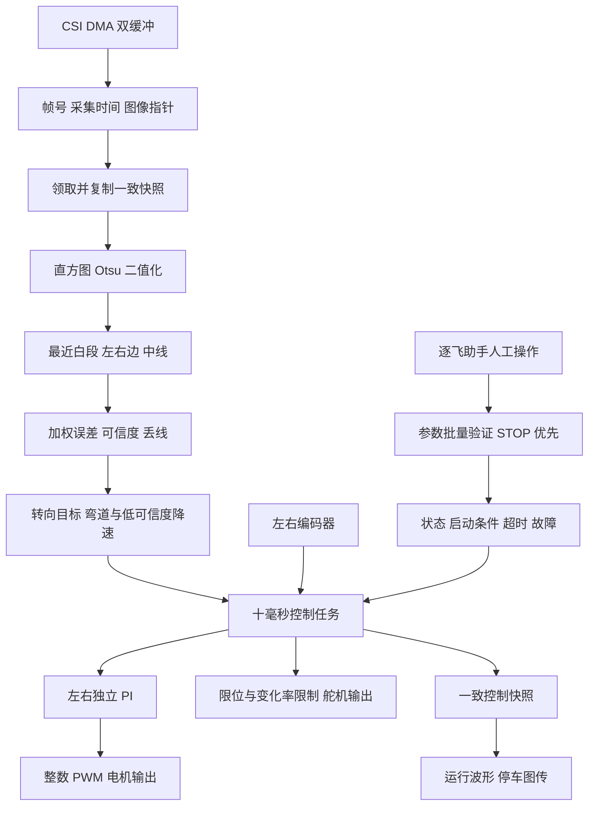
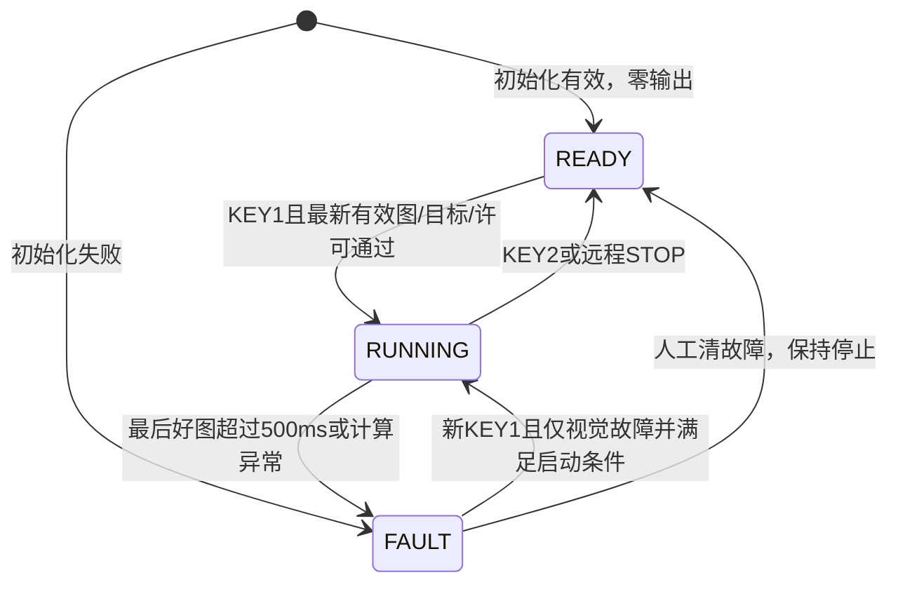
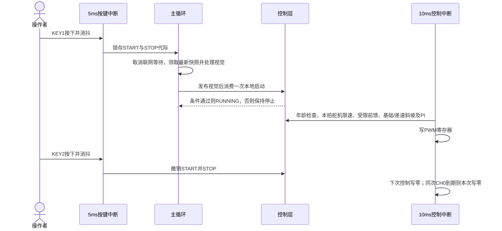

# 基础循迹软件实现与复核报告

2026年10月15日右转33度（R049）：仅将右转估算角上限由30提高到33deg，左转20deg、基础速度1.2m/s、差速70%保持。右侧理论1352.8889us，当前50Hz/10000刻度内向取1354us，估算−32.7561deg，命令76.87；左侧仍101.71/1630us/估算+19.8571deg。实际输出与差速lead/center查询统一使用原始右前轮车身纵轴角−33至+20deg边界，中位92.5/+5deg、增益10、34行前瞻、故障标签及保护保持。适配已有断言源码，不运行测试/仿真、不烧录；外推端点并非新实测，M3-24/25和M4门槛保持。详见[本轮记录](evidence/M3/right_limit33_20261015/CHANGE.md)。

2026年10月15日差速上限70%（R048）：按用户要求将CONTROL_DIFFERENTIAL_MAX从0.5f提高到0.7f，内轮最低乘0.3、外轮最高乘1.7；差速增益10保持。基础速度1.2m/s、左20/右30deg、名义脉宽1368至1630us、中位92.5及原映射不变；4/s差速渐变、50/s基础斜坡、PD/PI、前瞻/故障显示/启停保护保持。固定请求0.7时由零达到上限至少18拍，正负满差速反向至少35拍，均为软件推演。已有断言源码同步，不运行测试/仿真、不烧录；实机轮速及路线仍待M3-24/25，M4未解锁。详见[本轮记录](evidence/M3/differential70_20261015/CHANGE.md)。

2026年10月15日右转30度（R047）：仅将右转估算角上限由25提高到30deg，左转20deg、默认速度1.2m/s保持。控制角域为−30至+20deg，仍按右前轮相对车身纵轴定义。右侧理论1366.5556us，当前50Hz/10000刻度内向取1368us，估算−29.6829deg，默认命令78.13；左侧仍101.71/1630us/估算+19.8571deg。中位92.5/+5deg、增益10/差速上限50%、34行前瞻、故障标签及保护保持。仅适配已有断言源码，不运行测试/仿真、不烧录；外推并非新实测，M3-24/25和M4门槛保持。详见[本轮记录](evidence/M3/right_limit30_20261015/CHANGE.md)。

2026年10月15日右转25度（R046）：仅将右转估算角上限由20提高到25deg，左转20deg、默认速度1.2m/s保持。左右角域拆为独立配置−25至+20deg，仍以右前轮相对车身纵轴为参考。右侧理论1389.3333us，50Hz/10000刻度内向量化1390us，估算−24.8537deg，命令80.11；左侧仍101.71/1630us/估算+19.8571deg。中位92.5/+5deg、差速增益10/50%上限、前瞻34行、故障标签和保护保持。仅适配已有断言源码，不运行测试/仿真、不烧录，新增端点仍非实测，M3-24/25与M4门槛保持。详见[本轮记录](evidence/M3/right_limit25_20261015/CHANGE.md)。

2026年10月15日默认1.2m/s与左右20度（R045）：用户明确左右上限均为20deg，沿用右前轮相对车身纵轴的插值/有界外推定义。理论脉宽1412.1111/1631us，当前50Hz/10000刻度内向取1414/1630us，估算右−19.5854/左+19.8571deg；默认命令82.27至101.71。默认基础速度1.2m/s，分轮约139.2586/136.3281 counts/10ms，前瞻自动前移34行，远带46/51/56/61/66。中位92.5/+5deg、差速增益10/上限50%、故障标签与无新帧刷新、限速/启停/500ms视觉保护保持；外推仍非新实测，不运行测试/仿真、不烧录。M3-24/25与M4门槛保持。详见[本轮记录](evidence/M3/speed120_limit20_20261015/CHANGE.md)。

2026年10月15日停车故障标签独立刷新（R044）：按用户要求将停车TFT状态绘制移出相机新帧分支，新增local_display_poll。左侧y70显示FAULT:与数值，y86显示原因；非零故障白字红底，原因固定宽度清旧内容。无新图时保留旧图，但每200逻辑ms尝试刷新控制状态；状态/故障变化优先，仍只在主循环停车路径绘制，实际响应受主循环服务影响。左右计数/可信度增加LEFT/RIGHT/CONF标签，默认1.5m/s、±35deg有界外推、50%差速及视觉/启停保护不变。本轮不运行测试/仿真、不烧录；右转失败根因仍待现场记录，M3-24/25与M4门槛保持。详见[本轮记录](evidence/M3/fault_display_20261015/CHANGE.md)。

2026年10月15日有界分段外推±35度（R043）：按用户要求将右前轮相对车身纵轴的左右估算极限设为−35/+35deg，保留原始三测点及92.5命令中位/+5deg偏置。理论端点1343.7778/1736us，50Hz/10000刻度内向量化为1344/1736us（估算−34.9512/+35deg），默认命令75.97至111.25。控制实际输出与差速前馈均使用同一±35deg有界外推；旧严格插值API和实测记录不变。默认1.5m/s、增益10与±50%差速、前瞻/限速及故障清零保持。外推不是新实测或机械限位验收；不运行测试/仿真、不烧录，M3-24/25仍待实机，M4未解锁。详见[本轮记录](evidence/M3/servo_extrapolate_35deg_20261015/CHANGE.md)。

2026年10月15日默认速度1.5m/s（R042）：按用户要求将CONTROL_DEFAULT_SPEED_MPS从1.0f改1.5f，分轮约174.0732/170.4102 counts/10ms。原前瞻公式自动取36行上限，默认远带变为44/49/54/59/64行；其可靠性仍按原连续道路门槛判断。实测转角映射/增益10、±50%差速、基础50/s与差速4/s渐变、PD/PI、100ms前瞻/500ms停车及10ms保持。只同步已有断言和说明，不运行测试/仿真，不烧录；M3-25待实机、M4未解锁。详见[本轮记录](evidence/M3/default_speed_150_20261015/CHANGE.md)。

2026年10月15日前瞻控制（R041）：针对用户实测入弯响应迟、最终停车，加入当前连续道路的近远融合；默认1m/s时远带为50/55/60/65/70行，最多75%并按可信度衰减。D只用近带；舵机先执行本拍限速，后轮参考最多100ms受限转向前馈，基础速度斜坡与4/s差速比例渐变分开。默认1.0m/s、实测映射/增益10、±50%差速、舵机85至100/60度每秒、PD/PI、10ms及500ms停车保护保持。前瞻坏帧/超100ms/STOP撤销，不运行测试或仿真、不烧录；无现场故障码，未确认停车唯一根因，效果待M3-25实机。详见[本轮记录](evidence/M3/preview_control_20261015/CHANGE.md)。

2026年10月15日实测转角接入差速（R040）：舵机限速命令按现有整数PWM刻度换算名义脉宽，查右前轮三点实测表，以当前映射角减直行中位映射角生成相对转向量，再计算差速。默认1.0m/s、差速增益10.0与±50%上限保持；原始中位+5度记录保留，直行相对角为0。映射失败/越界锁INVALID_VALUE并清输出，不外推或回退命令角。沿用原斜坡、PD/PI、10ms及启停保护；不运行测试/仿真或烧录，M3-24待实机、M4未解锁。详见[本轮记录](evidence/M3/mapped_differential_20261015/CHANGE.md)。

2026年10月15日差速放宽到50%（R039）：按上下文将用户“转向极限放宽到50%”落实为后轮差速比例上限±0.30→±0.50，增益6.0→10.0，使当前转向端点可达到50%分配；内轮乘0.5、外轮乘1.5，之后仍执行原独立斜坡。默认1.0m/s、舵机命令85至100/中位92.5、PD/PI、10ms、视觉与启停保护保持。已有断言同步但不运行测试/仿真，不烧录；M3-24待实机，M4未解锁。详见[本轮记录](evidence/M3/differential_50pct_20261015/CHANGE.md)。

2026年10月15日差速达到30%（R038）：按用户要求将DIFFERENTIAL_GAIN由3.5提高到6.0，命令偏离中位约7.45度开始触及原±30%硬限幅，当前85/100端点均可达到30%目标分配；内轮乘0.7、外轮乘1.3，之后仍执行原独立斜坡。默认1.0m/s、PD/PI、10ms、视觉与启停保护保持。已有断言同步但不运行测试/仿真，不烧录；M3-24待实机、M4未解锁。详见[本轮记录](evidence/M3/differential_30pct_20261015/CHANGE.md)。

2026年10月15日默认速度与差速更新（R037）：按用户要求将基础速度0.75→1.0m/s，分轮约116.0488/113.6068 counts/10ms；差速增益2.4→3.5，当前±7.5命令度下最大估计差速比例约±17.62%。±30%限幅、斜坡、PD/PI、10ms、视觉及启停保护保持。同步已有断言但不运行测试/仿真，不烧录；M3-24待实机，M4未解锁。详见[本轮记录](evidence/M3/speed100_gain350_20261015/CHANGE.md)。

2026年10月15日差速增益调大（R036）：按用户反馈将DIFFERENTIAL_GAIN从1.0提高到2.4，当前±7.5命令度下最大估计差速比例约±12.09%（原约±5.04%）；±30%比例限幅及原斜坡保持。默认0.75m/s、PD/PI、10ms与启停保护不改。已有断言同步但不运行测试/仿真，不烧录；M3-24仍待实机，M4未解锁。详见[本轮记录](evidence/M3/differential_gain_240_20261015/CHANGE.md)。

2026年10月15日后轮差速移植（R035）：参考demonew_changes_20261015手工合并TRACK几何差速，增益1.0、估计轴距0.20m/后轮距0.153m、比例限幅±0.30；按前一拍限速后的舵机命令差估计转角，左转左轮减速右轮加速，之后沿用原斜坡与独立PI。默认0.75m/s、PD0.22/0.002、10ms、视觉/冻结、KEY1/KEY2及500ms保护保持。更新已有断言但不运行测试或仿真，不烧录；几何尺寸、转角关系和实车方向/轮速仍待M3-24实测，M4未解锁。详见[本轮记录](evidence/M3/rear_differential_20261015/CHANGE.md)。

2026年10月15日默认速度更新（R034）：默认基础目标由0.5改为0.75m/s，当前标定下约左87.0366/右85.2051 counts/10ms。10ms、PD、PI、斜坡、低可信/弯道降速、背景过滤、法向恢复、冻结回传和启停保护保持。按用户要求本轮不运行测试或仿真，仅编译正式目标，不烧录；R033的软件/仿真结果对应此前0.5m/s，不作为0.75m/s验证。M3实机门槛与M4锁定保持。

2026年10月15日鸟瞰法向单边恢复（R033）：按用户最终更正使用0.45m路宽，沿当前真实可见边线的地面内法向偏移0.225m，反投影到现有像素PD接口。继续使用明确标记的可配置估计映射；边框不作真实边线，不再用像素宽度恢复单边。配套控制带允许在原带附近前后搜索；保留背景过滤、冻结回放/导出、0.5m/s、10ms与启停保护。本轮仅软件验证与三目标编译，不烧录；M3实机门槛及M4锁定保持。详见[法向恢复说明](BEV_NORMAL_RECOVERY.md)和[验证证据](evidence/M3/bev_normal_20261015/VALIDATION.md)。

2026年10月15日首弯修正（R032）：加入地面ROI直方图、近端连续道路筛选、当前单边与近期实测宽度恢复、自适应控制带；V1只传有效XY点，停车自动回放冻结记录并提供只读完整导出。按用户补充同步转向P0.22/D0.002；默认0.5m/s、10ms、原舵机限位/变化率与启停保护保持。本轮只完成软件验证和编译，不烧录。现场反馈为首弯稍转后停车，待冻结证据确认根因；M3路线/性能仍待实机，M4未解锁。详见[FIRST_CURVE_DEBUG_GUIDE.md](FIRST_CURVE_DEBUG_GUIDE.md)与[evidence/M3/first_curve_20261015](evidence/M3/first_curve_20261015)。

2026年10月15日曝光更新（R031）：用户实测反馈过曝，将当前CSI相机默认曝光由512改为450（MT9V03X_EXP_TIME_DEF），自动曝光保持关闭。新值需重新编译并下载固件、相机重新初始化后生效；本轮只做软件修改与构建，不烧录。成像效果仍待同一现场光照复测，M3实机项与M4门槛保持。证据见[evidence/M3/camera_exposure_450_20261015](evidence/M3/camera_exposure_450_20261015)。

2026年10月15日停车图传调频（R030）：默认发送间隔由100ms改为33ms，配置上限由10帧/秒提高到约30帧/秒；真实帧率仍受采集、处理和无线传输耗时限制。现有V1通道7可在停车时设为33，无需烧录即可临时试用；新默认值需下载新固件后生效。运行仍只发100ms间隔波形，10ms控制周期与启停规则保持。本轮不烧录。图传调度保留不足一个周期的余量，避免33ms在10ms逻辑时钟上每次都被取成40ms；健康且主循环足够快时，软件夹具330ms内得到10次发送。迟到时跳过旧时隙，每次只发送当前新帧，不补发积压图；该结果不代表无线接收实测。软件核对及构建证据见[evidence/M3/wifi_fps_30_20261015](evidence/M3/wifi_fps_30_20261015)。

2026年10月15日默认速度更新（R029）：本地默认基础目标改为0.5m/s，按左N2333.3/右N2284.2及名义周长0.20106193m分别换算为约58.0244/56.8034 counts/10ms；斜坡、弯道/低可信降速和启停保护保持。本轮仅修改、验证和编译，不烧录，实际车速待测。证据见[evidence/M3/default_speed_050_20261015](evidence/M3/default_speed_050_20261015)。


2026年10月15日源码增量（R028）：已接入普通道路查表鸟瞰、骨架细化及有界路径恢复，记录11项GPT微秒步骤和最近64帧。相机映射为用户允许的软件估计；保持10ms速度环、KEY1/KEY2、500ms视觉保护、PI和执行器基线。本轮仅软件验证和三目标构建，不烧录；板上仍以R027实读基线为准。详见[本轮证据](evidence/M3/bev_minimal_20261014/VALIDATION.md)。


本轮源码（2026年10月14日，R026）：已改为KEY1启动循迹、KEY2停止；默认基础目标20/20 counts/10ms，上电仍零输出。取消曝光调整/二值记录增量、远程发车和普通循迹远程确认，通信异常不停车；视觉采用最后有效采集图超过500逻辑ms统一停车，保留短失线/低可信半速。软件验证与三目标构建结果见[本轮证据](evidence/M3/local_button_control_20261014)。本轮未烧录、未发车，硬件响应继续待实机。

板上版本实读确认（2026年10月14日，R027）：本轮DAP只读Flash逐字节匹配本地按键正式版b12069b70cb851748425d63960d2b67e0c25b1fc3bcab2fac6941df0d267f296，CPU运行；此前“最后仅曝光版有烧录证据”描述是当时记录，现由此次实读更新。本轮未烧录。Wi-Fi助手监听已恢复，但模块B17持续低、初始化就绪超时仍待检查接线/断电复测。见[本轮记录](evidence/M3/wifi_recheck_20261014_01/diagnosis_progress.json)。

本报告记录 M0 至 M2 基线及2026年10月13日补充的M3舵机/编码器标定软件，按照总体架构、运行基础、视觉、运动控制、通信及标定展开，并提供仓库代码索引和可复跑的验证证据。软件已经实现上电停止、人工启动、加权视觉循迹、双轮 PI、有界通信及故障锁存。R024历史固件已完成Flash、上电及手机热点TCP/图传观察，后续曝光版另有烧录证据，长期无线稳定性、机械标定、R50行驶和完整路线仍需M3实测；用户安排在2026年10月13日或14日进行，本轮补齐M3本地标定准备软件；真实测量仍待操作者执行。

M4 的电脑桥、实验协议、连续 100 Hz 完整日志及自动评价尚未实现；它们严格依赖 M3 连续三次路线验收。当前 10 Hz 波形仅供人工观察；新增1024×32字节单次M3诊断记录用于本地标定，不是M4完整实验日志。操作步骤见[标定操作说明](CALIBRATION_GUIDE.md)。范围和任务状态分别见 [MILESTONES.md](MILESTONES.md) 与 [TODO.md](TODO.md)。

## 阅读顺序与索引使用

历史M2-16文档修订以R009冻结固件为基线；当前M3软件采用本轮三目标冻结构建与新验证证据，历史M2固件和报告快照继续保留。

本报告以当前demo源码和已冻结固件为依据，参考解析提供拆解方式；各章的算法与参数按本车实际实现说明。源码事实、配置数值、教学算例和待实测项分别标明。读者可先顺着前三章建立调用图，再读视觉/PI/舵机与通信，最后按现场门槛验证。

- [总体架构与数据流](#guide-architecture)
- [工程接入与可恢复基线](#guide-project)
- [初始化、主循环与反馈采样](#guide-runtime)
- [公共接口与参数一致性](#guide-interfaces)
- [启动 停止和故障保护](#guide-state)
- [运行状态与多速率时序](#guide-timing)
- [M3舵机与编码器运行态标定](#guide-calibration-m3)
- [相机快照与帧新鲜度](#guide-camera)
- [灰度处理与视觉循迹](#guide-vision)
- [双轮速度 PI](#guide-pi)
- [舵机控制与降速](#guide-steering)
- [V1人工参数与有界 WIFI](#guide-wifi)
- [停车显示与图像调试](#guide-display)
- [静止直道标定](#guide-calibration)
- [软件验证与最终构建](#guide-validation)
- [Review发现及关闭情况](#guide-review)
- [本轮行级中文注释及复核](#guide-comments)
- [按功能的仓库代码索引](#guide-index)
- [控制周期的实测与调整路径](#guide-period)
- [下一阶段的实测证据](#guide-next)

每个功能章提供关键函数的**实际定义**索引，显示函数名和行号；调用链中的同名接口可以据此逐层进入。在VS Code Markdown编辑区Ctrl+单击，在内置预览直接点击相对路径加#L行号链接。报告应保留在demo/docs目录，并与同级libraries保持布局；代码调整后运行tools/update_report_index.py同时刷新章内入口和末尾总表，避免只更新总表而正文行号过期。未指定--build-dir时仅刷新索引，输出到evidence/current_index，保留现有构建摘要；更新构建摘要须显式提供同目录的冻结日志与firmware.axf。

<a id="guide-architecture"></a>

## 总体架构与数据流

当前工程是RT1064裸机程序。完整循迹链为：**相机采集 → 一致灰度快照 → 地面ROI Otsu二值化 → 原逐行白段 → 近端连续道路/单边及必要的鸟瞰骨架恢复 → 连续近远控制带融合 → 远带P/近带PD转向目标 → PIT限速与PWM；双轮编码器 → 独立速度PI → 电机PWM → 轮速反馈。** 视觉观察车辆相对赛道的位置，编码器闭合左右轮速度；软件没有前轮转角传感器，因此servo_cmd是命令刻度，实际轮角和R50能力需机械标定。

### 与参考解析的对应关系

本报告借鉴[参考工程的完整闭环代码解析](../../20th_smart_vision/docs/完整闭环代码解析.md)的阅读层次：先看调用入口和数据流，再看关键函数、公式、反馈、失败分支及验证边界。参考车为三轮全向底盘；当前车为双驱动轮加转向舵机，不能按参考的轮速逆解算解释本车。

| 功能层 | 当前实际实现 | 阅读时应区分 |
| --- | --- | --- |
| 调度 | main、CSI、PIT_CH0三种入口 | 主循环按新帧执行；PIT配置10ms；相机和PWM各自运行 |
| 普通赛道视觉 | 地面ROI、近端连续白段、当前单边、自适应控制带及鸟瞰骨架恢复 | 188×120图像；八邻域仅普通道路恢复，不包含特殊元素状态机 |
| 转向 | control_publish_vision锁外前瞻/短锁P与近带D；control_tick同拍舵机限速与受限差速前馈 | 图像误差单位像素，输出是舵机命令度，无IMU角速度阻尼 |
| 驱动 | 左右独立基础目标与PI（当前V1共用目标） | 无三轮运动学、无电流PI；左右反馈不能混用 |
| 操作与调试 | V1人工参数、10Hz波形、停车图传/标定 | 当前不是M4的实验协议、电脑桥或完整100Hz日志 |

下图保留总体连接关系，具体调用顺序见下方三条链和各功能章节。



### 实际调用链：入口与交接点

```text
采集事件：
CSI_IRQHandler()
  → CSI_DriverIRQHandler() → CSI_TransferHandleIRQ()
  → frame_callback() → 原mt9v03x_finished_callback()
  → 完成图指针 + capture_time_ms + frame_sequence

主循环每次迭代：
calibration_debug_poll(GPT) → control_get_params() → 必要时vision_set_control_band()
  → 领取非独占时的人工宽度请求 → [诊断标记] TFT小色块
  → camera_frame_take()
  → [有新快照] capture_raw → histogram → Otsu → binary → vision_process
  → vision_track_process（连续道路/法向/必要的骨架） → control_publish_vision() → local_drive_poll_start() → control_get_snapshot()
  → [有人工请求] calibrate_width()
  → 标记display_image_pending → wifi_assistant_on_frame() [新帧分支结束]
  → [超时] 取消宽度请求 → local_drive_poll_start() → local_display_poll() → wifi_assistant_poll()
  → local_display_poll仅停车绘制：状态/故障变化优先，否则200逻辑ms；无新帧也刷新标签

PIT_CH1每5ms先于同次CH0被服务：
local_drive_scan() → local_buttons_scan(KEY1/KEY2)
  → KEY2：清START、control_request_stop()；KEY1：锁存START和STOP代际

PIT_CH0每次被服务：
GPT时间 + encoder_get_count(左、右持续计数)
  → encoder_measurement_sample() → calibration_debug_before_tick()
  → control_tick()
  → 保护/停机及100ms前瞻撤销 → 本拍舵机限速/实测表域检查
  → 受限100ms转向前馈查表差速 → 基础速度斜坡/独立差速比例渐变 → 两个PidLocCtrl()
  → 发布舵机PWM命令 → control_get_snapshot()
  → 前进DIR → 左右pwm_set_duty() → 舵机pwm_set_duty()
  → calibration_debug_after_tick() → wifi_assistant_tick(10) → 清PIT事件位
```

### 主要数据由谁写、由谁读

| 数据/状态 | 写入位置 | 消费位置 | 含义及所有权 |
| --- | --- | --- | --- |
| mt9v03x_image | 原相机完成回调 | 包装回调记录地址，main复制 | 当前完成缓冲指针，后续可被采集复用 |
| frame_sequence/captured_ms/completed_image | camera_frame的CSI包装回调 | camera_frame_take短锁领取 | 三项对应同一个发布事件；时间来自设备逻辑时钟 |
| main.image / hist_gram | camera_frame_take、灰度处理函数 | vision_process；停车图传先复制 | main自有快照22560字节，原地灰度→二值，不在DMA原图上计算 |
| VisionResult | vision_process→vision_track_process；main补threshold | control_publish_vision、宽度标定、边线图传 | 每行证据和整体置信度；无效占位中点不能驱动转向 |
| config（ControlParams） | control_init / 停止态control_apply_params | control_tick、主循环配置视觉控制带 | 基础目标与保护配置，不被斜坡结果反写 |
| steering_target | 有效RUNNING/TRACK新帧发布 | control_tick | 已按配置限位的转向目标，和限速后servo_cmd不同 |
| speed_pid_l/r | 控制层初始化/复位与各轮PidLocCtrl | 控制快照、下一周期PI | 两轮历史独立，I项保存PWM输出贡献 |
| current（ControlSnapshot） | control_tick及控制操作/视觉发布 | PIT硬件写出、main、WIFI | 原子复制可保证字段读取一致，但不是所有字段都在同一物理时刻产生 |

### 本章代码索引

| 阅读顺序 | 实际入口 | 阅读目的 |
| --- | --- | --- |
| 1 | [main（第 262 行）](../user/src/main.c#L262)、[Init（第 97 行）](../user/src/main.c#L97) | 先找到初始化和主循环，观察main如何交接各模块 |
| 2 | [CSI_IRQHandler（第 48 行）](../user/src/isr.c#L48)、[PIT_IRQHandler（第 61 行）](../user/src/isr.c#L61) | 区分采集事件与固定控制入口 |
| 3 | [camera_frame_take（第 57 行）](../user/src/camera_frame.c#L57)、[vision_process（第 165 行）](../user/src/img_process.c#L165) | 追到图像与视觉结果的生成 |
| 4 | [control_publish_vision（第 707 行）](../user/src/control.c#L707)、[control_tick（第 779 行）](../user/src/control.c#L779) | 追到视觉外环和双轮速度内环 |
| 5 | [wifi_assistant_poll（第 415 行）](../user/src/wifi_assistant.c#L415) | 最后看人工请求和调试数据如何进入/离开车辆 |

接口结构定义见[control_types.h](../user/inc/control_types.h#L1)。每个功能章下面都有就近函数索引；末尾全局查找表汇总这些入口。

<a id="guide-project"></a>

## 工程接入与可恢复基线

### 哪些目录决定当前运行代码

| 目录/文件 | 实际职责 | 核对方式 |
| --- | --- | --- |
| [user/src](../user/src)、[user/inc](../user/inc) | 主循环、中断、控制、相机快照、视觉、PI与WIFI应用 | 从main/isr追真实调用；头文件固定单位与硬件宏 |
| [drivers/wifi_spi_v2](../drivers/wifi_spi_v2) | 本地WIFI6B21-SPI V2驱动 | uvprojx唯一登记本地C源，包含目录优先于根库旧头 |
| [mdk/rt1064.uvprojx](../mdk/rt1064.uvprojx) | 文件组、器件、编译与链接目标 | 当前目标nor_sdram_zf_dtcm；不使用已经清理的临时工程 |
| [mdk/scf](../mdk/scf) | Flash/SDRAM/DTCM链接布局 | 最终map检查真实段和资源；不能仅凭目录名推断变量落位 |
| [同级libraries](../../libraries) | 逐飞外设、MT9V03X、组件、NXP SDK及启动 | demo必须与当前同级库配套；参考工程自己的库不参与当前编译 |
| [tools](../tools)与[evidence/M2](evidence/M2) | 宿主验证、图像回放、索引生成和最终证据 | 工具验证的是同一源文件的软件路径，不能替代实机 |

本轮工程恢复登记了control.c、camera_frame.c与本地V2；旧WIFI同名C不重复编译。本地V2应用保持“检查模块 → 单独连热点 → 建Socket”的步骤。用户昨天成功的临时Keil工程已清理，不能将那次实测直接归给当前AXF。

共享库的seekfree_assistant.c/.h本次包含接收复位、合法包observer、剩余容量读取和异常计数。复制demo到另一位置时须同时保留这套同级libraries；只带应用目录会缺失本次通信保护改动。uvoptx与M0用户原件逐字节相同，其他用户配置保留。

### 怎样恢复及核对同一版本

实施前原件保存在[evidence/M0/baseline_20261012](evidence/M0/baseline_20261012)。最终[源清单](evidence/M2/source_manifest.json)登记22项源码/工程哈希；[固件](evidence/M2/firmware.axf)、[map](evidence/M2/firmware.map)、[完整构建日志](evidence/M0/keil_rebuild.log)相互核对。R007/R009前版本分别保存在revisions目录，恢复时应按同一清单取成套源码/公共库与工程配置，再完整重编译，不能混搭旧AXF与新参数说明。

程序调用了flash_init，但当前ControlParams与reference_width仍只在RAM中维护。没有从Flash装载/保存控制参数的业务链，也没有M4的恢复基线网络接口；掉电恢复本地默认目标；诊断确认和单边参考宽度仍须重新建立。

### 本章代码索引

| 关键入口 | 作用 |
| --- | --- |
| [Init（第 97 行）](../user/src/main.c#L97) | 看注册后的模块是否实际初始化 |
| [wifi_assistant_init（第 327 行）](../user/src/wifi_assistant.c#L327)、[wifi_spi_init（第 1095 行）](../drivers/wifi_spi_v2/zf_device_wifi_spi.c#L1095) | 区分应用接入与底层模块配置 |
| [seekfree_assistant_receive_reset（第 493 行）](../../libraries/zf_components/seekfree_assistant.c#L493) | 共享库必须随当前版本交付的接收改动 |

<a id="guide-runtime"></a>

## 初始化、主循环与反馈采样

### 上电按什么顺序建立运行基础

main先调用clock_init(SYSTEM_CLOCK_600M)、debug_init，等待300ms后进入Init。这里的600MHz与等待值为代码配置；整车响应与真实周期不能由主频推断。

| Init步骤 | 关键调用与参数 | 建立的状态/硬件条件 |
| --- | --- | --- |
| 1. 先零输出 | 双电机pwm_init(...,17000,0)、方向GPIO；舵机pwm_init(...,50,0) | 硬件PWM先以0命令初始化；舵机此时也不输出中位脉宽 |
| 2. 安装同步 | control_set_critical_hooks(interrupt_global_disable,interrupt_global_enable) | 主循环控制操作能保存/恢复PRIMASK，避免PIT观察到半更新结构 |
| 3. 控制初始化 | control_init(92.5,76.87,101.71,SERVO_DIR)，再设置编译许可 | 基础目标1.2m/s分轮换算约139.2586/136.3281，配置有效即READY且实际输出为0；许可不是RUN请求 |
| 4. 采样与调度 | 编码器/GPT/诊断初始化，配置按键，再启CH1=5ms及CH0=10ms | CH1在同次ISR先处理，KEY2可在闭环计算前停止 |
| 5. 显示外设 | flash_init、tft180_init | 显示初始化在main内，不在PIT执行 |
| 6. 图像入口 | 相机失败等1000ms重试；成功后camera_frame_install、vision_reset | 本地输入就绪，仍保持停止 |
| 7. 联网 | wifi_assistant_init及可取消等待 | KEY1能打断等待；本地启动由主循环处理，不以联网成功为条件 |

startup在进入main前已开启全局IRQ；PIT初始化后就可能在WIFI和相机等待期间服务，持续写出零命令。main末尾的interrupt_global_enable(0)确认主循环中断开放，不是首次启用PIT。相机一直初始化失败时main不能进入常规poll，但已建立的控制任务保持停止；WIFI初始化失败会记录错误状态，返回后主循环允许停车重连。

### 一次主循环迭代如何消费数据

每轮先执行calibration_debug_poll处理完整标定命令；诊断RPM色块为新帧处理之前的独立小绘制，不受普通停车显示门控。

1. **安装当前控制带。** control_get_params同时取得整组参数和version。与band_version不同才调用vision_set_control_band；成功才推进band_version，失败走control_report_invalid_fault。参数的控制版本和视觉内部安装版本各有用途。
2. **领取人工请求。** wifi_assistant_take_width_calibration_request复制并消费一次性请求，main只登记pending和起始逻辑时间，不在这里发车。
3. **领取新快照。** camera_frame_take返回1才进入图像链；返回0时main不重新发布旧图，PIT继续独立检查视觉年龄。
4. **灰度到控制目标。** 二值化前保存允许发送的原灰度副本，然后统计直方图、求Otsu、原地二值化、vision_process；main补vision.threshold，再vision_track_process筛选整行道路，最后control_publish_vision，并领取本地KEY1事件。转向目标在这里更新，速度PI与真正硬件写出在PIT。
5. **处理停车辅助功能。** 取一致快照后尝试一次宽度标定；仅非RUNNING且显示间隔≥200逻辑ms时刷新TFT。wifi_assistant_on_frame内部检查状态和图传周期，边线另传，不涂改算法输入图。
6. **主循环末尾收发。** 宽度pending持续没有新帧且超过1000逻辑ms则取消；再次消费待启动事件，最后wifi_assistant_poll接收人工请求并发送快照。某轮poll产生的宽度请求通常在下一轮领取。

main把视觉放在显示/网络之前，但没有为各工作分配固定的CPU时间片。停车时整图发送、屏幕和重连仍可能拉长一次主循环；运行路径关闭这些工作并使用SPI截止检查。实际帧龄、最坏耗时和中断抖动仍需仪器确认。

### 10ms采样怎样成为轮速反馈

PIT_CH0是硬件计数唯一采样者：读取持续16位计数，以模65536差分获得增量，再按ENCODER_1_SIGN/ENCODER_2_SIGN校正。左侧配置-1、右侧+1，前进为正仍须实测。encoder_clear_count仅在Init清一次；运行中不再读后清零，避免两步之间到达的脉冲丢失。歧义半环差分拒绝，要求每窗口实际增量绝对值小于32768。

读取不是累计里程：正常10ms服务时，增量12就表示12 counts/10ms；一秒约1200 counts。若一次服务被延迟到20ms仍直接把较长窗口计数交给control_tick，当前没有按实际窗口重新归一化，也没有补漏计时。两轮依次读取仍存在很小的时刻偏移。新增GPT1记录真实dt并独立换算RPM；诊断版异常时窗作废停车，生产PI仍保留10ms逻辑时间合同。改变周期前须按后文现场测试检查量化、丢服务和方向。

control_tick完成后，PIT调用control_get_snapshot，固定DIR为各轮前进电平，将pwm_left/right的非负整数命令转uint32写入pwm_set_duty。速度PI不直接碰DIR寄存器，负误差最多把命令压到0，当前没有反向制动命令。舵机servo_enabled为0则写0；为1则写控制快照中的整数servo_duty_cmd。TRACK/BENCH使用与原SERVO_MOTOR_DUTY等价的legacy_servo_duty换算，SERVO_CAL仅走确认范围内的us换算。PWM载波与脉宽由外设产生，CPU不会等待17kHz周期或舵机高电平结束。

最后wifi_assistant_tick只推进通信逻辑时间，再清PIT事件位。PIT_CH1先执行5ms本地按键扫描，PIT_CH2/3仅检查并清标志；SysTick入口未承担该控制链。

### 本章代码索引

| 调用入口 | 输入/输出或阅读要点 |
| --- | --- |
| [main（第 262 行）](../user/src/main.c#L262)、[Init（第 97 行）](../user/src/main.c#L97) | 完整初始化顺序与主循环六个步骤 |
| [control_set_critical_hooks（第 315 行）](../user/src/control.c#L315)、[control_set_output_enabled（第 385 行）](../user/src/control.c#L385) | 同步钩子与编译输出许可 |
| [encoder_quad_init（第 151 行）](../../libraries/zf_driver/zf_driver_encoder.c#L151) | 将A/B引脚与QTIMER计数器关联 |
| [encoder_get_count（第 119 行）](../../libraries/zf_driver/zf_driver_encoder.c#L119)、[encoder_clear_count（第 133 行）](../../libraries/zf_driver/zf_driver_encoder.c#L133) | 读取持续硬件计数；清零仅用于Init，不直接计算RPM |
| [pit_init（第 75 行）](../../libraries/zf_driver/zf_driver_pit.c#L75) | pit_ms_init宏的实际底层实现；宏定义见[zf_driver_pit.h](../../libraries/zf_driver/zf_driver_pit.h#L90) |
| [PIT_IRQHandler（第 61 行）](../user/src/isr.c#L61) | 反馈先于控制，控制先于PWM，最后推进通信时间 |
| [pwm_set_duty（第 98 行）](../../libraries/zf_driver/zf_driver_pwm.c#L98)、[pwm_init（第 129 行）](../../libraries/zf_driver/zf_driver_pwm.c#L129) | 占空命令换寄存器值、LDOK与完整周期重载 |

<a id="guide-interfaces"></a>

## 公共接口与参数一致性

### 三类数据分别处于哪一层

`VisionResult`承接一次新图像的计算结果，`ControlParams`保存人工准备的基础配置，`ControlSnapshot`提供当前控制状态和计算命令。主循环通过接口把视觉和参数送给控制层，PIT通过同一控制层计算输出，再由ISR把命令写入硬件。当前应用的运动参数与启停请求使用这条统一链；兼容全局变量不是正式调参入口，直接修改控制器历史也不具有整组验证、版本和状态保护。

| 数据对象 | 由谁产生、由谁使用 | 关键含义 |
| --- | --- | --- |
| `VisionResult` | CSI提供帧号/采集时间，主循环视觉处理填入边线、质量、误差和可信度；`control_publish_vision`读取 | 帧号表示完成事件；时间来自10ms量化的设备逻辑时基。失效行的边线/中线是占位值，不能当作实测路径 |
| `ControlParams` | 人工操作准备候选；`control_apply_params`整组提交；运行中的PIT只读 | `target_left/right`是基础目标，弯道降速、差速分配和斜坡不反写它们。标定确认是人工许可，不是自动获得的物理标定证据 |
| `ControlSnapshot` | 控制层更新；主循环和ISR通过`control_get_snapshot`复制 | `target_left/right`是实际送PI的有效目标；`pwm_left/right`是整数化后存为float的命令，不能解释成引脚测量值 |

快照字段属于多个时间域：编码器读数、有效目标和PWM在PIT更新；新视觉发布可以先更新`frame_id`、`threshold`、`confidence`和可用误差。短临界区保证结构复制一致，但不把所有字段变成同一时刻的一次采样。`frame_id`还可能属于失效新帧，不能从读取时的帧号反推此前某次PWM计算使用了哪一帧。

这些结构是内部C接口，尚不是M4的64字节日志或网络ABI。后续协议须显式选字段、定义版本和编码方式，不能直接发送结构内存。

### 单位与方向约定

| 信号或参数 | 当前单位/方向 | 使用方式 |
| --- | --- | --- |
| 基础目标、有效目标、编码器反馈 | `counts/10ms`；前进应为正，基础目标只允许0～CONTROL_TARGET_COUNTS_MAX（当前400） | ISR读取持续计数，测量模块求模差分并校正`ENCODER_1_SIGN/ENCODER_2_SIGN`；有效目标减反馈得到速度误差 |
| 速度Kp | `PWM命令单位/(counts/10ms)` | 乘速度误差产生比例输出贡献 |
| 速度Ki | `PWM命令单位/[(counts/10ms)·s]` | 每次积分乘`dt_s=0.010`；旧按调用次数定义的非零Ki不能原样使用 |
| 速度斜坡 | `(counts/10ms)/s` | 每tick允许变化量为变化率乘周期秒数 |
| 视觉误差 | 像素；`94-控制带加权中点`，中点偏左为正 | 新帧P/PD转向和PIT弯道降速使用该值 |
| 转向Kp、Kd | 命令度/像素、命令度·s/像素 | Kp乘误差，Kd乘新帧误差变化率；二者产生舵机命令修正量 |
| 舵机命令及变化率 | 命令度、命令度/s | 命令度是脉宽刻度，需实测映射到前轮角度和R50能力 |
| `device_ms`、采集时间、视觉年龄 | 逻辑ms | 每次被服务的PIT加10；丢服务不会补计真实经过时间 |

编码器读数没有再除以实测间隔。调度正常时它对应标称10ms窗口；IRQ延迟或漏服务会使物理窗口变长，不能仍把它当作经独立时钟归一化的速度。人工测得每圈有效计数N和轮周长C后，规范速度单位可换算为`v[m/s]=counts10×100×C[m]/N`，这不替代对N、符号和真实采样间隔的标定。

### 运行期间保存的状态

| 持久RAM状态 | 跨调用保留的内容 | 复位/变化条件 |
| --- | --- | --- |
| `config` | 整组基础参数 | 上电初始化；停止态合法整组应用。当前没有由`flash_init`自动恢复这组控制参数的链路 |
| `current` | 状态、模式、故障、版本、测量和命令 | 上电清零，之后按操作、新帧和PIT分别更新 |
| `latest_frame_usable/good_seen/last_good_ms` | 最新帧是否可用、是否已有可用帧、最近可用帧采集时刻 | 新帧更新可用标志；仅有效帧刷新采集时间；改控制带清旧资格 |
| `frame_seen/last_frame_ms` | 已接受帧和相邻采集时间 | 每个向前的新帧更新，失效新帧也更新；重复/回退帧直接返回 |
| `derivative_ready/previous_error/steering_target` | 转向微分历史和限位目标 | 启动、停止或失效清微分资格；RUNNING/TRACK可用新帧计算目标 |
| 双轮`pid_param_t` | 各轮独立参数、积分贡献和误差历史 | 初始化、参数应用、停止/故障及停止态tick清历史，不共享左右积分 |
| `device_ms/run_start_ms/stop_sample` | 逻辑时钟、本次BENCH起点、显式停止等操作的采样屏障 | tick推进时钟/样本；人工启动记录起点；显式STOP、故障和要求全停的输出许可撤销记录屏障 |

`speed_target/speed_real/speed_pwm`只是右轮兼容字段；`speed_KP/KI`等兼容模板跟随部分应用参数，不能自动把变量修改传播到已初始化的两轮控制器。整车控制应使用参数API和统一快照。

### 参数候选怎样验证与提交

`params_valid`先拒绝空指针，对每个浮点范围通过`isfinite`排除NaN/无穷，再按闭区间校验。它不把非法值悄悄裁剪为合法值。

| 参数组 | 全组通过条件 |
| --- | --- |
| 双轮速度 | 两个基础目标均0～400；四个独立Kp/Ki均0～1000 |
| 输出与积分 | `pwm_max`为0～5000的整数，`floorf(pwm_max)==pwm_max`；`integral_max`为0～`pwm_max` |
| 速度斜坡 | `accel_counts_per_s`为1～1000 |
| 舵机配置 | min/max在0～180且min<max；center在二者之内；direction严格为-1或+1 |
| 转向与降速 | 转向Kp/Kd均0～5；变化率1～360命令度/s；弯道因子0.1～1 |
| 控制带 | 五行均0～119且严格递增；对应五权重各0.001～100，权重总和为正 |
| 保护与确认 | 视觉年龄固定500ms；丢线字段固定3但仅作兼容占位；确认位为0/1 |

整组提交按以下顺序完成：

1. `control_get_params`在同一短临界区复制配置与版本，调用者在自己的候选上修改。
2. `control_apply_params`在锁外校验稳定候选，减少IRQ屏蔽时间；非法候选返回0，保留已有参数。
3. 进入锁后再查`state!=RUNNING`及`expected_version==current.params_version`。运行中写入或旧版本写入均拒绝，不部分应用。
4. 若控制行或权重改变，清`latest_frame_usable/good_seen/derivative_ready`，避免用旧控制带的图像资格启动。
5. 一次复制整组配置，版本加1，记录逻辑生效时间；即使提交值完全相同，成功提交仍产生新版本。
6. 用新参数重新初始化独立左右PI，并清有效目标、输出和历史；保留原控制状态，FAULT不会因应用参数解除。随后恢复原PRIMASK并返回1。

例如读到版本7，准备目标20和新Kp后，若其他请求已成功提交成版本8，本次带版本7的请求返回0；必须重新读取，再准备候选。`pwm_max=10.5`也会整组拒绝，不能让软件限幅上限与硬件整数命令形成两个约定。这里是接口行为示例，不是一次真实车端调参记录。

参数应用本身不发车。V1正目标仅应用候选；本地KEY1另行调用启动API完整检查。改控制带后，main还须把新行/权重安装到视觉模块；setter失败锁`INVALID_VALUE`且不推进视觉已安装版本，不能报参数已经完整进入实际视觉链。

### 中断一致性与章内代码索引

`Init`在启动PIT之前安装保存/恢复PRIMASK的配对钩子。主循环改状态、参数或取快照时用短临界区，防止PIT读取半组数据；离开时恢复进入前状态，不能破坏外层已经关闭的IRQ。PIT内计算不执行网络、显示或整图复制。32位对齐的`device_ms`读取给出逻辑时间，`volatile`不把它变成实测墙钟。

| 阅读目的 | 源码入口 |
| --- | --- |
| 初始化数据与输出许可 | [control_init（第 328 行）](../user/src/control.c#L328)；[control_set_output_enabled（第 385 行）](../user/src/control.c#L385) |
| 验证候选和整组版本提交 | [params_valid（第 244 行）](../user/src/control.c#L244)；[control_get_params（第 401 行）](../user/src/control.c#L401)；[control_apply_params（第 450 行）](../user/src/control.c#L450) |
| 临界区、状态与快照 | [lock_control（第 59 行）](../user/src/control.c#L59)；[unlock_control（第 64 行）](../user/src/control.c#L64)；[control_get_snapshot（第 922 行）](../user/src/control.c#L922)；[control_now_ms（第 937 行）](../user/src/control.c#L937) |
| main安装控制带、V1准备请求 | [main（第 262 行）](../user/src/main.c#L262)；[apply_parameters（第 136 行）](../user/src/wifi_assistant.c#L136) |

<a id="guide-state"></a>

## 启动 停止和故障保护



### 上电初始化与控制服务先后

Init先以零占空比初始化执行器，安装PRIMASK保存/恢复钩子，初始化控制与编码器、GPT和诊断模块。基础目标默认为0.5m/s，按分轮标定换成约58.0244/56.8034 counts/10ms，仅表示按键启动后使用的配置；READY的实际目标和PWM仍为零。随后配置KEY1=C15、KEY2=C14上拉低有效，启动5ms扫描及10ms控制PIT，完成TFT、相机和采集回调包装，再开放本地启动事件并尝试联网。相机失败仍在停止态重试。网络成功不是本地启动条件。已RUNNING或标定独占期间KEY1直接忽略，不产生通信取消事件。

### 按键事件、消费与停止优先

独立local_buttons模块每5ms接受两键按下布尔值，连续两次确认按下或释放。上电先确认释放才武装；长按只有一次事件。KEY2按下及释放消抖期间屏蔽KEY1，被屏蔽事件不重放。PIT_CH1先于同次CH0处理，KEY2立即调用STOP并撤销待启动，CH0之后统一计算并写零PWM。主循环阻塞不会阻止按键扫描或速度控制任务。

KEY1只在ISR记录事件及当时的control_stop_generation。主循环发布最新视觉结果后，在短临界区内领取一次事件，核对STOP代际并调用control_request_local_track_run；无新图时也消费一次，条件不符即拒绝。任何按键/远程STOP或故障使代际变化，旧事件不能越过它启动；检查与启动期间保持短临界区，防止中间插入STOP。接受启动之后才执行显示和完整图传门控。

### 本地启动的输入与拒绝

| 条件 | 行为 |
| --- | --- |
| READY或仅VISION_TIMEOUT/历史TRACK_LOST故障 | 本次新KEY1可尝试启动；初始化、非法数据、诊断LINK等故障不能旁路 |
| 平台初始化有效、无标定独占、电机/舵机编译许可有效 | 本地接口不能使用诊断会话临时配置或重新打开禁用输出 |
| 至少一轮基础目标为正，且跨过STOP所在sample | 保留硬件经过零输出周期的机会；目标均零时拒绝 |
| 最新接受帧有效且最后好图采集年龄不超过500逻辑ms | 第一帧即可，不累计三帧；最近坏帧不能借用更早好帧发车 |

所有条件通过才清可恢复视觉故障并进入RUNNING；失败保持停止和原故障。普通本地TRACK不要求calibration_confirmed；该字段仍用于兼容人工接口及诊断BENCH。control_request_run保留人工确认语义，上位机不调用它。原vision_process内部仍保留像素标定重建；R033最终单边输出改由vision_track_process使用配置物理路宽和地面法向，不要求先采到双边像素宽度。当前可见边线、映射范围及道路支持门槛仍须通过。

### 新帧发布与统一500ms规则

control_publish_vision按帧号半范围比较拒绝重复/回退，接受帧的valid、track_lost、可信度、误差有限性和采集年龄共同决定latest_frame_usable。有效帧更新最后好图采集时间和误差；无效新帧令最新资格及可信度无效、复位PD微分资格，保留最近有效转向，不刷新last_good_ms。不存在高可信连续计数或连续丢线停车计数。

RUNNING/TRACK在每个10ms控制tick检查最后有效图像年龄，超过500逻辑ms才锁VISION_TIMEOUT并清输出；500仍允许，常见下一逻辑值510触发。连续无效帧和完全没有新帧走同一条年龄规则。复制竞争、重复帧、旧帧均不续命。短暂坏帧及低可信度仍使速度目标至多半基准，并经过既有斜坡；弯道降速保留。500ms是代码策略，不是实测机械停止上界。

### STOP、故障恢复与诊断边界

STOP立即清软件目标、PWM、积分、舵机使能和PD历史，非FAULT回READY；基础配置目标保留。故障不随图像恢复或重连自动清除。新一次KEY1可恢复视觉故障并尝试发车；通用CLEAR保持停止且不会把最新坏帧变成有效。初始化/非法故障仍锁存。control_request_stop记录sample与代际，必须后续tick前进才可重新启动。

普通Wi-Fi发送、解析或掉线异常只改变通信状态和缓存，不调用行车LINK接口。control_report_link_fault仍保留给诊断pyOCD失联保护；BENCH八秒、舵机/手转会话确认与独占规则继续有效。KEY2的STOP代际也能终止被动手转会话，不将READY误认为没有停止操作。

### 软件零输出与物理停车

PIT统一取快照写两轮和舵机PWM；STOP已接受、寄存器写零、引脚停止脉冲与机械停住是不同事件。电机17kHz及舵机50Hz为配置，PWM重载延迟、5ms按键扫描的真实抖动和端到端停车时间仍需实机测量。

### 本章代码索引

- 按键扫描与消费：[local_buttons_scan（第 59 行）](../user/src/local_buttons.c#L59)、[local_drive_scan（第 52 行）](../user/src/main.c#L52)、[local_drive_poll_start（第 79 行）](../user/src/main.c#L79)、[PIT_IRQHandler（第 61 行）](../user/src/isr.c#L61)。
- 启停与恢复：[control_request_local_track_run（第 518 行）](../user/src/control.c#L518)、[control_request_stop（第 651 行）](../user/src/control.c#L651)、[control_reset_fault（第 661 行）](../user/src/control.c#L661)。
- 视觉与实际输出：[control_publish_vision（第 707 行）](../user/src/control.c#L707)、[control_tick（第 779 行）](../user/src/control.c#L779)、[control_get_snapshot（第 922 行）](../user/src/control.c#L922)。

<a id="guide-timing"></a>

## 运行状态与多速率时序

| 上下文 | 配置节奏 | 工作与优先级 |
| --- | --- | --- |
| CSI采集回调 | 相机完成事件 | SDK换缓冲，记录帧号/逻辑采集时间；不做视觉 |
| PIT_CH1 | 5ms | GPIO消抖、STOP或锁存START；同次ISR先于CH0 |
| PIT_CH0 | 10ms | 编码器采样、诊断停止/心跳、控制保护、PI、PWM写入及通信逻辑计时 |
| 主循环 | 非固定周期 | 诊断命令、最新图像处理、领取本地启动、停车显示/图传、通信 |
| PWM外设 | 电机17kHz、舵机50Hz | 自主生成波形；寄存器命令到引脚生效须等待重载并实测 |



设备逻辑时间仅在已服务的控制tick累加10ms，不补计合并事件；视觉年龄使用CSI记录的逻辑采集时间。GPT用于编码器/诊断独立时间，DWT用于SPI交换和服务预算。不能把配置5/10/500ms写成实测时延；PIT清标志仍不能证明没有漏服务，真实周期、抖动与引脚停止需M3独立仪器确认。

旧的[共轴时序图](visualizations/control_timeline.html)记录M2的三帧/100ms/通信停车基线，仅作历史示意，不描述R026运行规则；本章表格和当前源码为本轮依据，图中假设数字不得当作新策略实测。原M3周期实测和调整步骤保留于报告后文。

本章入口：[Init（第 97 行）](../user/src/main.c#L97)、[main（第 262 行）](../user/src/main.c#L262)、[PIT_IRQHandler（第 61 行）](../user/src/isr.c#L61)、[frame_callback（第 14 行）](../user/src/camera_frame.c#L14)、[control_tick（第 779 行）](../user/src/control.c#L779)。

<a id="guide-camera"></a>

## 相机快照与帧新鲜度

当前CSI相机在`mt9v03x_init()`中使用配置表的默认曝光450，自动曝光为0（关闭）；配置定义见[MT9V03X_EXP_TIME_DEF（第84行）](../../libraries/zf_device/zf_device_mt9v03x.h#L84)及[MT9V03X_AUTO_EXP_DEF（第81行）](../../libraries/zf_device/zf_device_mt9v03x.h#L81)。450是驱动曝光配置值，未换算为毫秒；用户反馈原512过曝，450的现场成像效果待复测。

### 从相机配置到原SDK双缓冲

当前[相机配置](../../libraries/zf_device/zf_device_mt9v03x.h#L77)为188×120灰度、50FPS、自动曝光关闭、曝光配置450、增益32、左右/上下偏移0。512是设备曝光配置值，不能写成已确认的毫秒/微秒。每帧8位像素共22560字节；50FPS换算为20ms配置周期，实际帧率和曝光影响待M3确认。

```text
Init()
  → mt9v03x_init()
      → 先尝试SCCB配置；失败后UART配置/回读
      → csi_init(..., mt9v03x_finished_callback, ...)
      → csi_add_empty_buffer(image1、image2) → csi_start()
  → camera_frame_install() 保存原callback和userData，再换成frame_callback

采集完成IRQ：
CSI_IRQHandler → CSI_DriverIRQHandler → CSI_TransferHandleIRQ → frame_callback
  → 原mt9v03x_finished_callback
      → csi_get_full_buffer成功 → 切换mt9v03x_image
      → 提交另一空缓冲 → mt9v03x_finish_flag=1
  → 包装层发布完成指针、逻辑时间、帧号
```

两个采集缓冲在驱动源码中用AT_DTCM_SECTION_ALIGN(...,64)声明；其实际落位须和最终map配合检查。原双缓冲负责采集交替，包装层不能省略原callback，否则图像地址和空缓冲提交会失去原行为。包装安装使用短临界区，若callback已经是frame_callback则不重复保存自己，避免递归。

### 包装回调怎样保证新旧事件语义

frame_callback先在FrameDone事件清旧finish_flag，再调用保存的原callback并传原userData；只有status确为FrameDone且原回调重新置flag，才发布新事件。先存completed_image和captured_ms，最后frame_sequence加1。其他事件、原回调没有取得完整缓冲的失败路径都不刷新图像时间。

captured_ms通过control_now_ms读取最近PIT推进的逻辑时钟。它对应采集完成回调，不是曝光开始时间，也不是独立高精度时戳；CSI先于某次PIT被服务时可读到上一tick标签。把复制完成时刻填进去会让旧图看起来变新鲜，因此main始终沿用这个采集标签。

### camera_frame_take的五个步骤

| 步骤 | 关键判断/操作 | 成功或失败之后保留什么 |
| --- | --- | --- |
| 1. 验输出空间 | destination、frame_id、capture_time_ms都非NULL | 输出容量需至少22560字节；接口不会推断缓冲长度 |
| 2. 同锁领取 | 保存原PRIMASK，复制sequence/time/pointer；拒绝NULL或已消费编号 | 无新图返回0，不向控制层伪造重复结果 |
| 3. 复制整图 | 清领取时旧flag，再恢复原PRIMASK后memcpy | 正常main开放IRQ时PIT/CSI可以服务；不强开外层本来关闭的IRQ |
| 4. 再验序号 | 重新短锁；若sequence!=frame_sequence则拒绝 | 目标图本次不可用；consumed推进到被拒旧序号，最新事件仍待下一轮消费 |
| 5. 成功发布 | 计入跳过的中间编号，更新consumed，输出帧号与采集时间 | 返回1；main可在自己的快照上二值化/扫描 |

序号复核保护“复制期间又发布新完成事件”的软件竞争，并不锁住物理DMA或证明缓存一致性。当前真实CSI/DMA、缓冲复用与cache行为尚未取得板端证据；不能将模拟PASS写成图像原子采集已实测。

### 丢帧统计和视觉超时是两条不同路径

camera_frame_dropped统计主循环没有消费的发布序号及复制竞争拒绝的旧图。两个独立教学场景均从已消费10开始：场景A成功领取13，计入11/12两帧；场景B复制13时14到来，拒绝13并按13−10=3计入11/12/13，将consumed推进到13，下一轮成功消费14不会再次计旧13。数值推演用于解释公式，非现场采样结果；uint32差值按自然回绕计算。

control_publish_vision只用可用新帧刷新last_good_ms。camera_frame_take返回0、重复帧、旧帧或不可用图像都不能延长最近好图的保护寿命。control_tick报告的vision_age_ms是“最近可用视觉采集时间的年龄”，并非最近任意frame_id的年龄；是否停车由控制章的age>500逻辑ms统一条件决定。

### 本章代码索引

| 层次 | 关键函数 | 阅读目的 |
| --- | --- | --- |
| 相机设备 | [mt9v03x_init（第 415 行）](../../libraries/zf_device/zf_device_mt9v03x.c#L415)、[mt9v03x_finished_callback（第 389 行）](../../libraries/zf_device/zf_device_mt9v03x.c#L389) | 配置失败/成功返回与原缓冲回调 |
| CSI封装 | [csi_init（第 130 行）](../../libraries/zf_driver/zf_driver_csi.c#L130)、[csi_get_full_buffer（第 87 行）](../../libraries/zf_driver/zf_driver_csi.c#L87)、[csi_add_empty_buffer（第 74 行）](../../libraries/zf_driver/zf_driver_csi.c#L74) | 获取完成缓冲与提交空缓冲 |
| IRQ入口 | [CSI_IRQHandler（第 48 行）](../user/src/isr.c#L48)、[CSI_DriverIRQHandler（第 1407 行）](../../libraries/sdk/drives/fsl_csi.c#L1407)、[CSI_TransferHandleIRQ（第 852 行）](../../libraries/sdk/drives/fsl_csi.c#L852) | 查SDK何时调用应用callback |
| 包装与领取 | [camera_frame_install（第 35 行）](../user/src/camera_frame.c#L35)、[frame_callback（第 14 行）](../user/src/camera_frame.c#L14)、[camera_frame_take（第 57 行）](../user/src/camera_frame.c#L57) | 元数据同步、恢复原中断状态与复制复核 |
| 统计/保护 | [camera_frame_dropped（第 98 行）](../user/src/camera_frame.c#L98)、[control_publish_vision（第 707 行）](../user/src/control.c#L707)、[control_now_ms（第 937 行）](../user/src/control.c#L937) | 软件丢帧、最近好图标签与逻辑时间 |

<a id="guide-vision"></a>

## 灰度处理与视觉循迹

R033当前入口使用地面ROI直方图、近端连续道路检查、单边/自适应带和必要的鸟瞰恢复；下文vision_process解析仍说明原模块内部步骤，最终送控制器的结果还须经过vision_track_process。当前单边流程见本报告末尾R033与BEV_NORMAL_RECOVERY.md；冻结取证见FIRST_CURVE_DEBUG_GUIDE.md。

### 本章入口：从新灰度快照到视觉结果

本车的视觉主链在主循环 `main()` 中运行。每次先读取 `ControlParams` 与参数版本；若版本尚未安装到视觉模块，调用 `vision_set_control_band(params.look_rows, params.look_weights)`。设置成功才更新 `band_version`，失败则上报接口非法故障。图像处理以 `camera_frame_take()` 成功返回为入口，没有新帧就不调用后面的直方图、阈值、寻线和视觉发布。

`image[120][188]` 是主循环持有的独立缓冲区，包含22,560个8位像素。采集交接成功时它是灰度图，二值化后在同一空间内变成0/255图。视觉模块只读取这份快照，不在SDK的DMA图像上边采边计算。相机复制一致性检查的源码机制已经实现，但真实DMA/cache一致性及最坏复制耗时仍属于现场验证。

```text
CSI完成事件
  → camera_frame_take(image, &frame_id, &capture_ms)成功
  → wifi_assistant_capture_raw(image)    [按停车图传条件保存独立原灰度缓存]
  → vision_track_histogram(image, hist_gram)（第42至119行地面ROI）
  → threshold = get_threshold_otsu(hist_gram)
  → binaryzation_process(image, 120, 188, threshold)    [原地改为0/255]
  → vision_process(image, frame_id, capture_ms, &vision)
      → 各行最近白段、实测/重建质量、五行加权误差
  → vision.threshold = threshold        [调用层补入诊断值]
  → vision_track_process(image, &params, &vision) [整行连续道路/法向/骨架筛选]
  → control_publish_vision(&vision)      [控制资格、图像年龄与转向目标]
  → control_get_snapshot(&snapshot)
  → 待标定时尝试calibrate_width(params, snapshot)
  → 停车时显示 / wifi_assistant_on_frame(图像与独立边线)
  → 本轮末尾wifi_assistant_poll()
```

这里有两种时间。相机帧号 `frame_id` 来自成功完成事件，允许uint32自然回绕；`capture_ms` 来自完成回调读取的设备逻辑时钟，当前每服务一次PIT推进10 ms，因而按10 ms量化。视觉模块原样传递该标签，不读时钟，不把处理结束时刻作为新采集时间。帧龄和PD间隔使用这个逻辑标签，不能写成已测得的真实帧间隔或墙钟时间。

主循环不根据 `vision_process()` 的返回值跳过发布。有效和失效的新结果均发布给控制层：有效帧更新好帧资格，失效帧才能被控制层计为一次新丢线。如果一直拿不到新图，控制层仍由PIT检查最后有效图像的年龄，主循环不会制造重复有效帧。

### 章内函数职责与源码索引

| 函数与真实入口 | 主要输入 | 输出／返回 | 在本章中的作用 |
| --- | --- | --- | --- |
| [main（第 262 行）](../user/src/main.c#L262) | 参数版本、相机新帧、人工请求 | 调度图像与发布，不直接写电机PWM | 明确各处理步骤先后及阈值补写位置 |
| [camera_frame_take（第 57 行）](../user/src/camera_frame.c#L57) | 独立图像空间、帧号／时间输出指针 | 成功1；无新帧或复制失效0 | 只有稳定的新快照才进入视觉处理 |
| [get_hist_gram（第 321 行）](../user/src/img_process.c#L321) | 灰度图、尺寸、256个32位计数空间 | `void`，输出直方图 | 每帧完整清零并统计灰度 |
| [get_threshold_otsu（第 340 行）](../user/src/img_process.c#L340) | 256桶直方图 | 0～255阈值 | 遍历分割点求最大类间差异 |
| [binaryzation_process（第 305 行）](../user/src/img_process.c#L305) | 灰度图、尺寸、阈值 | `void`，图像原地改写 | 严格大于阈值为255，其余为0 |
| [find_white_run（第 39 行）](../user/src/img_process.c#L39) | 单行二值像素、列数、种子 | 候选1／无候选0；左右白端点 | 在全部白段中选距种子最近者 |
| [clip_column（第 76 行）](../user/src/img_process.c#L76) | 有符号边界列坐标 | 0～187显示列号 | 只限幅边界输出，不参与重建中点计算 |
| [vision_process（第 165 行）](../user/src/img_process.c#L165) | 固定尺寸二值图、帧号、采集标签 | 整体有效1／失效0；写入`VisionResult` | 行质量、跨帧状态及控制带加权的核心 |
| [vision_set_control_band（第 126 行）](../user/src/img_process.c#L126) | 5行行号与5个相对权重 | 接受1／拒绝0，失败保留配置 | 校验并安装实际图像行控制带 |
| [vision_set_reference_width（第 102 行）](../user/src/img_process.c#L102) | 图像行、人工标定宽度 | 接受1／拒绝0 | 单边重建的逐行空间依据 |
| [vision_reset（第 89 行）](../user/src/img_process.c#L89) | 无 | `void` | 清视觉时间历史，保留宽度及控制带 |
| [control_publish_vision（第 707 行）](../user/src/control.c#L707) | 完整`VisionResult` | `void`，更新控制状态字段 | 将新视觉结果交给运行资格／保护／转向层 |
| [auxiliary_process（第 395 行）](../user/src/img_process.c#L395) | 旧接口二值图、边线输出 | `void`，双实测边线／占位 | 仅兼容旧调用，当前驾驶主链没有调用 |

这些索引按本车实际职责组织。参考解析中的八邻域轮廓、最长白列、环岛状态和三轮分配不在本车这条调用链内；本车直接以逐行白段中点形成五行视觉误差。

### 灰度直方图：每一帧先清零，再计数

`get_hist_gram()` 的输入是二值化前的8位灰度图。`hist_gram[g]` 表示本帧灰度恰为 `g` 的像素个数，`g` 范围0～255；正常188×120图像的256桶总和应为22,560。

函数首先检查输出指针，再用 `sizeof(uint32_t) * 256` 清除全部1,024字节，随后按像素值增加对应计数。图像指针为空时，有效输出仍会得到全零直方图。原实现的16位计数和不完整清零问题已修复，重复输入不会把旧帧高灰度桶残留到新帧中。

尺寸乘法在乘法前转成32位无符号数，避免两个 `unsigned short` 经整数提升后发生有符号乘积溢出。调用者仍负责图像空间实际容量与行列尺寸一致，函数没有缓冲区长度参数。70000像素的合成统计验证了计数不在32767处溢出；它是计数类型测试，不表示相机分辨率改为70000像素。

### Otsu：具体中间量、公式与空类边界

`get_threshold_otsu()` 不直接读取图像，只读取256桶统计。第一遍先求总像素数 `count` 和灰度积分 `integral`：

```text
count    = Σ hist[g]                  [像素]
integral = Σ g × hist[g]              [灰度×像素]
```

这两项，以及低灰度类的累加量，均使用 `uint64_t`。`g × hist[g]` 先提升到64位再乘，避免32位乘法先溢出。循环变量 `gray` 使用16位，能够在遍历到255后增至256退出，不会发生8位循环变量回绕。

第二遍依次试阈值 `T=0...254`。低灰度类包含 `g≤T`，高灰度类包含 `g>T`：

```text
nB = back_count      = Σ(g≤T) hist[g]
sB = back_integral   = Σ(g≤T) g × hist[g]
nF = count - nB
sF = integral - sB
mB = sB / nB
mF = sF / nF
delta = mB - mF
score(T) = nB × nF × delta²
```

`mB`、`mF` 与 `delta` 的单位是灰度级，分数与归一化类间方差只差固定因子 `count²`。同一帧总像素数不变，省略这项分母不会改变最大分数对应的阈值。均值、分数使用 `double`；先转浮点再做乘法和除法，既保留均值小数，也避免像素数乘积在整数类型中溢出。

关键失败分支如下：

| 情况 | 实际分支 | 结果及原因 |
| --- | --- | --- |
| 直方图指针为空或总计数为0 | 直接返回0 | 不尝试求均值 |
| 低灰度类为空 | `continue` | 低类均值分母为0，先找首个非空桶 |
| 高灰度类为空 | `break` | 之后更大阈值也不能形成两类 |
| 多个阈值分数相同 | 只在严格大于旧分数时更新 | 保留先遇到的较低阈值 |
| 整帧只有一种灰度 | 第一遍记录唯一非空灰度，第二遍没有非空两类 | 返回该灰度作为后备阈值 |
| 候选阈值255 | 不进入候选循环 | 255以上无像素，高灰度类必然为空 |

二值化随后执行 `pixel > threshold ? 255 : 0`。阈值桶属于低灰度类，因此等于阈值归黑；这与Otsu评分的类别划分一致。全部为127的图像返回阈值127，二值化后全部为0；全黑、全白的灰度输入同理转为全黑，不会因为阈值0而把纯黑图伪造成白赛道。直接输入的全白二值图也会在寻线阶段因两端都触边而失效。

这仍是全局统一阈值，主链没有局部阈值、透视转换或形态学处理。主要成本是直方图、二值化与逐行扫描的三次全图遍历，加上两次约256桶的阈值统计；渐进规模为 `O(HW+256)`。相机复制、可选原图缓存及通信另计，板端真实耗时不能从算法规模或600 MHz配置推断。

### 最近白段：种子怎样逐行、逐帧传递

图像左上是原点，`x` 向右、`y` 向下，实际列号0～187，行号0～119。`vision_process()` 从底部 `y=119` 向上扫描到0。默认控制带80、85、90、95、100是**实际图像行号**，不是扫描深度，也不是参考工程路径数组的第几个点；远近地面位置仍取决于相机姿态。

每行调用 `find_white_run()`，从左向右枚举连续值为255的像素段。含端点长度 `right-left+1` 至少3像素才成为候选。它与种子 `seed` 的距离定义为：

```text
seed < left  时：distance = left - seed
seed > right 时：distance = seed - right
seed在白段内：distance = 0
```

比较的是种子到白段的距离，并非到白段中点的距离。只接受严格更小的距离，因此同距候选保留最先发现的左侧白段。白段是被黑像素隔开的白区域；它只是赛道候选，后续还需判断边框、参考宽度及中点位置。

首次或 `vision_reset()` 后，跨帧种子 `previous_seed` 为94。每处理一行，只有该行质量通过且整数中点位于0～187，才用本行中点更新局部 `seed`，供下一行使用。无候选或被拒绝的行保留原种子，不把无效占位94传给上一行。

扫描完后，只有整体控制带有效，才将质量加权中点转为整数，写回 `previous_seed` 供下一帧底部起步。这个跨帧种子不是本帧最后扫描到的远端中点，也不是运动模型预测：它只是上一整体有效帧的五行代表中点。比如加权中点80.5像素，下一帧起点存为80；整体失效时保留上一有效种子。

最近白段选定后才检查参考宽度。若最近候选虽至少3个白像素，但宽度校验失败，本行直接失效，不再尝试次近白段。因此它没有全局路径最优搜索、对杂白斑的完整回退或曲率连续约束；实车遇到白色反光、赛道外白区和遮挡时需要保留原图分析，而不能仅观察中点曲线。

### 每行初始化、质量含义与边框处理

每个非重复新帧首先清零整个 `VisionResult`，写入帧号与采集标签，默认 `track_lost=1`。每行默认左边界0、右边界187、中点94、`row_quality=0`。这些是显示占位，不能由“中点等于94”推断车辆已居中。

| `row_quality` | 边界来源 | 本行是否参与控制 | 质量系数 |
| --- | --- | --- | --- |
| 0 | 没有合格候选、被宽度拒绝、重建期限耗尽或中点出画面 | 不参与 | 0 |
| 1 | 一侧实测，另一侧用本行人工参考宽度重建 | 参与但降权 | 0.5 |
| 2 | 白段两端都在画面内部，满足已有参考宽度校验 | 参与 | 1 |

双边实测要求 `left>0` 且 `right<187`。图像边框本身不是赛道边界，白段触边表示那一侧不能在图像内确认。未标定时，内部双边可以正常工作；若 `reference_width[y]` 非零，还要求：

```text
measured_width = right - left          [像素坐标差]
0.5 × reference_width[y] ≤ measured_width ≤ 1.5 × reference_width[y]
```

源码以 `measured_width*2` 与参考值、参考值的3倍比较，实现含端点的整数范围判断。标定宽度是端点坐标差，不是白像素个数；3个连续白像素只形成宽度2，不能作为3像素的合法标定值。

`valid_rows` 是整张120行图像中质量1或2的总行数，`reconstructed_rows` 是其中质量1的行数；两项都不是控制带参与行数。图像远端很多行有效，五个控制行全失效时仍不能发布有效转向。

### 单边重建：空间依据与跨帧期限是两道条件

单边重建必须同时满足：白段至少一端在画面内部、另一端触边、本行参考宽度非零、连续单边候选新帧数尚小于3。两端同时触边的全白行不满足条件；宽度为0的未标定行也不能用默认画面宽度补线。

缺失左边时，用右实测边减参考宽度；缺失右边时，用左实测边加参考宽度：

```text
左侧缺失：left_virtual  = right_measured - reference_width[y]
右侧缺失：right_virtual = left_measured + reference_width[y]
middle = (left_virtual + right_virtual) / 2
```

临时边界为有符号坐标，允许超出画面。中点先由未限幅边界按整数除法计算，C除法向0截断；随后只接受位于0～187的整数中点。输出的左右边线才分别经 `clip_column()` 限幅，不能先把虚拟边界夹到边框再求中点，否则会把控制中点拉向画面内侧。

例如参考宽度120、右实测边100，左虚拟边是−20，中点40；显示左边界为0，控制中点仍是40。显示边线差100不能反推本次参考宽度120，这也是重建行禁止参与重新标定的原因。

`reconstructed_frames` 按**整张图像是否存在已标定单边候选的新帧**累计，单帧即使重建120行也只增加一次。第1、2、3帧允许重建，第4帧起拒绝重建；存在候选时计数保持3，不会在第4帧失效后立刻清零、让第5帧再次获得许可。候选出现在控制带外也会消耗整帧期限；即使某单边候选最终因中点出画面而未发布，也会标记本帧存在候选。

如果整帧没有已标定单边候选，计数清零。双边恢复可以使它清零，全黑而完全没有候选也会使它清零；实际条件并不是“必须恢复完整双边才重新开放”。`vision_reset()` 也会清零。

达到上限只禁止质量1的重建行，不会强制将整帧失效。如果另有足够质量2的控制行，整体结果仍可有效；若控制带全部依赖单边，第4帧才开始输出失效结果。停车则由控制层最后有效图像年龄超500逻辑ms决定。因此“3帧重建”既不是固定60 ms，也不是“第4帧必然立刻停车”。

### 控制带设置、质量加权与独立算例

`vision_set_control_band()` 接收5个严格递增、均小于120的行号和5个有限正权重。它先验证全部输入、权重总和及归一化结果，再复制两组配置，任何校验失败都保留原控制带。把原权重除以总和后再存储，可以避免很大但有限的权重在乘像素坐标时溢出；比例不改变控制结果。

停止态与串行访问由调用者保证，setter自身不查控制状态、也没有跨并发读写者的原子发布机制。当前全部视觉状态在主循环访问，PIT使用发布后的控制结果，不直接扫描图像。

对第 `i` 个配置行，`w_i` 是相对权重，`m_i` 是像素中点，`q_i` 是上表的质量系数。有效权重 `a_i=w_iq_i` 同时用于中点分子、有效分母和可信度：

$$
m_{weighted}=\frac{\sum_i w_iq_i m_i}{\sum_i w_iq_i},\qquad
e_{px}=94-m_{weighted},\qquad
confidence=\frac{\sum_i w_iq_i}{\sum_i w_i}.
$$

中点和误差单位均为像素；`e>0` 表示赛道代表中点在画面左侧，`e<0` 表示在右侧。误差不是地面厘米，也不是已测得的前轮角度，控制层还需转向增益和电气方向换算。

中点分母只包含可用证据，因此无效占位不会把结果拖向0或94；可信度分母仍包含配置的全部5行，缺失的行会降低可信度。若5行全为实测，可信度1；若5行全为重建，可信度只有0.5，即使中点曲线很平滑也不会当作完整实测。

`test_mixed_quality_weighting()` 使用以下合成质量算例，目的在于单独检查重建行贡献减半，不代表实车标定数据：

| 实际行号 | 原比例权重 `w` | 中点／像素 | `row_quality` | `q` | 有效比例 `wq` |
| --- | ---: | ---: | ---: | ---: | ---: |
| 80 | 1 | 94 | 2 | 1 | 1 |
| 85 | 2 | 94 | 2 | 1 | 2 |
| 90 | 4 | 40 | 1 | 0.5 | 2 |
| 95 | 2 | 94 | 2 | 1 | 2 |
| 100 | 1 | 94 | 2 | 1 | 1 |

比例权重总和10，有效和8；中点为 `(6×94+2×40)/8=80.5`，偏差 `94−80.5=13.5`，可信度 `8/10=0.8`。初版仅对置信度降权、误差仍用原权重，会得到中点72.4和偏差21.6。真实C测试同时核对13.5和0.8，覆盖了这一已修复错误，而不是只重复实现步骤。

### 整体有效门槛、帧身份与控制交接

扫描结束后，整体有效要求三个条件同时满足：5个配置行中至少3行质量非零、有效权重和大于0、可信度至少0.35。成功才写入 `error_px`、置 `valid=1`、清 `track_lost` 并更新跨帧种子；失败时 `valid=0`、`track_lost=1`，清零初始化留下的误差0只是无效占位。置信度仍可保留低于门槛的实际质量汇总，不等同于所有行都没有候选。

同一编号再次调用时，`vision_process()` 直接返回 `previous_result`，不采用本次传入的时间、不重扫图像、不推进重建期限。缓存保存的是上次处理结果，包括失效帧；它与只由整体有效帧更新的 `previous_seed` 是两种状态。阈值是主循环在函数返回后补写的字段，视觉内部缓存本身不生成该值，调用者每次返回后都须补写阈值。

旧帧通过 `(int32_t)(frame_id-previous_result.frame_id)≤0` 拒绝。先作uint32差值再转为有符号，实现常见的最大编号回绕到0判断；前提是相邻比较的间隔小于 `2^31`。拒绝旧帧或空新图时返回初始化的失效输出，不推进内部帧缓存。复位视觉缓存不会复位相机计数器。

`control_publish_vision()` 再次按新帧编号过滤，并检查 `valid`、`track_lost`、有限误差、可信度及采集年龄。视觉0.35、控制接口0.3和严格TRACK启动0.6是不同门槛；当前临时关闭的是最后一项连续高可信资格：

| 层次 | 实际条件 | 对应行为 |
| --- | --- | --- |
| 视觉模块 | 至少3个控制行且`confidence≥0.35` | 允许发布有效像素误差 |
| 控制接收接口 | 有效且未丢线、`0.3≤confidence≤1`、误差有限、采集年龄≤500逻辑ms | 更新最后好帧与控制字段；正常视觉有效结果已满足0.3 |
| TRACK人工启动 | KEY1要求最新一帧有效且采集年龄≤500ms，无连续三帧和远程确认要求 | 才接受本地KEY1启动请求 |
| TRACK运行 | 可用但`confidence<0.6` | 目标速度因子最多0.5，随后仍经过斜坡 |
| TRACK保护 | 最后有效图像年龄>500逻辑ms | 后续PIT锁存相应故障并清零命令 |

只有RUNNING且TRACK时，控制层才用新误差计算舵机P/PD目标；视觉函数不直接改变舵机PWM。PIT执行速度PI、目标斜坡、舵机变化率及保护，PWM寄存器写入和引脚重载生效的时序另见状态/多速率章节。

### 现有证据如何阅读，现场还要验证什么

宿主测试直接编译并调用同一份 `img_process.c`，6组覆盖直方图重复清零、70000像素计数、全部256种纯灰、实际控制行权重、混合质量算例、最近白段/跨帧种子、未经标定拒绝重建、3帧上限、重复/旧帧、帧号回绕、配置非法值、显示边界和旧接口初始化。结果见 `evidence/M2/test_vision/result.log`，注释冻结后的复跑见 `evidence/M2/revisions/20261012/line_comments/software_checks/test_vision_result.log`。

`replay_vision.py` 将灰度输入交给真实C动态库的直方图、Otsu、二值化和视觉函数，Python负责读取图像及记录输出，没有重新实现一套视觉算法。已有14帧全部标为synthetic，5帧有效、9帧失效。默认回放没有安装任何参考宽度，因此其中5个单边样例均失效，不能拿这些帧证明“已标定后3帧重建”；后者由独立C测试验证。

两种阴影使用真实灰度合成，而非直接指定二值图。第72～105行覆盖了全部默认控制行：

| 合成场景 | 阴影区背景／白赛道灰度 | 其余背景／赛道 | C输出阈值 | 控制行质量 | 误差／可信度／有效性 |
| --- | --- | --- | ---: | --- | --- |
| 可辨认阴影 | 25／140 | 45／205 | 45 | 五行全为2 | 0像素／1／有效 |
| 深阴影 | 15／35 | 45／205 | 45 | 五行全为0 | 占位0像素／0／失效 |

深阴影中白赛道35小于全局阈值45，控制带被二值化为黑。其他行仍有86行双边实测，但不能弥补控制带全失效。原灰度、真实C二值图、逐项期望和哈希保存在 `evidence/M2/shadows`；主代理独立复跑见 `replay_primary_review.csv/json`。它证明实现对这两份夹具的行为可解释，也明确全局阈值的深阴影边界；不能推广为真实阴影、R50、连续S弯或赛道实测通过。

下一阶段须记录真实相机姿态、曝光/照明、图像/帧号/逻辑时间、控制带逐行质量、误差/置信度及失败原图；同时用独立计时检查复制、视觉耗时和新鲜度。当前仅软件逻辑、宿主回放与构建通过，尚未烧录本版、验证真实DMA/cache或完成现场循迹。

<a id="guide-pi"></a>

## 双轮速度 PI

### 从本周期编码器反馈到PWM

主速度环实际调用位置式`PidLocCtrl`，由同一次10ms PIT分别计算左右轮。输入不是图像误差，而是本轮经过降速/斜坡的有效目标减本轮带符号编码器增量。主控制层把速度Kd固定为0，因而当前是PI。

```text
PIT读取持续编码器计数并求模差分
  → control_tick执行保护
  → 基础目标×降速因子，经斜坡得到左右有效目标
  → e_left/right=有效目标-本轮编码器反馈
  → 独立PidLocCtrl，dt_s=0.010秒
  → 0..pwm_max的浮点输出截为uint32，再以float存快照
  → ISR写前进DIR和左右PWM
  → 电机/传动产生新的编码器计数，进入下一次PIT
```

这里没有电流反馈内环、模糊增益调度或速度微分。当前默认左右Kp=17.5、Ki=480（按秒积分），为2026年10月14日用户授权应用的实测计数换算后合成候选1；原100/1000保存在evidence/M3/pi_measured_candidate1_20261014/before；积分/输出上限仍为5000，不能当作实车闭环已调好。改前Kp=50、Ki=0及源码保存在evidence/M3/candidate1_20261013/before；`PWM_DUTY_MAX=10000`时5000对应配置满量程的一半，不是5000%。

### 2026年10月14日新PI及0～3m/s目标范围

用户要求将新版排名第一候选写入主工程，并追加要求放宽上限兼容本轮0～3m/s。control_init及旧My_Pid_Init模板统一左右Kp=17.5、秒制Ki=480；Kd=0。首周期零反馈、斜坡目标0.5时，P=8.75、I≈2.4、整数PWM=11。该参数来自实测N换算下的合成动力学，0.05/0.10m/s全网格检查仍有失败，未验证实车效果；写入依据为用户授权，不把候选eligible=false改成实测通过。

`CONTROL_TARGET_COUNTS_MAX=400.0f`统一三个入口：params_valid整组参数校验、V1通道0、CAL_CMD_PREPARE_RPM。超过400拒绝且保留原参数，不静默裁剪；V1目标0仍STOP，运行中仍不允许切运动参数。400是基础目标配置限制；TRACK差速后有效目标可高于400，不是实际反馈上限；425/426实测计数仍原样参与PI。参数/快照/ABI1邮箱布局不变。

按单组实测左/右N=2333.3/2284.2与64mm标称轮径，3m/s目标分别348.146/340.820 counts/10ms；400对应约3.447/3.521m/s，兼容本轮范围。V1仍把同一计数目标给两轮，实际等速需按各轮N分别换算；RPM准备可分别给左右目标。N和转角表仍未自动写入profile。10ms周期、50单位/s斜坡、PWM/积分5000、8s BENCH、视觉已由R026改为统一500ms且本地按键启动；实际高速度可达性与行驶稳定性待现场验证。

代码入口：[params_valid（第 244 行）](../user/src/control.c#L244)、[control_init（第 328 行）](../user/src/control.c#L328)、[apply_parameters（第 136 行）](../user/src/wifi_assistant.c#L136)、[prepare_request（第 242 行）](../user/src/calibration_debug.c#L242)。范围宏见[control_types.h](../user/inc/control_types.h)。构建与回归见[evidence/M3/pi_measured_candidate1_20261014](evidence/M3/pi_measured_candidate1_20261014)，复核记录R017。

### 位置式各项与状态单位

设误差为e、周期秒数为dt、上次积分贡献为I：

```text
P = Kp × e
D = Kd × (e-e_prev) / dt                 （主速度环Kd=0）
ΔI = Ki × e × dt
I_candidate = clamp(I+ΔI, -imax, +imax)
raw_candidate = P+I_candidate+D
```

`integrator`直接保存PWM输出贡献，`out_i`在提交后等于它；它不是累计原始误差，也不是未乘Ki的积分。Kp把counts/10ms误差变为PWM贡献，Ki再按秒积分。10ms必须传0.010秒；若错误传10，同一误差积分增量会放大1000倍。

输入检查要求指针非空、误差和dt有限、dt>0；kp/ki/kd/imax/outmax均有限非负；被读取的积分、上次误差、增量差分和旧输出历史也必须有限。随后还检查P、D、ΔI、未限幅积分和以及最终总和，因为有限输入相乘仍可能溢出。任一异常路径调用`Pid_Reset`并返回0；PID接口本身不把控制状态设置成FAULT，状态层的FAULT有自己的显式触发入口。

Ki=0先清掉位置式旧积分贡献，重新启用Ki不会释放关闭期间残留的误差积分。Kd=0直接给微分项0，跳过除法。`Pid_Reset`清输出、积分和误差历史，保留增益/限幅；控制层在停止、故障、应用参数及停止态每tick执行相应清历史路径。左右结构体互相独立。

### 条件积分为何需要候选与边界两步

不能只把输出裁到上限，同时让积分无限增加。当前实现先形成候选积分和候选raw，再判断“是否越界且继续往越界方向积分”：

| 候选总量和误差 | 积分处理 |
| --- | --- |
| raw>outmax且e>0 | 拒绝继续上推的整步积分；必要时只前进到上边界 |
| raw<0且e<0 | 拒绝继续下推的整步积分；必要时只后退到下边界 |
| 未越界，或误差方向有助于退出当前饱和 | 提交候选积分贡献 |

若候选刚跨越边界，完全拒绝整步会使输出停在边界前。于是反求`I_at_limit=边界-P-D`，上边界取outmax，下边界取0：正误差仅在I_at_limit大于旧I时提交；负误差仅在它小于旧I时提交，且仍限制在±imax。已经在边界外继续同向时保留旧I，不为追逐边界而反向改写积分历史。

最后发布真正提交的`out_i`，重算`out_raw=P+I+D`，将`out`裁到0～outmax并保存本次误差供下次使用。`out_raw`是最终提交后的诊断量，不是可能被拒绝的raw_candidate。控制层以同一个整数命令写快照和硬件，避免遥测浮点值与实际整数写入不一致。

### 上限、下限与恢复的可核算算例

下表全部为教学参数与状态，不是实车测量：Kp=2、Ki=10、Kd=0、dt=0.010s、outmax=100、imax=30。积分贡献和输出单位均为PWM命令，误差单位counts/10ms。

| 场景 | 旧I与本次e | 候选与边界处理 | 最终I / raw / 输出 |
| --- | --- | --- | --- |
| 未饱和 | I=0，e=10 | P=20，ΔI=1，候选I=1，raw=21，直接提交 | 1 / 21 / 21 |
| 一步刚越上限 | I=9.5，e=45 | P=90，ΔI=4.5，候选I=14、raw=104；反求边界I=100-90=10，只走到10 | 10 / 100 / 100 |
| 继续同向推动上限 | I=10，e=45 | 候选I=14.5、raw=104.5；边界I=10不大于旧I，保持积分 | 10 / 100 / 100 |
| 比例需求下降，退出上限 | I=10，e=20 | P=40，ΔI=2，候选I=12、raw=52，可正常提交 | 12 / 52 / 52 |
| 负误差释放积分且总输出仍正 | I=10，e=-1 | P=-2，ΔI=-0.1，候选I=9.9、raw=7.9，允许下降 | 9.9 / 7.9 / 浮点7.9，控制层写7 |
| 一步触下限 | I=10.2，e=-5 | P=-10，ΔI=-0.5，候选I=9.7、raw=-0.3；边界I=10，小于旧I，只退到10 | 10 / 0 / 0 |
| 负需求已在下限外 | I=0，e=-5 | 候选I=-0.5、raw=-10.5；边界I=10不小于旧I，保持旧I | 0 / -10 / 0 |

上述场景分别给定旧状态，不能把表的所有行当作一段连续采样轨迹。Ki改0后，本次旧I直接变0。例如旧I=10、e=10时只剩P=20，输出20；再次开Ki从清零历史起算。

快照饱和标记在`raw<0`时置位，或非零pwm_max且整数命令达到上限时置位。因此“最终raw恰100、输出100”也报上限触顶；恰到下限raw=0不报下限触顶。pwm_max=0不会按上限触顶报饱和，负raw仍可报下限约束。饱和标记不是电机堵转传感器。

### 兼容接口与现场限制

`PidIncCtrl`保留正向增量式兼容：在旧实际输出上累加ΔP/ΔI/ΔD，imax只限本次ΔI，越界同向时整步舍弃该ΔI；它没有位置式“积分只走到边界”的同一状态规则。`last_derivative`保存的是上次误差差分，不是每秒导数。该接口不在当前主速度链中使用，不能与位置式混用同一历史，切换前必须复位。

当前位置式输出下限为0；超速导致负误差时可以减小或关闭正向PWM，但不会反转DIR产生主动反向制动。真实速度跟踪、负载变化、饱和恢复和停距须架空/实车检验。BENCH每次人工试验最多8秒逻辑时间，当前运行不改运动参数；先停车、提交下一组、再人工重启，不能把10Hz波形当作完整100Hz评分日志。

### 本章代码索引

| 阅读目的 | 源码入口 |
| --- | --- |
| 本轮目标、反馈、PI和命令量化 | [control_tick（第 779 行）](../user/src/control.c#L779)；[PIT_IRQHandler（第 61 行）](../user/src/isr.c#L61) |
| 初始化与清历史 | [Pid_Param_Init（第 36 行）](../user/src/pid.c#L36)；[Pid_Reset（第 56 行）](../user/src/pid.c#L56) |
| 条件积分主算法和门槛 | [PidLocCtrl（第 107 行）](../user/src/pid.c#L107)；[pid_input_valid（第 74 行）](../user/src/pid.c#L74)；[pid_integral_allowed（第 92 行）](../user/src/pid.c#L92) |
| 兼容增量式与幅值限制 | [PidIncCtrl（第 190 行）](../user/src/pid.c#L190)；[constrain_float（第 248 行）](../user/src/pid.c#L248) |
| 最终硬件占空与重载 | [pwm_set_duty（第 98 行）](../../libraries/zf_driver/zf_driver_pwm.c#L98)；[pwm_init（第 129 行）](../../libraries/zf_driver/zf_driver_pwm.c#L129) |

<a id="guide-steering"></a>

## 舵机、前瞻与后轮差速（R041）

### 当前观测和执行链

源码入口：[preview_row_valid（第 135 行）](../user/src/control.c#L135)、[preview_from_vision（第 153 行）](../user/src/control.c#L153)、[control_publish_vision（第 707 行）](../user/src/control.c#L707)、[request_run（第 465 行）](../user/src/control.c#L465)、[control_tick（第 779 行）](../user/src/control.c#L779)、[control_get_preview_snapshot（第 915 行）](../user/src/control.c#L915)。

当前新帧先经过原视觉、连续道路筛选、法向单边及必要的骨架恢复。即使原近带高可信，vision_track_process也返回guarded整行结果；前瞻不能使用未通过道路筛选的上部原中线。VisionResult.error_px仍为实际近带误差，边线、质量和采集标签保持原接口；控制模块再对该帧计算远带。该增量针对用户“未提前入弯并最终停车”的观察，没有现场故障码，不能认定这是唯一停车原因，更不能用编译证明实车能过弯。

```text
主循环稳定当前VisionResult
  → 短锁复制ControlParams/版本/停止代次
  → 锁外检查近带及当前连通远带，生成far/near融合P输入
  → 短锁重验版本/停止代次/帧号/采集年龄，更新近带D与转向目标
每次10ms PIT
  → KEY2/故障优先，远带超过100逻辑ms则撤销；500ms总视觉期限保持
  → 本周期舵机命令先按60命令度/s靠近目标，并检查实测脉宽表域
  → 后轮最多前馈100ms的受限转向命令，再查实测角/归零/限幅±0.7
  → 基础左右目标按50计数单位/s斜坡，差速比例单独按4/s渐变
  → 分配两轮有效目标并执行PI，发布舵机PWM；ISR统一写三个执行器命令
```

### 近远带如何提前看到弯道

### R043至R049 有界外推与量化端点

原严格单轮API仍只接受1444至1610us，新增_extrapolate接口显式接收原始角闭区间；本控制R049左右独立配置，调用−33至+20deg（R043历史±35deg，R045历史±20deg，R046历史右25/左20deg，R047历史右30/左20deg）。首段斜率18/82 deg/us向右延伸，末段12/84 deg/us向左延伸，区间内仍分段插值；R049反解分别为1352.888889和1631us。正反查询验证表/有限值/角域及500至2500us，失败不写输出。正向只对端点浮点误差允许1e-4deg并收回边界，不允许多一个2us网格。

当前50Hz、10000占空刻度，每格2us；R049向角域内取格后为1354和1630us，估算−32.7560976和+19.8571429deg。默认命令用76.87/101.71，留0.01命令度余量避免float值刚好落在整数边界下方而被legacy截断到前一格；没有修改原PWM算法。改变PWM刻度/频率后必须重新核对量化边界。中位仍92.5/1526us/原始+5deg，差速相对角范围约−37.7561至+14.8571deg，因此配置的是相对车身纵轴的非对称角域，不宣称以中位为零的对称行程或左前轮已测角。

实际即将输出的脉宽与前馈/中位映射都经control_steering_angle检查；超角域仍锁INVALID_VALUE并当拍清输出。默认速度1.2m/s、差速增益10/上限±70%、前瞻100ms、差速4/s、基础50/s及舵机60命令度/s保持。本轮右33/左20deg未降低视觉比例门槛，未改变500ms视觉保护，不能据此保证右弯成功。新增边界和控制端点断言源码仅准备，不执行。原始测量文件保持原样，外推新端点未经机械实测；仍需M3-24/25现场确认。

源码入口：[steering_wheel_map_us_to_angle_extrapolate（第 76 行）](../user/src/steering_map.c#L76)、[steering_wheel_map_angle_to_us_extrapolate（第 94 行）](../user/src/steering_map.c#L94)、[control_steering_angle（第 98 行）](../user/src/control.c#L98)、[mapped_differential（第 111 行）](../user/src/control.c#L111)。R043历史证据见[CHANGE.md](evidence/M3/servo_extrapolate_35deg_20261015/CHANGE.md)，R045历史参数见[CHANGE.md](evidence/M3/speed120_limit20_20261015/CHANGE.md)，R046历史参数见[CHANGE.md](evidence/M3/right_limit25_20261015/CHANGE.md)，R047历史参数见[CHANGE.md](evidence/M3/right_limit30_20261015/CHANGE.md)，R049现行参数见[CHANGE.md](evidence/M3/right_limit33_20261015/CHANGE.md)。

原默认近带80/85/90/95/100行与1/2/4/2/1权重不修改。按配置分轮计数目标与N/名义周长估计基础m/s，行距shift=round(clamp(12+18×v_base,12,36))；当前R045默认1.2m/s使12+18×1.2=33.6，取整为34行，远带46/51/56/61/66（R042历史1.5m/s取36行，R041的1.0m/s前移30行）。行距是图像采样配置，不是已实测前瞻米数、前瞻时间或当前车体地速。

远带只在下列当前帧证据同时成立时启用：每行质量为1/2、边界和中点在图内白段内；双边不能取0/187边框；配置近带至少3行/质量权重≥0.35且与实际近带误差相差≤4像素；所有远行均不越过42行地面ROI；从最远采样行到近带末行逐行连通，最多连续缺2行，中点变化≤8像素/行；远带至少3行/质量权重≥0.35。无法确认自适应近带、远带缺失、断裂、背景大跳变或坐标非法均退回原近带，不外推缺失路径。

远带按原五个权重汇总，质量1半权、质量2全权。设e_n为原近带误差、e_f为远带误差、q_n/q_f为两带可信度，则β=0.75×min(q_n,q_f)，e_eff=e_n+β(e_f−e_n)。β最多0.75，保留近带反馈；前瞻不抬高原视觉有效性或可信度，不产生新帧。仅当原视觉仍可用时才刷新last_good_ms，时间始终来自原capture_time_ms。

教学例子：近带中点94（e_n=0），远带中点70（e_f=24），两带可信度1，则β=0.75、e_eff=18像素。原P0.22/方向−1/中位92.5给出96.46命令度目标，近带还未偏离就已产生转向请求。该例为公式推演，实际道路是否可见、机械响应和通过效果待实机。

### P、D、启动和过期

控制公式为：

```text
d_near_dt = (near_now-near_previous)×1000/frame_dt_ms
feedback_target_raw = center-direction×(Kp×e_n+Kd×d_near_dt)
steering_target_raw = feedback_target_raw-direction×Kp×β×(e_f-e_n)
steering_target = clamp(steering_target_raw, servo_min, servo_max)
```

D始终对未融合近带求导，远带有效性/行距/置信度切换只进入P项；首个RUN新帧、坏帧后首帧、采集间隔0或超过500ms时D=0。重复/回退帧不更新历史。默认P0.22/D0.002、中位92.5、方向−1与60命令度/s保持；R049将舵机右侧限位扩大至76.87，左侧101.71保持，对应原始右轮估算角约−32.7561/+19.8571deg。有效新帧的目标仍受配置命令限位（新外推范围待机械确认）；每个10ms逻辑tick舵机最多走0.6命令度，前瞻不会绕过此限制。

启动通过原有效图/停机屏障后，立即用最新观测计算首拍P目标，PIT无需等待启动后的又一张图。预瞄只在valid且采集年龄≤100逻辑ms时进入首拍；否则用近带。STOP/故障同步清前瞻标志、混合系数、有效误差和运动状态，现有中位软件值不表示停机执行了物理回中。

坏帧、超过100逻辑ms、STOP/故障、撤销输出或切参数会撤销远带前馈。无新帧时PIT将目标退回保存的近带PD，并取消后轮100ms预测；原500ms规则不变，age=500仍允许、>500停车，预测不续命。STOP后无新帧重启也不得复用已取消的旧融合误差。锁外计算期间版本或停止代次变化，会丢弃在途结果；重新入锁按当前device_ms再检查采集年龄。

### 实测转角映射与后轮提前分配

源码入口：[mapped_differential（第 111 行）](../user/src/control.c#L111)、[legacy_servo_duty（第 86 行）](../user/src/control.c#L86)、[duty_to_nominal_us（第 92 行）](../user/src/control.c#L92)、[steering_wheel_map_us_to_angle（第 34 行）](../user/src/steering_map.c#L34)。

先将本周期实际舵机命令推进并查表域。仅当前连续远带有效且采集年龄≤100ms时，后轮参考lead=approach(actual_command,steering_target,servo_rate×0.10s)，不超过转向目标和既有机械命令限位；反向S弯预测跨越中位时先限制到中位，前轮尚未回中不提前施加反方向期望差速。无前瞻时直接参考本拍舵机命令，消除R040的额外一拍差速滞后。0.10s是软件预测配置，并非实测执行器时延。

实际命令和lead均通过与输出相同的整数PWM刻度换算名义脉宽。控制专用control_steering_angle使用原右前轮三点表，在测点内插值、外延首末段斜率，R049限制原始角−33至+20deg；原严格API不变。默认76.87/92.5/101.71量化为1354/1526/1630us，右轮估算−32.7561/+5/+19.8571度；只有1444/1526/1610us的−13/+5/+17度是原始实测记录。δ=θ右(u_lead)−θ右(u_center)，保留原始+5度，只在差速计算中抵消；中位不产生固定差速，也不自动把插值零角1503.22us改成车身中位。

GAIN10.0、估计轴距L0.20m/后轮距b0.153m保持；R048将上限提高到±0.70：d_requested=clamp(GAIN×b×tan(δ×π/180)/(2L),−0.70,+0.70)。右轮相对角仍是单轮转向代理，未宣称完整阿克曼等效转角、实时角反馈或已标定几何补偿。实际或前馈命令越界、表非法、角度接近tan奇点或非有限计算均锁INVALID_VALUE，同tick清目标/PI/PWM/舵机门控；不越过−33至+20deg有界外推角域或退回命令角。BENCH/SERVO_CAL不走前瞻/映射差速，原输出约束保持。

### 基础斜坡与差速比例分开

原R040把两轮最终目标分别按50 `(counts/10ms)/s`靠近，固定116基础目标要形成50%差速，单侧约58计数变化的教学推演需约1.16s。R041将这两种过程分开：

```text
base_left/right = approach(base_previous, config.target_left/right×factor, accel_counts_per_s×0.010)
d_applied = approach(d_previous, d_requested, 4.0×0.010)
target_left  = base_left ×(1-d_applied)
target_right = base_right×(1+d_applied)
```

基础起步和弯道/低可信降速仍按配置50/s；差速比例每标称10ms最多变化0.04，R048固定期望0.7时从0达到上限最少18拍（180逻辑ms），+0.7至−0.7最少35拍（350逻辑ms）的软件推演（未计转向目标变化等待；R041原0.5为13拍）。最终轮目标变化率包含差速贡献，不能继续声称每轮仍限定50/s；116基础计数时差速项单独贡献约464 `(counts/10ms)/s`，实际受基础降速与PI/PWM影响。实际轮速及引脚响应不由此公式保证。

factor仍由|e_eff|/30与curve_speed_factor计算，低可信/短失线取至多0.5。默认基础1.2m/s、左右目标约139.2586/136.3281；基础配置上限400保持，R048最终差速理论包络提高到680 counts/10ms。满比例左右倍率0.3/1.7；停止绕过所有斜坡立刻清零。BENCH保留旧独立轮目标斜坡和8秒时限，不继承TRACK差速状态。

### 诊断、记录和验证边界

新增control_get_preview_snapshot读取独立ControlPreviewSnapshot，提供来源帧/采集时间、近远/有效误差、混合系数、行距、前瞻/lead标志、基础斜坡、差速参考命令及请求/实际比例。此API只读且短锁复制，不改变ControlParams、VisionResult、ControlSnapshot、标定邮箱或冻结记录ABI。

V1通道6仍读取ControlSnapshot.vision_error_px，现为近远融合后的P/降速误差，坏帧/100ms过期回近带。冻结VisionStopFrame.error_px仍记录原近带；原冻结记录保留完整边线/质量和执行命令，但没有冻结新增前瞻状态，不能单凭原8槽记录完整复原融合/TTL/差速前馈时序。新增API的当前快照也不是停机前的完整环形记录；需要结合对应固件与现场取证，不能混淆两种误差。

准备了远带左右弯首拍响应、100ms过期/重复帧、近带失配/远路断裂、停止无新帧重启、D域不受远带反向冲击、跨中位预测、基础/差速状态及整幅guarded输出的断言源码；旧映射断言同步独立ratio渐变等待时间。按根agent.md本轮不运行测试/仿真，不连接硬件/烧录；软件行为的运行验证与ARM锁外扫描耗时/PIT抖动、映射/实际响应及路线继续M3-25。三目标构建/独立只读复核见[本轮记录](evidence/M3/preview_control_20261015/CHANGE.md)，M4未解锁。

### 从命令度到舵机PWM及章内索引

原`SERVO_MOTOR_DUTY(x)`作为电气公式保留；当前控制层`legacy_servo_duty()`采用完全等价的double中间量和整数截断，ISR只施加快照。该公式将命令度换算成高电平宽度`0.5+x/90`ms，再换成PWM占空计数：

```text
pulse_ms = 0.5+x/90
period_ms = 1000/SERVO_MOTOR_FREQ
duty_count = PWM_DUTY_MAX×pulse_ms/period_ms
```

代码已配置50Hz和PWM_DUTY_MAX=10000，90命令度数学对应1.5ms、占空计数750；默认中位92.5对应数学脉宽约1.52778ms、计数约763.89，控制层截为763，ISR施加该整数，再由底层16位占空转换。R049默认76.87～101.71命令度对应约1.35411～1.63011ms数学脉宽，整数PWM截为1.354～1.630ms；图中的1.5ms中位示例不能取代实车92.5配置或实际波形。

宏本身不限位，控制层先按配置范围约束命令；配置范围仍需确认与机械安全极限一致。寄存器写入、50Hz重载采用、舵机轴运动和前轮实际角度是不同事件。M3应核对方向、物理中位、限位、响应和R50转弯半径；当前软件与算例不能提供这些实机结论。

| 阅读目的 | 源码入口 |
| --- | --- |
| 新帧资格、P/PD目标与历史 | [control_publish_vision（第 707 行）](../user/src/control.c#L707) |
| 限位、每tick变化率与降速因子 | [clamp_value（第 69 行）](../user/src/control.c#L69)；[approach（第 74 行）](../user/src/control.c#L74)；[control_tick（第 779 行）](../user/src/control.c#L779) |
| 默认参数与停止门控 | [control_init（第 328 行）](../user/src/control.c#L328)；[reset_outputs（第 282 行）](../user/src/control.c#L282) |
| 命令施加和硬件重载 | [PIT_IRQHandler（第 61 行）](../user/src/isr.c#L61)；[pwm_set_duty（第 98 行）](../../libraries/zf_driver/zf_driver_pwm.c#L98)；[pwm_init（第 129 行）](../../libraries/zf_driver/zf_driver_pwm.c#L129) |

<a id="guide-wifi"></a>

## V1人工参数与有界 WIFI

本章解释当前`demo`已经实现的人工调试链路：电脑逐飞助手V1经网络连接WIFI6B21-SPI V2.0模块，模块通过SPI与RT1064交换数据，应用层再把参数交给统一控制接口。模块的V2驱动与电脑的V1图像/波形协议是两个层次，不能用模块型号推断上位机协议版本。

当前实现提供人工设置、人工发车、停车图传和运行最高10 Hz波形。M4的实验协议、电脑桥、心跳及100 Hz完整日志尚未解锁；这些功能不在本章调用链中。以下时间预算和周期来自代码配置，SPI兼容、最坏服务耗时、控制抖动及真实停车延迟仍需M3实测。

### 1. 从初始化到收发回调：本地就绪后可取消联网

本地相机与按键先于wifi_assistant_init就绪。初始化绑定V1观察器/收发回调，清旧半包，分阶段查询模块版本/MAC、加入热点和建立Socket。驱动保持SPI_1、20MHz、MODE3、原协议与ACK长度修复，不以旧版本字符串当本次连接成功。

wifi_spi_set_cancel_hook安装只读待启动事件的回调。模块就绪等待和复位延时按小段检查，取消在事务边界释放CS、确保RST高、恢复mutex和FIFO，失败返回上层并记录通信状态。主循环随后领取当前相机快照、发布视觉，再消费KEY1；不能在驱动钩子或ISR中直接发车。停车重连仍按原2000逻辑ms间隔，运行不重连。取消只让出本地操作，不制造成功应答。同一服务轮次一旦观察到取消便锁存至下一次service_begin，即使KEY2撤销待启动事件，也不能再交付旧字节或继续续传。

入口：[Init（第 97 行）](../user/src/main.c#L97)、[local_drive_network_cancel（第 73 行）](../user/src/main.c#L73)、[wifi_assistant_init（第 327 行）](../user/src/wifi_assistant.c#L327)、[wifi_spi_set_cancel_hook（第 185 行）](../drivers/wifi_spi_v2/zf_device_wifi_spi.c#L185)、[wifi_spi_wait_idle（第 326 行）](../drivers/wifi_spi_v2/zf_device_wifi_spi.c#L326)。

### 2. 接收链路：两个FIFO各自保留一类未完成数据

主循环接收顺序是`wifi_assistant_poll → seekfree_assistant_data_analysis → seekfree_assistant_receive_callback → wifi_spi_read_buffer`。驱动先交付已有缓存，再按模块应答主动取包；解析器把交付字节写入自己的FIFO，等待完整参数包。

| 缓冲层 | 当前容量 | 保存什么 | 清理入口 |
| --- | --- | --- | --- |
| V2驱动`wifi_spi_fifo` | 1024字节 | 本次调用者容量装不下的模块接收尾部；发送时顺带收到的上行参数数据 | `wifi_spi_init`重新初始化驱动FIFO |
| V1组件`seekfree_assistant_fifo` | 128字节 | 等待拼齐/寻找帧头的参数半包和字节流 | `seekfree_assistant_receive_reset` |

`wifi_spi_read_buffer(buffer, length)`的`length`是调用者容量，返回值是**实际交付字节数**。它先取驱动FIFO已有量与请求容量的较小值，再尝试SPI读取；单个模块接收载荷为32字节。载荷装不下时，多出的尾部继续留在驱动FIFO，不能假定每次调用者都还有32字节空间。运行时，一次`read_buffer`主动读取最多4个模块包，并受本轮DWT截止限制；发送函数附带的尾包读取也受共用截止约束，不能把“4包”扩大解释为整轮所有收发的统一包数上限。

解析器每轮先计算`receive_capacity = 128 - fifo_used(...)`，再只向回调请求这部分容量。FIFO无剩余空间时，先解析已有数据，不继续塞一整块新数据。

**3字节半包与125字节请求的算例。** 旧FIFO已有3字节，新的上游突发有128字节，则首轮只能请求`128−3=125`字节；剩下3字节仍在上游，下一轮续读。若直接请求128字节，原FIFO的整体写入可能因空间不足被拒绝，突发中的STOP也会一起丢失。修复后的回归夹具验证了首读125字节、完整STOP成功消费、剩余3字节继续解析。一般字节布局中，若STOP本身落在未读尾部，需下一轮补齐，不能把这个算例解释成任意布局都能首轮完成STOP。

若回调报告量超过本次请求容量，或FIFO写入返回非成功，组件增加`seekfree_assistant_receive_error_count`并清接收状态。应用层会比对该计数，禁止执行错误轮次中的参数。`receive_reset`只清本组件FIFO和更新标记，不清参数数值；未标更新的旧正目标不会再被应用。清理也不归零累计错误计数，因此异常不会被复位动作掩盖。

就近入口：[wifi_spi_read_buffer（第 1009 行）](../drivers/wifi_spi_v2/zf_device_wifi_spi.c#L1009)、[seekfree_assistant_data_analysis（第 400 行）](../../libraries/zf_components/seekfree_assistant.c#L400)、[seekfree_assistant_receive_reset（第 493 行）](../../libraries/zf_components/seekfree_assistant.c#L493)。

### 3. V1参数包怎样成为请求：校验、观察事件，再覆盖通道末值

当前参数包包含帧头、功能字、线上通道号、8位和校验及一个`float`值，本工程结构大小为8字节。接收帧头为`0x55`，设置参数功能为`0x20`。这里使用**和校验**，不能称作CRC。

解析器只在FIFO至少有一整包时窥看候选包，保留原校验字节，把局部副本中的校验位置零，再重新求和。它同时验证和校验、设置参数功能、通道下限1及上限8；四项都成立才处理请求。无帧头或非法候选只移除1字节继续寻找帧头；合法包移除整包；不足一包的尾部留待下轮补齐。

合法候选按以下顺序处理：

1. 调用可选`seekfree_assistant_parameter_observer(channel, value)`，保留每个合法包的事件顺序。
2. 将线上通道减1，写入`seekfree_assistant_parameter[0..7]`。
3. 置对应更新标记，供应用层消费。

协议合法仅说明包可被解释，不表示参数值已被控制层接受。同通道多包在数值数组中保留末值；observer提供单独的STOP锁存，补足“末值覆盖”无法表达的停止事件。普通坏和校验包只触发重同步，不增加容量异常计数，也不会直接触发LINK故障。

就近入口：[seekfree_assistant_data_analysis（第 400 行）](../../libraries/zf_components/seekfree_assistant.c#L400)、[assistant_parameter_event（第 127 行）](../user/src/wifi_assistant.c#L127)。

### 4. 远程STOP优先，正目标只调参

合法线上通道1的零目标由observer逐包锁存；即使同批后续正目标覆盖数值，STOP仍优先，整批其它运动字段不提交。错误轮次中已解析的合法STOP也先执行再清缓存。接收前运行身份固定，运行中STOP后本轮直接结束，不转入停车长重试。

正目标只在停车时修改左右基础目标，不调用任何启动接口。KEY1固定TRACK；旧通道3的1/2作为兼容空操作，不再选择远程发车模式。BENCH使用既有本地诊断工具的显式准备和START，不再通过V1正目标启动。

### 5. 八个输入通道

| 界面通道 | 取值与作用 |
| --- | --- |
| 0 | 0远程停止；正数(0,400]仅停车设置左右基础目标，单位counts/10ms |
| 1 / 2 | 共用速度Kp/Ki各0～1000，Ki按秒 |
| 3 | 0/1/2兼容空操作；3清故障保持停止；4仅更新兼容确认位；5撤销确认并STOP；6请求静止宽度标定 |
| 4 | 舵机P，0～5 |
| 5 | 停车0只接收、1普通图传、2波形；新增记录模式3已移除 |
| 6 | 普通图源0原灰度、1二值图 |
| 7 | 停车发送周期20～1000ms，默认33ms（配置上限约30帧/秒，实际帧率待测）；运行波形固定100ms配置间隔 |

### 6. 参数提交与兼容边界

停止态复制完整ControlParams及版本，在局部修改候选并整组校验/提交；运行拒绝修改。PI、方向、机械范围、有限数和版本检查保留。显示设置和已执行STOP/CLEAR不是同一回滚事务。通道0正目标、参数应用和图像恢复均不发车；重启本地TRACK只由新的KEY1事件触发。

ControlParams布局保持100字节：vision_timeout_ms固定500；lost_frame_limit固定3仅作历史兼容占位，不参与控制；calibration_confirmed保留诊断/兼容语义，普通本地循迹不依赖。快照结构及诊断邮箱ABI不变。

### 7. 一次poll的顺序

poll位于主循环末尾，先固定运行身份并开启共用RX/TX预算。通信非READY时：运行直接退出；停车且重连到期才初始化，等待可被KEY1取消。READY则解析、比对错误计数，错误清缓存并保留已解析STOP；成功后应用参数、取一致快照，再按间隔发送波形。所有分支成对结束服务预算。网络错误不更改车辆RUNNING，也不把诊断pyOCD心跳改成Wi-Fi心跳。

入口：[assistant_parameter_event（第 127 行）](../user/src/wifi_assistant.c#L127)、[apply_parameters（第 136 行）](../user/src/wifi_assistant.c#L136)、[wifi_assistant_poll（第 415 行）](../user/src/wifi_assistant.c#L415)、[control_apply_params（第 450 行）](../user/src/control.c#L450)。

### 8. 八个输出波形通道：展示快照，保留控制与硬件的边界

当前`wave.channel_num=8`，逐飞组件填入V1帧头、功能/通道数、长度和8位和校验，再调用受控发送回调。本工程一个8通道波形包为4字节头部加8个4字节`float`，共36字节，不含模块SPI层头部。它与输入8个参数滑块是两套含义。

| 波形索引 | 来自`ControlSnapshot` | 含义与单位 |
| --- | --- | --- |
| 0 | `target_left` | 左轮有效目标，已包含弯道/可信度降速、基础目标斜坡及独立平滑差速分配；`counts/10ms` |
| 1 | `target_right` | 右轮有效目标，`counts/10ms` |
| 2 | `measured_left` | 最近PIT的左编码器计数，约定为标称10 ms窗口计数，转float显示 |
| 3 | `measured_right` | 最近PIT的右编码器计数，含义同左轮 |
| 4 | `pwm_left` | 左轮实际下发整数PWM命令，以float保存；不是`raw_pwm_left`或硬件反馈 |
| 5 | `pwm_right` | 右轮实际下发整数PWM命令 |
| 6 | `vision_error_px` | 近远融合像素误差；坏帧/前瞻过期退回最后近带，不等于当前图仍可信 |
| 7 | `servo_cmd` | 变化率限制后的命令角；不是实测前轮角或已生效脉宽 |

快照复制在同一短临界区内完成，保证字段读取一致，但不同字段仍可能由不同事件更新：主循环可能刚发布了更晚的视觉帧，PWM仍来自最近PIT。`ControlSnapshot.frame_id`是最新发布帧号，不是PWM所用视觉来源的凭证；当前8通道中也没有发送帧号。

运行最高10 Hz波形取的是当时快照，**没有做100 ms平均，也没有收集每个100 Hz控制样本**。它适合人工观察大致跟随、符号与饱和；可能漏掉或混叠快速振荡，不能用它证明100 Hz抖动、完整超调曲线或每周期保护响应。严格原日志与实验评价属于未解锁的M4。

就近入口：[wifi_assistant_poll（第 415 行）](../user/src/wifi_assistant.c#L415)、[control_get_snapshot（第 922 行）](../user/src/control.c#L922)、[seekfree_assistant_oscilloscope_send（第 196 行）](../../libraries/zf_components/seekfree_assistant.c#L196)。

### 9. SPI的两层DWT截止：整轮共享，单次交换也有上限

受检交换`wifi_spi_exchange_checked(write_data, read_data, length)`返回0成功、1错误。写指针为空时发0产生时钟，读指针为空时仍取走RX数据但不保存；外部片选由上层写/命令/数据函数统一释放。每次受检交换固定局部`start`，每个字节的TX/RX等待都复用它，不在等待循环中续期。

| 配置 | 代码值 | 作用范围与限制 |
| --- | --- | --- |
| `WIFI_SPI_RUNTIME_BUDGET_US` | 2000 μs | 从本轮`service_begin(1)`起，RX/TX/命令/数据段共享的运行截止预算 |
| `WIFI_SPI_RUNTIME_TRANSFER_US` | 1000 μs | 每次`exchange_checked`的运行等待预算；头段与载荷段各自还有局部检查，但不能绕过整轮截止 |
| `WIFI_SPI_STOP_TRANSFER_US` | 10000 μs | 停车单次受检交换预算，不包括模块复位、热点/socket等恢复等待 |
| 运行B17等待 | 未就绪立即返回 | 不进行停止路径的10 μs轮询睡眠 |
| 停止B17等待 | 参数单位ms，内部乘100形成10 μs轮询次数 | 设置/查询命令保留原恢复等待；不能误读成参数本来就是100 μs |

判定使用`(uint32)(DWT->CYCCNT-start)`，按`system_clock/1000000`换算为每μs核心周期，再同时检查局部预算与运行整轮预算。短区间的无符号差值可跨32位计数回绕；当前这些区间远短于一次回绕。DWT时间包含中断抢占，不只是SPI移位时间。`runtime_service_enabled`保存轮次身份，控制层在中途停车也不会把本轮变成长重试路径。

受检交换先等模块Busy清除，再暂停LPSPI、清TX/RX FIFO与状态；仅修改连续传输、屏蔽、硬件片选及帧长位，设置`FRAMESZ=7`代表8位。CPOL/CPHA/PRESCALE等其余TCR配置保留，CCR不重写，沿用原SPI_1/20 MHz/MODE3设置。随后逐字节检查TX空间、硬件错误和RX到达，最后再确认Busy结束。

任一等待逾期或硬件错误都会调用`wifi_spi_abort_exchange`：暂停、清FIFO/状态、重新使能，增加`wifi_spi_io_error_count`并返回错误；外层仍拉高软件片选。它不在失败处复位模块或联网。`service_end`记录最近运行轮次及峰值整数μs，随后清轮次标记；这些是软件观测字段，源码存在它们不表示本次已经取得实机数据，也不构成物理2 ms最坏耗时保证。

就近入口：[wifi_spi_deadline_expired（第 109 行）](../drivers/wifi_spi_v2/zf_device_wifi_spi.c#L109)、[wifi_spi_exchange_checked（第 260 行）](../drivers/wifi_spi_v2/zf_device_wifi_spi.c#L260)、[wifi_spi_abort_exchange（第 237 行）](../drivers/wifi_spi_v2/zf_device_wifi_spi.c#L237)、[wifi_spi_wait_idle（第 326 行）](../drivers/wifi_spi_v2/zf_device_wifi_spi.c#L326)、[wifi_spi_service_end（第 155 行）](../drivers/wifi_spi_v2/zf_device_wifi_spi.c#L155)。

### 10. 从V1发送段到模块数据块：返回的是未发尾部

所有V1发送段经`assistant_send(buffer, length)`进入驱动。它计算`running = 当前控制RUNNING || 本轮service仍为运行`，因此PIT刚停车时也不能触发停车20 ms延时。运行只尝试一次；停车按配置最多尝试3次，尚有尾部及下一次尝试时等待20 ms后续传。

`wifi_spi_send_buffer`返回**剩余未发送字节数**，不是已发送量。应用层以`buffer+(length-remaining)`定位已发前缀后的尾部；驱动只在一个发送块成功交换后扣长度并推进指针。停车单发送块上限4088字节，运行单块上限128字节；运行收尾取包仍共享原DWT截止。Busy软件标记防当前工程主循环调用重入，不是可以任意跨ISR/线程使用的原子锁。

模块的数据交换先发4字节SPI层头部，再发有效数据：长发送块先保存本地32字节接收窗口内的RX，余下TX仍读走RX但不保存；短发送块先补零到32字节，避免发送未初始化字节或读越界。模块报告长度超过本次载荷容量也增加I/O异常计数，将包头设无效、长度清零，消费者不能复用前一次的命令和长度。

`assistant_send`在尾部未发完，或运行轮次新增底层I/O错误时设通信`SEND_ERROR`、使原图失效，并调用控制链路故障入口。V1组件当前没有消费发送回调的返回值；因此后续图像段可能仍调用该回调，但通信状态已不是READY，回调立即返回整段未发，不继续SPI。完整图像计数只在整套组件发送后通信仍READY时增加。

兼容多缓冲接口`wifi_spi_send_buffer_multi`先求全部段总长度，再依次发送；返回值包含当前未发尾部及以后所有段。某段有长度但地址为空，或第一次发送失败，就停止后续段，避免跳过缺段把一个协议帧拼成伪完整数据。

就近入口：[assistant_send（第 49 行）](../user/src/wifi_assistant.c#L49)、[wifi_spi_send_buffer（第 913 行）](../drivers/wifi_spi_v2/zf_device_wifi_spi.c#L913)、[wifi_spi_transfer_data（第 427 行）](../drivers/wifi_spi_v2/zf_device_wifi_spi.c#L427)、[wifi_spi_transfer_command（第 386 行）](../drivers/wifi_spi_v2/zf_device_wifi_spi.c#L386)、[wifi_spi_send_buffer_multi（第 1177 行）](../drivers/wifi_spi_v2/zf_device_wifi_spi.c#L1177)。

### 11. 通信错误与行车控制解耦

| 异常 | 通信行为 | 行车行为 |
| --- | --- | --- |
| 无连接或非READY | 运行立即结束本轮；停车按间隔重连 | 不停车，不调用LINK接口 |
| SPI/解析容量错误 | 清半包/更新标记、作废本轮参数；已解析STOP先执行 | 无合法STOP则维持运行 |
| 发送未完成 | 记录SEND_ERROR、剩余字节，丢弃旧图缓存 | 维持运行，不进行运行长重试 |
| KEY1请求取消停车网络等待/发送 | 在边界回收并返回主循环 | 发布当前视觉后独立判断启动，不由网络返回值决定 |
| 合法远程零目标 | STOP优先并递增停止代际 | 清软件输出，PIT统一写零；FAULT保持 |

control_report_link_fault仍由诊断pyOCD心跳失效使用，不能全局改为空函数。普通模式没有M4网络心跳；500ms是本轮视觉年龄门槛，与诊断会话500ms心跳是两个来源。停车自动重连保留，运行永不进入长初始化；重连不发车。

入口：[assistant_send（第 49 行）](../user/src/wifi_assistant.c#L49)、[wifi_assistant_poll（第 415 行）](../user/src/wifi_assistant.c#L415)、[control_report_link_fault（第 678 行）](../user/src/control.c#L678)、[calibration_debug_before_tick（第 517 行）](../user/src/calibration_debug.c#L517)。

### 12. 原灰度图传的生命周期：二值化前保存，停车后消费

主循环对一个成功领取的新帧按以下顺序处理：`camera_frame_take → wifi_assistant_capture_raw → 直方图/Otsu/原地二值化 → vision_process → vision_track_process → control_publish_vision → 本地启动事件消费 → 标记图像待绘 → wifi_assistant_on_frame`；跳出新帧分支后再消费本地启动事件、local_display_poll和wifi_assistant_poll。原图保存必须在原地二值化之前，否则“原始图”已经只有0/255。

1. `capture_raw`先清`raw_frame_valid`。只有停止、通信READY、`stream_mode=1`、`image_mode=0`且图传到期同时成立，才将当前188×120灰度复制到独立`camera_image`，置有效标记。当前22560字节只是独立图传副本，不修改算法图。
2. 算法继续在主循环自己的图上二值化和寻线。边线数组独立传递，不在图上涂线后再交给视觉。
3. `on_frame`运行时、通信异常、未选图传或未到期都直接退出。原图模式需要本次有效副本，消费后清标记；处理图模式在此复制当前处理图，两种模式仍走8位MT9V03X图像封装。
4. 复制当前左/中/右边线到独立缓存，并记录本次发送时刻。配置使用X方向边线，每条120个8位横坐标，纵坐标由图像行确定。
5. 在停车service方式下调用`seekfree_assistant_camera_send`。组件依次发送图像头、图像主体、打点头和三条边线；图像主体22560字节按4088字节发送上限拆为6个发送数据块，额外协议头和模块尾包回读不包含在这个“6”中。
6. 只有全部段走完后通信仍READY，完整图像计数才增加。异常或重连使原图有效标记失效；不会在新连接续接旧半帧。

若原图保存时尚未到期、处理结束时才到期，`on_frame`会因本次没有原图副本而等待下一新帧，而不是发送旧图。图传模式切换、图源切换及连接恢复同样会使旧缓存失效。`on_frame`的`mid_error/servo_angle/threshold`保留旧调用接口，当前波形不使用它们，统一从控制快照取值。

完整图传和状态TFT均只允许停止路径。运行时即使停车设置仍为图像模式，也由`poll`强制小波形；停止后恢复原停车设置。发送频率还受到实际新帧到达、主循环处理和链路占用影响，不能把设定周期写成实测图传帧率。

就近入口：[main（第 262 行）](../user/src/main.c#L262)、[wifi_assistant_capture_raw（第 523 行）](../user/src/wifi_assistant.c#L523)、[wifi_assistant_on_frame（第 590 行）](../user/src/wifi_assistant.c#L590)、[seekfree_assistant_camera_information_config（第 234 行）](../../libraries/zf_components/seekfree_assistant.c#L234)、[seekfree_assistant_camera_boundary_config（第 263 行）](../../libraries/zf_components/seekfree_assistant.c#L263)、[seekfree_assistant_camera_send（第 379 行）](../../libraries/zf_components/seekfree_assistant.c#L379)、[seekfree_assistant_camera_data_send（第 105 行）](../../libraries/zf_components/seekfree_assistant.c#L105)。

### 13. 沿调用链阅读和现场核对

读代码可按“初始化绑定 → 两层接收 → 校验与observer → STOP/参数应用 → 快照波形 → SPI截止与续传 → 故障/停车恢复 → 图传缓存”顺序追踪。每一步先区分参数来源、返回的是交付量还是未发量，以及调用处属于主循环还是PIT，避免把调试开销加入控制ISR。

现有通信软件回归覆盖真实解析器/FIFO、同通道STOP顺序、3字节半包加突发、非法返回长度和SPI寄存器/截止模型。它们验证代码路径，不能代替实车模块兼容和停车时序。M3现场应保留当前固件/参数，先停车图波/重连，再架空小目标和人工STOP，随后受控TRACK注入通信/图像异常，分别记录控制时序与PWM实际生效；未通过M3，不将本章扩展成agent实验闭环已实现。

<a id="guide-display"></a>

## 停车显示与图像调试

### TFT显示的实际调用与输入

R044将状态绘制从camera_frame_take成功分支移出。每轮处理相机和待标定超时后，先local_drive_poll_start，再local_display_poll，最后wifi_assistant_poll。显示函数重新control_get_snapshot；RUNNING立即返回，停车普通刷新间隔为200逻辑ms，首次停车、状态或故障枚举变化可绕过普通限频。因此相机完全无新帧时也可显示PIT锁存的故障，绘制仍依赖主循环能得到执行机会；200ms不是已实测硬实时保证，不在PIT或CSI中绘屏。

成功处理新帧只置display_image_pending，显示函数仅在有待绘图时调用tft180_displayimage03x(image,125,100)，绘后清标志；无新图保留上次图像，首次尚无图时仍可画标签。宏展开为tft180_show_gray_image(0,0,image,188,120,125,100,0)，不改变算法输入。图像绘制后再次读取快照，让标签尽量反映绘图期间新发生的故障。上电/开始行驶不自动改变故障，显示函数不调用发布视觉、清故障或发车接口。

左侧y0为LEFT:左轮计数，y30为RIGHT:右轮计数，y50为CONF:可信度，y70为FAULT:故障码，y86为英文原因。0=NONE、1=VISION TIMEOUT（有效图采集年龄超500逻辑ms）、2=TRACK LOST（保留枚举，当前不按失线帧数触发）、3=DIAG LINK、4=INVALID VALUE（可能是参数/控制带/映射/计算非法），未知值显示UNKNOWN。非零故障两行白字红底；每行16字符宽、默认8×16字库覆盖128像素，切换短原因也清掉旧尾字。原因行至y101，不覆盖y112的Wi-Fi状态/诊断色块；绘制后恢复默认颜色，避免后续通信文本继承红底。

左右计数/可信度和故障均来自控制快照；无新图时可信度可能仍是旧视觉值，旧图不能证明新采集，故障0也不代表视觉持续新鲜或RUNNING。故障码有助于区分视觉超时和非法值，尚不能单独确认右转失败唯一根因。显示不测量真实PWM引脚，不更改500ms视觉保护、冻结证据或当前R049的1.2m/s/右33左20deg/70%差速。通信状态show_state继续独立于车辆状态机。

### 原灰度、二值图和边线各自从哪里来

| 图像/信号 | 创建与消费顺序 | 读图含义 |
| --- | --- | --- |
| 原灰度副本 | main在二值化前调用wifi_assistant_capture_raw；符合停车图传条件时复制 | 原图可用于判断曝光/阴影及Otsu问题；未复制时不能拿二值图冒充灰度 |
| 二值算法图 | binaryzation_process原地改写main.image，再vision_process只读 | TFT当前显示的是这个处理图；阈值和纯色处理见视觉章 |
| 左/中/右线 | VisionResult按行给出，wifi_assistant_on_frame复制到独立缓存 | 边线不画回二值算法图；row_quality=0的坐标只是占位，V1几何线条本身不证明有效 |
| 波形目标/反馈/PWM/转向 | wifi_assistant_poll从一致控制快照填8通道 | 运行配置10Hz发送，无法据此复原每个100Hz控制样本 |

行驶关闭TFT图像刷新、原图保存和完整图传，把主循环时间优先留给新帧与有界通信。停车图传的缓存、一次性有效标记和发送故障详见[WIFI功能章](#guide-wifi)；这里的屏幕显示周期不是相机采集周期，不能用刷屏帧率标定相机50FPS。

### 本章代码索引

| 调用入口 | 阅读目的 |
| --- | --- |
| [local_display_poll（第 210 行）](../user/src/main.c#L210) | 无新帧停车刷新、最新控制快照、限频/变化优先、标签配色及待绘图消费 |
| [main（第 262 行）](../user/src/main.c#L262) | 看snapshot门控、200ms限频、显示先后和图像缓存使用 |
| [tft180_show_gray_image（第 695 行）](../../libraries/zf_device/zf_device_tft180.c#L695) | tft180_displayimage03x宏的实际显示实现；宏见[zf_device_tft180.h](../../libraries/zf_device/zf_device_tft180.h#L146) |
| [tft180_show_int（第 519 行）](../../libraries/zf_device/zf_device_tft180.c#L519)、[tft180_show_float（第 600 行）](../../libraries/zf_device/zf_device_tft180.c#L600) | 编码器、可信度与故障数值显示 |
| [show_state（第 102 行）](../user/src/wifi_assistant.c#L102) | 通信状态的停车显示，独立于车辆状态机 |
| [wifi_assistant_capture_raw（第 523 行）](../user/src/wifi_assistant.c#L523)、[wifi_assistant_on_frame（第 590 行）](../user/src/wifi_assistant.c#L590)、[wifi_assistant_poll（第 415 行）](../user/src/wifi_assistant.c#L415) | 原灰度、二值边线图传及快照波形 |

<a id="guide-calibration"></a>

## 静止直道标定

### 标定分成宽度数据与人工硬件确认

本车有两种彼此独立的“标定”动作。`calibrate_width()` 把居中直道图像的双实测宽度写入视觉模块RAM，用于原模块识别和最终几何筛选；R033单边法向恢复另用配置物理路宽；界面通道3值4只把 `ControlParams.calibration_confirmed` 置1，表示操作者确认方向、中位、限制和现场试验条件。宽度成功不会替操作者完成机械标定，也不会自动写入这个确认标志。

程序通过图像有效/置信度、居中误差、轮计数和帧龄限制标定工况，但没有“直道识别”算法。居中弯道也可能符合像素门槛；直道、相机固定与车辆静止仍须人工摆放确认。标定宽度单位是每个图像行的像素坐标差，不是实际车道厘米宽度；改变相机高度、俯仰、光轴或图像配置后须在新姿态下重新标定。

### 请求与处理的真实顺序

下文通道均为逐飞助手V1界面0～7编号，界面通道3在线上对应通道4。通道3值6仅准备一次宽度请求，上位机没有启动路径；它不启动，也不把确认标志设为1。

运行中整批参数请求被拒绝，STOP优先于同批其他请求。应先单独完成STOP，再在停止态发送通道3值6；若把STOP和标定放进同一批，STOP分支提前结束，本批标定不会被执行。

```text
V1界面通道3 = 6
  → wifi_assistant_poll()
      → apply_parameters(initially_running)
          [运行态拒绝；停止批优先；合法停止态准备请求并取消本批启动]
          width_calibration_request = 1
  → 下一轮main领取wifi_assistant_take_width_calibration_request()
      calibration_pending = 1
      calibration_request_ms = control_now_ms()
  → 本轮或后续camera_frame_take()成功获得新快照
      → 灰度/Otsu/二值化/vision_process()
      → control_publish_vision(&vision)
      → control_get_snapshot(&snapshot)
      → calibrate_width(&params, &snapshot)
          → 工况检查
          → 收集120行候选
          → 五个控制行全部校验
          → 逐行vision_set_reference_width()
          → vision_reset()
      → 消费pending，无论成功还是失败
      → 打印width calibration OK或REJECTED
  → 始终没有成功的新快照且等待>1000逻辑ms
      → 取消pending并打印NO NEW FRAME
```

请求不会拿现有旧图立即标定，而是等主循环后续成功领取的新帧再尝试。这里的“新”指尚未消费的相机编号，且标定时年龄不超过100逻辑ms；代码没有要求采集标签晚于请求起点，因此不保证该图是在收到命令后才采集。遇到不合格的新帧只尝试一次，输出REJECTED后请求已消费，操作者需纠正工况并重新发6，不会在后续某张图上悄悄自动成功。若仍无新帧，主循环末尾按逻辑时间检查1秒超时；代码先处理新帧，再检查超时，所以“>1秒取消”表示没有先取得新快照的那条路径，不是独立硬件截止中断。

### 章内函数职责与源码索引

| 函数与真实入口 | 输入／返回 | 关键责任 |
| --- | --- | --- |
| [apply_parameters（第 136 行）](../user/src/wifi_assistant.c#L136) | 本轮接收前运行标记及各通道末值；`void` | 运行态拒绝、STOP优先；值6锁存请求并取消本批启动 |
| [wifi_assistant_take_width_calibration_request（第 671 行）](../user/src/wifi_assistant.c#L671) | 无参数；有请求1／无请求0 | 主循环领取后立刻清零，保证一次性 |
| [main（第 262 行）](../user/src/main.c#L262) | 新帧、参数/版本、状态快照 | 先发布视觉，再对pending执行一次尝试或超时取消 |
| [calibrate_width（第 177 行）](../user/src/main.c#L177) | `ControlParams*`、`ControlSnapshot*`；接受1／拒绝0 | 工况、候选宽度、五控制行校验及整组提交 |
| [vision_set_reference_width（第 102 行）](../user/src/img_process.c#L102) | 行号0～119及宽度0或3～187；接受1／拒绝0 | 按行保存RAM参考宽度，0代表未标定 |
| [vision_reset（第 89 行）](../user/src/img_process.c#L89) | 无；`void` | 清视觉种子/重建期限/帧缓存，保留刚写的宽度 |
| [control_request_run（第 509 行）](../user/src/control.c#L509) | TRACK或BENCH；接受1／拒绝0 | 独立审核人工确认、停机屏障及TRACK好帧资格 |
| [control_reset_fault（第 661 行）](../user/src/control.c#L661) | 无；接受1／拒绝0 | 清故障后仍停止，并清控制层连续好帧/丢线计数 |

`calibrate_width()` 是主循环内的静态辅助函数，直接读取本模块的 `vision` 静态结果，参数用于当前控制行和快照门控。它不是可从网络直接绕过主循环调用的公共API。

### 工况检查：每个拒绝条件具体限制什么

函数先检查以下条件；任一不满足即返回0，尚未写入参考宽度。

| 项目 | 允许条件 | 实际含义与边界 |
| --- | --- | --- |
| 控制状态 | `state != CONTROL_RUNNING` | 源码只拒绝RUNNING，READY或FAULT均可能尝试；成功不解除FAULT |
| 左轮读数 | −1～1，含端点 | 最新标称10 ms编码器窗口计数，不是cm/s |
| 右轮读数 | −1～1，含端点 | 与左轮同时近零；仅零PWM不能证明轮子已静止 |
| 视觉整体 | `vision.valid != 0` | 本次新图已有可用的控制带结果 |
| 可信度 | `confidence≥0.9` | 标定比运行接收门槛严格 |
| 居中 | `−5≤error_px≤5` | 像素中点接近图像中心，不替代光轴与直道人工确认 |
| 帧龄 | `control_now_ms()-capture_time_ms≤100` | 使用无符号逻辑差值；100允许，超过100拒绝 |

函数使用已产生的真实视觉结果；主循环先发布视觉，再读取控制快照。两项都对应同一轮处理，但快照中的编码器值来自最近PIT，取快照之后PIT仍可能继续服务；这不是对图像与轮计数的硬件同步采样。上述近零门槛只看最近一次计数，没有持续静止计时或视觉运动估计。操作者必须先让车辆实际停稳。

### 候选宽度：先收集，再检查控制行，最后提交

工况通过后，函数在局部 `widths[120]` 中建立整组候选。每行先取 `vision.right[y]-vision.left[y]`，仅在 `row_quality[y]==2` 且宽度属于3～187时保留，否则存0：

```text
width[y] = right[y] - left[y]          [像素坐标差]
候选[y] = 双实测且3≤width[y]<188 ? width[y] : 0
```

零候选表示该行未标定，不是宽度0的有效赛道。重建行不能进入候选；其边界可能已因显示限幅而不再保留原参考宽度，而且用重建结果再次标定会把假设当作新测量。太窄白斑即使被寻线接受为3个白像素，也因端点差为2被拒绝。

接下来逐一检查 `params.look_rows[0..4]`。五个控制行的候选必须全非零，任何一行失败就返回0；其他115行可为0，不要求全幅120行均双实测。因而可以在图像远端不可辨认时完成近端控制带标定，远端零候选仍不允许重建。

上述校验结束后才遍历120行调用 `vision_set_reference_width(y, widths[y])`，并检查每次返回。有效3～187存为参考值，0清除该行旧值；这是整组替换，之前某远端行有标定、这次没实测到时会被清为未标定。

局部预验证避免了常规数据错误在中途留下“控制行标定失败、前面部分参考值已写入”的情况。提交本身仍是120次逐行setter，不是有回滚的存储事务或跨线程原子更新；当前在主循环停止态串行执行，候选已满足setter约束，正常代码路径不应出现中途拒绝。保留逐次返回检查，至少确保拒绝时不能打印OK。

### 成功后改变哪些状态，哪些仍需人工操作

全部setter成功才执行 `vision_reset()` 并返回1。它把跨帧种子恢复94，重建连续帧数清0，视觉帧缓存清空；刚提交的宽度与控制带保持。主循环的当前 `vision` 结果也不会因为这个调用自动改写。

本帧的 `control_publish_vision()` 已发生在标定之前；`vision_reset()` 只清视觉模块状态，不会清控制层的最新帧资格、`last_good_ms` 或故障。故此不能写成“标定成功后软件必然重新累计3帧”或者“标定成功自动解除故障”。当前实现实际仍按控制层已有资格、图像新鲜度、停机屏障和下一次本地KEY1请求判断启动。

作为现场操作，标定成功后继续观察新图和控制带是必要的；若执行通道3值3清故障，控制层确实会把连续好帧/丢线计数清0，此后TRACK才需重新累积3个高可信新帧。普通STOP本身则保留原好帧计数，重启仍须资格有效、新鲜且至少跨过一个PIT服务屏障。

宽度保存在静态RAM数组，没有写Flash的持久化流程。普通 `vision_reset()` 保留宽度；掉电或固件复位使静态数组重新清零，所以新上电须重新做宽度请求和人工硬件确认。当前控制快照也不直接导出完整120行参考宽度表，现场应保存标定图与结果信息，不能把“OK”当作完整标定档案。

### 可交给操作者的标定与复核步骤

1. 先按硬件说明确认电机前进方向、编码器符号、舵机中位/命令限制及相机固定姿态；这些现场事实不能由通道3值4代替。
2. 单独发送通道0值0停止，实际观察车辆停稳，左右最新计数均在−1～1；至少让后续PIT服务一次。若有故障先排查，保持人工独立停电手段。
3. 把车放在光照均匀、真实居中的直道上，停车图传查看原灰度与二值图。五个当前控制行须有完整实测边界，像素误差应在±5内。
4. 在停止态单独发送通道3值6，等待串口输出 `[vision] width calibration OK`。若输出 `REJECTED`，检查轮计数、误差/置信度、图像年龄及控制行缺边/窄白斑；若 `NO NEW FRAME`，先检查相机新帧交接再重发。
5. 保存当前固件标识、参数版本、相机姿态/照明、标定时原图与二值图、五行左右坐标及质量、误差/置信度、轮计数和串口结果。改变相机姿态后重新标定。
6. 方向/限制等真实检查完成后，停车设置目标或采用本地默认20/20，再取得有效新图，按KEY1启动、KEY2停止。普通循迹不需要通道3确认或模式选择；软件仍审核输出许可、目标、停机屏障、独占与最新帧资格。
7. 架空、小目标与地面单弯/连续S弯按M3顺序执行；标定软件成功不能提前关闭R50、完整路线或保护实测项。

### 标定验证的覆盖与边界

`tools/tests/test_main_contract.py` 从真实 `main.c` 提取 `calibrate_width()`，与真实 `img_process.c` 一起编译。7个场景验证：3白像素端点差2拒绝、合格实测宽度接受、RUNNING拒绝、轮读数2拒绝、图像过旧拒绝、一个控制行失效拒绝、偏差10像素拒绝。结果见 `evidence/M2/test_main_contract/result.log`；注释冻结后的复跑见 `evidence/M2/revisions/20261012/line_comments/software_checks/test_main_contract_checks.log`。

这些测试证明真实标定函数的已检查分支，不覆盖逐飞助手实际无线请求交付、主循环等待/超时的完整物理时序、相机现场成像、近零计数对应的真实静止程度或真实直道姿态，也没有证明舵机命令边界等于安全机械角度。当前软件尚未烧录，M3须补齐这些现场证据；标定函数返回1只是一条软件接受记录。

<a id="guide-validation"></a>


<a id="guide-calibration-m3"></a>

## M3舵机与编码器运行态标定

### 入口、状态与输出仲裁

本轮新增calibration_clock、encoder_measurement、steering_map、calibration_profile及calibration_debug模块，三个Keil目标分别为默认正式版、关闭双输出诊断版和人工活动版。默认CALIBRATION_DEBUG_ENABLE=0，不分配416B邮箱或32768B日志；活动版仍上电READY和零输出，不能把编译许可当已发车。现场全过程见[操作说明](CALIBRATION_GUIDE.md)。

Init在PIT之前安装短临界区、初始化持续计数测量和GPT1、装入用户授权的左右每圈计数及名义周长、初始化邮箱。N=0表示RPM不可用，周长=0表示m/s不可用；双前轮完整表仍为空。非法N/周长、GPT失败或计数模式不符合连续环时锁初始化故障，普通CLEAR不能旁路。主循环calibration_debug_poll复制完整命令、校验CRC和会话，统一调用control接口；PIT先采样、优先消费STOP/心跳/期限/测量异常，再执行control_tick并统一写PWM，之后after_tick记录同次样本。

SERVO_CAL在RUNNING中单独处理，左右目标/PWM/积分始终为0，允许电机许可关闭而舵机许可开启。手转COUNT保持READY零输出，但reserved阻止普通参数与TRACK/BENCH启动。普通V1 STOP通过control_stop_generation被准备/手转检测；RPM临时目标和人工确认由所有终止路径恢复，恢复失败保留独占权并锁fault，不能暴露临时确认给正常发车。

输出快照增加请求us、整数duty和名义us。SERVO_CAL把确认下限向上、上限向下量化到安全整数网格；范围内无网格则拒绝。TRACK/BENCH保留原命令度、P/PD、变化率和脉宽量化；本轮不以物理转角替换循迹控制。

### 实际时间、RPM与转角查询

GPT1回读PERCLK并分频为1MHz，自由运行且调试暂停仍计时；重复init不清GPT。GPT2留给延时库，DWT通信预算不改。相邻32位差值延展64位累计；任何暂停均作废当前测量，不能据此宣称软件保护覆盖CPU Halt。

encoder_measurement以uint16原始计数解码模差分，在宽整数中校正方向，半环0x8000拒绝。控制接口仍int16 counts/10ms，PI仍0.010s；独立RPM使用最近10/50个有效样本的净计数和真实总时间，公式为delta_count×60000000/(N×window_us)。首样本只建基线；N未测、窗口未填满或dt异常时撤销RPM有效位，0只是占位。两轮N独立且包含传动影响，不默认PPR×4。诊断5/15ms异常门槛和9.5/10.5ms警告均为拟定工程值。

steering_map的完整双轮表保存3至17个实测节点，两前轮分别严格单调，中位零点存在；正反查询分段线性、不外推。单独新增的SteeringWheelMap只保存已测轮侧的脉宽/角度，不要求已有实测零角，不能作为完整SteeringMap应用。当前profile已按用户授权使用左右10圈平均N和右前轮三点单轮表；完整双轮表仍为空。原Python完整候选校验的正反重复、双前轮与实测中位门槛保留。查询结果是静态表推算，关脉冲不表示机械回中。

### 2026年10月14日实测比例、m/s换算与右轮部分表

本次用户确认[左轮原始记录](../calibration_records/left_01.json)和[右轮原始记录](../calibration_records/right_02.json)各转10圈。读取本轮起终点差值，不用导出时的全历史total作为圈计数：左轮净计数-23333取绝对值后除10得到2333.3 counts/rev；右轮22842/10得到2284.2。双轮算术平均2308.75仅作参考，运行换算分别使用左右N，不额外乘4.25减速比。方向仍由现有ENCODER_1/2_SIGN校正；这两组数值本身不能证明手转方向或正反重复性已验收。

周长来自既有[speed_pi_sim车辆配置](../speed_pi_sim/config/vehicle.json)的64mm名义轮径：C=pi×0.064≈0.20106193m。它不是由计数JSON测得的滚动周长。接口给出的m/s是该周长假设下的轮周速度，打滑时不代表车体地速；后续可在停车态更新左右实测周长。

```text
测量：speed_mps = 净计数 × C[m] × 1000000 / (N × 实际窗口us)
目标：counts = speed_mps × N × 窗口us / (C[m] × 1000000)
PI目标换算使用10000us；测量换算使用GPT真实dt或真实10/50样本总时间。
```

encoder_measurement_sample增加本次与10/50样本的m/s字段。首样本、异常计数/时窗、参数未配置或窗口未填满时对应有效标记为0；参数更新会清旧窗口和物理速度，累计计数不清。纯换算API失败不写输出，拒绝非法轮侧、NaN/Inf、零时间、未配置及float溢出；它不改控制状态、不裁剪或提交目标。

用户明确撤回PI单位迁移，当前control_tick、V1通道0、RPM准备及PI误差继续使用counts/10ms，Kp17.5/秒制Ki480、10ms、400上限、斜坡、人工启动和保护保留。例如相同0.5m/s期望，左右计数目标应分别约58.0244与56.8034；只给V1通道0相同计数值不等于左右物理速度相同。新接口提供换算，分轮结果可通过现有停止态control_apply_params或RPM准备应用。

[右前轮三点](../calibration_records/servo_right_three_points_20261014.json)已按用户更正为1444us/-13deg、1526us/+5deg、1610us/+17deg，角度相对车身纵轴，左转为正。单轮表保留+5deg偏置，分段斜率分别+18/82和+12/84 deg/us，只在1444～1610us内正反插值。0deg对应约1503.222us是插值推算，不是实测零点；1504us估计+0.170732deg，1550us估计+8.428571deg。脉宽增大对应右前轮向左偏，当前SERVO_DIR=-1与现有正误差向左的公式一致，不改为+1。原脉宽来源是请求/标称值，实际引脚波形仍待仪器验证。该部分表不填造左轮，不自动改舵机中位或视觉转向公式；R043按新授权另外扩大默认限位并加入控制专用有界外推，不修改这些实测点。

| 阅读目的 | 真实源码入口 |
| --- | --- |
| 实际dt、单次及平滑m/s快照 | [encoder_measurement_sample（第 144 行）](../user/src/encoder_measurement.c#L144)、[encoder_measurement_get_snapshot（第 212 行）](../user/src/encoder_measurement.c#L212) |
| 分轮计数与m/s双向换算 | [encoder_measurement_counts_to_mps（第 70 行）](../user/src/encoder_measurement.c#L70)、[encoder_measurement_mps_to_counts（第 81 行）](../user/src/encoder_measurement.c#L81) |
| 停止态换算比例更新 | [encoder_measurement_set_counts_per_rev（第 219 行）](../user/src/encoder_measurement.c#L219)、[encoder_measurement_set_wheel_circumference（第 238 行）](../user/src/encoder_measurement.c#L238) |
| 单轮部分表验证与正反查询 | [steering_wheel_map_validate（第 10 行）](../user/src/steering_map.c#L10)、[steering_wheel_map_us_to_angle（第 34 行）](../user/src/steering_map.c#L34)、[steering_wheel_map_angle_to_us（第 53 行）](../user/src/steering_map.c#L53) |

当前单轮分段表审计见[evidence/M3/servo_points_correction_20261014/measurement_audit.json](evidence/M3/servo_points_correction_20261014/measurement_audit.json)。R018原测角关联有误，保留旧冻结证据并由本次R019更正；控制器原始导出及编码器原件保持只读，更正前口述角度JSON另存before.zip。数学/集成测试不替代重复圈计数、实际滚动周长、手机RPM、转角回差或地面路线验收。

### 邮箱、记录与电脑端数据流

416B小端邮箱明确主机写区和固件读区；payload+CRC先写、对齐32位请求seq最后提交，一个在途请求。ACK最后发布，重复/回退seq不执行；独立stop_seq取消pending START。CPU临界区不能阻止SWD写入，因此仍校验稳定seq/CRC；DTCM运行态可达须现场验证。所有公共更新通过seqlock，关闭版空桩不改变控制语义。

诊断固件上电检查Wi-Fi后不自动重连或整图发送，已有V1连接采用有界预算保留STOP；正式版原恢复/图传规则保留。READY手转不会再因缺席Wi-Fi模块的停车重连阻塞邮箱。本地独占SERVO_CAL由pyOCD心跳保护，不因Wi-Fi缺席或收发错误停机；普通Wi-Fi错误不再触发TRACK/BENCH/RPM停车；诊断pyOCD心跳和测量异常仍独立保护。错误收发轮中已解析的合法STOP先执行，再清接收标记。

Python工具从本次AXF解析符号/对象大小/ALLOC数据段和构建字符串，核对运行标识后才允许白名单写入。只读status/export不发心跳；交互工作线程串行处理停止、100ms心跳和命令，人工输入不阻塞心跳。工具只attach，不加载用户脚本或执行halt/reset/flash/resume；身份变化/通信异常不自动重连。完整入口准备和START分离、另输入RUN。计数专用入口 `--count-only --skip-save` 中start自动准备并开始，end正常结束，restart显式丢弃未导出的当前手转组后重开；不用于RPM。舵机专用入口`--servo-only`拒绝电机试验；舵机restart重用本窗口已人工确认的范围，匹配STOP/实际零输出冻结后丢弃本组未保存原始记录及角度笔记，再另输入RUN；end提交SERVO_END正常结束。确认超时先STOP，不自动重发。邮箱原保留字新增可选STOP消费确认（偏移124、feature位1）及主循环就绪（偏移28、feature位2），布局仍416B/ABI1。feature位3另标识无固定时限舵机、事件记录及SERVO_END，旧固件不能进入舵机专用入口。重开等待匹配本次STOP序号、冻结和零输出后才准备新组，旧冻结快照不能取消下一次PREPARE；交互连接在就绪前不发送测量命令。

所有准备/活动组500ms失联停车；RPM保留8s硬上限，COUNT与SERVO由显式start/end界定且无固定时长，500ms心跳、STOP及测量异常仍可终止。最多1024条32B记录，包括sample_id、GPT时间/dt、原始/校正计数、左右PWM、舵机duty、flags和请求us。开始保存已包含的累计锚点，首日志只记录后续新样本；STOP后继续到实际ISR零命令周期，再保存匹配终点并冻结。RPM逐周期记录，容量满优先停机、不覆盖。SERVO只在首次、显式SET首周期、整数duty变化、停止周期记录事件；稳定保持和慢速float斜坡不逐周期耗容量，预留最后零输出槽，活动事件满后下一事件触发停止。冻结前不能新prepare覆写。这里的“已写零”仅指ISR寄存器命令，不是引脚或机械已停证明。

RPM自动在2s/6s请求主循环TFT小色块，每次持久颜色翻转，并保存绘制起止软件时间及显式完成mask；CPU中断不绘屏。手机同拍轮标记和色块，以实际采集fps映射同一日志区间，报告视频/显示/采样端点不确定度。不能可靠辨圈或同步时证据不足。

导出核对冻结、版本、fault标记；RPM核对连续样本和起终点计数，SERVO事件核对前向序号、短间隔5至15ms合同及最终零输出，事件行累计计数为null，整组计数用起终点摘要。GPT与elapsed仅低32位模差，不宣称跨多次回绕的连续波形，保存JSON/CSV及人工条目；未测仪器脉宽为空。完整入口新prepare前先导出；手转专用入口支持set skip-save on/off及显式restart，丢弃未保存组不影响已导出文件。退出尝试STOP并保存尚未导出的当前组。计数集合独立验证左右正反各3组10圈及1%重复性后可停车应用N；完整profile另需每角节点双向各3组、2°回差/独立中间点门槛及真实来源。生成独立C候选与审计JSON，不直接覆写默认profile，不写Flash或自动烧录。失败原始数据保留。

### 本轮验证与待实机门槛

六组C测试覆盖测量、查表、默认/诊断控制、真实邮箱及实际control+measurement+mailbox集成；35项Python测试覆盖attach无副作用、身份/写范围、半写/CRC/ACK丢失、快照、心跳、冻结导出、退出恢复、真实C候选校验及视频参考。原PI20312检查、视觉6组、通信27场景、宽度7场景及相机回归通过。三目标完整构建及最终内存范围/哈希见[evidence/M3/calibration](evidence/M3/calibration)。这些均是软件证据。

真实探针DTCM往返、GPT误差、PWM周期/脉宽/停止延迟、角度回差、每圈有效计数和RPM准确性仍待现场；M3-01/M3-03及路线任务不能据软件PASS关闭。新增软件只准备M3，不解锁M4。M2历史固件/报告快照保留，原冻结证据不覆写。

本轮M3-13新增舵机无时限/end/restart及事件日志。真实C集成覆盖1us/s慢斜坡与130秒跨GPT回绕；独立只读复核、软件回归、三目标构建与活动版上电零输出证据见[evidence/M3/servo_session_20261013](evidence/M3/servo_session_20261013)及R015。没有代理自动舵机START，真实保持、脉宽/转角、STOP引脚延迟仍待操作者测量。

本轮M3-12实机协议检查已完成：关闭输出版逐字节烧录校验、连续开始/结束、无保存重开及126.07秒正常结束通过。附带统计观测失败原件保留，修正可选符号读取后重跑通过。证据见[evidence/M3/count_session_20261013](evidence/M3/count_session_20261013)及R014；没有人工圈数/仪器PWM或RPM精度验收，默认N/转角表仍未标定。

### 本章代码索引

| 阅读目的 | 实际定义 |
| --- | --- |
| 独立时基及唯一计数采样 | [calibration_clock_init（第 7 行）](../user/src/calibration_clock.c#L7)；[encoder_measurement_sample（第 144 行）](../user/src/encoder_measurement.c#L144)；[PIT_IRQHandler（第 61 行）](../user/src/isr.c#L61) |
| 表校验与正反查询 | [steering_map_validate（第 113 行）](../user/src/steering_map.c#L113)；[steering_map_us_to_angles（第 150 行）](../user/src/steering_map.c#L150)；[steering_map_angle_to_us（第 170 行）](../user/src/steering_map.c#L170) |
| 诊断命令/保护/冻结（启用分支） | [calibration_debug_poll（第 465 行）](../user/src/calibration_debug.c#L465)；[calibration_debug_before_tick（第 517 行）](../user/src/calibration_debug.c#L517)；[calibration_debug_after_tick（第 561 行）](../user/src/calibration_debug.c#L561) |
| 舵机零电机与停机代次 | [control_request_servo_cal（第 581 行）](../user/src/control.c#L581)；[control_stop_generation（第 556 行）](../user/src/control.c#L556)；[control_tick（第 779 行）](../user/src/control.c#L779) |
| 手转直接控制与重开 | [prepare_count_start（第 641 行）](../tools/calibrate_pyocd.py#L641)；[interactive（第 683 行）](../tools/calibrate_pyocd.py#L683)；[stop_and_wait（第 286 行）](../tools/calibrate_pyocd.py#L286) |
| 主机连接、实测候选与参考 | [attach_factory（第 514 行）](../tools/calibrate_pyocd.py#L514)；[validate_encoder_measurements（第 1030 行）](../tools/calibrate_pyocd.py#L1030)；[generate_profile（第 1219 行）](../tools/calibrate_pyocd.py#L1219)；[rpm_reference（第 1257 行）](../tools/calibrate_pyocd.py#L1257) |

## 软件验证与最终构建

<!-- BUILD_SUMMARY_START -->
ARM Compiler 6.15 完整重构建：**0错误、0警告**。代码 72536字节，RO 28152字节，RW 312字节，ZI 229216字节。

固件AXF SHA256：`1a05ab70567259461f5c3117bb0e89e8f12bd41196730c0109e56d4d063eb14e`。构建日志及本轮固件副本位于 `evidence/M3/right_limit33_20261015/builds/nor_sdram_zf_dtcm`；本轮源清单位于 `evidence/M3/right_limit33_20261015/index`。M2及M3标定历史证据保留原位。
<!-- BUILD_SUMMARY_END -->

### 当前默认PI及用户选用记录

2026年10月13日用户选用[speed_pi_sim候选1](../speed_pi_sim/reports/demo/candidates.json)，左右共用Kp=100、Ki=1000；Ki按秒计算，速度反馈仍为counts/10ms。该历史版本默认基础目标为0；R026当前默认为20/20且上电零输出、本地按键启动。控制配置与实际双轮PID初始化读取同一组参数，兼容初始化模板也同步；斜坡、限幅、停止与保护未改。

该候选来源为合成演示，原候选文件仍为eligible=false；1024计数/圈和64mm尚未实测标定。本次是用户选择的待实测配置，并非验证通过的上车推荐。改前50/0、选择记录、源清单与新构建保存在[evidence/M3/candidate1_20261013](evidence/M3/candidate1_20261013)；独立模拟副本/模型/HTML及旧隔离证据保留交付时版本。

本轮六组C、35项Python与原PI/视觉/控制/通信/主循环/相机回归通过。新增实际默认值与人工BENCH首周期检查：零反馈、斜坡目标0.5时P=50、I=1000×0.5×0.010=5、PWM=55；STOP清除两轮PWM与积分。当前正式、只读诊断、活动诊断三目标均0错0警告；正式版没有诊断邮箱/日志对象，当前主工程诊断ABI仍为1（独立模拟副本为2）。未连接探针、烧录或执行实车试验；M3-11与SIM-06待实机。


| 验证项 | 实际验证对象 | 结果与证据 |
| --- | --- | --- |
| PI | 同一pid.c，严格宿主编译与数值测试 | 20312个检查通过；evidence/M2/test_pid |
| 视觉 | 同一img_process.c | 6组通过；包含混合行、纯灰、边界、重建、帧回绕；evidence/M2/test_vision |
| 控制 | 同一control.c与pid.c | 启停、斜坡、故障、版本、重采、量化与饱和通过；evidence/M2/test_control |
| 标定 | 提取main真实静态函数并编译 | 7种场景通过；evidence/M2/test_main_contract |
| 相机 | 同一camera_frame.c配模拟CSI | 回调、时间、复制竞争、计数、旧标志通过；evidence/M2/test_camera_contract |
| 通信 | 实际函数、FIFO、解析器与寄存器模型 | 27场景通过：10参数、10SPI、7解析；evidence/M2/wifi_checks.log |
| 回放 | 编译实际视觉DLL后由ctypes调用 | 14帧合成图，5有效9失效；replay.csv/json明确hardware_acceptance=false |
| 独立review | 子代理只读复核及另行实际C验证 | 所发现P1/P2已关闭；evidence/M2/independent_review.log |

入口 `tools/run_software_checks.py` 可复跑宿主验证；`--keil-only` 完整重构建。GCC在受限环境无法启动时自动回退本机MSVC。回放工具也支持GCC/MSVC，RAW/PGM无需额外图像依赖；PNG/JPEG使用可选Pillow。回放时间轴为假定周期，不等于实车采集时间。

### 软件检查实际执行哪些函数

```text
run_software_checks.main()
  → compile_test(test_pid / test_vision / test_control)
      → 编译真实模块C及测试入口 → 执行 → 保存compile.log/result.log
  → 实际WIFI函数/FIFO/解析器/寄存器模型场景
  → main真实标定函数与camera实际源模拟场景
--keil-only分支
  → keil_build() → 隐藏启动Keil全量重编译 → 核对退出码与0错误0警告
```

宿主编译优先GCC，当前受限环境不能启动GCC时回退本机MSVC；测试使用同一控制/视觉/PI C实现，不是另写一套数学模型冒充车端行为。WIFI测试提取真实函数并配SPI寄存器/FIFO模型，证明条件和处理顺序，不能证明模块电气时序或无线收发。每个检查日志明确软件边界。

### 图像回放如何保持算法一致

replay_vision的build_library编译实际img_process.c为动态库，configure安装控制带/可选宽度并复位跨帧状态。main按图像文件顺序或synthetic_frames输入，调用同一get_hist_gram、get_threshold_otsu、binaryzation_process、vision_process，保存阈值、帧号、误差、可信度、控制行质量及可选二值PGM/逐行JSON。输入RAW/PGM无需图像依赖，PNG/JPEG使用可选Pillow。

合成两种局部阴影由check_shadow_case按预期逐项核对；已有14帧回放为5有效9失效，可辨认阴影通过，深阴影输出valid=0/track_lost=1等不可用视觉结果；该回放未调用整车控制/PWM，不能把全部回放都写成真实阴影鲁棒性或停车保护验收。回放时间标签由--period-ms构造，默认20ms，为离线假设；hardware_acceptance=false。实拍文件离线回放也不自动证明现场轮速、PWM或完整路线通过。

### 索引及图形工具的边界

update_report_index对每个章内函数取得真实定义行，更新可见函数名/行号和相对#L链接；全局表继续保留主要入口并自动收录正文引用的补充函数。C源码忽略注释/字符串中的伪定义，Python工具用语法树定位def；函数缺失或存在多个定义时拒绝生成，避免悄悄猜行号。章节正文的算法含义仍由主代理review，不由生成器自动编写。

render_control_timeline的build_model/state_at构造教学事件模型，输出总体/10ms窗口SVG及离线HTML，数值分类和边界仍见时序章。它不连接车、不测CPU耗时；M3独立计时和M4完整日志另有门槛。原六Mermaid源码、三份图形资产与已验收渲染/交互证据保持。

### 本章代码索引

| 工具入口 | 输入/产物与证明范围 |
| --- | --- |
| [main（第 69 行）](../tools/run_software_checks.py#L69)、[compile_test（第 12 行）](../tools/run_software_checks.py#L12)、[keil_build（第 50 行）](../tools/run_software_checks.py#L50) | 同一C模块宿主验证与当前Keil全量构建 |
| [build_library（第 89 行）](../tools/replay_vision.py#L89)、[configure（第 243 行）](../tools/replay_vision.py#L243)、[main（第 309 行）](../tools/replay_vision.py#L309) | 动态库、参数安装、离线逐帧回放 |
| [check_shadow_case（第 273 行）](../tools/replay_vision.py#L273) | 两类合成阴影的逐项预期检查 |
| [definition_line（第 91 行）](../tools/update_report_index.py#L91)、[refresh_chapter_links（第 147 行）](../tools/update_report_index.py#L147)、[main（第 183 行）](../tools/update_report_index.py#L183) | 定位真实定义、刷新章内链接与生成总表 |
| [build_model（第 22 行）](../tools/render_control_timeline.py#L22)、[state_at（第 60 行）](../tools/render_control_timeline.py#L60) | 教学时序模型与查看时刻的帧来源推演 |

<a id="guide-review"></a>

## Review发现及关闭情况

| 发现 | 修复及回归 | 状态 |
| --- | --- | --- |
| 当前工程注册旧WIFI驱动 | 修正唯一源与优先头路径，完整构建 | 已关闭 |
| 直方图半清零、阈值0判黑失效 | uint32完整清零，统一二值判断 | 已关闭 |
| 原PI积分限制被覆盖、周期按1计算 | 秒制、条件积分、Ki0清历史、实际上下限 | 已关闭 |
| 处理末尾清帧标志、复制竞争 | 采集回调元数据，复制前领取、复制后校验 | 已关闭 |
| 复制失败与帧间隔重复计算丢帧 | 失败推进消费序号，回归模拟事件 | 已关闭 |
| 参数允许的控制带被视觉拒绝 | 两侧校验一致，失败不推进版本并锁故障 | 已关闭 |
| 快照浮点PWM不同于硬件整数 | 先量化再发布，上限整数校验 | 已关闭 |
| 条件积分恰好触顶时漏报饱和 | 覆盖实际触顶，纯积分边界回归 | 已关闭 |
| 宽度setter拒绝却报告OK | 整组预验证与返回检查，窄白段测试 | 已关闭 |
| 重建质量只影响置信度不影响误差 | 分子分母均乘质量，13.5独立算例 | 已关闭 |
| 同批STOP被同通道START覆盖 | 合法包事件锁存，真实解析顺序测试 | 已关闭 |
| 3字节半包加128字节突发吞掉STOP | 按free读取、保留未读尾、异常计数联动 | 已关闭 P1 |
| 行车轮次中途停止转为长重试 | 保留服务轮次预算并立即结束 | 已关闭 |
| 旧完成标志可能把失败回调当新帧 | 包装回调先清旧标志，实际源模拟回归 | 已关闭 |
| 阴影覆盖缺少实际回放证据 | 增加可辨认/深阴影灰度夹具，主代理独立复跑并核对预期 | 已关闭 软件证据 |

容量P1的修复前真实输出是 `STOP calls=0`；修复后首读125字节，STOP被执行，未读3字节保留并可继续解析。完整输出和源码哈希保存在独立review日志。当前软件路径未发现未关闭的P1/P2，这不是实机稳定性的替代结论。

所有新增修改的注释采用中文，公共接口说明包含用途、参数、返回及需要的备注。原UTF-8/GBK和CRLF保留，原版权声明保留；没有修改参考工程。

<a id="guide-comments"></a>

## 本轮行级中文注释及复核

本节记录2026年10月12日M2-15的历史注释审查；采样读清与有效token不变结论属于当时基线，本轮M3执行逻辑变化见运行态标定章节。

M2-15按用户确认的形式实施：默认读者理解C基础，保留函数说明和公共字段/宏说明；较长解释放代码上方，行尾标单位或短含义，复杂流程编号。重点解释变量来源与去向、复合条件各项、公式及单位、状态变化、数组边界、主循环与中断同步。

| 功能 | 本轮补充的文件 | 关键说明 |
| --- | --- | --- |
| 主循环与硬件输出 | main.c/.h、isr.c | 零PWM上电、PIT早于联网完成、方向符号、采样读清、停止显示/图传门控；10ms任务与硬件50Hz舵机脉冲并行 |
| 控制状态与公共API | control.c/.h | 整组参数/版本、启动每个门槛、显式STOP屏障、FAULT清除、基础目标保留、逻辑时钟与硬件输出差异 |
| 相机快照 | camera_frame.c/.h | 原SDK回调先行、元数据发布顺序、恢复原PRIMASK、开放IRQ的常规main路径、复制竞争与丢帧统计边界 |
| 灰度及视觉 | img_process.c/.h | 完整直方图清零、Otsu空类与评分公式、白段距离、坐标差宽度、逐行占位、单边3帧期限及质量归一化 |
| 双轮PI | pid.c/.h | P/I/D贡献单位、Ki秒制、有限数检查、候选积分与饱和方向、只积分至边界、实际命令和raw诊断、旧增量式兼容限制 |
| WIFI应用与驱动 | wifi_assistant.c/.h/config、本地V2.c/.h、共享seekfree_assistant.c/.h接收改动 | STOP包先于末值覆盖、接收前运行身份、运动事务与本地设置区别、剩余字节续传、DWT总/单次截止、按FIFO剩余容量读取（3字节半包时125字节）及异常处理 |

本轮实际补注释18份C/H；control_types.h已验收的61字段、6宏和11枚举值说明保持。根agent.md保存所选风格，参考20th_smart_vision保持只读。未批量解释C语法或扩写未改动的供应商模块。

主代理复核三个模块提交；PI代理独立只读检查主代理的控制、main、ISR和相机改动。已关闭的表述修订包括：BENCH仅撤销舵机许可的例外、整图复制恢复原PRIMASK、BENCH自然到期不重新设置stop_sample、10ms仅标称配置、舵机配置限位仍待机械标定、尺寸乘法的整数提升及SPI等待单位。旧舵机脉宽示例已纠正为代码实际公式`0.5+x/90`，90命令度对应1.5ms。

检查对照修改前21份固件归档：有效C token、预处理指令均一致，UTF-8/GBK、BOM、CRLF及原版权保留。控制算法、接口声明、参数与周期配置未改；源码行号、调试信息及`__LINE__`诊断值可能随注释增加而变化，因此重新完整构建并更新最终固件哈希。M2-15时点的现有宿主验证再次通过，当时43个真实函数索引同步重算；本次M2-16扩写新增的章内入口与总表见下节。

证据见[行级注释检查](evidence/M2/revisions/20261012/line_comments/comment_only_check.json)与[主代理复核](evidence/M2/revisions/20261012/line_comments/primary_review.json)，关闭记录见REVIEW_LOG的R009。修改前源码ZIP、固件/map/源清单/构建日志均保存在同一目录，支持对照和恢复。图形资产、原六段Mermaid源码及其渲染证据保持；现场验证仍为M3待实机。

### 本章代码索引

| 说明对象 | 实际入口 |
| --- | --- |
| 公共字段/宏/枚举 | [control_types.h](../user/inc/control_types.h#L1)的逐项中文说明；根[agent.md](../../agent.md)约定 |
| 注释修订是否改变有效代码 | [canonical（第 25 行）](../tools/check_comment_only.py#L25)、[main（第 47 行）](../tools/check_comment_only.py#L47)；检查C token、预处理指令、编码/换行/版权，保留修改前归档 |
| 函数/源码行号可接续 | [refresh_chapter_links（第 147 行）](../tools/update_report_index.py#L147)、[main（第 183 行）](../tools/update_report_index.py#L183)；正文入口与总表同时更新 |


<a id="guide-index"></a>

## 按功能的仓库代码索引

本次M2-16按参考解析扩写了调用链、函数输入输出、状态/失败分支及算例。章内有204处函数引用，下表汇总111个独立真实定义，包含原43个主要入口及正文涉及的补充函数/工具入口。所有实现、调试与验证功能章都有就近索引。

下表由实际函数定义生成。链接以本报告所在的 `docs` 目录为起点，使用 `../user/src/main.c#L43` 这样的相对路径和行号片段；根共享库使用 `../../libraries`。可见文字同时显示函数名与行号，便于手动定位。VS Code内置Markdown编辑器/预览支持这种非Markdown文件行号跳转，依据见 [VS Code官方测试](https://github.com/microsoft/vscode/blob/main/extensions/markdown-language-features/src/test/documentLink.test.ts#L99)。原来的Windows盘符加冒号行号链接已移除。

在Markdown源码编辑器中按住Ctrl点击链接；在内置Markdown编辑器/预览中点击链接。以文件形式打开本报告，保持 `demo` 与同级 `libraries` 的相对布局，链接才能正确解析；将报告文本单独复制到另一目录会改变链接起点。源码变化后运行 `tools/update_report_index.py` 同时更新并校验章内入口及总表；功能说明仍由主代理复核维护。

<!-- CODE_INDEX_START -->
| 功能 | 源码路径（相对本报告） | 关键入口及行号 |
| --- | --- | --- |
| M3真实时基 | ../user/src/calibration_clock.c | [calibration_clock_init（第 7 行）](../user/src/calibration_clock.c#L7)、[calibration_clock_now_us（第 32 行）](../user/src/calibration_clock.c#L32) |
| M3编码器物理量 | ../user/src/encoder_measurement.c | [encoder_measurement_sample（第 144 行）](../user/src/encoder_measurement.c#L144)、[encoder_measurement_get_snapshot（第 212 行）](../user/src/encoder_measurement.c#L212)、[encoder_measurement_set_counts_per_rev（第 219 行）](../user/src/encoder_measurement.c#L219)、[encoder_measurement_set_wheel_circumference（第 238 行）](../user/src/encoder_measurement.c#L238)、[encoder_measurement_counts_to_mps（第 70 行）](../user/src/encoder_measurement.c#L70)、[encoder_measurement_mps_to_counts（第 81 行）](../user/src/encoder_measurement.c#L81) |
| M3实测转角表 | ../user/src/steering_map.c | [steering_map_validate（第 113 行）](../user/src/steering_map.c#L113)、[steering_map_us_to_angles（第 150 行）](../user/src/steering_map.c#L150)、[steering_map_angle_to_us（第 170 行）](../user/src/steering_map.c#L170)、[steering_map_apply（第 210 行）](../user/src/steering_map.c#L210)、[steering_wheel_map_validate（第 10 行）](../user/src/steering_map.c#L10)、[steering_wheel_map_us_to_angle（第 34 行）](../user/src/steering_map.c#L34)、[steering_wheel_map_angle_to_us（第 53 行）](../user/src/steering_map.c#L53) |
| M3内存标定 | ../user/src/calibration_debug.c | [calibration_debug_init（第 438 行）](../user/src/calibration_debug.c#L438)、[calibration_debug_poll（第 465 行）](../user/src/calibration_debug.c#L465)、[calibration_debug_before_tick（第 517 行）](../user/src/calibration_debug.c#L517)、[calibration_debug_after_tick（第 561 行）](../user/src/calibration_debug.c#L561) |
| M3输出仲裁 | ../user/src/control.c | [control_request_servo_cal（第 581 行）](../user/src/control.c#L581)、[control_request_calibration_bench（第 572 行）](../user/src/control.c#L572)、[control_apply_calibration_params（第 455 行）](../user/src/control.c#L455)、[control_stop_generation（第 556 行）](../user/src/control.c#L556) |
| M3电脑工具 | ../tools/calibrate_pyocd.py | [main（第 917 行）](../tools/calibrate_pyocd.py#L917)、[attach_factory（第 514 行）](../tools/calibrate_pyocd.py#L514)、[validate_encoder_measurements（第 1030 行）](../tools/calibrate_pyocd.py#L1030)、[validate_measurements（第 1119 行）](../tools/calibrate_pyocd.py#L1119)、[generate_profile（第 1219 行）](../tools/calibrate_pyocd.py#L1219)、[rpm_reference（第 1257 行）](../tools/calibrate_pyocd.py#L1257) |
| 本地按键 | ../user/src/local_buttons.c | [local_buttons_init（第 52 行）](../user/src/local_buttons.c#L52)、[local_buttons_scan（第 59 行）](../user/src/local_buttons.c#L59) |
| 本地事件桥 | ../user/src/main.c | [local_drive_scan（第 52 行）](../user/src/main.c#L52)、[local_drive_poll_start（第 79 行）](../user/src/main.c#L79)、[local_drive_network_cancel（第 73 行）](../user/src/main.c#L73) |
| 可取消联网 | ../drivers/wifi_spi_v2/zf_device_wifi_spi.c | [wifi_spi_set_cancel_hook（第 185 行）](../drivers/wifi_spi_v2/zf_device_wifi_spi.c#L185)、[wifi_spi_cancel_requested（第 197 行）](../drivers/wifi_spi_v2/zf_device_wifi_spi.c#L197) |
| 系统初始化 | ../user/src/main.c | [Init（第 97 行）](../user/src/main.c#L97)、[main（第 262 行）](../user/src/main.c#L262) |
| 硬件输出 | ../user/src/isr.c | [PIT_IRQHandler（第 61 行）](../user/src/isr.c#L61)、[CSI_IRQHandler（第 48 行）](../user/src/isr.c#L48) |
| 参数与单位 | ../user/src/control.c | [params_valid（第 244 行）](../user/src/control.c#L244)、[control_apply_params（第 450 行）](../user/src/control.c#L450) |
| 运行状态 | ../user/src/control.c | [control_init（第 328 行）](../user/src/control.c#L328)、[control_request_local_track_run（第 518 行）](../user/src/control.c#L518)、[control_request_run（第 509 行）](../user/src/control.c#L509)、[control_request_stop（第 651 行）](../user/src/control.c#L651)、[control_reset_fault（第 661 行）](../user/src/control.c#L661) |
| 故障与快照 | ../user/src/control.c | [latch_fault（第 305 行）](../user/src/control.c#L305)、[control_publish_vision（第 707 行）](../user/src/control.c#L707)、[control_tick（第 779 行）](../user/src/control.c#L779)、[control_get_snapshot（第 922 行）](../user/src/control.c#L922) |
| 相机快照 | ../user/src/camera_frame.c | [frame_callback（第 14 行）](../user/src/camera_frame.c#L14)、[camera_frame_install（第 35 行）](../user/src/camera_frame.c#L35)、[camera_frame_take（第 57 行）](../user/src/camera_frame.c#L57)、[camera_frame_dropped（第 98 行）](../user/src/camera_frame.c#L98) |
| 灰度处理 | ../user/src/img_process.c | [get_hist_gram（第 321 行）](../user/src/img_process.c#L321)、[get_threshold_otsu（第 340 行）](../user/src/img_process.c#L340)、[binaryzation_process（第 305 行）](../user/src/img_process.c#L305) |
| 边线与误差 | ../user/src/img_process.c | [find_white_run（第 39 行）](../user/src/img_process.c#L39)、[vision_process（第 165 行）](../user/src/img_process.c#L165) |
| 视觉配置 | ../user/src/img_process.c | [vision_reset（第 89 行）](../user/src/img_process.c#L89)、[vision_set_reference_width（第 102 行）](../user/src/img_process.c#L102)、[vision_set_control_band（第 126 行）](../user/src/img_process.c#L126) |
| 普通道路鸟瞰恢复 | ../user/src/vision_track.c | [vision_track_init（第 366 行）](../user/src/vision_track.c#L366)、[vision_track_reset（第 358 行）](../user/src/vision_track.c#L358)、[vision_track_process（第 663 行）](../user/src/vision_track.c#L663)、[thin_road（第 430 行）](../user/src/vision_track.c#L430)、[find_path（第 508 行）](../user/src/vision_track.c#L508)、[project_path（第 591 行）](../user/src/vision_track.c#L591) |
| 首弯道路约束 | ../user/src/vision_track.c | [vision_track_histogram（第 328 行）](../user/src/vision_track.c#L328)、[guard_road（第 252 行）](../user/src/vision_track.c#L252)、[summarize_guard（第 199 行）](../user/src/vision_track.c#L199) |
| 鸟瞰法向单边 | ../user/src/vision_track.c | [distort_point（第 57 行）](../user/src/vision_track.c#L57)、[image_ground_point（第 69 行）](../user/src/vision_track.c#L69)、[ground_image_point（第 94 行）](../user/src/vision_track.c#L94)、[edge_tangent（第 110 行）](../user/src/vision_track.c#L110)、[normal_intersections（第 141 行）](../user/src/vision_track.c#L141)、[recover_normal（第 160 行）](../user/src/vision_track.c#L160) |
| 停车视觉取证 | ../user/src/vision_record.c | [vision_record_observe（第 8 行）](../user/src/vision_record.c#L8)、[vision_record_capture（第 37 行）](../user/src/vision_record.c#L37)、[vision_record_frame（第 47 行）](../user/src/vision_record.c#L47)、[vision_record_replay（第 77 行）](../user/src/vision_record.c#L77)、[vision_record_display_lines（第 93 行）](../user/src/vision_record.c#L93) |
| 冻结图传点表 | ../user/src/wifi_assistant.c | [assistant_pack_boundaries（第 543 行）](../user/src/wifi_assistant.c#L543)、[assistant_replay_label（第 563 行）](../user/src/wifi_assistant.c#L563) |
| 停车记录导出 | ../tools/export_vision_stop.py | [decode（第 21 行）](../tools/export_vision_stop.py#L21)、[read_stable（第 67 行）](../tools/export_vision_stop.py#L67)、[read_probe（第 80 行）](../tools/export_vision_stop.py#L80)、[save（第 126 行）](../tools/export_vision_stop.py#L126)、[main（第 152 行）](../tools/export_vision_stop.py#L152) |
| 视觉步骤耗时 | ../user/src/vision_track.c | [vision_timing_begin（第 391 行）](../user/src/vision_track.c#L391)、[vision_timing_set（第 401 行）](../user/src/vision_track.c#L401)、[vision_timing_finish（第 407 行）](../user/src/vision_track.c#L407) |
| 人工宽度只读 | ../user/src/img_process.c | [vision_get_reference_width（第 117 行）](../user/src/img_process.c#L117) |
| 离线鸟瞰映射 | ../tools/generate_vision_map.py | [generate（第 12 行）](../tools/generate_vision_map.py#L12)、[geometry（第 90 行）](../tools/generate_vision_map.py#L90)、[render_header（第 116 行）](../tools/generate_vision_map.py#L116)、[main（第 140 行）](../tools/generate_vision_map.py#L140) |
| 耗时离线解码 | ../tools/decode_vision_timing.py | [decode（第 15 行）](../tools/decode_vision_timing.py#L15)、[main（第 45 行）](../tools/decode_vision_timing.py#L45) |
| 速度PI | ../user/src/pid.c | [Pid_Param_Init（第 36 行）](../user/src/pid.c#L36)、[Pid_Reset（第 56 行）](../user/src/pid.c#L56)、[PidLocCtrl（第 107 行）](../user/src/pid.c#L107) |
| 人工标定 | ../user/src/main.c | [calibrate_width（第 177 行）](../user/src/main.c#L177) |
| 人工参数 | ../user/src/wifi_assistant.c | [assistant_parameter_event（第 127 行）](../user/src/wifi_assistant.c#L127)、[apply_parameters（第 136 行）](../user/src/wifi_assistant.c#L136)、[wifi_assistant_take_width_calibration_request（第 671 行）](../user/src/wifi_assistant.c#L671) |
| 通信调度 | ../user/src/wifi_assistant.c | [assistant_send（第 49 行）](../user/src/wifi_assistant.c#L49)、[wifi_assistant_init（第 327 行）](../user/src/wifi_assistant.c#L327)、[wifi_assistant_poll（第 415 行）](../user/src/wifi_assistant.c#L415)、[wifi_assistant_on_frame（第 590 行）](../user/src/wifi_assistant.c#L590) |
| SPI截止时间 | ../drivers/wifi_spi_v2/zf_device_wifi_spi.c | [wifi_spi_deadline_expired（第 109 行）](../drivers/wifi_spi_v2/zf_device_wifi_spi.c#L109)、[wifi_spi_exchange_checked（第 260 行）](../drivers/wifi_spi_v2/zf_device_wifi_spi.c#L260)、[wifi_spi_service_begin（第 130 行）](../drivers/wifi_spi_v2/zf_device_wifi_spi.c#L130)、[wifi_spi_service_end（第 155 行）](../drivers/wifi_spi_v2/zf_device_wifi_spi.c#L155) |
| 共享V1解析 | ../../libraries/zf_components/seekfree_assistant.c | [seekfree_assistant_data_analysis（第 400 行）](../../libraries/zf_components/seekfree_assistant.c#L400)、[seekfree_assistant_receive_reset（第 493 行）](../../libraries/zf_components/seekfree_assistant.c#L493) |
| 章节补充 | ../drivers/wifi_spi_v2/zf_device_wifi_spi.c | [wifi_spi_init（第 1095 行）](../drivers/wifi_spi_v2/zf_device_wifi_spi.c#L1095)、[wifi_spi_wait_idle（第 326 行）](../drivers/wifi_spi_v2/zf_device_wifi_spi.c#L326)、[wifi_spi_read_buffer（第 1009 行）](../drivers/wifi_spi_v2/zf_device_wifi_spi.c#L1009)、[wifi_spi_abort_exchange（第 237 行）](../drivers/wifi_spi_v2/zf_device_wifi_spi.c#L237)、[wifi_spi_send_buffer（第 913 行）](../drivers/wifi_spi_v2/zf_device_wifi_spi.c#L913)、[wifi_spi_transfer_data（第 427 行）](../drivers/wifi_spi_v2/zf_device_wifi_spi.c#L427)、[wifi_spi_transfer_command（第 386 行）](../drivers/wifi_spi_v2/zf_device_wifi_spi.c#L386)、[wifi_spi_send_buffer_multi（第 1177 行）](../drivers/wifi_spi_v2/zf_device_wifi_spi.c#L1177) |
| 章节补充 | ../user/src/control.c | [control_set_critical_hooks（第 315 行）](../user/src/control.c#L315)、[control_set_output_enabled（第 385 行）](../user/src/control.c#L385)、[control_get_params（第 401 行）](../user/src/control.c#L401)、[lock_control（第 59 行）](../user/src/control.c#L59)、[unlock_control（第 64 行）](../user/src/control.c#L64)、[control_now_ms（第 937 行）](../user/src/control.c#L937)、[preview_row_valid（第 135 行）](../user/src/control.c#L135)、[preview_from_vision（第 153 行）](../user/src/control.c#L153)、[request_run（第 465 行）](../user/src/control.c#L465)、[control_get_preview_snapshot（第 915 行）](../user/src/control.c#L915)、[control_steering_angle（第 98 行）](../user/src/control.c#L98)、[mapped_differential（第 111 行）](../user/src/control.c#L111)、[legacy_servo_duty（第 86 行）](../user/src/control.c#L86)、[duty_to_nominal_us（第 92 行）](../user/src/control.c#L92)、[clamp_value（第 69 行）](../user/src/control.c#L69)、[approach（第 74 行）](../user/src/control.c#L74)、[reset_outputs（第 282 行）](../user/src/control.c#L282)、[control_report_link_fault（第 678 行）](../user/src/control.c#L678) |
| 章节补充 | ../../libraries/zf_driver/zf_driver_encoder.c | [encoder_quad_init（第 151 行）](../../libraries/zf_driver/zf_driver_encoder.c#L151)、[encoder_get_count（第 119 行）](../../libraries/zf_driver/zf_driver_encoder.c#L119)、[encoder_clear_count（第 133 行）](../../libraries/zf_driver/zf_driver_encoder.c#L133) |
| 章节补充 | ../../libraries/zf_driver/zf_driver_pit.c | [pit_init（第 75 行）](../../libraries/zf_driver/zf_driver_pit.c#L75) |
| 章节补充 | ../../libraries/zf_driver/zf_driver_pwm.c | [pwm_set_duty（第 98 行）](../../libraries/zf_driver/zf_driver_pwm.c#L98)、[pwm_init（第 129 行）](../../libraries/zf_driver/zf_driver_pwm.c#L129) |
| 章节补充 | ../../libraries/zf_device/zf_device_mt9v03x.c | [mt9v03x_init（第 415 行）](../../libraries/zf_device/zf_device_mt9v03x.c#L415)、[mt9v03x_finished_callback（第 389 行）](../../libraries/zf_device/zf_device_mt9v03x.c#L389) |
| 章节补充 | ../../libraries/zf_driver/zf_driver_csi.c | [csi_init（第 130 行）](../../libraries/zf_driver/zf_driver_csi.c#L130)、[csi_get_full_buffer（第 87 行）](../../libraries/zf_driver/zf_driver_csi.c#L87)、[csi_add_empty_buffer（第 74 行）](../../libraries/zf_driver/zf_driver_csi.c#L74) |
| 章节补充 | ../../libraries/sdk/drives/fsl_csi.c | [CSI_DriverIRQHandler（第 1407 行）](../../libraries/sdk/drives/fsl_csi.c#L1407)、[CSI_TransferHandleIRQ（第 852 行）](../../libraries/sdk/drives/fsl_csi.c#L852) |
| 章节补充 | ../user/src/img_process.c | [clip_column（第 76 行）](../user/src/img_process.c#L76)、[auxiliary_process（第 395 行）](../user/src/img_process.c#L395) |
| 章节补充 | ../user/src/calibration_debug.c | [prepare_request（第 242 行）](../user/src/calibration_debug.c#L242) |
| 章节补充 | ../user/src/pid.c | [pid_input_valid（第 74 行）](../user/src/pid.c#L74)、[pid_integral_allowed（第 92 行）](../user/src/pid.c#L92)、[PidIncCtrl（第 190 行）](../user/src/pid.c#L190)、[constrain_float（第 248 行）](../user/src/pid.c#L248) |
| 章节补充 | ../user/src/steering_map.c | [steering_wheel_map_us_to_angle_extrapolate（第 76 行）](../user/src/steering_map.c#L76)、[steering_wheel_map_angle_to_us_extrapolate（第 94 行）](../user/src/steering_map.c#L94) |
| 章节补充 | ../../libraries/zf_components/seekfree_assistant.c | [seekfree_assistant_oscilloscope_send（第 196 行）](../../libraries/zf_components/seekfree_assistant.c#L196)、[seekfree_assistant_camera_information_config（第 234 行）](../../libraries/zf_components/seekfree_assistant.c#L234)、[seekfree_assistant_camera_boundary_config（第 263 行）](../../libraries/zf_components/seekfree_assistant.c#L263)、[seekfree_assistant_camera_send（第 379 行）](../../libraries/zf_components/seekfree_assistant.c#L379)、[seekfree_assistant_camera_data_send（第 105 行）](../../libraries/zf_components/seekfree_assistant.c#L105) |
| 章节补充 | ../user/src/wifi_assistant.c | [wifi_assistant_capture_raw（第 523 行）](../user/src/wifi_assistant.c#L523)、[show_state（第 102 行）](../user/src/wifi_assistant.c#L102) |
| 章节补充 | ../user/src/main.c | [local_display_poll（第 210 行）](../user/src/main.c#L210) |
| 章节补充 | ../../libraries/zf_device/zf_device_tft180.c | [tft180_show_gray_image（第 695 行）](../../libraries/zf_device/zf_device_tft180.c#L695)、[tft180_show_int（第 519 行）](../../libraries/zf_device/zf_device_tft180.c#L519)、[tft180_show_float（第 600 行）](../../libraries/zf_device/zf_device_tft180.c#L600) |
| 章节补充 | ../tools/calibrate_pyocd.py | [prepare_count_start（第 641 行）](../tools/calibrate_pyocd.py#L641)、[interactive（第 683 行）](../tools/calibrate_pyocd.py#L683)、[stop_and_wait（第 286 行）](../tools/calibrate_pyocd.py#L286) |
| 章节补充 | ../tools/run_software_checks.py | [main（第 69 行）](../tools/run_software_checks.py#L69)、[compile_test（第 12 行）](../tools/run_software_checks.py#L12)、[keil_build（第 50 行）](../tools/run_software_checks.py#L50) |
| 章节补充 | ../tools/replay_vision.py | [build_library（第 89 行）](../tools/replay_vision.py#L89)、[configure（第 243 行）](../tools/replay_vision.py#L243)、[main（第 309 行）](../tools/replay_vision.py#L309)、[check_shadow_case（第 273 行）](../tools/replay_vision.py#L273) |
| 章节补充 | ../tools/update_report_index.py | [definition_line（第 91 行）](../tools/update_report_index.py#L91)、[refresh_chapter_links（第 147 行）](../tools/update_report_index.py#L147)、[main（第 183 行）](../tools/update_report_index.py#L183) |
| 章节补充 | ../tools/render_control_timeline.py | [build_model（第 22 行）](../tools/render_control_timeline.py#L22)、[state_at（第 60 行）](../tools/render_control_timeline.py#L60) |
| 章节补充 | ../tools/check_comment_only.py | [canonical（第 25 行）](../tools/check_comment_only.py#L25)、[main（第 47 行）](../tools/check_comment_only.py#L47) |
<!-- CODE_INDEX_END -->

<a id="guide-period"></a>

## 控制周期的实测与调整路径

### 可交给操作者的 10 ms 实测表

先保留当前固件/参数基线。测量前由主代理准备并复核独立“只加标记”的诊断版本：经原理图确认未占用的 GPIO 标记 ISR 入口/出口、STOP 被接受、CSI 完成、视觉发布，或使用独立 free-running GPT/DWT。当前正式源码还没有这些标记；不要把计划写成已实现。ISR内不printf、不发WIFI。运行10 Hz波形只作观察，不能用它评估100 Hz的周期/闭环响应指标。每周期的诊断统计或少量RAM样本在停车后从调试器导出，正式M4完整日志仍未实现；测量时不打断点，避免暂停污染时序。

建议逻辑分析仪以至少 10 MS/s 采 GPIO/PWM/编码器；若要直接解码 20 MHz SPI，改用至少 100 MS/s 的仪器。DWT 在 600 MHz 下 32 位约 7.16 s 回绕，8 s BENCH/60 s 记录必须用连续差值累加，或用经示波器校验的 1 MHz free-running GPT；不能拿两个 DWT 起止读数直接当长时间差。

| 项目 | 仪器与接线 | 工况与操作 | 必须记录的指标 | 建议工程目标，待实测判定 |
| --- | --- | --- | --- | --- |
| 实际 PIT 间隔及漏服务 | PIT 入口标记＋逻辑分析仪；DWT/GPT交叉验证；读 NVIC/AIRCR/PRIMASK | READY 网络/图传、受控TRACK分别采至少60s；BENCH保持每次≤8s、人工多次启动累计60s，运行与停止段分别统计；覆盖CSI到帧、波形发送、停止后恢复 | 入口间隔 min/mean/p99/p99.9/max、累计次数、接近20ms等长间隔、优先级回读值 | 稳态平均10ms误差≤0.5%；p99.9偏差≤0.1ms，最差≤0.5ms；不出现漏周期。超出先定位屏蔽/CSI/主循环，不直接改周期 |
| ISR 执行与阻塞 | ISR入口/出口标记；CSI独立标记；DWT记录短区间 | 同上，加相机持续采集和正常收发；另记录主循环短临界区 | ISR脉宽、最长不可抢占段、CSI占用、入口延迟 | ISR p99≤0.3ms、最差≤1ms；绝不跨10ms周期。门槛为建议预算，非芯片性能保证 |
| STOP 响应和停机屏障 | STOP接受标记、PIT标记、左右PWM和舵机PWM；编码器记录机械停住 | BENCH小目标；在PIT不同相位发STOP，重复至少20次；随后故障/清故障/重启分步骤观察 | 接受→ISR写零、接受→最后PWM脉冲；逻辑READY/FAULT；立即重启拒绝；后续tick屏障；最后轮脉冲时间 | 健康调度目标：电机最后脉冲≤12ms、舵机≤32ms，分别覆盖周期抖动/ISR/重载。电脑发送→接受单独测；无同步触发不能混算。机械停距/时间按实车记录，另定门槛 |
| 相机时序及图像年龄 | VSYNC/CSI标记、视觉发布标记、PIT标记；GPT/DWT；LED可作同一仪器可见场景变化 | 静态直道、弯道、正常WIFI、局部阴影；再分别停止新帧和给三个无效新帧 | 真实采集完成间隔、完成→发布延迟、帧号缺口、真实年龄与逻辑年龄差、保护→PWM停止 | 配置50FPS先核对实测约20ms；建议完成→发布p99≤20ms、常态真实年龄p99≤40ms；逻辑年龄大于500ms不得用于本地启动或继续TRACK，真实年龄差单独记录，不能把逻辑门槛当物理500ms保证。无新好图的逻辑保护约500～510ms加服务/重载，必须与独立仪器比较，不能只看逻辑510 |
| 编码器量化与偏置 | 手动一轮整圈/脉冲源；实际A/B波形＋PIT标记；必要时测速仪 | 手动前进/反转确认符号；每轮至少3圈计数标定；架空5/10/20 counts/10ms，分轮观察 | 每圈有效计数/倍率、10ms窗口整数分布、左右读取偏移、采样边界脉冲、累计计数与参考脉冲数 | 方向不得反；整圈计数重复误差建议≤1%；一个计数对应100counts/s，目标5/30时单计数量化分别20%/3.33%。低速抖动先归因量化，不用大增益掩盖 |
| 速度输入与闭环响应 | 实际编码器脉冲、PWM、PIT标记；10Hz波形辅助；每次人工BENCH最长8s | 每次从停止人工启动5/10/20等小目标，同工况至少2次。当前运行禁止改参；默认50单位/s斜坡必须记录 | 基础目标与实际斜坡目标、上升/稳定时间、稳态均值/误差、超调、左右差、饱和比例、停止积分复位 | 当前合成候选1为Kp17.5/Ki480，改前Kp100/Ki1000和历史Kp50/Ki0均可恢复；这些均为待实测候选，不预称达标。调好后建议超调≤15%、稳定误差≤max(1count/10ms,目标5%)、实际目标到位后0.5s内稳定。默认斜坡不是理想阶跃；若需阶跃，先独立冻结斜坡设置并复核，再只改一个PI参数组 |
| 转向目标及真实舵机脉冲 | 舵机PWM＋PIT/视觉标记；前轮角标尺和120/240FPS视频；确认机械限位 | 架空受控TRACK小目标，人工改变静态轨迹横向位置；随后实地低速R50。BENCH仅保持中位，不能用于视觉转向响应测试 | 误差符号、发布→脉宽变化、命令角与实际轮角映射、触限、左右R50半径、首帧D抑制 | 软件命令每10ms变化≤0.6命令度；50Hz脉冲可每20ms体现约1.2命令度，不能套用0.6/物理帧。不得机械越限；实测最小转弯半径须≤50cm。前轮角/响应时间由视频标定，命令角不等于轮角 |

“半速”是基础目标乘因子后的目标上限；当前有效目标还经过50单位/s斜坡，实际PWM和轮速不会瞬间减半。保护/STOP直接清零不经斜坡。操作者记录“电气零输出”与“车身停止”两个不同事件。

每组记录：固件/诊断版哈希、参数版本、编译开关、周期/时钟/优先级回读、探头标记说明、采样率、台架或赛道、路向、光照/电池、原始波形/视频、指标及异常。仪器原始数据保留，失败样本不删除。各项仍属于待实机，不因本稿或软件模拟通过而关闭。

### 怎样判定保留或调整周期

10 ms作为实测基线：若没有漏周期、执行预算有余量、速度/转向响应与停车指标达标，就保留。若出现问题，先分辨中断阻塞、采样量化、PI参数或机械响应，再对单一原因作调整。

| 候选控制周期 | 控制频率 | 归一化到counts/10ms后的一个原始计数步长 | 何时才值得比较 |
| --- | --- | --- | --- |
| 5 ms | 200 Hz | 2单位；目标5时步长占40% | 已证明10ms调度正常，但速度闭环的电气响应仍不足；需要CPU预算和足够编码器分辨率。视觉仍约50FPS、舵机仍50Hz，缩短PIT不增加这些物理更新频率 |
| 10 ms（当前） | 100 Hz | 1单位；目标5时步长占20% | 作为首选基线，先完成上表实测；指标通过时维持 |
| 20 ms | 50 Hz | 0.5单位；目标5时步长占10% | 已证明低速采样量化是主要问题，再比较更长速度估计窗口；优先研究保留10ms保护调度、独立延长测量窗口，避免连保护响应一起变慢 |

这里的百分比是单计数步长占目标的比例，不是已经测得的速度噪声或误差。延长窗口会增加估计延迟；缩短周期会增加低速量化和执行负担。表中5/20 ms及多速率估计均为后续候选，需要下述接口和时间适配，当前固件仍为10 ms。

人工旋转车轮标定每圈有效编码器计数N、测得周长C后，当前速度单位可换算为 `v[m/s]=counts10×100×C[m]/N`。用实测速度和相机完成到转向脉冲的延迟估算延迟期间前进距离，结合R50轨迹观察，再判断周期缩短能否解决实际问题；优先处理占主导的相机处理、舵机或机械限制。

### 如果以后考虑 5/20 ms，必须联动的事项

当前保持 CONTROL_PERIOD_MS=10 和 control_tick(int16_t, int16_t) ABI。没有实测瓶颈或控制需求，不改周期；先修真正的阻塞/漏服务和调参问题。

1. 保留目标、Kp 误差和斜坡参数的规范单位 counts/10ms。新采样窗口真实时长为Δt时，内部浮点测量为 v10=(float)ΔN×0.010/Δt秒。5ms一计数为2单位；20ms一计数为0.5单位，实际抖动也会得到非整数。不得强转int16、四舍五入后冒充原单位。
2. 当前快照 measured_left/right 为int16的10ms原始计数。若未来改变采样窗口，原字段无法精确表示归一化的0.5等值：必须先设计版本化的“原始计数＋实际Δt＋浮点归一化速度”合同，或保留独立10ms测量窗口。推荐获授权后版本化增加归一化浮点字段；当前不偷偷改变ABI或遥测语义。
3. Ki继续按秒：积分贡献增量为Ki×error×Δt秒；斜坡为accel_counts_per_s×Δt秒；舵机限速为servo_rate_deg_s×Δt秒。改变周期不是把Ki机械乘2/除2；Kp若保持规范误差单位也不机械缩放。完成采样变化验证后，才单独重新调PI。
4. PIT实际周期、CONTROL_PERIOD_MS、device_ms推进、通信tick、BENCH时限、500ms视觉规则、参数生效时间、帧时间与测试期望必须一起审核。最好用独立单调硬件时钟计算真实时限，不能只改PIT寄存器让逻辑仍每次加10。
5. 新帧PD按采集时间差计算；当前是10ms逻辑量化，未来独立采集时基经验证后才使用真实间隔。相机50FPS不因控制5ms自动变100/200FPS。有效资格只由新帧更新，500ms规则使用逻辑采集年龄，不能把重复帧当新图；舵机物理50Hz和电机17kHz也不会因PIT周期改变。
6. 5ms更容易出现低速量化与重复视觉信息；20ms增加执行器响应延迟。若采用多速率速度估计，必须明确持有上一测量、滤波延迟与快照所报速度，不把旧值当新采样。
7. 先冻结当前10ms基线；仅改变采样周期及其必要单位适配，复跑同一仪器工况；通过后再一次只调一个增益组。周期、PI增益、速度、前瞻和机械参数不能同轮一起改变。
8. 所有宿主边界/状态测试、Keil完整构建、GPIO时序、故障电气响应、架空阶跃与低速R50回归都通过，主代理review后才允许替换现场版本。M4完整日志/桥仍按里程碑门槛实施，不能把测量探头方案描述成M4已建成。

建议测试路线：保持10ms → 标记诊断版本复核 → 回读优先级/时钟 → READY时序 → 架空BENCH及STOP → 受控TRACK视觉/旧图/丢线 → 地面低速R50。确认真正问题来源后，再决定是否需要改变周期。

<a id="guide-next"></a>

## 下一阶段的实测证据

M3需要依次完成：方向与中位/限位标定、架空速度和停车、R50转向能力、直道/单弯/S弯、相机超时停车、通信异常继续运行及本地停止、指定方向连续三次完成。每次保留固件和参数、路线方向、现场观察及图像/视频，失败样本也保留。

当前已有左右单组10圈N与右前轮三点静态记录，并按用户授权接入初步物理量换算；完整正反重复、实际滚动周长、双前轮实测中位/限位/回差仍未验收。宽度、PWM上限、默认增益与新增估速耗时继续待现场验证。本次新固件未烧录或发车；新SPI路径的实机兼容、100 Hz任务抖动、真实DMA快照和行车行为仍需取得证据。

M3通过后再实施M4；届时报告扩展日志、协议、电脑桥、人工启动窗口、指标和回退功能。最终验收版本连续五次完成后关闭M6。本报告随这些阶段更新，不提前宣称整个长程项目完成。

本次功能解析及索引维护的检查见[document_validation.json](evidence/M2/revisions/20261012/functional_analysis/document_validation.json)与[index_maintenance_checks.json](evidence/M2/revisions/20261012/functional_analysis/index_maintenance_checks.json)，独立复核与关闭结论记入REVIEW_LOG的R010。原报告、索引工具和任务文档快照保存在同目录；历史review里的报告哈希/链接数量代表当次版本。

## 独立全赛道仿真补充（2026年10月14日）

用户另行授权的本机项目位于 `full_track_sim`。复用冻结的当前C视觉、控制、PI、编码器和单轮转角模块，编译宿主动态库；特殊元素模块在Python扩展，未移植进真实固件。灰度摄像头→二值/循迹→原C TRACK/P-PD/PI→执行器与车体→下一帧构成真实闭环，控制路径不接收评分中线或真实位置。

当前软件同一假设配置完整双向完成蓝图33路段，正97.67s/反94.86s。原实测三点/current及1504候选默认相机模型A→B均丢线，不能以假设转向表替代实车能力，也不能把估计模型失败当作现场验收结论。20核心/11浏览器检查及独立场景、扰动记录通过相应条件。

本机操作、参数来源、时序、函数输入输出与异常分支在独立项目 [实现报告](../full_track_sim/IMPLEMENTATION_REPORT.md)、[187个实际定义索引](../full_track_sim/SOURCE_INDEX.md)、[验证报告](../full_track_sim/VALIDATION.md) 和 [补测清单](../full_track_sim/MEASUREMENTS.md)。冻结C与原件保护核对如实记录原Wi-Fi配置外部变化，没有回退现有修改。本项目未修改真实控制核心或硬件状态，M3实机及M4门槛保持。

## 普通道路鸟瞰与骨架恢复（R028）

源码入口：[main（第 262 行）](../user/src/main.c#L262)；[vision_track_init（第 366 行）](../user/src/vision_track.c#L366)；[vision_track_process（第 663 行）](../user/src/vision_track.c#L663)；[vision_get_reference_width（第 117 行）](../user/src/img_process.c#L117)。

### 入口、数据与状态

Init在相机和原视觉就绪后初始化恢复模块，独立GPT成功才安装有效计时函数，失败继续原初始化故障策略。主循环安全领取188×120快照，原直方图/Otsu/二值化/vision_process仍先执行；原五行都是双边、可信度≥0.8且宽度不异常时直接采用原结果，否则调用普通道路恢复。结果发布后才消费KEY1；PIT仍10ms取编码器、PI及写PWM，KEY2仍由5ms按键任务优先停止。control、pid、isr、camera_frame和执行器配置没有行为修改。

恢复模块持久状态为10440格白路/骨架/删除数组、两张256项删除表、两层各8个候选、重复帧缓存及最近100逻辑ms内的路径远端连续性参考。参数版本或STOP代际改变时主循环清历史，不清累计耗时；历史不能单独生成中线或更新最后好图。控制接口结构和数值单位不变，误差仍为94减质量加权图像中点（像素）。质量1拓展为单边或当前图像路径重建，系数0.5；质量2只在当前双边观测与恢复中点相差≤4像素时沿用原真实边界。

### 查表、同步细化、寻路与投影

源码入口：[generate（第 12 行）](../tools/generate_vision_map.py#L12)；[thin_road（第 430 行）](../user/src/vision_track.c#L430)；[find_path（第 508 行）](../user/src/vision_track.c#L508)；[project_path（第 591 行）](../user/src/vision_track.c#L591)。

离线配置位于vision_config/estimated_camera.json：前0.18m、高0.22m、俯25°、水平90°、无畸变、显示路宽0.45m，全部为估计。生成器支持fx/fy/cx/cy、五项畸变和已校正图像的H；配置SHA写入生成头。地面格X=0.06+0.02j、Y=-1.15+0.02i（米），116×90；有效格保存round(v)×188+round(u)，不可见格65535。逐帧只索引当前二值图，不读取真实地图/姿态或路段编号。

恢复先拒绝白路少于20格或超过可见格80%的无区分证据。细化每轮包含两个Zhang-Suen子步骤：先检查中心及八邻居，再统一删除；最多45轮，未收敛不使用粗白路寻路。近处根点按(X-0.42)^2+2Y^2选取；最多65层、每层8候选、每候选80节点，拒绝重复格和明显回头边。方向变化、前向长度、横向位置及短时连续性共同评分，不做环岛/十字路由。近端切线最多延伸0.48m，每格必须仍为当前可见白路。

投影通过同一索引表把路径格转换为u/v，只求五个控制行的线段交点；至少3行且权重质量≥0.35才替换原结果。重建显示宽度优先只读人工宽度，否则使用估计投影宽度，绝不写回人工标定。失败/白图/黑图/无路径/未收敛/恢复超过10,000µs软件预算均保留原视觉事实；重复/回退帧不推进历史，重复帧返回原采集标签。10,000µs是预算，不是已测通过值；预算检查在细化逐行和搜索逐层执行，抢占仍可能使退出检查晚于预算。

### 各步骤耗时记录

源码入口：[vision_timing_begin（第 391 行）](../user/src/vision_track.c#L391)；[vision_timing_set（第 401 行）](../user/src/vision_track.c#L401)；[vision_timing_finish（第 407 行）](../user/src/vision_track.c#L407)；[calibration_clock_now_us（第 32 行）](../user/src/calibration_clock.c#L32)。

vision_timing_log在正式和两种诊断目标均存在，4240字节。每帧64字节，最近64帧环形保存；另保存累计帧数、每步骤最大值和uint64累计微秒。11字段依次为复制、直方图、Otsu、二值化、原寻线、鸟瞰、细化、寻路、投影、控制发布、总耗时。没有执行的恢复阶段为0；时基未就绪clock_valid=0，时间字段为0，不把0解释为性能通过。总耗时从复制开始到控制发布结束，包含中断抢占、计时调用及未单列操作；各项相加不必等于总时间。

记录保留原frame_id/capture_time_ms，并额外保存finish_us、来源估计标志、恢复状态、细化轮数和路径点数。uint32无符号差分处理GPT回绕。主循环唯一写入，不打印/网络发送，不在整个记录更新期间关中断。外部只读需读sequence、整区、再读sequence，前后相同且偶数才接受；读不同固件前用相应ELF确认地址和结构大小。最近64帧可算窗口p99，累计最大值覆盖此前帧；不提供未测CPU实时达标结论。

### 软件证据、构建与实际限制

本轮验收见[evidence/M3/bev_minimal_20261014/VALIDATION.md](evidence/M3/bev_minimal_20261014/VALIDATION.md)，包含原保护回归、真实主循环片段、映射/骨架对照、当前C闭环和三目标。假设相机/±35°/PD配置下C移植完成A→B 31.65s、B→A 31.06s；不是Python elements驱动。默认估计相机/实测三点模型仍在17.14s、15.43%进度因四轮越界100ms失败；不能声称现有实车已经能跑通。仿真仍没有轮胎力，ARM步骤时耗、PIT抖动、相机映射和真实机械角需M3-20实测。当前仿真midterm截取前12段，未含上方8段S；独立S弯场景另测，真实中期路线仍须现场核对。本轮不烧录，M3路线验收和M4门槛不关闭。

耗时离线解码入口：[decode（第 15 行）](../tools/decode_vision_timing.py#L15)；[main（第 45 行）](../tools/decode_vision_timing.py#L45)。对稳定4240字节小端导出调用decode_vision_timing.py，可生成逐帧CSV和最近64帧p99/累计最大值JSON；输入端先确认相同偶数sequence，工具本身不连接硬件，也不能从一次不稳定内存拷贝证明一致性。相机参数替换通过generate_vision_map.py --camera生成新表后重新编译；H须匹配输入图像，本轮不做整帧去畸变。

## 默认基础速度0.5m/s（R029）

入口：[control_init（第 328 行）](../user/src/control.c#L328)；[control_tick（第 779 行）](../user/src/control.c#L779)。CONTROL_DEFAULT_SPEED_MPS为0.5，control_init读取calibration_profile中的左右每圈计数及现有周长，按`counts=v(m/s)×N(counts/rev)×CONTROL_PERIOD_MS/1000÷C(m/rev)`计算两轮基础目标。当前约58.0244/56.8034 counts/10ms；左右计数不同对应同一轮周线速度。周长仍为名义64mm推算，不表示已测车体地速。

READY仍零输出；按键启动后的10ms斜坡仍每次最多0.5计数，弯道和低可信仍按原规则降低目标，KEY2/500ms故障仍跳过斜坡写零。PI、舵机、视觉映射及恢复没有改变。宿主夹具对control.c同时链接真实calibration_profile.c，避免测试复制标定数值。保留R028完整证据，本轮三目标另存default_speed_050_20261015/builds。


## 首弯单边与背景修正、停车冻结（R032历史实现）

本节保存R032实现与验证；当前单边及控制带已由下文R033替代，冻结协议和保护保持。

当前实际入口为main中的vision_track_histogram→Otsu→vision_process→vision_track_process→control_publish_vision。guard_road从下部已选道路向上筛选，要求白段重叠、边线位移不超过12像素/行、宽度门槛及至多两行间断；42行以上不作为地面证据。只有原控制带五行均通过近端筛选、误差一致且没有单边或带前移，才能原样沿用原视觉。背景即使被原视觉标为高可信也不能直接绕过检查；失败不重新启用被拒绝结果。

单边中点由当前可见边与人工宽度或最近1500ms双边实测宽度求得，必须落在当前白段内。当前边持续提供观测，不再受原三帧限制；宽度过期后仍须由当前连续路径的较远有效带或骨架提供证据。summarize_guard保持原五行配置，固定带不足时从连续有效路径选五个相隔3行的带，最远中心55行，置信度上限0.6；控制API仍使用原采集标签，完全无路时仍500ms停车。映射和地面ROI依旧是估计，不能声称对全部背景/遮挡均有效。

停车视觉取证由主循环vision_record_observe识别TRACK运行和停止转换。约80ms采样一帧，八槽共保留最多560ms跨度的采样序列（实际因调度可更长，少帧时可更短）、同编号最后灰度与停车时64帧耗时。每帧3428字节，含阈值、实际控制行、边线质量、当前误差/可信度、控制命令及原时间；全组54288字节。中断不复制大图，之后停车图像不覆盖；再次人工启动清上一组。冻结时间是主循环观察时刻，不代替PIT故障边沿和物理停止实测。

正常目标用原V1已有XY格式，仅发送有效坐标；含单边重建时只显示有效中线点。停车自动循环冻结二值，F序号/总数标记；通道6的0/1切回实时灰度/二值，2/3取冻结二值/最后灰度；线上参数编号比0起界面索引加1。没有新相机帧时通信poll也能回放，诊断版仍不整图发送。只读工具export_vision_stop严格校验ABI、大小、冻结/偶数代际与前后头一致；显式探针模式先核对AXF Flash、禁用用户脚本，不复位/暂停/写命令，本轮只测试离线与模拟读取。

用户补充要求同步闭环仿真PD，当前control_init默认P=0.22、D=0.002，D按采集间隔秒制；单位为命令度/像素和命令度/(像素/秒)。新增回归用200ms帧差验证D数值，首帧/失效后D清零保持。0.5m/s、10ms、速度PI17.5/480、92.5中位、85至100限位、60命令度/秒变化率、KEY1/KEY2及500ms保护保持；仿真假设90.4中位、150变化率和±35°角表未移入实车。

本轮真实函数入口：[vision_track_histogram（第 328 行）](../user/src/vision_track.c#L328)、[guard_road（第 252 行）](../user/src/vision_track.c#L252)、[summarize_guard（第 199 行）](../user/src/vision_track.c#L199)、[vision_record_observe（第 8 行）](../user/src/vision_record.c#L8)、[vision_record_capture（第 37 行）](../user/src/vision_record.c#L37)、[vision_record_frame（第 47 行）](../user/src/vision_record.c#L47)、[vision_record_replay（第 77 行）](../user/src/vision_record.c#L77)、[vision_record_display_lines（第 93 行）](../user/src/vision_record.c#L93)、[assistant_pack_boundaries（第 543 行）](../user/src/wifi_assistant.c#L543)、[assistant_replay_label（第 563 行）](../user/src/wifi_assistant.c#L563)。

软件回归和构建证据在first_curve_20261015；假设映射/转角参数下当前C完成A↔B，估计相机/部分实测角、0.5m/s与同步PD的模型仍越界，不能写为实车首弯通过。没有原生相机连续帧，不把截图压缩图当准确阈值回放输入。实际相机、ARM执行/PIT抖动、V1 XY呈现和路线继续在M3-20现场验证；操作见FIRST_CURVE_DEBUG_GUIDE.md。


## 鸟瞰法向单边恢复与双向控制带（R033）

本轮把最终单边恢复从逐行像素参考宽度改为地面法向半路宽。用户最后确认路宽0.45m，因此偏移0.225m；配置位置vision_config/estimated_camera.json，来源保持估计。背景筛选、冻结回传、默认0.5m/s、P0.22/D0.002、10ms、PI/执行器限制和启停保护不改。原vision_process内部的历史像素重建仍作为原模块实现保留，但不能绕过guard_road决定最终单边输出。

调用链为原视觉 → guard_road筛选真实白段 → recover_normal → summarize_guard → 原像素PD；不足时才运行原骨架，且骨架只在当前双边白段补路径，不再由裁剪单边白路生成假中心。原图阈值和背景过滤仍在原图；R033当时未实施米制横偏/航向控制或曲率差速；当前命令角估算差速另见R035。

### 输入、状态与几何

[guard_road（第 252 行）](../user/src/vision_track.c#L252)输入稳定当前二值图、原帧标签及五行参数。guard_kind逐行标记无路/只见右边/只见左边/双边，图像0/187边框不作真实边。edge_x/edge_y/edge_valid、normal_middle/normal_hits是固定工作区，每个新帧重建，不以历史边线续命；原learned_width和width_time只辅助背景宽度筛选。重复帧返回原标签，停止或参数版本变化继续清历史。

[geometry（第 90 行）](../tools/generate_vision_map.py#L90)离线计算去畸变像素到地面及逆向矩阵，[render_header（第 116 行）](../tools/generate_vision_map.py#L116)把它们、内参、畸变、路宽和原采样表一起生成，实机与宿主共用同一入口。[image_ground_point（第 69 行）](../user/src/vision_track.c#L69)在有畸变时最多8次迭代，检查重投影残差0.05像素和鸟瞰范围；默认零畸变由编译器优化为直接矩阵计算。[ground_image_point（第 94 行）](../user/src/vision_track.c#L94)反投影时应用同一畸变，不把画外点裁剪为有效中线。

[edge_tangent（第 110 行）](../user/src/vision_track.c#L110)沿同一条真实可见边的两侧各约8cm弧长取端点弦，至少3点、4cm跨度，相邻跳变≤15cm，弧弦比≤1.25。点序从近到远，地面X向前、Y向左；单位切向t=(tx,ty)，左法向n=(-ty,tx)。[recover_normal（第 160 行）](../user/src/vision_track.c#L160)对左边计算c=p−0.225n，对右边计算c=p+0.225n，X/Y同时改变。它不读取人工像素半宽，也不依赖1500ms宽度历史。

[normal_intersections（第 141 行）](../user/src/vision_track.c#L141)只把连续恢复段与当前相应单边白段内的图像行交点标为质量1；映射失败、画外、短线、断裂、折返、恢复点跳变及交点相差>3像素均不发布。双边保持原实测中点和质量2。法向恢复失败保持无效，不让单边裁剪骨架替代它。

[summarize_guard（第 199 行）](../user/src/vision_track.c#L199)先用原五行；参与行不足3或加权可信度<0.35时，在原带中心附近按距离先远后近搜索五个相隔3行的有效点，中心55至113。法向改变前向位置使重投影行可前移或后移，因此扩展原来仅向远处的搜索。q1半权、q2全权，自适应可信度最多0.6；原look_rows不修改，实际行继续记录。控制误差仍为94−加权像素中点，PD单位不变。

### 耗时、冻结和验证

BASELINE记录原寻线与道路筛选，PROJECT记录新增双向变换/切向/法向/求交，原骨架投影执行时累加。11项/4240字节耗时和54288字节冻结ABI不变；状态8为当前法向单边、9为自适应带。冻结模块与Wi-Fi模块源码字节保持，停车自动回放/手动实时和导出协议兼容。

最终八组法向验证、五映射、三耗时、七骨架、七标定C/52Python/两Wi-Fi变体及基础回归通过。16个合成几何样本最大法向误差约5.41mm；这只是同模型合成精度。假设相机/执行器场景直道、左右、S、A→B31.55s/B→A30.78s及噪声31.52s通过；断图0.89s触发原500ms保护。当前估计相机/部分实测转角仍5.85s触发视觉超时，不能关闭真实A→B。

三目标完整编译0错误0警告；正式Code68808/RO27880/RW308/ZI229156，两诊断Code73400/RO27848/RW312/ZI262464。新增视觉工作区约2.9KB，记录区及原416/32768诊断区大小、DTCM范围通过。源码保护、最终AXF及SHA见本轮证据。只完成M3-23软件验收，不烧录、不连接硬件；ARM性能、映射和路线仍待M3-20，M4保持锁定。

操作：[BEV_NORMAL_RECOVERY.md](BEV_NORMAL_RECOVERY.md)。证据：[最终验证](evidence/M3/bev_normal_20261015/VALIDATION.md)、[最终构建](evidence/M3/bev_normal_20261015/builds_final/summary.json)。
