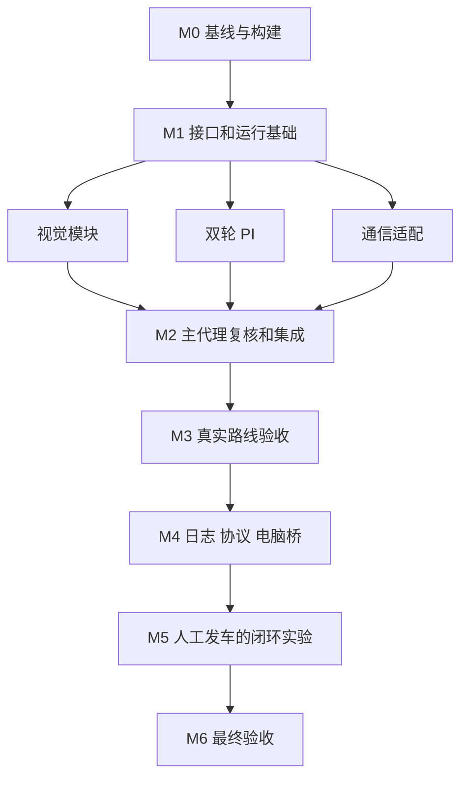

# 基础循迹与半自动调参里程碑

2026年10月15日右转33度（R049）：仅将右转估算角上限由30提高到33deg，左转20deg、基础速度1.2m/s、差速70%保持。右侧理论1352.8889us，当前50Hz/10000刻度内向取1354us，估算−32.7561deg，命令76.87；左侧仍101.71/1630us/估算+19.8571deg。实际输出与差速lead/center查询统一使用原始右前轮车身纵轴角−33至+20deg边界，中位92.5/+5deg、增益10、34行前瞻、故障标签及保护保持。适配已有断言源码，不运行测试/仿真、不烧录；外推端点并非新实测，M3-24/25和M4门槛保持。详见[本轮记录](evidence/M3/right_limit33_20261015/CHANGE.md)。

2026年10月15日差速上限70%（R048）：按用户要求将CONTROL_DIFFERENTIAL_MAX从0.5f提高到0.7f，内轮最低乘0.3、外轮最高乘1.7；差速增益10保持。基础速度1.2m/s、左20/右30deg、名义脉宽1368至1630us、中位92.5及原映射不变；4/s差速渐变、50/s基础斜坡、PD/PI、前瞻/故障显示/启停保护保持。固定请求0.7时由零达到上限至少18拍，正负满差速反向至少35拍，均为软件推演。已有断言源码同步，不运行测试/仿真、不烧录；实机轮速及路线仍待M3-24/25，M4未解锁。详见[本轮记录](evidence/M3/differential70_20261015/CHANGE.md)。

2026年10月15日右转30度（R047）：仅将右转估算角上限由25提高到30deg，左转20deg、默认速度1.2m/s保持。控制角域为−30至+20deg，仍按右前轮相对车身纵轴定义。右侧理论1366.5556us，当前50Hz/10000刻度内向取1368us，估算−29.6829deg，默认命令78.13；左侧仍101.71/1630us/估算+19.8571deg。中位92.5/+5deg、增益10/差速上限50%、34行前瞻、故障标签及保护保持。仅适配已有断言源码，不运行测试/仿真、不烧录；外推并非新实测，M3-24/25和M4门槛保持。详见[本轮记录](evidence/M3/right_limit30_20261015/CHANGE.md)。

2026年10月15日右转25度（R046）：仅将右转估算角上限由20提高到25deg，左转20deg、默认速度1.2m/s保持。左右角域拆为独立配置−25至+20deg，仍以右前轮相对车身纵轴为参考。右侧理论1389.3333us，50Hz/10000刻度内向量化1390us，估算−24.8537deg，命令80.11；左侧仍101.71/1630us/估算+19.8571deg。中位92.5/+5deg、差速增益10/50%上限、前瞻34行、故障标签和保护保持。仅适配已有断言源码，不运行测试/仿真、不烧录，新增端点仍非实测，M3-24/25与M4门槛保持。详见[本轮记录](evidence/M3/right_limit25_20261015/CHANGE.md)。

2026年10月15日默认1.2m/s与左右20度（R045）：用户明确左右上限均为20deg，沿用右前轮相对车身纵轴的插值/有界外推定义。理论脉宽1412.1111/1631us，当前50Hz/10000刻度内向取1414/1630us，估算右−19.5854/左+19.8571deg；默认命令82.27至101.71。默认基础速度1.2m/s，分轮约139.2586/136.3281 counts/10ms，前瞻自动前移34行，远带46/51/56/61/66。中位92.5/+5deg、差速增益10/上限50%、故障标签与无新帧刷新、限速/启停/500ms视觉保护保持；外推仍非新实测，不运行测试/仿真、不烧录。M3-24/25与M4门槛保持。详见[本轮记录](evidence/M3/speed120_limit20_20261015/CHANGE.md)。

2026年10月15日停车故障标签独立刷新（R044）：按用户要求将停车TFT状态绘制移出相机新帧分支，新增local_display_poll。左侧y70显示FAULT:与数值，y86显示原因；非零故障白字红底，原因固定宽度清旧内容。无新图时保留旧图，但每200逻辑ms尝试刷新控制状态；状态/故障变化优先，仍只在主循环停车路径绘制，实际响应受主循环服务影响。左右计数/可信度增加LEFT/RIGHT/CONF标签，默认1.5m/s、±35deg有界外推、50%差速及视觉/启停保护不变。本轮不运行测试/仿真、不烧录；右转失败根因仍待现场记录，M3-24/25与M4门槛保持。详见[本轮记录](evidence/M3/fault_display_20261015/CHANGE.md)。

2026年10月15日有界分段外推±35度（R043）：按用户要求将右前轮相对车身纵轴的左右估算极限设为−35/+35deg，保留原始三测点及92.5命令中位/+5deg偏置。理论端点1343.7778/1736us，50Hz/10000刻度内向量化为1344/1736us（估算−34.9512/+35deg），默认命令75.97至111.25。控制实际输出与差速前馈均使用同一±35deg有界外推；旧严格插值API和实测记录不变。默认1.5m/s、增益10与±50%差速、前瞻/限速及故障清零保持。外推不是新实测或机械限位验收；不运行测试/仿真、不烧录，M3-24/25仍待实机，M4未解锁。详见[本轮记录](evidence/M3/servo_extrapolate_35deg_20261015/CHANGE.md)。

2026年10月15日默认速度1.5m/s（R042）：按用户要求将CONTROL_DEFAULT_SPEED_MPS从1.0f改1.5f，分轮约174.0732/170.4102 counts/10ms。原前瞻公式自动取36行上限，默认远带变为44/49/54/59/64行；其可靠性仍按原连续道路门槛判断。实测转角映射/增益10、±50%差速、基础50/s与差速4/s渐变、PD/PI、100ms前瞻/500ms停车及10ms保持。只同步已有断言和说明，不运行测试/仿真，不烧录；M3-25待实机、M4未解锁。详见[本轮记录](evidence/M3/default_speed_150_20261015/CHANGE.md)。

2026年10月15日前瞻控制（R041）：针对用户实测入弯响应迟、最终停车，加入当前连续道路的近远融合；默认1m/s时远带为50/55/60/65/70行，最多75%并按可信度衰减。D只用近带；舵机先执行本拍限速，后轮参考最多100ms受限转向前馈，基础速度斜坡与4/s差速比例渐变分开。默认1.0m/s、实测映射/增益10、±50%差速、舵机85至100/60度每秒、PD/PI、10ms及500ms停车保护保持。前瞻坏帧/超100ms/STOP撤销，不运行测试或仿真、不烧录；无现场故障码，未确认停车唯一根因，效果待M3-25实机。详见[本轮记录](evidence/M3/preview_control_20261015/CHANGE.md)。

2026年10月15日实测转角接入差速（R040）：舵机限速命令按现有整数PWM刻度换算名义脉宽，查右前轮三点实测表，以当前映射角减直行中位映射角生成相对转向量，再计算差速。默认1.0m/s、差速增益10.0与±50%上限保持；原始中位+5度记录保留，直行相对角为0。映射失败/越界锁INVALID_VALUE并清输出，不外推或回退命令角。沿用原斜坡、PD/PI、10ms及启停保护；不运行测试/仿真或烧录，M3-24待实机、M4未解锁。详见[本轮记录](evidence/M3/mapped_differential_20261015/CHANGE.md)。

2026年10月15日差速放宽到50%（R039）：按上下文将用户“转向极限放宽到50%”落实为后轮差速比例上限±0.30→±0.50，增益6.0→10.0，使当前转向端点可达到50%分配；内轮乘0.5、外轮乘1.5，之后仍执行原独立斜坡。默认1.0m/s、舵机命令85至100/中位92.5、PD/PI、10ms、视觉与启停保护保持。已有断言同步但不运行测试/仿真，不烧录；M3-24待实机，M4未解锁。详见[本轮记录](evidence/M3/differential_50pct_20261015/CHANGE.md)。

2026年10月15日差速达到30%（R038）：按用户要求将DIFFERENTIAL_GAIN由3.5提高到6.0，命令偏离中位约7.45度开始触及原±30%硬限幅，当前85/100端点均可达到30%目标分配；内轮乘0.7、外轮乘1.3，之后仍执行原独立斜坡。默认1.0m/s、PD/PI、10ms、视觉与启停保护保持。已有断言同步但不运行测试/仿真，不烧录；M3-24待实机、M4未解锁。详见[本轮记录](evidence/M3/differential_30pct_20261015/CHANGE.md)。

2026年10月15日默认速度与差速更新（R037）：按用户要求将基础速度0.75→1.0m/s，分轮约116.0488/113.6068 counts/10ms；差速增益2.4→3.5，当前±7.5命令度下最大估计差速比例约±17.62%。±30%限幅、斜坡、PD/PI、10ms、视觉及启停保护保持。同步已有断言但不运行测试/仿真，不烧录；M3-24待实机，M4未解锁。详见[本轮记录](evidence/M3/speed100_gain350_20261015/CHANGE.md)。

2026年10月15日差速增益调大（R036）：按用户反馈将DIFFERENTIAL_GAIN从1.0提高到2.4，当前±7.5命令度下最大估计差速比例约±12.09%（原约±5.04%）；±30%比例限幅及原斜坡保持。默认0.75m/s、PD/PI、10ms与启停保护不改。已有断言同步但不运行测试/仿真，不烧录；M3-24仍待实机，M4未解锁。详见[本轮记录](evidence/M3/differential_gain_240_20261015/CHANGE.md)。

2026年10月15日后轮差速移植（R035）：参考demonew_changes_20261015手工合并TRACK几何差速，增益1.0、估计轴距0.20m/后轮距0.153m、比例限幅±0.30；按前一拍限速后的舵机命令差估计转角，左转左轮减速右轮加速，之后沿用原斜坡与独立PI。默认0.75m/s、PD0.22/0.002、10ms、视觉/冻结、KEY1/KEY2及500ms保护保持。更新已有断言但不运行测试或仿真，不烧录；几何尺寸、转角关系和实车方向/轮速仍待M3-24实测，M4未解锁。详见[本轮记录](evidence/M3/rear_differential_20261015/CHANGE.md)。

2026年10月15日默认速度更新（R034）：默认基础目标由0.5改为0.75m/s，当前标定下约左87.0366/右85.2051 counts/10ms。10ms、PD、PI、斜坡、低可信/弯道降速、背景过滤、法向恢复、冻结回传和启停保护保持。按用户要求本轮不运行测试或仿真，仅编译正式目标，不烧录；R033的软件/仿真结果对应此前0.5m/s，不作为0.75m/s验证。M3实机门槛与M4锁定保持。

2026年10月15日鸟瞰法向单边恢复（R033）：按用户最终更正使用0.45m路宽，沿当前真实可见边线的地面内法向偏移0.225m，反投影到现有像素PD接口。继续使用明确标记的可配置估计映射；边框不作真实边线，不再用像素宽度恢复单边。配套控制带允许在原带附近前后搜索；保留背景过滤、冻结回放/导出、0.5m/s、10ms与启停保护。本轮仅软件验证与三目标编译，不烧录；M3实机门槛及M4锁定保持。详见[法向恢复说明](BEV_NORMAL_RECOVERY.md)和[验证证据](evidence/M3/bev_normal_20261015/VALIDATION.md)。

2026年10月15日首弯修正（R032）：加入地面ROI直方图、近端连续道路筛选、当前单边与近期实测宽度恢复、自适应控制带；V1只传有效XY点，停车自动回放冻结记录并提供只读完整导出。按用户补充同步转向P0.22/D0.002；默认0.5m/s、10ms、原舵机限位/变化率与启停保护保持。本轮只完成软件验证和编译，不烧录。现场反馈为首弯稍转后停车，待冻结证据确认根因；M3路线/性能仍待实机，M4未解锁。详见[FIRST_CURVE_DEBUG_GUIDE.md](FIRST_CURVE_DEBUG_GUIDE.md)与[evidence/M3/first_curve_20261015](evidence/M3/first_curve_20261015)。

2026年10月15日曝光更新（R031）：用户实测反馈过曝，将当前CSI相机默认曝光由512改为450（MT9V03X_EXP_TIME_DEF），自动曝光保持关闭。新值需重新编译并下载固件、相机重新初始化后生效；本轮只做软件修改与构建，不烧录。成像效果仍待同一现场光照复测，M3实机项与M4门槛保持。证据见[evidence/M3/camera_exposure_450_20261015](evidence/M3/camera_exposure_450_20261015)。

2026年10月15日停车图传调频（R030）：默认发送间隔由100ms改为33ms，配置上限由10帧/秒提高到约30帧/秒；真实帧率仍受采集、处理和无线传输耗时限制。现有V1通道7可在停车时设为33，无需烧录即可临时试用；新默认值需下载新固件后生效。运行仍只发100ms间隔波形，10ms控制周期与启停规则保持。本轮不烧录。图传调度保留不足一个周期的余量，避免33ms在10ms逻辑时钟上每次都被取成40ms；健康且主循环足够快时，软件夹具330ms内得到10次发送。迟到时跳过旧时隙，每次只发送当前新帧，不补发积压图；该结果不代表无线接收实测。软件核对及构建证据见[evidence/M3/wifi_fps_30_20261015](evidence/M3/wifi_fps_30_20261015)。

2026年10月15日默认速度更新（R029）：本地默认基础目标改为0.5m/s，按左N2333.3/右N2284.2及名义周长0.20106193m分别换算为约58.0244/56.8034 counts/10ms；斜坡、弯道/低可信降速和启停保护保持。本轮仅修改、验证和编译，不烧录，实际车速待测。证据见[evidence/M3/default_speed_050_20261015](evidence/M3/default_speed_050_20261015)。

2026年10月15日源码增量（R028）：已接入普通道路查表鸟瞰、骨架细化及有界路径恢复，记录11项GPT微秒步骤和最近64帧。相机映射为用户允许的软件估计；保持10ms速度环、KEY1/KEY2、500ms视觉保护、PI和执行器基线。本轮仅软件验证和三目标构建，不烧录；板上仍以R027实读基线为准。详见[本轮证据](evidence/M3/bev_minimal_20261014/VALIDATION.md)。

当前源码（2026年10月14日，R026）：KEY1启动循迹、KEY2停止，本地默认20/20 counts/10ms；上电零输出。普通循迹取消三帧/远程确认和通信异常继续行车且实体按键可停止，视觉统一最后有效图像超过500逻辑ms停车，保留低可信/短丢线半速。曝光调整及二值记录增量已回退。本轮未烧录或发车，实机验收仍待完成。证据见[evidence/M3/local_button_control_20261014](evidence/M3/local_button_control_20261014)。

板上版本实读确认（2026年10月14日，R027）：本轮DAP只读Flash逐字节匹配本地按键正式版b12069b70cb851748425d63960d2b67e0c25b1fc3bcab2fac6941df0d267f296，CPU运行；此前“最后仅曝光版有烧录证据”描述是当时记录，现由此次实读更新。本轮未烧录。Wi-Fi助手监听已恢复，但模块B17持续低、初始化就绪超时仍待检查接线/断电复测。见[本轮记录](evidence/M3/wifi_recheck_20261014_01/diagnosis_progress.json)。

目标是在 2026 年 10 月 24 至 25 日中期检查前，稳定通过摄像头组 A 至 B 或 B 至 A 指定路线，并建立由人工确认发车的 agent 调参闭环。路线包含直道、R50 弯道和连续 S 弯，不经过环岛、十字，不放红砖，到达终点后可以人工截停。

## 当前阶段

- M0、M1、M2的软件已实现、复核和验收，完整Keil重构建0错误0警告；下一阶段为M3现场标定与受控实测。
- M2历史交付已冻结；2026年10月13日用户授权补齐M3本地标定软件。M3真实测量尚未完成，M4与M5实现尚未解锁。
- 用户确认昨天已在临时 Keil 工程完成 WIFI V2 通信修复；临时工程已清理。本次以已修复的V2实现为基础恢复当前工程注册，并在M2加入控制接口适配与运行有界收发。
- 实车为左右双驱电机加转向舵机，通信曾经验证，行车效果尚未验证。
- 工程入口为 `demo/mdk/rt1064.uvprojx`，公共库位于根目录 `libraries`；`20th_smart_vision` 仅作参考，不修改。

按功能的实现、review及章内/全局函数索引见 [IMPLEMENTATION_REPORT.md](IMPLEMENTATION_REPORT.md)。任务状态以 [TODO.md](TODO.md) 为准；每次验收记录写入 [REVIEW_LOG.md](REVIEW_LOG.md)。下一轮先读这三份文件和根目录 `agent.md`，核对工作区差异，再领取依赖已满足的任务。

## 实施节奏

2026 年 10 月 12 日用户调整了排期：M0 至 M2 的软件工作连续推进，接口固定后并行实现，不再预留三天。随后把更多时间用于机械标定、单弯、连续 S 弯、完整路线及故障实测。M3 通过后立即推进 M4 软件；M5、M6 根据场地证据验收，不以日历到期代替完成。

| 里程碑 | 通过条件 | 后续依赖 |
| --- | --- | --- |
| M0 文档与构建基线 | 文档可接续；用户修改保留；当前工程完整构建；驱动唯一注册 | 解锁软件实现 |
| M1 控制接口与运行基础 | 单位及接口固定；上电停止；帧时间可靠；故障路径可检查 | 模块独立实现与集成 |
| M2 视觉与运动模块 | 软件验证及集成构建通过；最终差异已复核 | 提供受控实测版本 |
| M3 基础循迹实机验收 | 指定方向连续 3 次完成；关键停车保护实测；基线可恢复 | 解锁 M4 实现 |
| M4 调参工具的软件实现 | 模拟联调、完整构建、日志完整性和人工启动入口通过 | 解锁 M5 |
| M5 半自动闭环实机验收 | 基线、候选、重复试验、评价、保留或回退完整可复现 | 解锁最终版本验收 |
| M6 中期验收版本 | 最终固件和参数连续 5 次完成；证据及操作说明齐全 | 关闭本周目标 |

## 控制与视觉接口约定

- 相机保留 188×120、配置 50 FPS；实测帧率另记。速度控制固定 10 ms，单位为 `counts/10ms`，Ki 按秒积分，速度 D 固定 0。
- `VisionResult` 包含帧号、采集时间、边线和中线、逐行质量、像素误差、可信度及丢线结果。
- `ControlParams` 包含左右独立 PI/目标、速度斜坡、舵机 P/PD、控制带以及人工标定的执行器限制。
- `ControlSnapshot` 包含设备时间、样本号、参数版本、左右实测/目标/真实 PWM/积分、舵机、视觉年龄及故障。
- 公共操作提供读取参数、停止态整组应用、人工启动请求、停止、清故障、发布视觉和读取快照。非法值拒绝，不静默裁剪。
- 上电进入 READY、目标为零；TRACK 启动需要人工标定确认和连续 3 帧高可信图像。BENCH 是人工确认的架空轮试验，最长 8 秒。
- 默认控制带 80/85/90/95/100 行，权重 1/2/4/2/1；双边实测质量为 1，单边重建质量为 0.5，无效行不参与。
- 参考宽度必须由静止、居中直道图像标定。未标定时不允许单边宽度重建；连续重建最多 3 帧。
- 视觉有效需至少3行参与且可信度≥0.35；控制接收下限为0.3。启动需连续3帧≥0.6，运行低于0.6半速；持续失线或有效图像年龄超过 100 ms，由 10 ms 任务停车并锁存故障。
- 网络恢复和清故障都不自动行车。运行不图传、不长重连；SPI 等待须有截止时间，实际服务耗时由 M3/M5 测量。

## 半自动闭环约定

M3 之前只预留内部类型和采样钩子，不实施电脑桥、实验协议或完整日志。

- M4 实现车端 100 Hz 日志，4096 条×64 字节，停止后分块读取；容量不足的试验准备请求直接拒绝。
- Python 桥独占车端 TCP 8086，HTTP 只绑定 localhost；逐飞助手 V1 接 localhost 8087 查看转换出的数据。
- MANUAL 与 AGENT 模式仅在停车时切换。agent 提供状态、参数、准备、停止、恢复、取日志接口，不提供启动接口。
- 每次人工窗口显示参数差异、试验 ID、类型和时限，由操作者确认发车；桥每 100 ms 发送心跳，试验中 500 ms 失联停车。
- 行驶只发送 10 Hz 摘要，评分使用完整 100 Hz 原日志；停车后图传。默认速度试验 8 秒，循迹短段最多 30 秒。
- 每次只改一个参数组，同工况至少重复 2 次；日志不完整、参数版本不符或保护触发的试验不能用于证明改善。

## 分工与复核

主代理独占公共接口、主循环、中断入口、工程注册和三份任务文档。视觉代理修改视觉模块与回放验证；PI 代理修改速度模块；通信代理修改助手适配及本地 V2 驱动。最多同时运行主代理和三个子代理。

子代理提交实际差异和验证证据后进入待复核，主代理复跑必要检查并决定关闭或返工。主代理自己的关键控制与集成改动另交子代理作独立只读复核。需要现场证据的任务单列待实机，不以编译或回放替代。

## 基线与恢复

实施前基线位于 `evidence/M0/baseline_20261012`：`HEAD.zip` 保存初始无修改的仓库源码；独立 `rt1064.uvprojx/uvoptx` 保存用户实施前工程配置，另有差异和元数据。恢复时先检查后续用户修改，禁止整树覆盖；选择需要恢复的文件并保留当前副本。

不自动烧录或发车；软件版本通过后提供人工操作步骤。不得把未实测功能写成已经可用。代码注释、版权、原文件编码与换行遵循根目录 `agent.md`。

## 延期功能

完整八邻域、环岛/十字、推箱、三轮解算、电流环、IMU 转向闭环、高速优化和几何差速实测优化不影响本周验收，另列后续任务。若实测失败，先排查机械转向、相机视野与帧龄、转向符号与饱和、轮速闭环，不直接扩大移植范围。

## 当前可用证据

最终固件、map、源码哈希清单、宿主测试、合成回放及独立review证据位于 `evidence/M2`；当前版本未烧录，硬件验收保持待完成。下一步按通信接入说明完成M3-01，回传实际参数与观察。

## 本轮报告与接口说明修订

M2-11至M2-13已完成：公共类型逐项中文注释、VS Code相对路径加#L行号索引、四张状态与多速率时序图、七类独立计时实测步骤及5/10/20ms选择条件。最终完整构建0错误0警告；类型声明、运行逻辑与10ms周期保持一致。下一轮按[实现报告的控制周期实测方案](IMPLEMENTATION_REPORT.md#控制周期的实测与调整路径)准备M3诊断与现场记录。诊断标记、真实仪器测量尚待实施，M4门槛保持不变。

M2-14已补充共用时间轴和10ms CPU窗口放大图，提供[离线交互图](visualizations/control_timeline.html)。图内区分已指定周期配置、软件预算、教学假设及推演；实际CPU占用、帧率和PWM波形仍待M3仪器验证。

M2-15已按用户确认的形式为18份本轮固件C/H补中文行级说明，根agent.md保存风格。21份源归档的有效代码/预处理指令一致检查、原编码/换行/版权检查、现有软件回归和独立review通过；最终Keil重构建0错误0警告，43函数索引及固件基线同步。证据与关闭记录见[实现报告](IMPLEMENTATION_REPORT.md#本轮行级中文注释及复核)和REVIEW_LOG的R009。M2-15关闭时48项任务为25已验收、1待实机、22待开始，下一步仍为M3现场数据。

M2-16已参考完整闭环代码解析，从架构展开实际调用顺序、关键函数输入输出、状态/失败分支、公式单位及教学算例；15个实现/调试/验证章有就近源码索引，全局111个真实定义、204处章内函数引用由生成器同步维护。315处函数链接、349个本地文件链接、19个目录锚点和8项索引维护行为检查通过，独立review发现的文档表述已关闭。固件/工程/参考文档及原时序图不变，本轮未重编译或开展实机。R010与functional_analysis目录保存前后证据；当前49项为26已验收、1待实机、22待开始，下一步仍为M3现场验证，M4未解锁。

## M3本地标定软件补充

2026年10月13日用户确认pyOCD为主、量角板/俯拍测左右前轮角、手机慢动作核对车轮RPM。新增M3-07软件支撑及M3-08/M3-09现场证据任务；不将软件通过算作M3路线验收，不解锁M4。现有转向仍为命令度P/PD，10ms与counts/10ms不改；实测表提供双向查询和估计值，未测N与表保持未标定。

正式版默认关闭标定入口；两种诊断版分别禁输出首验、人工有输出测量。首验和后续烧录/启动由操作者执行，代理未连接探针或驱动实机。操作与证据门槛见[标定说明](CALIBRATION_GUIDE.md)。记录仅单次1024×32B，不是M4的4096条完整实验日志或电脑桥。三目标完整构建、六C组、35Python项、原有回归与独立review分别记录；现场仍需实际DTCM/GPT/PWM/机械/RPM证据。

## 手转交互修订（2026年10月13日）

用户授权代理烧录关闭输出诊断版并操作；现场发现未连接Wi-Fi模块反复重连导致主循环无法及时确认邮箱命令。M3-12修复诊断服务阻塞，并增加计数专用start/end/restart和跳过未保存组设置；手转无固定时长，执行器8秒、500ms心跳、STOP及测量异常保护仍保留。原冻结固件和已导出错误组保留，最新软件/构建/实机协议证据另存evidence/M3/count_session_20261013。真实圈数、N、RPM、机械和路线验收仍待完成，M4未解锁。

## 用户选用合成候选1（2026年10月13日）

用户明确要求将离线演示候选1写入当前demo并做一次本地Git提交。当次写入左右默认Kp=100、Ki=1000（按秒积分），原50/0源码基线保存在[evidence/M3/candidate1_20261013/before](evidence/M3/candidate1_20261013/before)。零目标、上电停止、人工确认、停车切参、10ms与counts/10ms语义保持；这次应用不代表候选通过实车模型验证。

新增M3-10软件应用与M3-11现场比较任务。宿主回归及当前工程三目标构建均通过；正式版不含诊断对象。模拟实现仍独立位于speed_pi_sim，历史固件副本/模型/候选/报告与旧隔离证据保留。此前未提交的M3依赖和独立工具一并保存为本地检查点，不推送远程；实际提交ID以Git历史为准。现场计数、三档采集、候选架空/地面验证继续待测，M4仍未解锁。详细来源、测试和复核见R013。

2026年10月13日舵机交互修订M3-13（R015）：用户授权取消舵机固定时限并切活动固件/窗口。舵机start/end正常结束、restart显式丢弃本组后重用已确认范围并另输入RUN；事件记录预留末尾零输出槽，稳定保持与慢速斜坡不耗逐周期日志。pyOCD失联500ms停止、范围/速率/测量保护保留，RPM仍8秒。软件与三目标、活动版烧录回读/上电零输出/窗口就绪已验收；没有代理自动START，不关闭M3-08机械转角/PWM精度及路线门槛。

## 2026年10月14日新候选与速度范围（R017）

用户授权把新版候选1应用到主工程，并将目标限制扩到兼容本轮0～3m/s：当前左右Kp17.5、秒制Ki480，control/V1/RPM共用400 counts/10ms上限。原100/1000及100上限源码另存evidence/M3/pi_measured_candidate1_20261014/before。保持零目标上电停止、人工启动、10ms、8秒与其他保护，不写N/转角表，不烧录。三目标、六C组、52Python、两Wi-Fi变体及既有回归通过，独立复核关闭首周期旧算例发现。新增M3-14仅验收软件应用范围；M3-08/09/11、路线与M4门槛继续保持原状态。speed_pi_sim既有报告为更新主工程之前的计算快照，不重新覆盖。

## 2026年10月14日实测换算接口（M3-15）

本节记录R018验收时状态；其中两端测角关联已由下方M3-16/R019更正，旧证据保留。

本次后续授权将left_01/right_02各10圈平均2333.3/2284.2用于分轮换算；已有64mm名义轮径提供周长，实际滚动周长待测。新增计数与m/s双向接口及真实dt/10样本/50样本速度快照，右前轮1444/+17、1526/+5、1610/-13单轮分段正反查询。用户撤回PI单位迁移，PI/V1/RPM继续counts/10ms，Kp17.5/Ki480、周期与保护不改。右轮部分表不替代完整双轮表、不更改舵机中位/限位，不修改实测原件或独立模拟工程。证据另存evidence/M3/measured_conversion_20261014；不烧录或发车，M3-08/09/11及M4路线门槛继续待现场证据。

## 2026年10月14日右前轮测角更正（M3-16/R019）

用户确认1444和1610对应角度弄反。当前配置与记录采用1444us/-13deg、1526us/+5deg、1610us/+17deg；正角为左转，分段斜率+18/82、+12/84 deg/us，零角估计1503.222us。名义2us网格1504us预测+0.171deg，不自动修改中位。更正后的脉宽方向与现有SERVO_DIR=-1一致，撤回此前建议改为+1的判断。

固件部分表、真实C查询、离线JSON/CSV/HTML、说明及[俯视示意图](visualizations/steering_sign_top_view_20261014.png)同步更正；旧口述记录与报告另存before.zip，旧示意图另存before_diagram.zip，原始导出和历史冻结证据保留。R016一次性旧生成脚本已加停用提示，避免复造旧表；当前核对入口为tools/check_measured_profile.py。7组C、52Python、44模拟测试、既有回归、页面查询/布局和三目标0错误0警告通过，独立只读复核通过。证据见[evidence/M3/servo_points_correction_20261014](evidence/M3/servo_points_correction_20261014)。PI计数单位、增益、周期、编码器换算及现有保护保持；未连接探针、烧录或发车。M3现场验收与M4门槛保持。

## 2026年10月14日独立全赛道仿真首版（SIM-R001）

用户明确授权本机全赛道仿真，独立于原M4实机调参门槛。FTS-01至06软件范围完成：冻结demo C控制核心、本机网页、投影视觉、Python特殊元素扩展、车辆运动、顺序评分、批量和回放、标定导入及说明。同一假设配置双向全33路段完成97.67/94.86s，9独立场景、20核心测试和11浏览器检查通过；默认实测三点A→B仍在估计模型第一弯前丢线，保留证据。假设转向表和相机不作为实车参数。

本任务没有连接硬件、烧录、发送运动命令或修改真实控制核心。最终22份冻结源码不变、1442份保护原文件不变；1份原Wi-Fi连接配置工作期间外部变化保留并记录，不回退也不改冻结清单。软件交付见 [full_track_sim/README.md](../full_track_sim/README.md) 与 [验证报告](../full_track_sim/VALIDATION.md)。FTS-07模型实测准确性仍待现场，M3/M4既有门槛保持。
