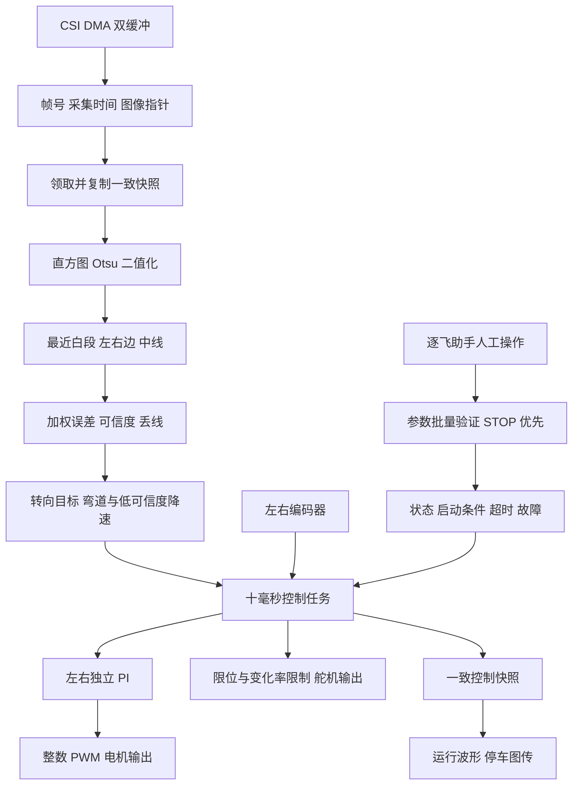
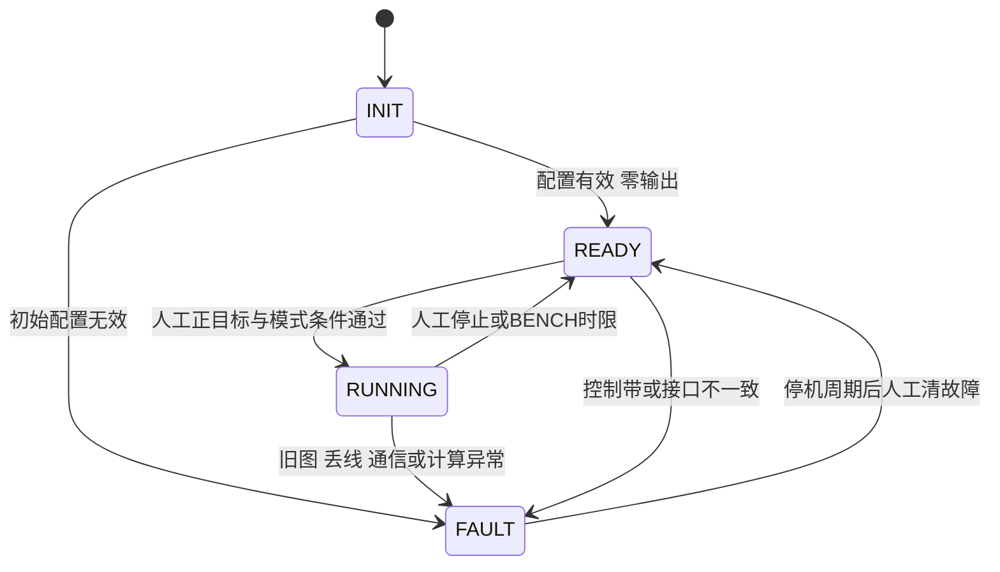
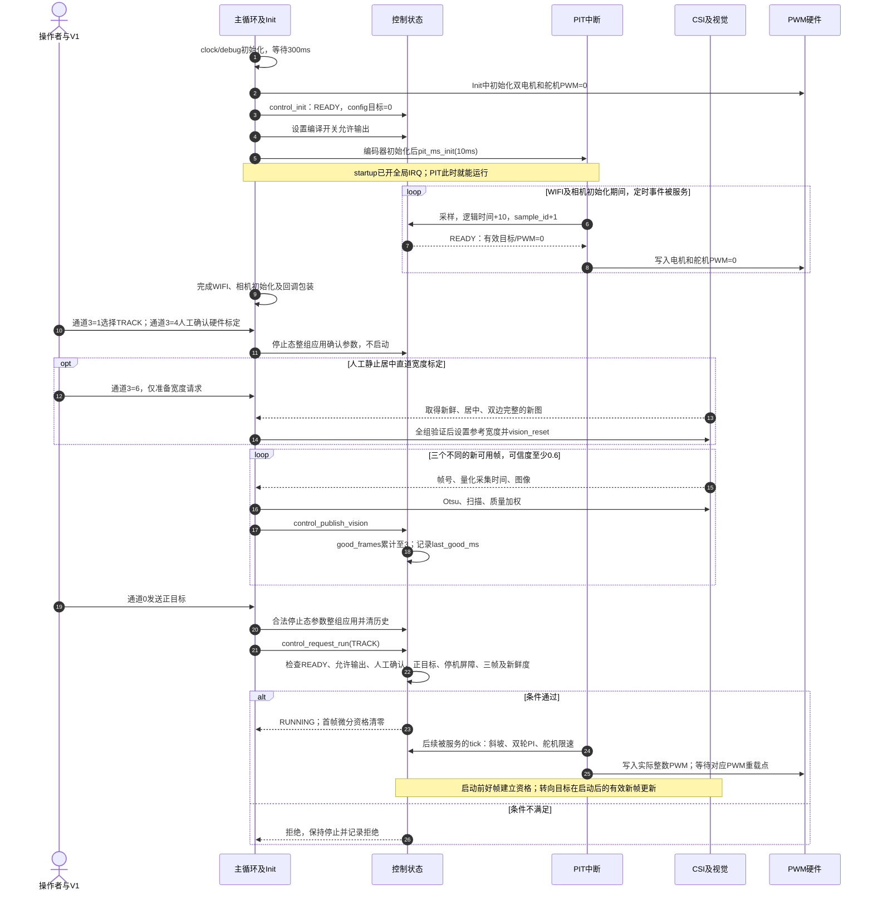
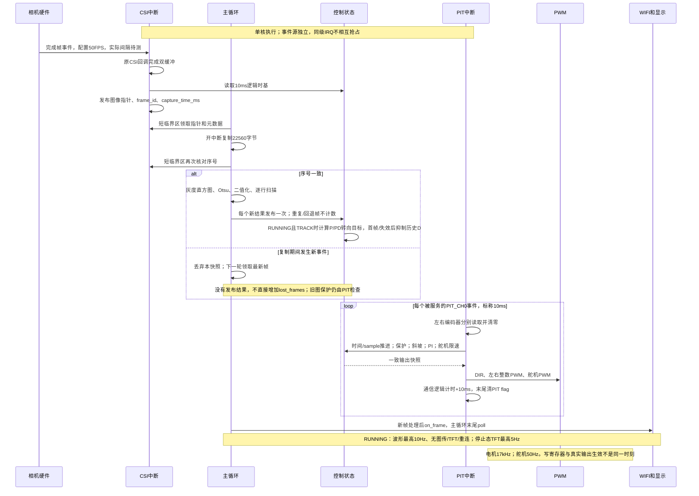
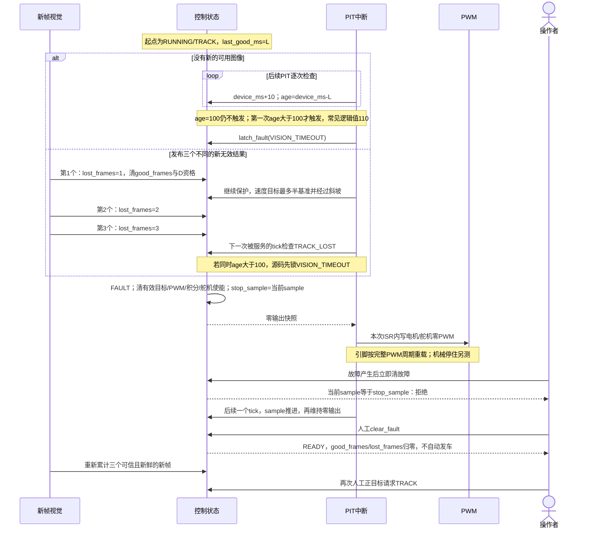
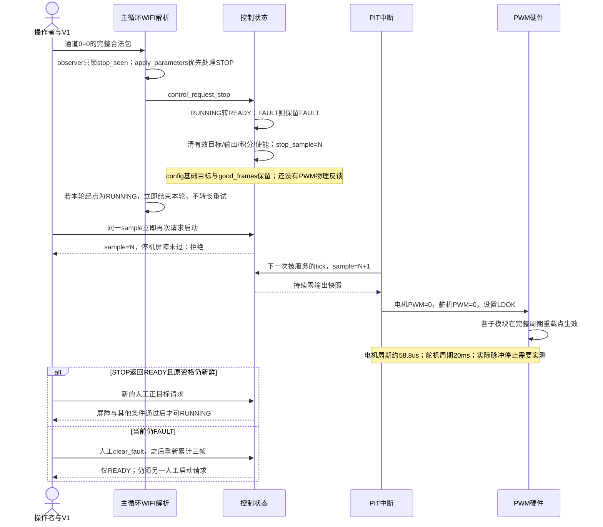

# 基础循迹软件实现与复核报告

本报告记录本次 M0 至 M2 的最终软件实现，按照总体架构、运行基础、视觉、运动控制、通信及标定展开，并提供仓库代码索引和可复跑的验证证据。软件已经实现上电停止、人工启动、加权视觉循迹、双轮 PI、有界通信及故障锁存。当前尚未烧录这套最终固件，真实无线兼容、机械标定、R50 行驶和完整路线仍需M3实测；用户安排在2026年10月13日或14日进行，本轮交付截至M2。

M4 的电脑桥、实验协议、连续 100 Hz 完整日志及自动评价尚未实现；它们严格依赖 M3 连续三次路线验收。当前 10 Hz 波形仅供人工观察，不能代替实验日志。范围和任务状态分别见 [MILESTONES.md](MILESTONES.md) 与 [TODO.md](TODO.md)。

## 总体架构与数据流

工程运行在 RT1064 裸机环境，没有引入 RTOS。三个时间域分工明确：CSI 回调发布采集完成事件；主循环每个新帧计算一次视觉；PIT 每 10 ms执行保护、目标斜坡、速度 PI 和硬件输出。通信和显示在主循环末端执行。

| 时间域 | 入口 | 执行内容 | 限制 |
| --- | --- | --- | --- |
| 相机事件 | CSI 包装回调 | 保存完成帧指针、序号和设备时间 | 保留原驱动双缓冲，不复制整帧 |
| 新帧任务 | main | 领取、二值化、扫描、误差、控制发布 | 同一帧不重复计数或微分 |
| 100 Hz控制 | PIT / control_tick | 采样、保护、斜坡、PI、舵机限速、快照 | 不发送网络，不刷新显示 |
| 通信任务 | wifi_assistant_poll | 接收人工请求、运行波形、停止态恢复 | 运行共享截止时间，停止后重连 |
| 停车显示 | main / on_frame | TFT限频和原始/二值图 | 行驶关闭图传及TFT刷新 |

接口使用 `VisionResult → ControlParams/ControlSnapshot`，硬件入口只把控制快照写入 PWM。视觉和通信不能直接修改 PID 内部历史，也不能绕过运行状态启动电机。

## 工程接入与可恢复基线

当前 Keil 工程重新登记 `drivers/wifi_spi_v2`，该目录优先于根库旧头文件，并唯一编译本地 V2 源。新增控制和相机源文件也已登记。用户原来的器件包、编译宏、下载和其他工程设置保留。

应用层 V2 的初始化、热点/Socket 独立连接和原有停车恢复逻辑沿用。昨天通信成功来自用户已清理的临时工程，不作为本次改动的实机证据。参考工程与它自己的库未修改。

实施前源码、用户工程配置及差异保存在 `evidence/M0/baseline_20261012`。本次另在根 `libraries/zf_components/seekfree_assistant.c/.h` 增加接收复位、合法包事件回调、容量校验和错误计数；对应原文件副本也保留在基线 `shared` 子目录。单独复制 demo 时必须一起提供同级 libraries。

## 公共接口与参数一致性

`control_types.h` 定义三个数据结构。它们只依赖标准整数类型，宿主 C 测试使用同一份控制、视觉和 PI 源码。

| 类型 | 主要字段 | 作用 |
| --- | --- | --- |
| VisionResult | frame_id、capture_time_ms、left/middle/right、row_quality、error_px、confidence、valid/track_lost | 区分真实边界、重建边界和无效结果 |
| ControlParams | 左右目标/Kp/Ki、PWM/积分限制、斜坡、舵机参数、五行控制带、保护阈值、人工确认 | 统一配置，禁止分散修改控制内部变量 |
| ControlSnapshot | sample_id、timestamp、版本、生效时间、左右目标/测量/实际与raw PWM/积分、视觉年龄、状态/故障、舵机 | 原子读取控制结果及后续日志接入点 |

速度单位是每 10 ms 编码器计数；目标 30 不代表 30 rpm 或 30 m/s。Ki 为按秒定义的积分增益，旧非零 Ki 不能直接沿用。舵机值是控制命令角，不能直接当作前轮实际转角。设备时间由 10 ms任务推进，采集时间有 10 ms量化；实际采集频率和任务抖动需要测量。

`control_apply_params` 只在停止态按读取版本整组应用：拒绝过期版本、非有限数、越界值、不递增控制行和非正权重；PWM上限必须是整数且不超过5000。成功时发布版本与生效时间并清积分，故障不会被顺带解除。更改控制带后，旧的三帧启动资格失效，必须重新取得可信新帧。

当前快照是内部结构，不是未来64字节日志或网络包；M4会选取字段显式编码，不能直接发送 C 结构内存。

公共字段和宏的逐项说明已经写入 [control_types.h](../user/inc/control_types.h#L1)，覆盖61个结构字段、6个宏（含头文件保护）和11个枚举值。注释说明基础目标与斜坡目标、像素误差符号、积分输出单位、逻辑时间、占位值、参数版本和PWM命令的含义。字段声明、顺序、类型和宏值均保持一致，去除注释后的声明token比较通过。

## 启动 停止和故障保护

上电目标为零，编译开关只允许执行器被使用，不产生发车动作。启动还要求人工标定确认、有效模式、非零目标和已完成停止周期。

- TRACK：电机和舵机允许输出，连续3帧可信度至少0.6，最近有效图像不超过100 ms。
- BENCH：专供人工确认的架空轮试验，不依赖视觉，最长8秒自动停止；舵机若允许输出则保持中位。
- STOP：立即清快照中的有效目标、计算输出、积分和舵机使能，基础配置目标保留。下个PIT写PWM零命令，输出引脚在PWM重载点生效；具体响应延迟须实测，不等待减速斜坡。
- FAULT：保持零输出。发布新图或应用参数不会恢复行车，清故障也只返回READY。

TRACK 中有效图像年龄超过100 ms或连续3帧失效时锁存故障。考虑10 ms检查周期，触发点具有一个周期的量化。通信底层或解析器异常时走LINK故障路径。保护在PIT执行，不等主循环显示或网络发送完成。

主循环和中断共享参数、视觉状态及快照时采用保存/恢复中断状态的短临界区。大图复制、显示和网络操作不在临界区内。

## 运行状态与多速率时序

以下图按当前源码调用次序绘制，用于区分软件状态、控制服务和硬件输出生效。PIT标称10 ms保持不变；时序中的实际延迟和中断优先级回读属于M3现场验证。control_init返回前直接进入READY或FAULT，图中的初始化阶段不意味着存在持续调度的INIT任务。

### 中断优先级与时间来源

当前 [器件头文件](../../libraries/sdk/deceive/MIMXRT1064.h#L270)定义4个NVIC优先级位；[interrupt_init](../../libraries/zf_common/zf_common_interrupt.c#L114)设置PRIGROUP=3，对应4位抢占优先级、0位子优先级。应用和已用 PIT/CSI 初始化没有为两者调用 SetPriority。按正常复位默认值推定，两者均为优先级 0；这是源码推定，现场须回读 NVIC_GetPriority(PIT_IRQn)、NVIC_GetPriority(CSI_IRQn)、NVIC_GetPriorityGrouping() 和 PRIMASK，不能声称已测。

两者若同级，不能相互抢占；若同时待处理，同优先级仲裁中 CSI_IRQn=43 先于 PIT_IRQn=122。短 PRIMASK 临界区也会延后可屏蔽中断。因此不能画成“PIT 一定抢占 CSI”，也不能只看主循环 WIFI 的 2 ms 截止检查就证明控制周期恒定。

| 时间量 | 当前来源 | 能说明什么 | 不能说明什么 |
| --- | --- | --- | --- |
| device_ms / control_now_ms | 每次被服务的 control_tick 加 10 | 控制逻辑时间与无符号差值 | 不等于独立墙钟；丢服务时不会补计漏掉的周期 |
| sample_id | 每次 control_tick 加 1 | 服务次数、停机屏障 | 不能由相邻 sample_id 推断真实间隔 |
| capture_time_ms | CSI 包装回调成功后读取 device_ms | 对应完成事件的 10 ms 量化时间 | 不是曝光起始时间；还包含 IRQ 服务/回调延迟影响 |
| vision_age_ms | device_ms - last_good_ms | 最近可用结果采集时间的逻辑年龄 | 不是最近任意帧的年龄，也不是独立计时的处理延迟 |
| WIFI runtime_last/max_us | DWT CYCCNT / system_clock | 运行服务轮次耗时，包含中断抢占 | 不能代替 PIT 周期、整个主循环或真实网络端到端时延 |
| 现场真实时间 | 示波器/逻辑分析仪；或经校验的 DWT/GPT free-running | ISR 间隔、执行、响应、帧间隔 | 当前没有采集这类现场证据 |

PIT 来源为 CLOCK_GetFreq(kCLOCK_PerClk)；pit_ms_init计算周期计数，SDK写LDVAL=count-1。当前[板时钟配置](../../libraries/sdk/board/clock_config.c#L79)声明PERCLK 75 MHz，对应 10 ms 约 750000 个计数；现场记录实际 CLOCK_GetFreq、LDVAL/CVAL 与独立波形，不仅引用配置值。

PIT flag 在 ISR 末尾清零。若服务被长时间阻塞或 ISR 跨过下一周期，多个定时事件可能合并，末尾清标志也可能清掉期间的新事件。device_ms 与 sample_id 都不能证明没有漏周期。应先测量，再决定是否改清旗位置/优先级；本稿没有实施这些修改。

### 上电、资格与人工 TRACK 启动

当前[启动文件](../../libraries/sdk/startup/mdk/startup_MIMXRT1064.S#L336)在进入main前开启全局IRQ；因此Init启动PIT后的联网/相机等待期间，控制任务已有机会运行并保持零输出。

宽度标定与人工硬件确认是不同操作；当前启动 API 不把“参考宽度非零”作为额外硬门槛。未标定仍可使用双边实测，但不允许单边重建。TRACK 启动还要求电机与舵机允许输出；BENCH 不依赖视觉，最长 8 秒逻辑时间并自动停止。

### 共用时间轴与10 ms窗口放大

下图采用用户提供的共轴泳道形式，显示各模块在同一时刻使用的数据，以及一个控制窗口中的CPU时间。项目配置保持相机50 FPS（帧周期20 ms）、PIT控制10 ms、舵机PWM50 Hz（20 ms）、电机PWM17 kHz（约0.0588 ms）。相机采集/DMA和PWM发生器同时工作；CPU只在回调、算法或寄存器更新时处理对应任务。

图中数字分为三类：

| 标识 | 数据 | 依据与验证状态 |
| --- | --- | --- |
| 已指定：代码配置/周期换算 | PIT 10 ms（100 Hz）、相机50 FPS（20 ms帧周期）、舵机50 Hz（20 ms脉冲周期）、电机PWM 17 kHz（约58.8 µs、每10 ms约170周期） | 当前源码已配置；括号内由频率换算。真实间隔、抖动、帧率和引脚波形尚待M3测量 |
| 已设预算：软件约束 | 运行单轮通信≤2 ms、单次SPI等待≤1 ms | 当前代码截止时间预算；不是周期，也不表示实际每轮都耗时2/1 ms；最坏耗时待实测 |
| 假设：教学示例 | CSI CPU 0.05 ms、整轮PIT CPU 0.20 ms、视觉CPU 2 ms、一次收发CPU 1 ms、舵机示例脉宽1.5 ms、5/25/45 ms脉冲相位及初始缓存结果F-1 | 为解释先后关系人为选取，不是本车测量或固定调度配额；F-1只是图例代号，不是负的车端uint32帧号 |
| 推演：由教学假设计算 | F0在22.25 ms发布、F1在42.25 ms发布、所选窗口余量6.75 ms、26/46 ms各泳道的帧来源 | 根据图内假设推演，不能用于证明真实停车/控制时延或性能 |

图例中的CSI 0.05 ms、整轮PIT 0.20 ms、视觉2 ms、一次收发1 ms、舵机脉宽1.5 ms及脉冲起点相位，全部是教学假设；没有来自本车的耗时或波形测量。相机灰条表示帧周期/采集传输窗口，不能据此推断曝光恰为20 ms。横轴是独立教学经过时间，不能直接当作当前10 ms量化的control_now_ms/capture_time_ms。

| 图例/泳道 | 周期或示例耗时 | 由谁推进 | 在10 ms窗口里怎样理解 |
| --- | --- | --- | --- |
| 相机帧采集 | 配置每20 ms完成一帧 | 传感器与CSI/DMA硬件 | 可以跨过两个控制窗口；只在完成回调时占用少量CPU |
| CSI完成回调 | 图例0.05 ms，实际待测 | CSI中断 | 发布指针、帧号和量化采集时间；相对PIT的相位/排序会影响真实进入时间 |
| 速度闭环与控制更新 | 每10 ms，图例整轮0.20 ms | PIT中断 | 同一轮包含编码器读清、保护、斜坡、双轮PI、舵机限速和PWM写入；其中舵机命令更新已包含在0.20 ms内，不重复加预算 |
| 视觉计算 | 领取成功的新帧才计算，图例2 ms | 主循环CPU | 有新帧的窗口才有这段工作，也可能跨窗口并被PIT打断；2 ms不是固定预留时隙 |
| 一次运行收发检查 | 图例1 ms；当前单轮预算≤2 ms | 主循环CPU与SPI硬件 | 示例画一轮；主循环可能执行多轮，≤2 ms不是每10 ms的全部通信总预算 |
| 舵机命令与物理脉冲 | PIT每10 ms更新命令；物理脉冲每20 ms | CPU写命令，PWM硬件按重载点输出 | 两次命令更新可能只体现为一次完整脉冲；图例1.5 ms高电平不是CPU忙等1.5 ms，实际脉宽随命令角变化 |
| 电机PWM载波 | 17 kHz，每10 ms约170个周期 | PWM硬件 | 在视觉计算、通信和其他主循环工作期间持续生成；PIT写入新的占空比后在重载点生效 |
| 其他主循环/余量 | 所选窗口图例6.75 ms | CPU | 可用于剩余循环与后续事件；不表示源码睡眠6.75 ms，也不保证每个窗口都剩余这么多 |

所选20～30 ms窗口的教学算式为 `0.05+0.20+2.00+1.00+6.75=10.00 ms`。相机20 ms采集窗口和舵机20 ms脉冲周期属于并行硬件时间，不加入这个CPU耗时求和。当前固件按事件和中断运行，没有把视觉、通信与余量划成固定任务配额；实际占用由M3独立仪器测得后替换。

在该教学相位下，F0于20 ms采集完成、22.25 ms发布视觉结果；PIT20已经执行过，因此30 ms这一轮才把F0用于降速和舵机命令限速。25 ms的舵机脉冲仍依据PIT20写入的F-1。查看26 ms时，相机/视觉是F0，而最近控制计算和舵机脉冲仍依据F-1；查看46 ms时，这组标签分别为F1与F0。帧标签表示降速/转向的视觉依据，速度PI误差仍来自本次编码器，舵机命令仍受P/PD、限位与变化率约束。

[离线交互图](visualizations/control_timeline.html)支持拖动查看时刻并跳转26/46 ms。用浏览器打开HTML；VS Code Markdown可直接显示上述两张SVG。交互图按教学时序解释数据流，未接入车端。图形可由[生成器](../tools/render_control_timeline.py)重新生成；26/46 ms交互、边界与渲染证据保存在 `evidence/M2/revisions/20261012/timeline`。当前ControlSnapshot.frame_id在新视觉发布时就会更新，不是“上次PWM计算采用帧”的专用字段；现场溯源须在控制计算处同步记录采用的帧号，不能从任意时刻的frame_id反推此前PWM命令。

### 多速率调度与帧事件

图的垂直排列展示各路径内部次序，不表示PIT必须等视觉处理结束；PIT可以打断主循环，相机与PIT的相位并不固定。速度采样/PI 标称100 Hz，摄像头配置50 FPS，运行遥测最高10 Hz，停车TFT最高5 Hz。它们不是四个严格同步的硬件任务。主循环被停车图传、显示或连接阻塞时，PIT 仍应被服务，但必须用独立仪器验证中断屏蔽/竞争造成的延迟。

### 旧图、三帧丢线与故障锁存

三帧指三个实际发布的新无效结果，不是三个 PIT，不是固定 30 ms，也不是“相机少了三个物理帧”。按真实 50 FPS 且每帧及时处理估算，从首个无效结果到第三个约 40 ms，再等待控制检查；从上个好帧到第三个通常约 60 ms，但这不是当前实测值。

重建最多三个新帧与三帧丢线是两条规则：被标定宽度重建且仍可用的结果会更新 last_good_ms；超过重建许可导致结果无效后，才进入 lost_frames 累计。两边全失效不享有重建许可。少数行重建到期也不必然使整体无效，仍取决于控制带有效行和质量。

### 人工 STOP、停机屏障与物理 PWM

根库[pwm_set_duty](../../libraries/zf_driver/zf_driver_pwm.c#L98)写入LDOK，[pwm_init](../../libraries/zf_driver/zf_driver_pwm.c#L157)选择完整周期重载。STOP 从“车端 API 已接受”到“寄存器写零”通常要等 0～一个控制周期及 ISR 输出段；这不是从电脑点击起算的网络端到端上界。17 kHz 电机完整周期约 58.8 μs，50 Hz 舵机完整周期 20 ms；不能把下个 PIT 写零直接解释为两个引脚在 10 ms 内都已停止脉冲。

在 PIT 内产生故障时，sample_id 已先加 1，latch_fault 记录这个新值：虽然本次 ISR 就写零，clear_fault 仍须再等一个后续 tick。主循环 STOP/LINK 故障则在下一 tick 跨过屏障。屏障证明控制服务次数，不证明实际轮速、驱动板制动模式或物理舵机位置。停机时servo_cmd记录中位且servo_enabled为0，并不会驱动舵机实际回中；电气零输出与机械停住分别记录。

## 相机快照与帧新鲜度

`camera_frame_install` 保存原 CSI 回调，包装后仍先调用原驱动完成双缓冲处理。只有原回调实际产生完成标志时才发布新指针、序号和采集时间；回调前清旧标志，避免失败事件把旧图重新标成新图。

`camera_frame_take` 在短临界区领取指针和元数据，然后开中断复制22560字节。复制后再次检查序号；若采集事件改变了缓冲状态，拒绝该快照并保留最新帧供下次领取。失败帧只计算一次，重复领取不会增加丢帧计数。

本次纠正了旧主循环在处理末尾清完成标志的行为，也修复了初版新模块的丢帧重复计数。模拟CSI事件测试使用实际相机模块源，验证元数据、复制竞争、旧标志和重复读取；真实DMA、缓存和采集时序仍在M3验证。

## 灰度处理与视觉循迹

### 直方图与二值化

原代码对 `short[256]` 只清256字节。现改为32位计数，并完整清除256项，避免高灰度计数跨帧累积。测试包含重复输入、全部256种纯灰图及70000像素合成直方图。

Otsu 对空直方图和纯色输入有明确输出，避免零样本除法。二值结果统一为0/255，寻线直接检查二值像素，灰度阈值不再参与判黑，因此阈值为0也能正确识别黑像素。

### 种子 边线和跨帧状态

每行寻找距预测种子最近的连续白段，从下向上把有效中点传给下一行；下一帧优先使用上一有效中点。每行输出先初始化，图像边框不作为实测赛道边界。

`row_quality` 为0时无效，1为使用参考宽度重建，2为双边实测。标定后还按参考宽度检查明显不合理的小白段。整幅白、黑或纯灰不会生成有效循迹结果。默认宽度为0，禁止未经标定的单边重建。

单边出画面时，用有效边和该行标定宽度重建中点；虚拟边界允许在画面外，显示坐标限幅。连续重建最多3个新帧，后续结果失效后由控制层执行丢线/超时保护。同一帧不延长重建期限，回退帧被拒绝，无符号帧号回绕按差值处理。

### 控制带与质量加权

初始控制带为80、85、90、95、100行，权重1、2、4、2、1。误差的分子和分母均乘质量，重建行贡献减半；无效行不参与。视觉结果有效要求至少3个控制行参与且可信度达到0.35。控制接口另校验可信度至少0.3；正常视觉模块输出已经满足该接口下限。人工启动需要连续3帧达到0.6，运行中低于0.6时速度目标最多为基准的一半。

$$
e=94-\frac{\sum_i w_iq_i\,mid_i}{\sum_iw_iq_i},\qquad
confidence=\frac{\sum_iw_iq_i}{\sum_iw_i}
$$

初版仅对置信度乘质量，混合行误差仍用完整权重，已在review中修正。独立算例中其余4行中点94、权重和6，90行重建中点40、原权重4；正确误差13.5，旧版为21.6。新增测试确认旧版失败、修复后通过。

合成阴影回放覆盖控制带72至105行：可辨认阴影的Otsu阈值45、误差0、可信度1，五行均双边实测；深阴影也得到阈值45，但五个控制行均失效、可信度0。深阴影的零误差是无效占位，不能用于居中判断。该结果确认全局Otsu在深阴影下存在丢线限制，真实光照仍须M3采样验证。原灰度、真实C二值图和逐项预期检查保存在 `evidence/M2/shadows`；主代理独立复跑结果见 `replay_primary_review.csv/json`。

`vision_process` 不修改二值输入。显示和图传通过独立边线传输，不把线条涂黑后再交算法使用。

## 双轮速度 PI

两轮使用独立 `pid_param_t`，控制器输出采用前进范围0至PWM上限，速度D固定0。采样周期传入0.010秒。

$$
e_k=v_k^*-v_k,\quad P_k=K_pe_k,\quad
I_{candidate}=clip(I_{k-1}+K_i\,0.010\,e_k, -I_{max},I_{max})
$$

`PidLocCtrl` 根据实际输出上下限做条件积分：已经饱和且误差进一步推向饱和时不继续积累，允许向退出饱和的方向变化。单步跨边界时只保留到达边界的积分，避免整步拒绝后无法触顶。

积分保存的是输出贡献，`out_i` 与其一致；`out_raw` 为未限幅浮点结果。Ki=0主动清积分，重新启用不会释放历史误差。非法周期、配置、输入或计算溢出清历史并返回0。

控制层对PID结果按硬件使用的整数进行量化，快照记录相同实际值；raw保留诊断精度。饱和标记覆盖恰好触顶的情况，而不只检查严格大于上限。停止、模式切换、故障和参数应用都清历史。

左右目标先分别进行速度斜坡，默认每秒50个速度单位。停止不经过斜坡。当前V1界面共用左右目标和增益，内部API保留独立参数。默认Kp=50、Ki=0是待实测起点，不代表实车PI已经调好。兼容增量PID保留，但不用于当前速度链。

## 舵机控制与降速

RUNNING且TRACK时每个有效新帧计算一次P/PD目标，微分使用采集逻辑时间间隔（当前10 ms量化）；重复帧不参与微分，首帧和失效后重新取得图像时抑制历史微分。

$$
servo^*=clip(center-direction\,[K_pe+K_d\dot e],min,max)
$$

PIT对目标执行变化率限制，默认60命令度/秒，即每10 ms最多0.6度。舵机PWM物理频率仍为50 Hz（20 ms），双轮电机PWM为17 kHz（约58.8 µs）；两者均不等于PIT控制周期。舵机中心通过独立 `SERVO_MOTOR_CENTER` 标定，不再强制等于左右极限平均值。

弯道速度按像素误差降低，默认弯道因子0.5；控制接收下限0.3，视觉有效下限0.35；可信度低于0.6或短时丢线时最多半速。先以相同左右基础目标低速验证，不在本周增加未标定的前轮角度差速公式。

## V1人工参数与有界 WIFI

### 人工请求

V1界面通道0至7对应线上编号1至8。通道0正数设置目标并请求所选模式启动，0优先停止；通道1/2分别是共用左右Kp/Ki，通道4是舵机P。通道3改为操作整数：1选TRACK、2选BENCH、3清故障、4确认标定、5撤销并停止、6请求直道宽度标定；0不操作。

停止态运动参数先合并成一组，再校验并应用一次；运行中拒绝改参。同一接收轮次中STOP不能被随后同通道的START覆盖。合法包observer只锁存事件顺序，不在解析器中阻塞。

重连会清私有接收FIFO和未应用参数，避免半包和旧启动请求跨连接复用。接收长度按FIFO剩余空间计算；异常返回长度或FIFO写失败有错误计数，应用层清理请求并进入对应故障路径。

### 运行通信

V2驱动保持SPI_1、20MHz、MODE3和8位帧。新受检交换绕过旧的无限忙等待，TX/RX FIFO、模块Busy和硬件错误均检查截止时间。保留TCR模式位和CCR时钟设置，超时中止本次交换并暴露错误。

运行RX/TX共享本轮2 ms截止时间，单次SPI等待预算1 ms；B17未就绪立即返回。运行中不重试整帧、不睡眠、不重连、不图传、不刷新TFT。某轮中途停止时仍保留本轮运行预算，立即结束，下一轮才能进入停车恢复，避免状态切换绕过限制。

停车保留原重试、续传、图传和自动连接。运行波形固定最高10 Hz，通道依次为左右目标、左右编码器、左右实际PWM、像素误差、舵机命令。完整控制状态可从快照读取。

上述是有截止检查的软件路径，真实最坏耗时、SPI模块协议兼容及控制抖动尚未测量；不能把寄存器模拟通过当作物理2 ms保证。

## 静止直道标定

通道3值6只准备宽度请求，不发车。主循环取得新帧后要求停止、轮速绝对值不超过1、可信度至少0.9、误差绝对值不超过5像素、图像新鲜，以及所有控制行存在可接受的实测宽度。

先校验整组候选，再调用逐行setter，并检查返回。三白像素的窄白段宽度为2，不能误报标定成功。无新帧超过1秒则取消请求。成功后重置视觉时间状态，保留实际标定宽度；重启后须重新标定。

实车方向、中位、限位和R50能力的校验属于操作者工作。完整步骤见 [WIFI与现场操作说明](../README_WIFI_SPI.txt)，报告不把确认命令当作已经完成机械标定的证据。

## 软件验证与最终构建

<!-- BUILD_SUMMARY_START -->
ARM Compiler 6.15 完整重构建：**0错误、0警告**。代码 53768字节，RO 6584字节，RW 296字节，ZI 106272字节。

固件AXF SHA256：`dfd881aaee297055273f769dc813331d7e01df34ffae85077b847942de1db364`。构建日志位于 `evidence/M0/keil_rebuild.log`；副本与最终源清单位于 `evidence/M2`。
<!-- BUILD_SUMMARY_END -->

| 验证项 | 实际验证对象 | 结果与证据 |
| --- | --- | --- |
| PI | 同一pid.c，严格宿主编译与数值测试 | 20312个检查通过；evidence/M2/test_pid |
| 视觉 | 同一img_process.c | 6组通过；包含混合行、纯灰、边界、重建、帧回绕；evidence/M2/test_vision |
| 控制 | 同一control.c与pid.c | 启停、斜坡、故障、版本、重采、量化与饱和通过；evidence/M2/test_control |
| 标定 | 提取main真实静态函数并编译 | 7种场景通过；evidence/M2/test_main_contract |
| 相机 | 同一camera_frame.c配模拟CSI | 回调、时间、复制竞争、计数、旧标志通过；evidence/M2/test_camera_contract |
| 通信 | 实际函数、FIFO、解析器与寄存器模型 | 27场景通过：10参数、10SPI、7解析；evidence/M2/wifi_checks.log |
| 回放 | 编译实际视觉DLL后由ctypes调用 | 14帧合成图，5有效9失效；replay.csv/json明确hardware_acceptance=false |
| 独立review | 子代理只读复核及另行实际C验证 | 所发现P1/P2已关闭；evidence/M2/independent_review.log |

入口 `tools/run_software_checks.py` 可复跑宿主验证；`--keil-only` 完整重构建。GCC在受限环境无法启动时自动回退本机MSVC。回放工具也支持GCC/MSVC，RAW/PGM无需额外图像依赖；PNG/JPEG使用可选Pillow。回放时间轴为假定周期，不等于实车采集时间。

## Review发现及关闭情况

| 发现 | 修复及回归 | 状态 |
| --- | --- | --- |
| 当前工程注册旧WIFI驱动 | 修正唯一源与优先头路径，完整构建 | 已关闭 |
| 直方图半清零、阈值0判黑失效 | uint32完整清零，统一二值判断 | 已关闭 |
| 原PI积分限制被覆盖、周期按1计算 | 秒制、条件积分、Ki0清历史、实际上下限 | 已关闭 |
| 处理末尾清帧标志、复制竞争 | 采集回调元数据，复制前领取、复制后校验 | 已关闭 |
| 复制失败与帧间隔重复计算丢帧 | 失败推进消费序号，回归模拟事件 | 已关闭 |
| 参数允许的控制带被视觉拒绝 | 两侧校验一致，失败不推进版本并锁故障 | 已关闭 |
| 快照浮点PWM不同于硬件整数 | 先量化再发布，上限整数校验 | 已关闭 |
| 条件积分恰好触顶时漏报饱和 | 覆盖实际触顶，纯积分边界回归 | 已关闭 |
| 宽度setter拒绝却报告OK | 整组预验证与返回检查，窄白段测试 | 已关闭 |
| 重建质量只影响置信度不影响误差 | 分子分母均乘质量，13.5独立算例 | 已关闭 |
| 同批STOP被同通道START覆盖 | 合法包事件锁存，真实解析顺序测试 | 已关闭 |
| 3字节半包加128字节突发吞掉STOP | 按free读取、保留未读尾、异常计数联动 | 已关闭 P1 |
| 行车轮次中途停止转为长重试 | 保留服务轮次预算并立即结束 | 已关闭 |
| 旧完成标志可能把失败回调当新帧 | 包装回调先清旧标志，实际源模拟回归 | 已关闭 |
| 阴影覆盖缺少实际回放证据 | 增加可辨认/深阴影灰度夹具，主代理独立复跑并核对预期 | 已关闭 软件证据 |

容量P1的修复前真实输出是 `STOP calls=0`；修复后首读125字节，STOP被执行，未读3字节保留并可继续解析。完整输出和源码哈希保存在独立review日志。当前软件路径未发现未关闭的P1/P2，这不是实机稳定性的替代结论。

所有新增修改的注释采用中文，公共接口说明包含用途、参数、返回及需要的备注。原UTF-8/GBK和CRLF保留，原版权声明保留；没有修改参考工程。

## 本轮行级中文注释及复核

M2-15按用户确认的形式实施：默认读者理解C基础，保留函数说明和公共字段/宏说明；较长解释放代码上方，行尾标单位或短含义，复杂流程编号。重点解释变量来源与去向、复合条件各项、公式及单位、状态变化、数组边界、主循环与中断同步。

| 功能 | 本轮补充的文件 | 关键说明 |
| --- | --- | --- |
| 主循环与硬件输出 | main.c/.h、isr.c | 零PWM上电、PIT早于联网完成、方向符号、采样读清、停止显示/图传门控；10ms任务与硬件50Hz舵机脉冲并行 |
| 控制状态与公共API | control.c/.h | 整组参数/版本、启动每个门槛、显式STOP屏障、FAULT清除、基础目标保留、逻辑时钟与硬件输出差异 |
| 相机快照 | camera_frame.c/.h | 原SDK回调先行、元数据发布顺序、恢复原PRIMASK、开放IRQ的常规main路径、复制竞争与丢帧统计边界 |
| 灰度及视觉 | img_process.c/.h | 完整直方图清零、Otsu空类与评分公式、白段距离、坐标差宽度、逐行占位、单边3帧期限及质量归一化 |
| 双轮PI | pid.c/.h | P/I/D贡献单位、Ki秒制、有限数检查、候选积分与饱和方向、只积分至边界、实际命令和raw诊断、旧增量式兼容限制 |
| WIFI应用与驱动 | wifi_assistant.c/.h/config、本地V2.c/.h、共享seekfree_assistant.c/.h接收改动 | STOP包先于末值覆盖、接收前运行身份、运动事务与本地设置区别、剩余字节续传、DWT总/单次截止、按FIFO剩余容量读取（3字节半包时125字节）及异常处理 |

本轮实际补注释18份C/H；control_types.h已验收的61字段、6宏和11枚举值说明保持。根agent.md保存所选风格，参考20th_smart_vision保持只读。未批量解释C语法或扩写未改动的供应商模块。

主代理复核三个模块提交；PI代理独立只读检查主代理的控制、main、ISR和相机改动。已关闭的表述修订包括：BENCH仅撤销舵机许可的例外、整图复制恢复原PRIMASK、BENCH自然到期不重新设置stop_sample、10ms仅标称配置、舵机配置限位仍待机械标定、尺寸乘法的整数提升及SPI等待单位。旧舵机脉宽示例已纠正为代码实际公式`0.5+x/90`，90命令度对应1.5ms。

检查对照修改前21份固件归档：有效C token、预处理指令均一致，UTF-8/GBK、BOM、CRLF及原版权保留。控制算法、接口声明、参数与周期配置未改；源码行号、调试信息及`__LINE__`诊断值可能随注释增加而变化，因此重新完整构建并更新最终固件哈希。现有宿主验证再次通过，43个真实函数索引同步重算。

证据见[行级注释检查](evidence/M2/revisions/20261012/line_comments/comment_only_check.json)与[主代理复核](evidence/M2/revisions/20261012/line_comments/primary_review.json)，关闭记录见REVIEW_LOG的R009。修改前源码ZIP、固件/map/源清单/构建日志均保存在同一目录，支持对照和恢复。图形资产、原六段Mermaid源码及其渲染证据保持；现场验证仍为M3待实机。

## 按功能的仓库代码索引

下表由实际函数定义生成。链接以本报告所在的 `docs` 目录为起点，使用 `../user/src/main.c#L43` 这样的相对路径和行号片段；根共享库使用 `../../libraries`。可见文字同时显示函数名与行号，便于手动定位。VS Code内置Markdown编辑器/预览支持这种非Markdown文件行号跳转，依据见 [VS Code官方测试](https://github.com/microsoft/vscode/blob/main/extensions/markdown-language-features/src/test/documentLink.test.ts#L99)。原来的Windows盘符加冒号行号链接已移除。

在Markdown源码编辑器中按住Ctrl点击链接；在内置Markdown编辑器/预览中点击链接。以文件形式打开本报告，保持 `demo` 与同级 `libraries` 的相对布局，链接才能正确解析；将报告文本单独复制到另一目录会改变链接起点。源码变化后运行 `tools/update_report_index.py` 更新并校验入口；功能说明仍由主代理复核维护。

<!-- CODE_INDEX_START -->
| 功能 | 源码路径（相对本报告） | 关键入口及行号 |
| --- | --- | --- |
| 系统初始化 | ../user/src/main.c | [Init（第 43 行）](../user/src/main.c#L43)、[main（第 110 行）](../user/src/main.c#L110) |
| 硬件输出 | ../user/src/isr.c | [PIT_IRQHandler（第 61 行）](../user/src/isr.c#L61)、[CSI_IRQHandler（第 48 行）](../user/src/isr.c#L48) |
| 参数与单位 | ../user/src/control.c | [params_valid（第 55 行）](../user/src/control.c#L55)、[control_apply_params（第 203 行）](../user/src/control.c#L203) |
| 运行状态 | ../user/src/control.c | [control_init（第 132 行）](../user/src/control.c#L132)、[control_request_run（第 237 行）](../user/src/control.c#L237)、[control_request_stop（第 263 行）](../user/src/control.c#L263)、[control_reset_fault（第 272 行）](../user/src/control.c#L272) |
| 故障与快照 | ../user/src/control.c | [latch_fault（第 109 行）](../user/src/control.c#L109)、[control_publish_vision（第 310 行）](../user/src/control.c#L310)、[control_tick（第 374 行）](../user/src/control.c#L374)、[control_get_snapshot（第 450 行）](../user/src/control.c#L450) |
| 相机快照 | ../user/src/camera_frame.c | [frame_callback（第 14 行）](../user/src/camera_frame.c#L14)、[camera_frame_install（第 35 行）](../user/src/camera_frame.c#L35)、[camera_frame_take（第 57 行）](../user/src/camera_frame.c#L57)、[camera_frame_dropped（第 98 行）](../user/src/camera_frame.c#L98) |
| 灰度处理 | ../user/src/img_process.c | [get_hist_gram（第 312 行）](../user/src/img_process.c#L312)、[get_threshold_otsu（第 331 行）](../user/src/img_process.c#L331)、[binaryzation_process（第 296 行）](../user/src/img_process.c#L296) |
| 边线与误差 | ../user/src/img_process.c | [find_white_run（第 39 行）](../user/src/img_process.c#L39)、[vision_process（第 156 行）](../user/src/img_process.c#L156) |
| 视觉配置 | ../user/src/img_process.c | [vision_reset（第 89 行）](../user/src/img_process.c#L89)、[vision_set_reference_width（第 102 行）](../user/src/img_process.c#L102)、[vision_set_control_band（第 117 行）](../user/src/img_process.c#L117) |
| 速度PI | ../user/src/pid.c | [Pid_Param_Init（第 36 行）](../user/src/pid.c#L36)、[Pid_Reset（第 56 行）](../user/src/pid.c#L56)、[PidLocCtrl（第 107 行）](../user/src/pid.c#L107) |
| 人工标定 | ../user/src/main.c | [calibrate_width（第 83 行）](../user/src/main.c#L83) |
| 人工参数 | ../user/src/wifi_assistant.c | [assistant_parameter_event（第 113 行）](../user/src/wifi_assistant.c#L113)、[apply_parameters（第 122 行）](../user/src/wifi_assistant.c#L122)、[wifi_assistant_take_width_calibration_request（第 598 行）](../user/src/wifi_assistant.c#L598) |
| 通信调度 | ../user/src/wifi_assistant.c | [assistant_send（第 43 行）](../user/src/wifi_assistant.c#L43)、[wifi_assistant_init（第 322 行）](../user/src/wifi_assistant.c#L322)、[wifi_assistant_poll（第 410 行）](../user/src/wifi_assistant.c#L410)、[wifi_assistant_on_frame（第 538 行）](../user/src/wifi_assistant.c#L538) |
| SPI截止时间 | ../drivers/wifi_spi_v2/zf_device_wifi_spi.c | [wifi_spi_deadline_expired（第 104 行）](../drivers/wifi_spi_v2/zf_device_wifi_spi.c#L104)、[wifi_spi_exchange_checked（第 178 行）](../drivers/wifi_spi_v2/zf_device_wifi_spi.c#L178)、[wifi_spi_service_begin（第 125 行）](../drivers/wifi_spi_v2/zf_device_wifi_spi.c#L125)、[wifi_spi_service_end（第 149 行）](../drivers/wifi_spi_v2/zf_device_wifi_spi.c#L149) |
| 共享V1解析 | ../../libraries/zf_components/seekfree_assistant.c | [seekfree_assistant_data_analysis（第 400 行）](../../libraries/zf_components/seekfree_assistant.c#L400)、[seekfree_assistant_receive_reset（第 493 行）](../../libraries/zf_components/seekfree_assistant.c#L493) |
<!-- CODE_INDEX_END -->

## 控制周期的实测与调整路径

### 可交给操作者的 10 ms 实测表

先保留当前固件/参数基线。测量前由主代理准备并复核独立“只加标记”的诊断版本：经原理图确认未占用的 GPIO 标记 ISR 入口/出口、STOP 被接受、CSI 完成、视觉发布，或使用独立 free-running GPT/DWT。当前正式源码还没有这些标记；不要把计划写成已实现。ISR内不printf、不发WIFI。运行10 Hz波形只作观察，不能用它评估100 Hz的周期/闭环响应指标。每周期的诊断统计或少量RAM样本在停车后从调试器导出，正式M4完整日志仍未实现；测量时不打断点，避免暂停污染时序。

建议逻辑分析仪以至少 10 MS/s 采 GPIO/PWM/编码器；若要直接解码 20 MHz SPI，改用至少 100 MS/s 的仪器。DWT 在 600 MHz 下 32 位约 7.16 s 回绕，8 s BENCH/60 s 记录必须用连续差值累加，或用经示波器校验的 1 MHz free-running GPT；不能拿两个 DWT 起止读数直接当长时间差。

| 项目 | 仪器与接线 | 工况与操作 | 必须记录的指标 | 建议工程目标，待实测判定 |
| --- | --- | --- | --- | --- |
| 实际 PIT 间隔及漏服务 | PIT 入口标记＋逻辑分析仪；DWT/GPT交叉验证；读 NVIC/AIRCR/PRIMASK | READY 网络/图传、受控TRACK分别采至少60s；BENCH保持每次≤8s、人工多次启动累计60s，运行与停止段分别统计；覆盖CSI到帧、波形发送、停止后恢复 | 入口间隔 min/mean/p99/p99.9/max、累计次数、接近20ms等长间隔、优先级回读值 | 稳态平均10ms误差≤0.5%；p99.9偏差≤0.1ms，最差≤0.5ms；不出现漏周期。超出先定位屏蔽/CSI/主循环，不直接改周期 |
| ISR 执行与阻塞 | ISR入口/出口标记；CSI独立标记；DWT记录短区间 | 同上，加相机持续采集和正常收发；另记录主循环短临界区 | ISR脉宽、最长不可抢占段、CSI占用、入口延迟 | ISR p99≤0.3ms、最差≤1ms；绝不跨10ms周期。门槛为建议预算，非芯片性能保证 |
| STOP 响应和停机屏障 | STOP接受标记、PIT标记、左右PWM和舵机PWM；编码器记录机械停住 | BENCH小目标；在PIT不同相位发STOP，重复至少20次；随后故障/清故障/重启分步骤观察 | 接受→ISR写零、接受→最后PWM脉冲；逻辑READY/FAULT；立即重启拒绝；后续tick屏障；最后轮脉冲时间 | 健康调度目标：电机最后脉冲≤12ms、舵机≤32ms，分别覆盖周期抖动/ISR/重载。电脑发送→接受单独测；无同步触发不能混算。机械停距/时间按实车记录，另定门槛 |
| 相机时序及图像年龄 | VSYNC/CSI标记、视觉发布标记、PIT标记；GPT/DWT；LED可作同一仪器可见场景变化 | 静态直道、弯道、正常WIFI、局部阴影；再分别停止新帧和给三个无效新帧 | 真实采集完成间隔、完成→发布延迟、帧号缺口、真实年龄与逻辑年龄差、保护→PWM停止 | 配置50FPS先核对实测约20ms；建议完成→发布p99≤20ms、常态真实年龄p99≤40ms；逻辑年龄大于100ms不得可用，真实年龄差单独记录，不能把逻辑门槛当物理100ms保证。无新好图的保护约100～110ms加服务/重载，必须与独立仪器比较，不能只看逻辑110 |
| 编码器量化与偏置 | 手动一轮整圈/脉冲源；实际A/B波形＋PIT标记；必要时测速仪 | 手动前进/反转确认符号；每轮至少3圈计数标定；架空5/10/20 counts/10ms，分轮观察 | 每圈有效计数/倍率、10ms窗口整数分布、左右读取偏移、采样边界脉冲、累计计数与参考脉冲数 | 方向不得反；整圈计数重复误差建议≤1%；一个计数对应100counts/s，目标5/30时单计数量化分别20%/3.33%。低速抖动先归因量化，不用大增益掩盖 |
| 速度输入与闭环响应 | 实际编码器脉冲、PWM、PIT标记；10Hz波形辅助；每次人工BENCH最长8s | 每次从停止人工启动5/10/20等小目标，同工况至少2次。当前运行禁止改参；默认50单位/s斜坡必须记录 | 基础目标与实际斜坡目标、上升/稳定时间、稳态均值/误差、超调、左右差、饱和比例、停止积分复位 | 基线Kp50/Ki0只测不预称达标。调好后建议超调≤15%、稳定误差≤max(1count/10ms,目标5%)、实际目标到位后0.5s内稳定。默认斜坡不是理想阶跃；若需阶跃，先独立冻结斜坡设置并复核，再只改一个PI参数组 |
| 转向目标及真实舵机脉冲 | 舵机PWM＋PIT/视觉标记；前轮角标尺和120/240FPS视频；确认机械限位 | 架空受控TRACK小目标，人工改变静态轨迹横向位置；随后实地低速R50。BENCH仅保持中位，不能用于视觉转向响应测试 | 误差符号、发布→脉宽变化、命令角与实际轮角映射、触限、左右R50半径、首帧D抑制 | 软件命令每10ms变化≤0.6命令度；50Hz脉冲可每20ms体现约1.2命令度，不能套用0.6/物理帧。不得机械越限；实测最小转弯半径须≤50cm。前轮角/响应时间由视频标定，命令角不等于轮角 |

“半速”是基础目标乘因子后的目标上限；当前有效目标还经过50单位/s斜坡，实际PWM和轮速不会瞬间减半。保护/STOP直接清零不经斜坡。操作者记录“电气零输出”与“车身停止”两个不同事件。

每组记录：固件/诊断版哈希、参数版本、编译开关、周期/时钟/优先级回读、探头标记说明、采样率、台架或赛道、路向、光照/电池、原始波形/视频、指标及异常。仪器原始数据保留，失败样本不删除。各项仍属于待实机，不因本稿或软件模拟通过而关闭。

### 怎样判定保留或调整周期

10 ms作为实测基线：若没有漏周期、执行预算有余量、速度/转向响应与停车指标达标，就保留。若出现问题，先分辨中断阻塞、采样量化、PI参数或机械响应，再对单一原因作调整。

| 候选控制周期 | 控制频率 | 归一化到counts/10ms后的一个原始计数步长 | 何时才值得比较 |
| --- | --- | --- | --- |
| 5 ms | 200 Hz | 2单位；目标5时步长占40% | 已证明10ms调度正常，但速度闭环的电气响应仍不足；需要CPU预算和足够编码器分辨率。视觉仍约50FPS、舵机仍50Hz，缩短PIT不增加这些物理更新频率 |
| 10 ms（当前） | 100 Hz | 1单位；目标5时步长占20% | 作为首选基线，先完成上表实测；指标通过时维持 |
| 20 ms | 50 Hz | 0.5单位；目标5时步长占10% | 已证明低速采样量化是主要问题，再比较更长速度估计窗口；优先研究保留10ms保护调度、独立延长测量窗口，避免连保护响应一起变慢 |

这里的百分比是单计数步长占目标的比例，不是已经测得的速度噪声或误差。延长窗口会增加估计延迟；缩短周期会增加低速量化和执行负担。表中5/20 ms及多速率估计均为后续候选，需要下述接口和时间适配，当前固件仍为10 ms。

人工旋转车轮标定每圈有效编码器计数N、测得周长C后，当前速度单位可换算为 `v[m/s]=counts10×100×C[m]/N`。用实测速度和相机完成到转向脉冲的延迟估算延迟期间前进距离，结合R50轨迹观察，再判断周期缩短能否解决实际问题；优先处理占主导的相机处理、舵机或机械限制。

### 如果以后考虑 5/20 ms，必须联动的事项

当前保持 CONTROL_PERIOD_MS=10 和 control_tick(int16_t, int16_t) ABI。没有实测瓶颈或控制需求，不改周期；先修真正的阻塞/漏服务和调参问题。

1. 保留目标、Kp 误差和斜坡参数的规范单位 counts/10ms。新采样窗口真实时长为Δt时，内部浮点测量为 v10=(float)ΔN×0.010/Δt秒。5ms一计数为2单位；20ms一计数为0.5单位，实际抖动也会得到非整数。不得强转int16、四舍五入后冒充原单位。
2. 当前快照 measured_left/right 为int16的10ms原始计数。若未来改变采样窗口，原字段无法精确表示归一化的0.5等值：必须先设计版本化的“原始计数＋实际Δt＋浮点归一化速度”合同，或保留独立10ms测量窗口。推荐获授权后版本化增加归一化浮点字段；当前不偷偷改变ABI或遥测语义。
3. Ki继续按秒：积分贡献增量为Ki×error×Δt秒；斜坡为accel_counts_per_s×Δt秒；舵机限速为servo_rate_deg_s×Δt秒。改变周期不是把Ki机械乘2/除2；Kp若保持规范误差单位也不机械缩放。完成采样变化验证后，才单独重新调PI。
4. PIT实际周期、CONTROL_PERIOD_MS、device_ms推进、通信tick、BENCH时限、100ms保护、参数生效时间、帧时间与测试期望必须一起审核。最好用独立单调硬件时钟计算真实时限，不能只改PIT寄存器让逻辑仍每次加10。
5. 新帧PD按采集时间差计算；当前是10ms逻辑量化，未来独立采集时基经验证后才使用真实间隔。相机50FPS不因控制5ms自动变100/200FPS。三帧资格/丢线仍按新帧，不能改成三控制周期；舵机物理50Hz和电机17kHz也不会因PIT周期改变。
6. 5ms更容易出现低速量化与重复视觉信息；20ms增加执行器响应延迟。若采用多速率速度估计，必须明确持有上一测量、滤波延迟与快照所报速度，不把旧值当新采样。
7. 先冻结当前10ms基线；仅改变采样周期及其必要单位适配，复跑同一仪器工况；通过后再一次只调一个增益组。周期、PI增益、速度、前瞻和机械参数不能同轮一起改变。
8. 所有宿主边界/状态测试、Keil完整构建、GPIO时序、故障电气响应、架空阶跃与低速R50回归都通过，主代理review后才允许替换现场版本。M4完整日志/桥仍按里程碑门槛实施，不能把测量探头方案描述成M4已建成。

建议测试路线：保持10ms → 标记诊断版本复核 → 回读优先级/时钟 → READY时序 → 架空BENCH及STOP → 受控TRACK视觉/旧图/丢线 → 地面低速R50。确认真正问题来源后，再决定是否需要改变周期。

## 下一阶段的实测证据

M3需要依次完成：方向与中位/限位标定、架空速度和停车、R50转向能力、直道/单弯/S弯、相机及通信异常停车、指定方向连续三次完成。每次保留固件和参数、路线方向、现场观察及图像/视频，失败样本也保留。

当前宽度、舵机命令范围、PWM上限和默认增益都没有因此获得物理标定。当前固件未自动烧录或发车。新SPI路径的实机兼容、服务最坏耗时、100 Hz任务抖动、真实DMA快照和行车行为是接下来必须取得的证据。

M3通过后再实施M4；届时报告扩展日志、协议、电脑桥、人工启动窗口、指标和回退功能。最终验收版本连续五次完成后关闭M6。本报告随这些阶段更新，不提前宣称整个长程项目完成。
