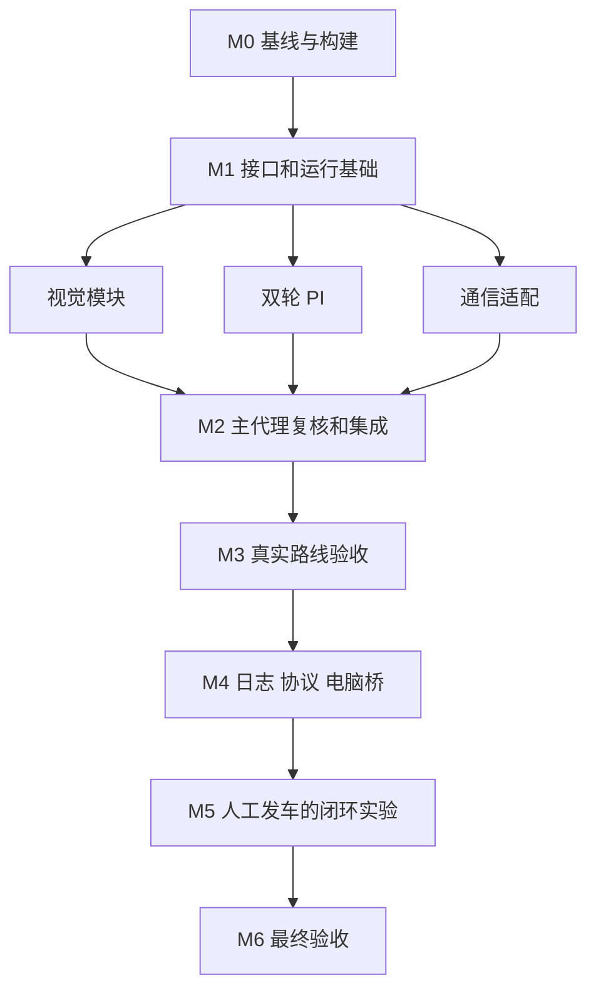

# 基础循迹与半自动调参里程碑

目标是在 2026 年 10 月 24 至 25 日中期检查前，稳定通过摄像头组 A 至 B 或 B 至 A 指定路线，并建立由人工确认发车的 agent 调参闭环。路线包含直道、R50 弯道和连续 S 弯，不经过环岛、十字，不放红砖，到达终点后可以人工截停。

## 当前阶段

- M0、M1、M2的软件已实现、复核和验收，完整Keil重构建0错误0警告；下一阶段为M3现场标定与受控实测。
- 用户确认本轮截至M2；M3计划2026年10月13日或14日实测，尚未完成，M4与M5实现尚未解锁。
- 用户确认昨天已在临时 Keil 工程完成 WIFI V2 通信修复；临时工程已清理。本次以已修复的V2实现为基础恢复当前工程注册，并在M2加入控制接口适配与运行有界收发。
- 实车为左右双驱电机加转向舵机，通信曾经验证，行车效果尚未验证。
- 工程入口为 `demo/mdk/rt1064.uvprojx`，公共库位于根目录 `libraries`；`20th_smart_vision` 仅作参考，不修改。

按功能的实现、review及43个函数索引见 [IMPLEMENTATION_REPORT.md](IMPLEMENTATION_REPORT.md)。任务状态以 [TODO.md](TODO.md) 为准；每次验收记录写入 [REVIEW_LOG.md](REVIEW_LOG.md)。下一轮先读这三份文件和根目录 `agent.md`，核对工作区差异，再领取依赖已满足的任务。

## 实施节奏

2026 年 10 月 12 日用户调整了排期：M0 至 M2 的软件工作连续推进，接口固定后并行实现，不再预留三天。随后把更多时间用于机械标定、单弯、连续 S 弯、完整路线及故障实测。M3 通过后立即推进 M4 软件；M5、M6 根据场地证据验收，不以日历到期代替完成。

| 里程碑 | 通过条件 | 后续依赖 |
| --- | --- | --- |
| M0 文档与构建基线 | 文档可接续；用户修改保留；当前工程完整构建；驱动唯一注册 | 解锁软件实现 |
| M1 控制接口与运行基础 | 单位及接口固定；上电停止；帧时间可靠；故障路径可检查 | 模块独立实现与集成 |
| M2 视觉与运动模块 | 软件验证及集成构建通过；最终差异已复核 | 提供受控实测版本 |
| M3 基础循迹实机验收 | 指定方向连续 3 次完成；关键停车保护实测；基线可恢复 | 解锁 M4 实现 |
| M4 调参工具的软件实现 | 模拟联调、完整构建、日志完整性和人工启动入口通过 | 解锁 M5 |
| M5 半自动闭环实机验收 | 基线、候选、重复试验、评价、保留或回退完整可复现 | 解锁最终版本验收 |
| M6 中期验收版本 | 最终固件和参数连续 5 次完成；证据及操作说明齐全 | 关闭本周目标 |

## 控制与视觉接口约定

- 相机保留 188×120、配置 50 FPS；实测帧率另记。速度控制固定 10 ms，单位为 `counts/10ms`，Ki 按秒积分，速度 D 固定 0。
- `VisionResult` 包含帧号、采集时间、边线和中线、逐行质量、像素误差、可信度及丢线结果。
- `ControlParams` 包含左右独立 PI/目标、速度斜坡、舵机 P/PD、控制带以及人工标定的执行器限制。
- `ControlSnapshot` 包含设备时间、样本号、参数版本、左右实测/目标/真实 PWM/积分、舵机、视觉年龄及故障。
- 公共操作提供读取参数、停止态整组应用、人工启动请求、停止、清故障、发布视觉和读取快照。非法值拒绝，不静默裁剪。
- 上电进入 READY、目标为零；TRACK 启动需要人工标定确认和连续 3 帧高可信图像。BENCH 是人工确认的架空轮试验，最长 8 秒。
- 默认控制带 80/85/90/95/100 行，权重 1/2/4/2/1；双边实测质量为 1，单边重建质量为 0.5，无效行不参与。
- 参考宽度必须由静止、居中直道图像标定。未标定时不允许单边宽度重建；连续重建最多 3 帧。
- 视觉有效需至少3行参与且可信度≥0.35；控制接收下限为0.3。启动需连续3帧≥0.6，运行低于0.6半速；持续失线或有效图像年龄超过 100 ms，由 10 ms 任务停车并锁存故障。
- 网络恢复和清故障都不自动行车。运行不图传、不长重连；SPI 等待须有截止时间，实际服务耗时由 M3/M5 测量。

## 半自动闭环约定

M3 之前只预留内部类型和采样钩子，不实施电脑桥、实验协议或完整日志。

- M4 实现车端 100 Hz 日志，4096 条×64 字节，停止后分块读取；容量不足的试验准备请求直接拒绝。
- Python 桥独占车端 TCP 8086，HTTP 只绑定 localhost；逐飞助手 V1 接 localhost 8087 查看转换出的数据。
- MANUAL 与 AGENT 模式仅在停车时切换。agent 提供状态、参数、准备、停止、恢复、取日志接口，不提供启动接口。
- 每次人工窗口显示参数差异、试验 ID、类型和时限，由操作者确认发车；桥每 100 ms 发送心跳，试验中 500 ms 失联停车。
- 行驶只发送 10 Hz 摘要，评分使用完整 100 Hz 原日志；停车后图传。默认速度试验 8 秒，循迹短段最多 30 秒。
- 每次只改一个参数组，同工况至少重复 2 次；日志不完整、参数版本不符或保护触发的试验不能用于证明改善。

## 分工与复核

主代理独占公共接口、主循环、中断入口、工程注册和三份任务文档。视觉代理修改视觉模块与回放验证；PI 代理修改速度模块；通信代理修改助手适配及本地 V2 驱动。最多同时运行主代理和三个子代理。

子代理提交实际差异和验证证据后进入待复核，主代理复跑必要检查并决定关闭或返工。主代理自己的关键控制与集成改动另交子代理作独立只读复核。需要现场证据的任务单列待实机，不以编译或回放替代。

## 基线与恢复

实施前基线位于 `evidence/M0/baseline_20261012`：`HEAD.zip` 保存初始无修改的仓库源码；独立 `rt1064.uvprojx/uvoptx` 保存用户实施前工程配置，另有差异和元数据。恢复时先检查后续用户修改，禁止整树覆盖；选择需要恢复的文件并保留当前副本。

不自动烧录或发车；软件版本通过后提供人工操作步骤。不得把未实测功能写成已经可用。代码注释、版权、原文件编码与换行遵循根目录 `agent.md`。

## 延期功能

完整八邻域、环岛/十字、推箱、三轮解算、电流环、IMU 转向闭环、高速优化和几何差速补偿不影响本周验收，另列后续任务。若实测失败，先排查机械转向、相机视野与帧龄、转向符号与饱和、轮速闭环，不直接扩大移植范围。

## 当前可用证据

最终固件、map、源码哈希清单、宿主测试、合成回放及独立review证据位于 `evidence/M2`；当前版本未烧录，硬件验收保持待完成。下一步按通信接入说明完成M3-01，回传实际参数与观察。

## 本轮报告与接口说明修订

M2-11至M2-13已完成：公共类型逐项中文注释、VS Code相对路径加#L行号索引、四张状态与多速率时序图、七类独立计时实测步骤及5/10/20ms选择条件。最终完整构建0错误0警告；类型声明、运行逻辑与10ms周期保持一致。下一轮按[实现报告的控制周期实测方案](IMPLEMENTATION_REPORT.md#控制周期的实测与调整路径)准备M3诊断与现场记录。诊断标记、真实仪器测量尚待实施，M4门槛保持不变。

M2-14已补充共用时间轴和10ms CPU窗口放大图，提供[离线交互图](visualizations/control_timeline.html)。图内区分已指定周期配置、软件预算、教学假设及推演；实际CPU占用、帧率和PWM波形仍待M3仪器验证。

M2-15已按用户确认的形式为18份本轮固件C/H补中文行级说明，根agent.md保存风格。21份源归档的有效代码/预处理指令一致检查、原编码/换行/版权检查、现有软件回归和独立review通过；最终Keil重构建0错误0警告，43函数索引及固件基线同步。证据与关闭记录见[实现报告](IMPLEMENTATION_REPORT.md#本轮行级中文注释及复核)和REVIEW_LOG的R009。当前48项任务为25已验收、1待实机、22待开始，下一步仍为M3现场数据。
