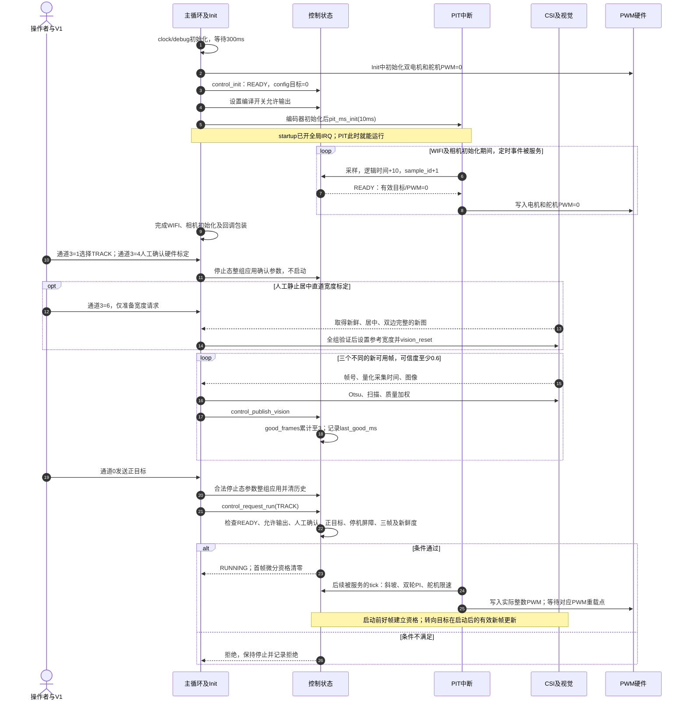
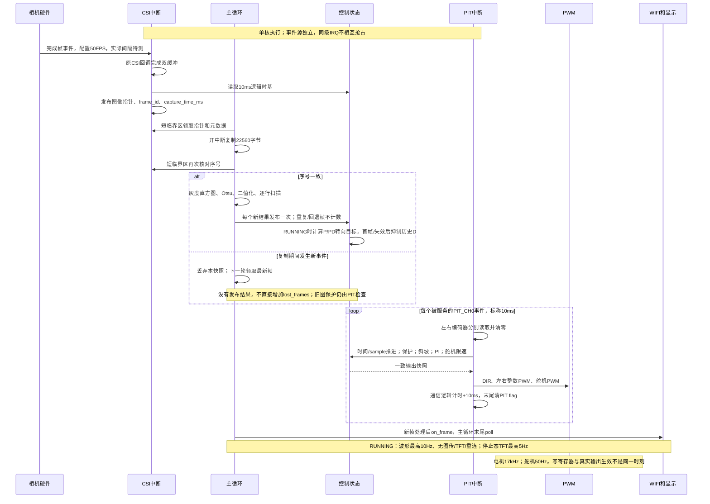
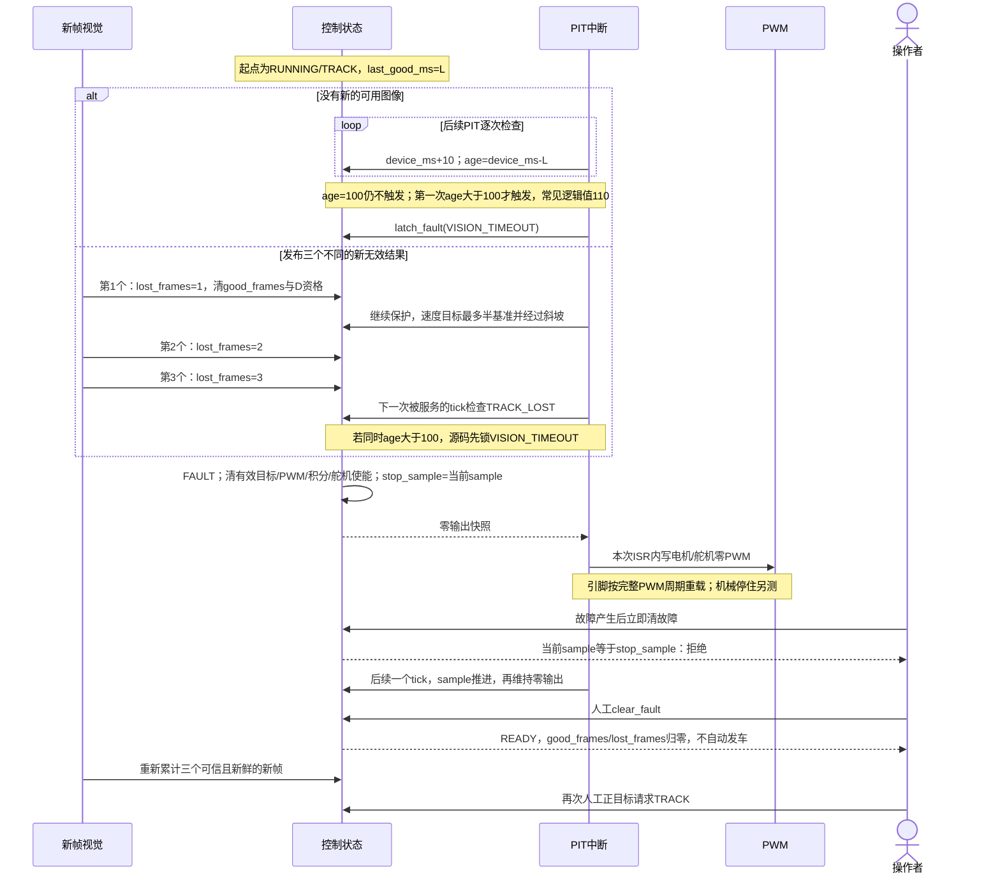
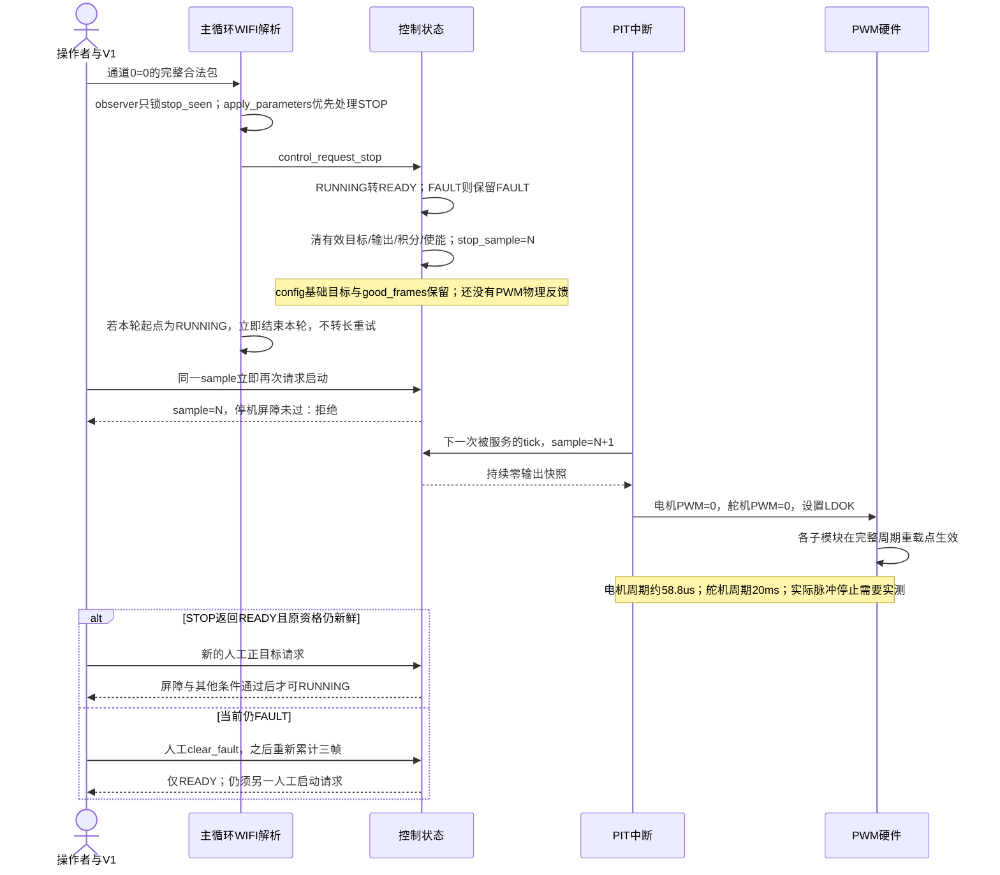

# M2-13 状态机、真实时序与控制周期实测工作稿

本稿依据当前实际源码只读核对。当前控制周期仍为 10 ms，没有修改 MCU 源、优先级、接口或参数，也没有烧录和实测。本轮可关闭的是时序分析与测试方案；以下现场门槛都是建议工程目标，不是已测结果、厂商指标或物理保证。M3 仍待现场证据，M4 尚未解锁。

## 1. 源码锚点与必须保留的区别

| 实际行为 | 源码位置 |
| --- | --- |
| PWM 先初始化为零；控制与编码器完成后立即启动 PIT，之后才初始化 WIFI/相机 | [main.c Init](../../../../user/src/main.c#L43) |
| 主循环先取得参数/宽度请求，再领取新帧、视觉、发布；停止态显示/图传，最后 poll | [main.c main](../../../../user/src/main.c#L101) |
| 编码器读取/清零 → control_tick → 快照 → DIR/PWM → 通信计时 → 最后清 PIT flag | [isr.c](../../../../user/src/isr.c#L58) |
| 人工启动、STOP、清故障及停机 sample 屏障 | [control.c](../../../../user/src/control.c#L213) |
| 发布新帧与 10 ms 保护/PI，逻辑时间逐次加 10 | [control_publish_vision](../../../../user/src/control.c#L279)、[control_tick](../../../../user/src/control.c#L337) |
| CSI 原回调成功后记录指针/帧号/逻辑采集时间；复制前后验证序号 | [camera_frame.c](../../../../user/src/camera_frame.c#L13) |
| 优先级只设分组 3，没有为 PIT/CSI 显式设置不同抢占优先级 | [interrupt_init](../../../../../libraries/zf_common/zf_common_interrupt.c#L114) |
| PWM 使用完整周期重载，写入 LDOK 后等待重载点 | [pwm_set_duty](../../../../../libraries/zf_driver/zf_driver_pwm.c#L98)、[pwm_init](../../../../../libraries/zf_driver/zf_driver_pwm.c#L157) |

- 上电的控制构造直接设置 READY 或 FAULT；图中的初始化阶段是启动过程，不代表源码有持续调度的 INIT 状态任务。
- 实际注册的 startup_MIMXRT1064.S 在进入 main 前已经 cpsie i。pit_init 启动计时器并 EnableIRQ，因此 PIT 在 WIFI/相机初始化等待期间就可能被服务。main 末尾 interrupt_global_enable(0) 不是首次开启控制周期。
- STOP 清的是快照中的有效目标、PWM、积分、速度历史和舵机使能；config.target_left/right 基础目标保留。STOP 本身不清 good_frames。再次启动必须人工请求、跨过停机屏障，并且原三帧资格仍有效且新鲜；不能写成每次 STOP 都强制重新积累三帧。
- clear_fault 清 good_frames/lost_frames，返回 READY，不启动；之后 TRACK 必须重新得到三帧可信度至少 0.6 的新结果，再人工请求。
- 软件 STOP 不代表车轮瞬间静止，也不代表舵机物理回中：servo_cmd 清成中位，但 servo_enabled=0，实际输出是无舵机脉冲。

## 2. 中断优先级与时间来源

当前 NVIC 实现 4 个优先级位；PRIGROUP=3 对应 4 位抢占优先级、0 位子优先级。应用和已用 PIT/CSI 初始化没有为两者调用 SetPriority。按正常复位默认值推定，两者均为优先级 0；这是源码推定，现场须回读 NVIC_GetPriority(PIT_IRQn)、NVIC_GetPriority(CSI_IRQn)、NVIC_GetPriorityGrouping() 和 PRIMASK，不能声称已测。

两者若同级，不能相互抢占；若同时待处理，同优先级仲裁中 CSI_IRQn=43 先于 PIT_IRQn=122。短 PRIMASK 临界区也会延后可屏蔽中断。因此不能画成“PIT 一定抢占 CSI”，也不能只看主循环 WIFI 的 2 ms 截止检查就证明控制周期恒定。

| 时间量 | 当前来源 | 能说明什么 | 不能说明什么 |
| --- | --- | --- | --- |
| device_ms / control_now_ms | 每次被服务的 control_tick 加 10 | 控制逻辑时间与无符号差值 | 不等于独立墙钟；丢服务时不会补计漏掉的周期 |
| sample_id | 每次 control_tick 加 1 | 服务次数、停机屏障 | 不能由相邻 sample_id 推断真实间隔 |
| capture_time_ms | CSI 包装回调成功后读取 device_ms | 对应完成事件的 10 ms 量化时间 | 不是曝光起始时间；还包含 IRQ 服务/回调延迟影响 |
| vision_age_ms | device_ms - last_good_ms | 最近可用结果采集时间的逻辑年龄 | 不是最近任意帧的年龄，也不是独立计时的处理延迟 |
| WIFI runtime_last/max_us | DWT CYCCNT / system_clock | 运行服务轮次耗时，包含中断抢占 | 不能代替 PIT 周期、整个主循环或真实网络端到端时延 |
| 现场真实时间 | 示波器/逻辑分析仪；或经校验的 DWT/GPT free-running | ISR 间隔、执行、响应、帧间隔 | 当前没有采集这类现场证据 |

PIT 来源为 CLOCK_GetFreq(kCLOCK_PerClk)；pit_ms_init 计算周期计数，SDK 写 LDVAL=count-1。当前板时钟配置声明 PERCLK 75 MHz，对应 10 ms 约 750000 个计数；现场记录实际 CLOCK_GetFreq、LDVAL/CVAL 与独立波形，不仅引用配置值。

PIT flag 在 ISR 末尾清零。若服务被长时间阻塞或 ISR 跨过下一周期，多个定时事件可能合并，末尾清标志也可能清掉期间的新事件。device_ms 与 sample_id 都不能证明没有漏周期。应先测量，再决定是否改清旗位置/优先级；本稿没有实施这些修改。

## 3. 上电、资格与人工 TRACK 启动

宽度标定与人工硬件确认是不同操作；当前启动 API 不把“参考宽度非零”作为额外硬门槛。未标定仍可使用双边实测，但不允许单边重建。TRACK 启动还要求电机与舵机允许输出；BENCH 不依赖视觉，最长 8 秒逻辑时间并自动停止。

## 4. 多速率调度与帧事件

速度采样/PI 标称 100 Hz，摄像头配置 50 FPS，运行遥测最高 10 Hz，停车 TFT 最高 5 Hz。它们不是四个严格同步的硬件任务。主循环被停车图传、显示或连接阻塞时，PIT 仍应被服务，但必须用独立仪器验证中断屏蔽/竞争造成的延迟。

## 5. 旧图、三帧丢线与故障锁存

三帧指三个实际发布的新无效结果，不是三个 PIT，不是固定 30 ms，也不是“相机少了三个物理帧”。按真实 50 FPS 且每帧及时处理估算，从首个无效结果到第三个约 40 ms，再等待控制检查；从上个好帧到第三个通常约 60 ms，但这不是当前实测值。

重建最多三个新帧与三帧丢线是两条规则：被标定宽度重建且仍可用的结果会更新 last_good_ms；超过重建许可导致结果无效后，才进入 lost_frames 累计。两边全失效不享有重建许可。少数行重建到期也不必然使整体无效，仍取决于控制带有效行和质量。

## 6. 人工 STOP、停机屏障与物理 PWM

STOP 从“车端 API 已接受”到“寄存器写零”通常要等 0～一个控制周期及 ISR 输出段；这不是从电脑点击起算的网络端到端上界。17 kHz 电机完整周期约 58.8 μs，50 Hz 舵机完整周期 20 ms；不能把下个 PIT 写零直接解释为两个引脚在 10 ms 内都已停止脉冲。

在 PIT 内产生故障时，sample_id 已先加 1，latch_fault 记录这个新值：虽然本次 ISR 就写零，clear_fault 仍须再等一个后续 tick。主循环 STOP/LINK 故障则在下一 tick 跨过屏障。屏障证明控制服务次数，不证明实际轮速、驱动板制动模式或物理舵机位置。

## 7. 可交给操作者的 10 ms 实测表

先保留当前固件/参数基线。测量前由主代理准备并复核独立“只加标记”的诊断版本：经原理图确认未占用的 GPIO 标记 ISR 入口/出口、STOP 被接受、CSI 完成、视觉发布，或使用独立 free-running GPT/DWT。当前正式源码还没有这些标记；不要把计划写成已实现。ISR 内不 printf、不发 WIFI。运行 10 Hz 波形只作观察，不能用它评估 100 Hz 的周期/阶跃指标。

建议逻辑分析仪以至少 10 MS/s 采 GPIO/PWM/编码器；若要直接解码 20 MHz SPI，改用至少 100 MS/s 的仪器。DWT 在 600 MHz 下 32 位约 7.16 s 回绕，8 s BENCH/60 s 记录必须用连续差值累加，或用经示波器校验的 1 MHz free-running GPT；不能拿两个 DWT 起止读数直接当长时间差。

| 项目 | 仪器与接线 | 工况与操作 | 必须记录的指标 | 建议工程目标，待实测判定 |
| --- | --- | --- | --- | --- |
| 实际 PIT 间隔及漏服务 | PIT 入口标记＋逻辑分析仪；DWT/GPT交叉验证；读 NVIC/AIRCR/PRIMASK | READY 网络/图传、受控TRACK分别采至少60s；BENCH保持每次≤8s、人工多次启动累计60s，运行与停止段分别统计；覆盖CSI到帧、波形发送、停止后恢复 | 入口间隔 min/mean/p99/p99.9/max、累计次数、接近20ms等长间隔、优先级回读值 | 稳态平均10ms误差≤0.5%；p99.9偏差≤0.1ms，最差≤0.5ms；不出现漏周期。超出先定位屏蔽/CSI/主循环，不直接改周期 |
| ISR 执行与阻塞 | ISR入口/出口标记；CSI独立标记；DWT记录短区间 | 同上，加相机持续采集和正常收发；另记录主循环短临界区 | ISR脉宽、最长不可抢占段、CSI占用、入口延迟 | ISR p99≤0.3ms、最差≤1ms；绝不跨10ms周期。门槛为建议预算，非芯片性能保证 |
| STOP 响应和停机屏障 | STOP接受标记、PIT标记、左右PWM和舵机PWM；编码器记录机械停住 | BENCH小目标；在PIT不同相位发STOP，重复至少20次；随后故障/清故障/重启分步骤观察 | 接受→ISR写零、接受→最后PWM脉冲；逻辑READY/FAULT；立即重启拒绝；后续tick屏障；最后轮脉冲时间 | 健康调度目标：电机最后脉冲≤12ms、舵机≤32ms，分别覆盖周期抖动/ISR/重载。电脑发送→接受单独测；无同步触发不能混算。机械停距/时间按实车记录，另定门槛 |
| 相机时序及图像年龄 | VSYNC/CSI标记、视觉发布标记、PIT标记；GPT/DWT；LED可作同一仪器可见场景变化 | 静态直道、弯道、正常WIFI、局部阴影；再分别停止新帧和给三个无效新帧 | 真实采集完成间隔、完成→发布延迟、帧号缺口、真实年龄与逻辑年龄差、保护→PWM停止 | 配置50FPS先核对实测约20ms；建议完成→发布p99≤20ms、常态真实年龄p99≤40ms；逻辑年龄大于100ms不得可用，真实年龄差单独记录，不能把逻辑门槛当物理100ms保证。无新好图的保护约100～110ms加服务/重载，必须与独立仪器比较，不能只看逻辑110 |
| 编码器量化与偏置 | 手动一轮整圈/脉冲源；实际A/B波形＋PIT标记；必要时测速仪 | 手动前进/反转确认符号；每轮至少3圈计数标定；架空5/10/20 counts/10ms，分轮观察 | 每圈有效计数/倍率、10ms窗口整数分布、左右读取偏移、采样边界脉冲、累计计数与参考脉冲数 | 方向不得反；整圈计数重复误差建议≤1%；一个计数对应100counts/s，目标5/30时单计数量化分别20%/3.33%。低速抖动先归因量化，不用大增益掩盖 |
| 速度输入与闭环响应 | 实际编码器脉冲、PWM、PIT标记；10Hz波形辅助；每次人工BENCH最长8s | 每次从停止人工启动5/10/20等小目标，同工况至少2次。当前运行禁止改参；默认50单位/s斜坡必须记录 | 基础目标与实际斜坡目标、上升/稳定时间、稳态均值/误差、超调、左右差、饱和比例、停止积分复位 | 基线Kp50/Ki0只测不预称达标。调好后建议超调≤15%、稳定误差≤max(1count/10ms,目标5%)、实际目标到位后0.5s内稳定。默认斜坡不是理想阶跃；若需阶跃，先独立冻结斜坡设置并复核，再只改一个PI参数组 |
| 转向目标及真实舵机脉冲 | 舵机PWM＋PIT/视觉标记；前轮角标尺和120/240FPS视频；确认机械限位 | 架空受控TRACK小目标，人工改变静态轨迹横向位置；随后实地低速R50。BENCH仅保持中位，不能用于视觉转向响应测试 | 误差符号、发布→脉宽变化、命令角与实际轮角映射、触限、左右R50半径、首帧D抑制 | 软件命令每10ms变化≤0.6命令度；50Hz脉冲可每20ms体现约1.2命令度，不能套用0.6/物理帧。不得机械越限；实测最小转弯半径须≤50cm。前轮角/响应时间由视频标定，命令角不等于轮角 |

“半速”是基础目标乘因子后的目标上限；当前有效目标还经过50单位/s斜坡，实际PWM和轮速不会瞬间减半。保护/STOP直接清零不经斜坡。操作者记录“电气零输出”与“车身停止”两个不同事件。

每组记录：固件/诊断版哈希、参数版本、编译开关、周期/时钟/优先级回读、探头标记说明、采样率、台架或赛道、路向、光照/电池、原始波形/视频、指标及异常。仪器原始数据保留，失败样本不删除。各项仍属于待实机，不因本稿或软件模拟通过而关闭。

## 8. 如果以后考虑 5/20 ms，必须联动的事项

当前保持 CONTROL_PERIOD_MS=10 和 control_tick(int16_t, int16_t) ABI。没有实测瓶颈或控制需求，不改周期；先修真正的阻塞/漏服务和调参问题。

1. 保留目标、Kp 误差和斜坡参数的规范单位 counts/10ms。新采样窗口真实时长为Δt时，内部浮点测量为 v10=(float)ΔN×0.010/Δt秒。5ms一计数为2单位；20ms一计数为0.5单位，实际抖动也会得到非整数。不得强转int16、四舍五入后冒充原单位。
2. 当前快照 measured_left/right 为int16的10ms原始计数。若未来改变采样窗口，原字段无法精确表示归一化的0.5等值：必须先设计版本化的“原始计数＋实际Δt＋浮点归一化速度”合同，或保留独立10ms测量窗口。推荐获授权后版本化增加归一化浮点字段；当前不偷偷改变ABI或遥测语义。
3. Ki继续按秒：积分贡献增量为Ki×error×Δt秒；斜坡为accel_counts_per_s×Δt秒；舵机限速为servo_rate_deg_s×Δt秒。改变周期不是把Ki机械乘2/除2；Kp若保持规范误差单位也不机械缩放。完成采样变化验证后，才单独重新调PI。
4. PIT实际周期、CONTROL_PERIOD_MS、device_ms推进、通信tick、BENCH时限、100ms保护、参数生效时间、帧时间与测试期望必须一起审核。最好用独立单调硬件时钟计算真实时限，不能只改PIT寄存器让逻辑仍每次加10。
5. 新帧PD仍按真实采集间隔；相机50FPS不因控制5ms自动变100/200FPS。三帧资格/丢线仍按新帧，不能改成三控制周期；舵机物理50Hz和电机17kHz也不会因PIT周期改变。
6. 5ms更容易出现低速量化与重复视觉信息；20ms增加执行器响应延迟。若采用多速率速度估计，必须明确持有上一测量、滤波延迟与快照所报速度，不把旧值当新采样。
7. 先冻结当前10ms基线；仅改变采样周期及其必要单位适配，复跑同一仪器工况；通过后再一次只调一个增益组。周期、PI增益、速度、前瞻和机械参数不能同轮一起改变。
8. 所有宿主边界/状态测试、Keil完整构建、GPIO时序、故障电气响应、架空阶跃与低速R50回归都通过，主代理review后才允许替换现场版本。M4完整日志/桥仍按里程碑门槛实施，不能把测量探头方案描述成M4已建成。

建议测试路线：保持10ms → 标记诊断版本复核 → 回读优先级/时钟 → READY时序 → 架空BENCH及STOP → 受控TRACK视觉/旧图/丢线 → 地面低速R50。确认真正问题来源后，再决定是否需要改变周期。
