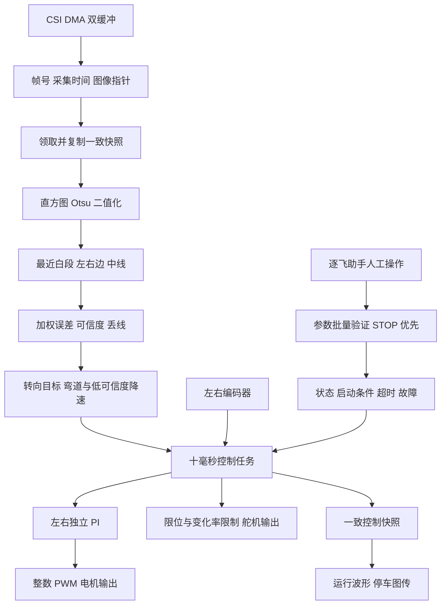
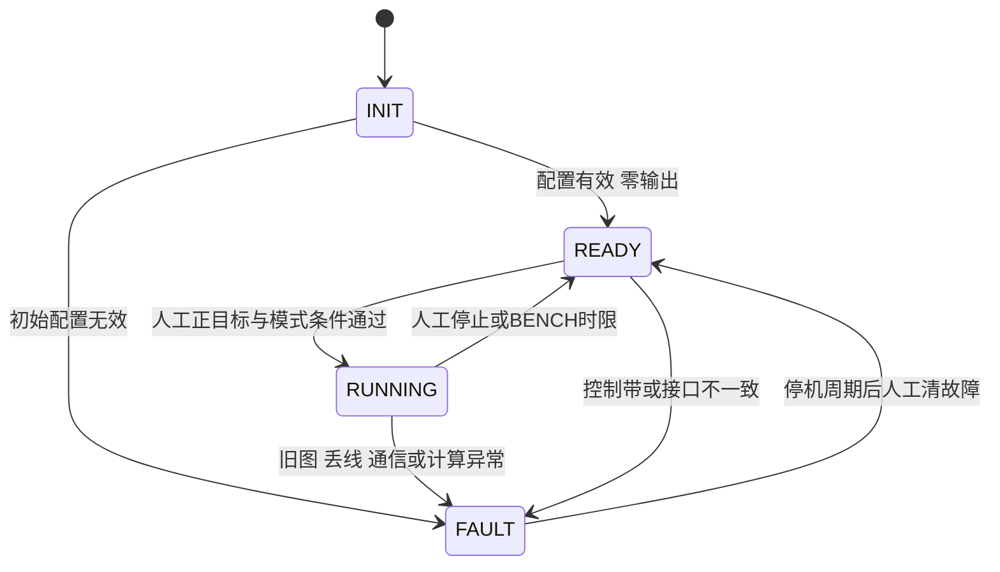
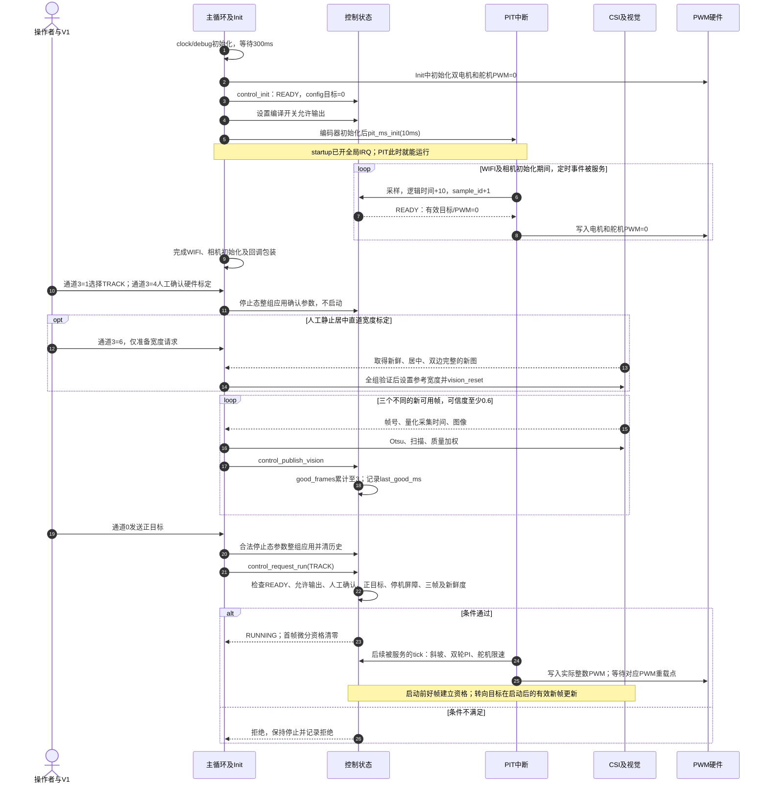
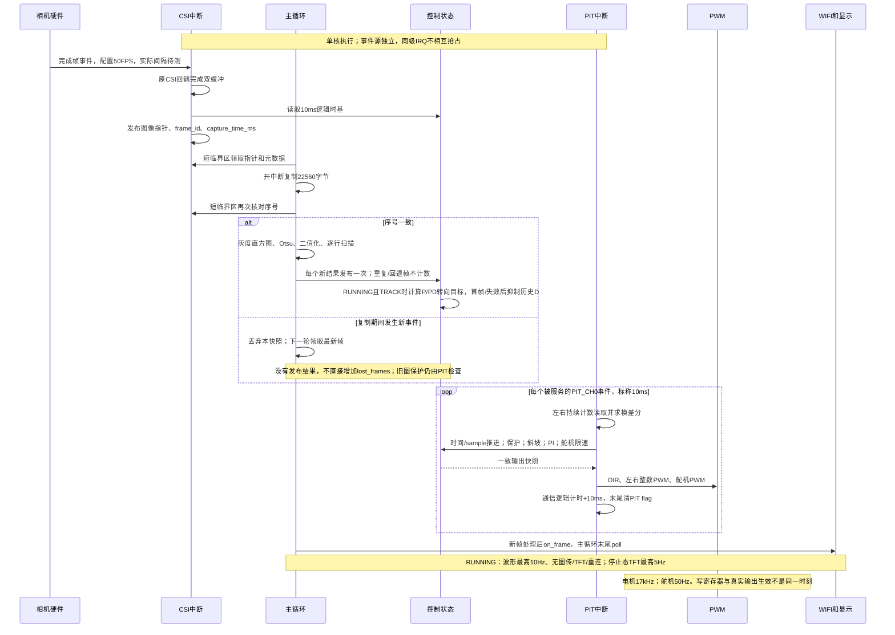
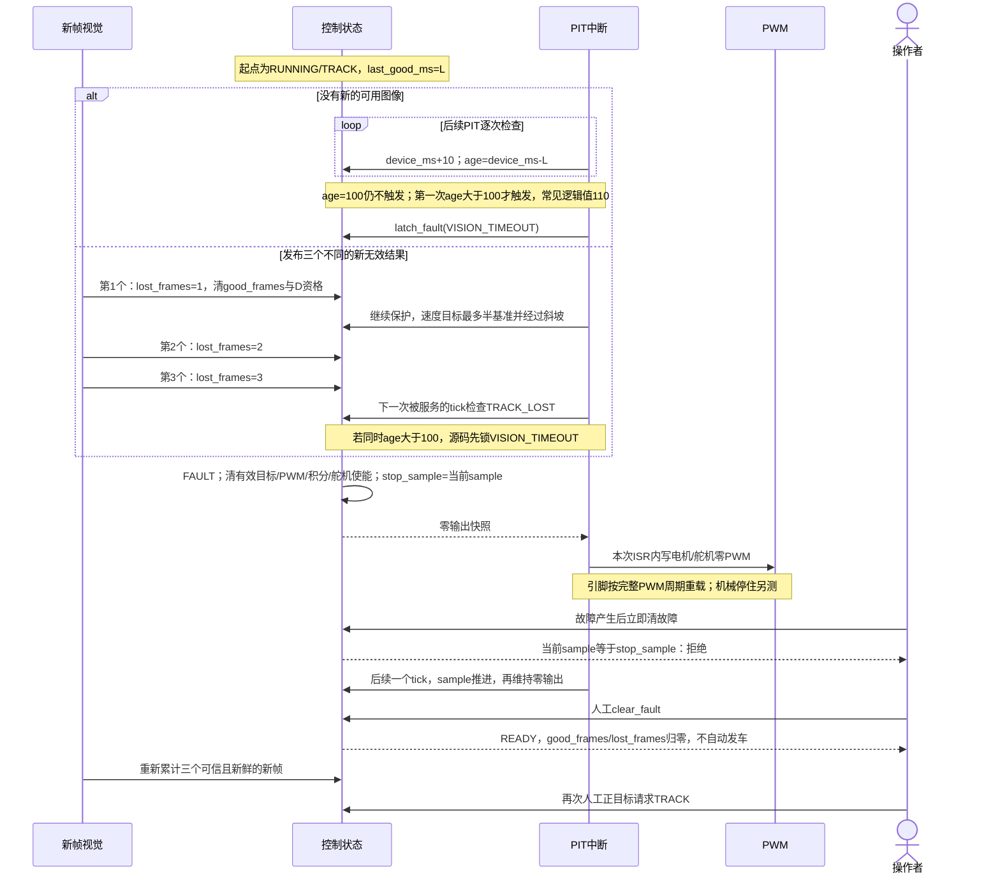

# 基础循迹软件实现与复核报告

本报告记录 M0 至 M2 基线及2026年10月13日补充的M3舵机/编码器标定软件，按照总体架构、运行基础、视觉、运动控制、通信及标定展开，并提供仓库代码索引和可复跑的验证证据。软件已经实现上电停止、人工启动、加权视觉循迹、双轮 PI、有界通信及故障锁存。当前尚未烧录这套最终固件，真实无线兼容、机械标定、R50 行驶和完整路线仍需M3实测；用户安排在2026年10月13日或14日进行，本轮补齐M3本地标定准备软件；真实测量仍待操作者执行。

M4 的电脑桥、实验协议、连续 100 Hz 完整日志及自动评价尚未实现；它们严格依赖 M3 连续三次路线验收。当前 10 Hz 波形仅供人工观察；新增1024×32字节单次M3诊断记录用于本地标定，不是M4完整实验日志。操作步骤见[标定操作说明](CALIBRATION_GUIDE.md)。范围和任务状态分别见 [MILESTONES.md](MILESTONES.md) 与 [TODO.md](TODO.md)。

## 阅读顺序与索引使用

历史M2-16文档修订以R009冻结固件为基线；当前M3软件采用本轮三目标冻结构建与新验证证据，历史M2固件和报告快照继续保留。

本报告以当前demo源码和已冻结固件为依据，参考解析提供拆解方式；各章的算法与参数按本车实际实现说明。源码事实、配置数值、教学算例和待实测项分别标明。读者可先顺着前三章建立调用图，再读视觉/PI/舵机与通信，最后按现场门槛验证。

- [总体架构与数据流](#guide-architecture)
- [工程接入与可恢复基线](#guide-project)
- [初始化、主循环与反馈采样](#guide-runtime)
- [公共接口与参数一致性](#guide-interfaces)
- [启动 停止和故障保护](#guide-state)
- [运行状态与多速率时序](#guide-timing)
- [M3舵机与编码器运行态标定](#guide-calibration-m3)
- [相机快照与帧新鲜度](#guide-camera)
- [灰度处理与视觉循迹](#guide-vision)
- [双轮速度 PI](#guide-pi)
- [舵机控制与降速](#guide-steering)
- [V1人工参数与有界 WIFI](#guide-wifi)
- [停车显示与图像调试](#guide-display)
- [静止直道标定](#guide-calibration)
- [软件验证与最终构建](#guide-validation)
- [Review发现及关闭情况](#guide-review)
- [本轮行级中文注释及复核](#guide-comments)
- [按功能的仓库代码索引](#guide-index)
- [控制周期的实测与调整路径](#guide-period)
- [下一阶段的实测证据](#guide-next)

每个功能章提供关键函数的**实际定义**索引，显示函数名和行号；调用链中的同名接口可以据此逐层进入。在VS Code Markdown编辑区Ctrl+单击，在内置预览直接点击相对路径加#L行号链接。报告应保留在demo/docs目录，并与同级libraries保持布局；代码调整后运行tools/update_report_index.py同时刷新章内入口和末尾总表，避免只更新总表而正文行号过期。

<a id="guide-architecture"></a>

## 总体架构与数据流

当前工程是RT1064裸机程序。完整循迹链为：**相机采集 → 一致灰度快照 → Otsu二值化 → 逐行白段与质量 → 五行加权误差 → 新帧P/PD转向目标 → PIT限速与PWM；双轮编码器 → 独立速度PI → 电机PWM → 轮速反馈。** 视觉观察车辆相对赛道的位置，编码器闭合左右轮速度；软件没有前轮转角传感器，因此servo_cmd是命令刻度，实际轮角和R50能力需机械标定。

### 与参考解析的对应关系

本报告借鉴[参考工程的完整闭环代码解析](../../20th_smart_vision/docs/完整闭环代码解析.md)的阅读层次：先看调用入口和数据流，再看关键函数、公式、反馈、失败分支及验证边界。参考车为三轮全向底盘；当前车为双驱动轮加转向舵机，不能按参考的轮速逆解算解释本车。

| 功能层 | 当前实际实现 | 阅读时应区分 |
| --- | --- | --- |
| 调度 | main、CSI、PIT_CH0三种入口 | 主循环按新帧执行；PIT配置10ms；相机和PWM各自运行 |
| 普通赛道视觉 | 最近白段、逐行中点、质量加权控制带 | 使用188×120图像，未启用八邻域、最长白列或特殊元素状态机 |
| 转向 | control_publish_vision计算P/PD目标；control_tick限制命令变化率 | 图像误差单位像素，输出是舵机命令度，无IMU角速度阻尼 |
| 驱动 | 左右独立基础目标与PI（当前V1共用目标） | 无三轮运动学、无电流PI；左右反馈不能混用 |
| 操作与调试 | V1人工参数、10Hz波形、停车图传/标定 | 当前不是M4的实验协议、电脑桥或完整100Hz日志 |

下图保留总体连接关系，具体调用顺序见下方三条链和各功能章节。



### 实际调用链：入口与交接点

```text
采集事件：
CSI_IRQHandler()
  → CSI_DriverIRQHandler() → CSI_TransferHandleIRQ()
  → frame_callback() → 原mt9v03x_finished_callback()
  → 完成图指针 + capture_time_ms + frame_sequence

主循环每次迭代：
calibration_debug_poll(GPT) → control_get_params() → 必要时vision_set_control_band()
  → 领取非独占时的人工宽度请求 → [诊断标记] TFT小色块
  → camera_frame_take()
  → [有新快照] capture_raw → histogram → Otsu → binary → vision_process
  → control_publish_vision() → control_get_snapshot()
  → [有人工请求] calibrate_width()
  → [停止且到期] TFT显示 → wifi_assistant_on_frame()
  → [超时] 取消宽度请求 → wifi_assistant_poll()

PIT_CH0每次被服务：
GPT时间 + encoder_get_count(左、右持续计数)
  → encoder_measurement_sample() → calibration_debug_before_tick()
  → control_tick()
  → 保护/停机 → 降速目标 → 目标斜坡 → 两个PidLocCtrl()
  → 舵机变化率限制 → control_get_snapshot()
  → 前进DIR → 左右pwm_set_duty() → 舵机pwm_set_duty()
  → calibration_debug_after_tick() → wifi_assistant_tick(10) → 清PIT事件位
```

### 主要数据由谁写、由谁读

| 数据/状态 | 写入位置 | 消费位置 | 含义及所有权 |
| --- | --- | --- | --- |
| mt9v03x_image | 原相机完成回调 | 包装回调记录地址，main复制 | 当前完成缓冲指针，后续可被采集复用 |
| frame_sequence/captured_ms/completed_image | camera_frame的CSI包装回调 | camera_frame_take短锁领取 | 三项对应同一个发布事件；时间来自设备逻辑时钟 |
| main.image / hist_gram | camera_frame_take、灰度处理函数 | vision_process；停车图传先复制 | main自有快照22560字节，原地灰度→二值，不在DMA原图上计算 |
| VisionResult | vision_process；main补threshold | control_publish_vision、宽度标定、边线图传 | 每行证据和整体置信度；无效占位中点不能驱动转向 |
| config（ControlParams） | control_init / 停止态control_apply_params | control_tick、主循环配置视觉控制带 | 基础目标与保护配置，不被斜坡结果反写 |
| steering_target | 有效RUNNING/TRACK新帧发布 | control_tick | 已按配置限位的转向目标，和限速后servo_cmd不同 |
| speed_pid_l/r | 控制层初始化/复位与各轮PidLocCtrl | 控制快照、下一周期PI | 两轮历史独立，I项保存PWM输出贡献 |
| current（ControlSnapshot） | control_tick及控制操作/视觉发布 | PIT硬件写出、main、WIFI | 原子复制可保证字段读取一致，但不是所有字段都在同一物理时刻产生 |

### 本章代码索引

| 阅读顺序 | 实际入口 | 阅读目的 |
| --- | --- | --- |
| 1 | [main（第 134 行）](../user/src/main.c#L134)、[Init（第 43 行）](../user/src/main.c#L43) | 先找到初始化和主循环，观察main如何交接各模块 |
| 2 | [CSI_IRQHandler（第 48 行）](../user/src/isr.c#L48)、[PIT_IRQHandler（第 61 行）](../user/src/isr.c#L61) | 区分采集事件与固定控制入口 |
| 3 | [camera_frame_take（第 57 行）](../user/src/camera_frame.c#L57)、[vision_process（第 156 行）](../user/src/img_process.c#L156) | 追到图像与视觉结果的生成 |
| 4 | [control_publish_vision（第 529 行）](../user/src/control.c#L529)、[control_tick（第 593 行）](../user/src/control.c#L593) | 追到视觉外环和双轮速度内环 |
| 5 | [wifi_assistant_poll（第 410 行）](../user/src/wifi_assistant.c#L410) | 最后看人工请求和调试数据如何进入/离开车辆 |

接口结构定义见[control_types.h](../user/inc/control_types.h#L1)。每个功能章下面都有就近函数索引；末尾全局查找表汇总这些入口。

<a id="guide-project"></a>

## 工程接入与可恢复基线

### 哪些目录决定当前运行代码

| 目录/文件 | 实际职责 | 核对方式 |
| --- | --- | --- |
| [user/src](../user/src)、[user/inc](../user/inc) | 主循环、中断、控制、相机快照、视觉、PI与WIFI应用 | 从main/isr追真实调用；头文件固定单位与硬件宏 |
| [drivers/wifi_spi_v2](../drivers/wifi_spi_v2) | 本地WIFI6B21-SPI V2驱动 | uvprojx唯一登记本地C源，包含目录优先于根库旧头 |
| [mdk/rt1064.uvprojx](../mdk/rt1064.uvprojx) | 文件组、器件、编译与链接目标 | 当前目标nor_sdram_zf_dtcm；不使用已经清理的临时工程 |
| [mdk/scf](../mdk/scf) | Flash/SDRAM/DTCM链接布局 | 最终map检查真实段和资源；不能仅凭目录名推断变量落位 |
| [同级libraries](../../libraries) | 逐飞外设、MT9V03X、组件、NXP SDK及启动 | demo必须与当前同级库配套；参考工程自己的库不参与当前编译 |
| [tools](../tools)与[evidence/M2](evidence/M2) | 宿主验证、图像回放、索引生成和最终证据 | 工具验证的是同一源文件的软件路径，不能替代实机 |

本轮工程恢复登记了control.c、camera_frame.c与本地V2；旧WIFI同名C不重复编译。本地V2应用保持“检查模块 → 单独连热点 → 建Socket”的步骤。用户昨天成功的临时Keil工程已清理，不能将那次实测直接归给当前AXF。

共享库的seekfree_assistant.c/.h本次包含接收复位、合法包observer、剩余容量读取和异常计数。复制demo到另一位置时须同时保留这套同级libraries；只带应用目录会缺失本次通信保护改动。uvoptx与M0用户原件逐字节相同，其他用户配置保留。

### 怎样恢复及核对同一版本

实施前原件保存在[evidence/M0/baseline_20261012](evidence/M0/baseline_20261012)。最终[源清单](evidence/M2/source_manifest.json)登记22项源码/工程哈希；[固件](evidence/M2/firmware.axf)、[map](evidence/M2/firmware.map)、[完整构建日志](evidence/M0/keil_rebuild.log)相互核对。R007/R009前版本分别保存在revisions目录，恢复时应按同一清单取成套源码/公共库与工程配置，再完整重编译，不能混搭旧AXF与新参数说明。

程序调用了flash_init，但当前ControlParams与reference_width仍只在RAM中维护。没有从Flash装载/保存控制参数的业务链，也没有M4的恢复基线网络接口；掉电后需重新人工确认和宽度标定。

### 本章代码索引

| 关键入口 | 作用 |
| --- | --- |
| [Init（第 43 行）](../user/src/main.c#L43) | 看注册后的模块是否实际初始化 |
| [wifi_assistant_init（第 322 行）](../user/src/wifi_assistant.c#L322)、[wifi_spi_init（第 963 行）](../drivers/wifi_spi_v2/zf_device_wifi_spi.c#L963) | 区分应用接入与底层模块配置 |
| [seekfree_assistant_receive_reset（第 493 行）](../../libraries/zf_components/seekfree_assistant.c#L493) | 共享库必须随当前版本交付的接收改动 |

<a id="guide-runtime"></a>

## 初始化、主循环与反馈采样

### 上电按什么顺序建立运行基础

main先调用clock_init(SYSTEM_CLOCK_600M)、debug_init，等待300ms后进入Init。这里的600MHz与等待值为代码配置；整车响应与真实周期不能由主频推断。

| Init步骤 | 关键调用与参数 | 建立的状态/硬件条件 |
| --- | --- | --- |
| 1. 先零输出 | 双电机pwm_init(...,17000,0)、方向GPIO；舵机pwm_init(...,50,0) | 硬件PWM先以0命令初始化；舵机此时也不输出中位脉宽 |
| 2. 安装同步 | control_set_critical_hooks(interrupt_global_disable,interrupt_global_enable) | 主循环控制操作能保存/恢复PRIMASK，避免PIT观察到半更新结构 |
| 3. 控制初始化 | control_init(92.5,85,100,SERVO_DIR)，再设置编译许可 | 参数目标为0，配置有效即READY；许可不是RUN请求 |
| 4. 采样与调度 | 两次encoder_quad_init，再pit_ms_init(PIT_CH0,10) | 此时反馈计数器和控制器已经就绪，才开放周期任务 |
| 5. 前台外设 | flash_init、tft180_init、wifi_assistant_init | 初始化/联网等待在main内，不在PIT中执行 |
| 6. 图像入口 | mt9v03x_init失败则等待1000ms重试；成功后camera_frame_install、vision_reset | 安装双缓冲包装回调，清视觉跨帧历史，仍保持停止 |

startup在进入main前已开启全局IRQ；PIT初始化后就可能在WIFI和相机等待期间服务，持续写出零命令。main末尾的interrupt_global_enable(0)确认主循环中断开放，不是首次启用PIT。相机一直初始化失败时main不能进入常规poll，但已建立的控制任务保持停止；WIFI初始化失败会记录错误状态，返回后主循环允许停车重连。

### 一次主循环迭代如何消费数据

每轮先执行calibration_debug_poll处理完整标定命令；诊断RPM色块为新帧处理之前的独立小绘制，不受普通停车显示门控。

1. **安装当前控制带。** control_get_params同时取得整组参数和version。与band_version不同才调用vision_set_control_band；成功才推进band_version，失败走control_report_invalid_fault。参数的控制版本和视觉内部安装版本各有用途。
2. **领取人工请求。** wifi_assistant_take_width_calibration_request复制并消费一次性请求，main只登记pending和起始逻辑时间，不在这里发车。
3. **领取新快照。** camera_frame_take返回1才进入图像链；返回0时main不重新发布旧图，PIT继续独立检查视觉年龄。
4. **灰度到控制目标。** 二值化前保存允许发送的原灰度副本，然后统计直方图、求Otsu、原地二值化、vision_process；main补vision.threshold，再control_publish_vision。转向目标在这里更新，速度PI与真正硬件写出在PIT。
5. **处理停车辅助功能。** 取一致快照后尝试一次宽度标定；仅非RUNNING且显示间隔≥200逻辑ms时刷新TFT。wifi_assistant_on_frame内部检查状态和图传周期，边线另传，不涂改算法输入图。
6. **主循环末尾收发。** 宽度pending持续没有新帧且超过1000逻辑ms则取消；最后wifi_assistant_poll接收人工请求并发送快照。某轮poll产生的宽度请求通常在下一轮领取。

main把视觉放在显示/网络之前，但没有为各工作分配固定的CPU时间片。停车时整图发送、屏幕和重连仍可能拉长一次主循环；运行路径关闭这些工作并使用SPI截止检查。实际帧龄、最坏耗时和中断抖动仍需仪器确认。

### 10ms采样怎样成为轮速反馈

PIT_CH0是硬件计数唯一采样者：读取持续16位计数，以模65536差分获得增量，再按ENCODER_1_SIGN/ENCODER_2_SIGN校正。左侧配置-1、右侧+1，前进为正仍须实测。encoder_clear_count仅在Init清一次；运行中不再读后清零，避免两步之间到达的脉冲丢失。歧义半环差分拒绝，要求每窗口实际增量绝对值小于32768。

读取不是累计里程：正常10ms服务时，增量12就表示12 counts/10ms；一秒约1200 counts。若一次服务被延迟到20ms仍直接把较长窗口计数交给control_tick，当前没有按实际窗口重新归一化，也没有补漏计时。两轮依次读取仍存在很小的时刻偏移。新增GPT1记录真实dt并独立换算RPM；诊断版异常时窗作废停车，生产PI仍保留10ms逻辑时间合同。改变周期前须按后文现场测试检查量化、丢服务和方向。

control_tick完成后，PIT调用control_get_snapshot，固定DIR为各轮前进电平，将pwm_left/right的非负整数命令转uint32写入pwm_set_duty。速度PI不直接碰DIR寄存器，负误差最多把命令压到0，当前没有反向制动命令。舵机servo_enabled为0则写0；为1则写控制快照中的整数servo_duty_cmd。TRACK/BENCH使用与原SERVO_MOTOR_DUTY等价的legacy_servo_duty换算，SERVO_CAL仅走确认范围内的us换算。PWM载波与脉宽由外设产生，CPU不会等待17kHz周期或舵机高电平结束。

最后wifi_assistant_tick只推进通信逻辑时间，再清PIT事件位。PIT_CH1/2/3没有本周业务任务，ISR仅检查并清标志；SysTick入口也未承担该控制链。

### 本章代码索引

| 调用入口 | 输入/输出或阅读要点 |
| --- | --- |
| [main（第 134 行）](../user/src/main.c#L134)、[Init（第 43 行）](../user/src/main.c#L43) | 完整初始化顺序与主循环六个步骤 |
| [control_set_critical_hooks（第 172 行）](../user/src/control.c#L172)、[control_set_output_enabled（第 233 行）](../user/src/control.c#L233) | 同步钩子与编译输出许可 |
| [encoder_quad_init（第 151 行）](../../libraries/zf_driver/zf_driver_encoder.c#L151) | 将A/B引脚与QTIMER计数器关联 |
| [encoder_get_count（第 119 行）](../../libraries/zf_driver/zf_driver_encoder.c#L119)、[encoder_clear_count（第 133 行）](../../libraries/zf_driver/zf_driver_encoder.c#L133) | 读取持续硬件计数；清零仅用于Init，不直接计算RPM |
| [pit_init（第 75 行）](../../libraries/zf_driver/zf_driver_pit.c#L75) | pit_ms_init宏的实际底层实现；宏定义见[zf_driver_pit.h](../../libraries/zf_driver/zf_driver_pit.h#L90) |
| [PIT_IRQHandler（第 61 行）](../user/src/isr.c#L61) | 反馈先于控制，控制先于PWM，最后推进通信时间 |
| [pwm_set_duty（第 98 行）](../../libraries/zf_driver/zf_driver_pwm.c#L98)、[pwm_init（第 129 行）](../../libraries/zf_driver/zf_driver_pwm.c#L129) | 占空命令换寄存器值、LDOK与完整周期重载 |

<a id="guide-interfaces"></a>

## 公共接口与参数一致性

### 三类数据分别处于哪一层

`VisionResult`承接一次新图像的计算结果，`ControlParams`保存人工准备的基础配置，`ControlSnapshot`提供当前控制状态和计算命令。主循环通过接口把视觉和参数送给控制层，PIT通过同一控制层计算输出，再由ISR把命令写入硬件。当前应用的运动参数与启停请求使用这条统一链；兼容全局变量不是正式调参入口，直接修改控制器历史也不具有整组验证、版本和状态保护。

| 数据对象 | 由谁产生、由谁使用 | 关键含义 |
| --- | --- | --- |
| `VisionResult` | CSI提供帧号/采集时间，主循环视觉处理填入边线、质量、误差和可信度；`control_publish_vision`读取 | 帧号表示完成事件；时间来自10ms量化的设备逻辑时基。失效行的边线/中线是占位值，不能当作实测路径 |
| `ControlParams` | 人工操作准备候选；`control_apply_params`整组提交；运行中的PIT只读 | `target_left/right`是基础目标，弯道降速和斜坡不反写它们。标定确认是人工许可，不是自动获得的物理标定证据 |
| `ControlSnapshot` | 控制层更新；主循环和ISR通过`control_get_snapshot`复制 | `target_left/right`是实际送PI的有效目标；`pwm_left/right`是整数化后存为float的命令，不能解释成引脚测量值 |

快照字段属于多个时间域：编码器读数、有效目标和PWM在PIT更新；新视觉发布可以先更新`frame_id`、`threshold`、`confidence`和可用误差。短临界区保证结构复制一致，但不把所有字段变成同一时刻的一次采样。`frame_id`还可能属于失效新帧，不能从读取时的帧号反推此前某次PWM计算使用了哪一帧。

这些结构是内部C接口，尚不是M4的64字节日志或网络ABI。后续协议须显式选字段、定义版本和编码方式，不能直接发送结构内存。

### 单位与方向约定

| 信号或参数 | 当前单位/方向 | 使用方式 |
| --- | --- | --- |
| 基础目标、有效目标、编码器反馈 | `counts/10ms`；前进应为正，基础目标只允许0～100 | ISR读取持续计数，测量模块求模差分并校正`ENCODER_1_SIGN/ENCODER_2_SIGN`；有效目标减反馈得到速度误差 |
| 速度Kp | `PWM命令单位/(counts/10ms)` | 乘速度误差产生比例输出贡献 |
| 速度Ki | `PWM命令单位/[(counts/10ms)·s]` | 每次积分乘`dt_s=0.010`；旧按调用次数定义的非零Ki不能原样使用 |
| 速度斜坡 | `(counts/10ms)/s` | 每tick允许变化量为变化率乘周期秒数 |
| 视觉误差 | 像素；`94-控制带加权中点`，中点偏左为正 | 新帧P/PD转向和PIT弯道降速使用该值 |
| 转向Kp、Kd | 命令度/像素、命令度·s/像素 | Kp乘误差，Kd乘新帧误差变化率；二者产生舵机命令修正量 |
| 舵机命令及变化率 | 命令度、命令度/s | 命令度是脉宽刻度，需实测映射到前轮角度和R50能力 |
| `device_ms`、采集时间、视觉年龄 | 逻辑ms | 每次被服务的PIT加10；丢服务不会补计真实经过时间 |

编码器读数没有再除以实测间隔。调度正常时它对应标称10ms窗口；IRQ延迟或漏服务会使物理窗口变长，不能仍把它当作经独立时钟归一化的速度。人工测得每圈有效计数N和轮周长C后，规范速度单位可换算为`v[m/s]=counts10×100×C[m]/N`，这不替代对N、符号和真实采样间隔的标定。

### 运行期间保存的状态

| 持久RAM状态 | 跨调用保留的内容 | 复位/变化条件 |
| --- | --- | --- |
| `config` | 整组基础参数 | 上电初始化；停止态合法整组应用。当前没有由`flash_init`自动恢复这组控制参数的链路 |
| `current` | 状态、模式、故障、版本、测量和命令 | 上电清零，之后按操作、新帧和PIT分别更新 |
| `good_frames/good_seen/last_good_ms` | 高可信连续资格、是否已有可用帧、最近可用帧采集时刻 | 可用新帧更新；无效或低可信帧断开高可信连续计数；改控制带清旧资格，清故障清连续计数 |
| `frame_seen/last_frame_ms` | 已接受帧和相邻采集时间 | 每个向前的新帧更新，失效新帧也更新；重复/回退帧直接返回 |
| `derivative_ready/previous_error/steering_target` | 转向微分历史和限位目标 | 启动、停止或失效清微分资格；RUNNING/TRACK可用新帧计算目标 |
| 双轮`pid_param_t` | 各轮独立参数、积分贡献和误差历史 | 初始化、参数应用、停止/故障及停止态tick清历史，不共享左右积分 |
| `device_ms/run_start_ms/stop_sample` | 逻辑时钟、本次BENCH起点、显式停止等操作的采样屏障 | tick推进时钟/样本；人工启动记录起点；显式STOP、故障和要求全停的输出许可撤销记录屏障 |

`speed_target/speed_real/speed_pwm`只是右轮兼容字段；`speed_KP/KI`等兼容模板跟随部分应用参数，不能自动把变量修改传播到已初始化的两轮控制器。整车控制应使用参数API和统一快照。

### 参数候选怎样验证与提交

`params_valid`先拒绝空指针，对每个浮点范围通过`isfinite`排除NaN/无穷，再按闭区间校验。它不把非法值悄悄裁剪为合法值。

| 参数组 | 全组通过条件 |
| --- | --- |
| 双轮速度 | 两个基础目标均0～100；四个独立Kp/Ki均0～1000 |
| 输出与积分 | `pwm_max`为0～5000的整数，`floorf(pwm_max)==pwm_max`；`integral_max`为0～`pwm_max` |
| 速度斜坡 | `accel_counts_per_s`为1～1000 |
| 舵机配置 | min/max在0～180且min<max；center在二者之内；direction严格为-1或+1 |
| 转向与降速 | 转向Kp/Kd均0～5；变化率1～360命令度/s；弯道因子0.1～1 |
| 控制带 | 五行均0～119且严格递增；对应五权重各0.001～100，权重总和为正 |
| 保护与确认 | 视觉年龄参数只能100，丢线阈值只能3，人工确认只能0或1 |

整组提交按以下顺序完成：

1. `control_get_params`在同一短临界区复制配置与版本，调用者在自己的候选上修改。
2. `control_apply_params`在锁外校验稳定候选，减少IRQ屏蔽时间；非法候选返回0，保留已有参数。
3. 进入锁后再查`state!=RUNNING`及`expected_version==current.params_version`。运行中写入或旧版本写入均拒绝，不部分应用。
4. 若控制行或权重改变，清`good_frames/good_seen/derivative_ready`，避免用旧控制带的图像资格启动。
5. 一次复制整组配置，版本加1，记录逻辑生效时间；即使提交值完全相同，成功提交仍产生新版本。
6. 用新参数重新初始化独立左右PI，并清有效目标、输出和历史；保留原控制状态，FAULT不会因应用参数解除。随后恢复原PRIMASK并返回1。

例如读到版本7，准备目标20和新Kp后，若其他请求已成功提交成版本8，本次带版本7的请求返回0；必须重新读取，再准备候选。`pwm_max=10.5`也会整组拒绝，不能让软件限幅上限与硬件整数命令形成两个约定。这里是接口行为示例，不是一次真实车端调参记录。

参数应用本身不发车。当前V1适配器可把同一批人工正目标请求拆成“先应用候选，再请求启动”；是否进入RUNNING仍由启动API完整检查。改控制带后，main还须把新行/权重安装到视觉模块；setter失败锁`INVALID_VALUE`且不推进视觉已安装版本，不能报参数已经完整进入实际视觉链。

### 中断一致性与章内代码索引

`Init`在启动PIT之前安装保存/恢复PRIMASK的配对钩子。主循环改状态、参数或取快照时用短临界区，防止PIT读取半组数据；离开时恢复进入前状态，不能破坏外层已经关闭的IRQ。PIT内计算不执行网络、显示或整图复制。32位对齐的`device_ms`读取给出逻辑时间，`volatile`不把它变成实测墙钟。

| 阅读目的 | 源码入口 |
| --- | --- |
| 初始化数据与输出许可 | [control_init（第 185 行）](../user/src/control.c#L185)；[control_set_output_enabled（第 233 行）](../user/src/control.c#L233) |
| 验证候选和整组版本提交 | [params_valid（第 106 行）](../user/src/control.c#L106)；[control_get_params（第 249 行）](../user/src/control.c#L249)；[control_apply_params（第 298 行）](../user/src/control.c#L298) |
| 临界区、状态与快照 | [lock_control（第 41 行）](../user/src/control.c#L41)；[unlock_control（第 46 行）](../user/src/control.c#L46)；[control_get_snapshot（第 690 行）](../user/src/control.c#L690)；[control_now_ms（第 705 行）](../user/src/control.c#L705) |
| main安装控制带、V1准备请求 | [main（第 134 行）](../user/src/main.c#L134)；[apply_parameters（第 122 行）](../user/src/wifi_assistant.c#L122) |

<a id="guide-state"></a>

## 启动 停止和故障保护




### 上电初始化与控制服务先后

启动文件在进入main之前开放全局IRQ。main配置时钟/中断分组、初始化调试口并等待300ms，随后调用`Init`。Init先用零占空比初始化双电机与舵机，安装控制临界区钩子，初始化参数/状态和编码器，接着启动标称10ms的PIT；WIFI和相机初始化在其后进行。

因此等待联网或相机重试时，PIT已经有机会采样并推进逻辑时间，而控制仍为READY和零输出。末尾的`interrupt_global_enable(0)`不是PIT首次能执行的时刻。默认参数使control_init直接返回READY；舵机初始配置非法则返回FAULT。`CONTROL_INIT`不是一个持续运行的初始化调度任务。

输出许可由Init按编译宏传入。许可为1只代表执行器可用；状态、人工确认、正目标和模式条件仍全部需要通过。当前参数协议没有把编译许可0重新打开的入口。

### 人工启动的输入、拒绝与结果

`control_request_run(mode)`在短临界区完成检查，只在READY接受请求。

| 检查 | 不通过时的原因 |
| --- | --- |
| READY、电机许可、`calibration_confirmed=1` | FAULT不能直接启动；未确认方向、限位和试验条件不能发车 |
| `sample_id!=stop_sample` | 显式停止等操作后，至少要服务一个后续tick，让ISR有机会写零 |
| mode为TRACK或BENCH | 不接受其他枚举值 |
| 至少一轮基础目标>0 | 两轮均0不是启动请求；合法范围由整组参数校验保证 |
| TRACK额外条件 | 舵机许可有效；连续3个可信度>=0.6的新可用结果；已有可用图，最近好帧采集逻辑年龄<=100ms |

拒绝返回0，不进入RUNNING；通信适配器会记录拒绝计数。成功只切到RUNNING、设置模式与本次运行起点、清首帧微分资格；它不立即写PWM，也不保证轮速已达到目标。后续PIT才从清零目标出发执行斜坡、PI和舵机变化率限制。

三帧资格按不同向前的发布帧计数，不按三个PIT计数。相机配置50FPS时，三帧也不能解释成固定30ms；实际相位、领取成功率和处理耗时需要实测。人工硬件确认与参考宽度标定是两个动作：TRACK启动API不额外要求参考宽度非零，未标定时视觉只能使用双边实测，不能启用单边重建。

### 新帧发布与运行保护怎样衔接

`control_publish_vision`先按帧号半范围比较拒绝重复/回退结果，再计算相邻采集逻辑时间差。所有接受的新帧都更新最新帧号和阈值，可用条件还必须同时满足：`valid!=0`、`track_lost==0`、可信度0.3～1、有限像素误差在±188内、采集年龄<=100逻辑ms。

可用帧更新最近可用误差、`last_good_ms`和`good_seen`，清丢线计数；可信度>=0.6使连续启动计数增长至3，否则清该计数。不可用新帧将快照可信度归0，清启动/微分资格并增加`lost_frames`，但不刷新最后好图采集时间；旧误差可保留用于短暂运行，不能脱离可信度和年龄解释它。

每次`control_tick`先推进逻辑时间与sample，保存本次编码器读数，再执行保护。RUNNING/TRACK优先检查无好图或`vision_age_ms>100`，然后才检查`lost_frames>=3`。两条件同次满足时，锁存原因是`VISION_TIMEOUT`。age恰为100仍允许，常见下一服务逻辑值110才触发；这不是独立仪器测出的110ms物理停车上界。

前两个不可用结果只触发至多半基准的降速目标，仍经过正常斜坡；第三个不同的新无效结果在随后被服务的PIT触发停车。主循环完全没有新图时不会伪造失效结果或增加lost_frames，年龄保护仍在PIT检查。复制竞争拒绝快照也不直接计作一次控制层丢线。

| 故障 | 真实触发入口 | 恢复含义 |
| --- | --- | --- |
| `VISION_TIMEOUT` | TRACK的PIT保护查最近可用采集年龄/是否有好图 | 新图恢复不自动解除锁存 |
| `TRACK_LOST` | TRACK的PIT保护查连续3个不同新帧不可用 | 源码判断的是结果不可用，不要求全图120行都无边线 |
| `LINK` | 运行中SPI/接收解析异常报告 | 停车连接失败不按运行故障锁存；当前尚未实现M4心跳失联监测 |
| `INVALID_VALUE` | 控制带安装/模块约定失败，或转向计算非有限等路径 | READY也可锁存；普通非法参数候选则直接拒绝，不能把两种路径混为一谈 |

`latch_fault`设置FAULT和原因，清高可信启动计数，调用统一清输出，再记录当前sample作为屏障。故障产生在PIT内时，本次ISR就会写零，但清故障仍需再服务一个后续tick。LINK/接口故障来自主循环时，软件先清零，下一次PIT才施加到硬件。

### STOP、清故障与保留基础目标

`control_request_stop`将非FAULT状态转READY；已有FAULT则保留。它立即清有效速度目标、PWM/raw、积分、饱和标记和舵机使能，复位两轮PI以及微分资格，并记录`stop_sample`。配置中的基础目标和已有高可信连续帧资格保留。舵机命令字段记中位，但使能为0，并不驱动前轮回中。

假设显式STOP发生在sample=N，立刻再请求启动或清故障会因为sample仍等于N被拒；后续tick推进到N+1并维持零命令，才跨过屏障。若STOP返回READY、保留的3帧资格仍新鲜，之后的人工TRACK请求可以使用这组资格，不强制重新采三帧。清FAULT则不同：`control_reset_fault`要求不RUNNING、屏障已过、配置合法；成功回READY、清故障和good/lost连续计数，仍需重新积累3帧并再次人工启动。该接口在正常READY调用也会清连续资格并保持停止，不能把它当作无副作用状态查询。

完整V1 STOP包由observer优先锁存；同批后来的正目标末值不能覆盖STOP。同批STOP优先路径不继续应用或启动运动请求。若该轮通信服务起点为RUNNING，中途STOP后仍立即结束本轮，不转入停车长重试。控制API的屏障是另一层保证，二者共同使“同批停后又启”不能绕过一次零输出服务。

BENCH启动使用自己的`run_start_ms`；每次人工获准启动重新计时，到`device_ms-run_start_ms>=8000`自动回READY并清输出，不依赖图像。**BENCH自然到期不重新设置stop_sample**；到期ISR在本次控制任务后续输出段写零。显式STOP、故障及要求全停的许可撤销才建立新的屏障，不能把所有回READY的路径都描述成同一种停机屏障。下一次BENCH仍要人工请求，不自动续接8秒。

撤销电机许可，或当前TRACK撤销舵机许可，会立即清软件输出并记录屏障；BENCH仅撤销舵机许可不停止电机，后续tick把舵机使能更新为0。参数应用、清故障或网络恢复都不自动启动。

### 软件零输出与物理停车

PIT先取统一快照，保持配置的电机前进DIR，再写两轮整数PWM；舵机使能为0时写0。底层`pwm_set_duty`更新缓冲寄存器并设置LDOK，初始化选择完整周期重载。人工STOP的API已接受与下一ISR写零是不同事件；写零与引脚停止脉冲又是不同事件。

电机已配置17kHz，周期换算约58.8µs；舵机已配置50Hz，完整周期20ms。它们的相位与PIT不必同步，真实端到端停车延迟、驱动板滑行/制动模式和机械停距仍属M3实测。停机屏障证明控制服务次数前进，不能证明轮子已静止或前轮已到中位。

### 本章代码索引

| 阅读目的 | 源码入口 |
| --- | --- |
| 上电零输出、PIT早启 | [Init（第 43 行）](../user/src/main.c#L43)；[main（第 134 行）](../user/src/main.c#L134) |
| 人工启动/停止/清故障 | [control_request_run（第 340 行）](../user/src/control.c#L340)；[control_request_stop（第 473 行）](../user/src/control.c#L473)；[control_reset_fault（第 483 行）](../user/src/control.c#L483) |
| 故障清输出与来源 | [reset_outputs（第 144 行）](../user/src/control.c#L144)；[latch_fault（第 161 行）](../user/src/control.c#L161)；[control_report_link_fault（第 500 行）](../user/src/control.c#L500)；[control_report_invalid_fault（第 515 行）](../user/src/control.c#L515) |
| 新帧资格与PIT保护/时限 | [control_publish_vision（第 529 行）](../user/src/control.c#L529)；[control_tick（第 593 行）](../user/src/control.c#L593) |
| STOP事件优先与硬件施加 | [assistant_parameter_event（第 113 行）](../user/src/wifi_assistant.c#L113)；[apply_parameters（第 122 行）](../user/src/wifi_assistant.c#L122)；[PIT_IRQHandler（第 61 行）](../user/src/isr.c#L61) |

<a id="guide-timing"></a>

## 运行状态与多速率时序

以下图按当前源码调用次序绘制，用于区分软件状态、控制服务和硬件输出生效。PIT标称10 ms保持不变；时序中的实际延迟和中断优先级回读属于M3现场验证。control_init返回前直接进入READY或FAULT，图中的初始化阶段不意味着存在持续调度的INIT任务。

### 中断优先级与时间来源

当前 [器件头文件](../../libraries/sdk/deceive/MIMXRT1064.h#L270)定义4个NVIC优先级位；[interrupt_init（第 114 行）](../../libraries/zf_common/zf_common_interrupt.c#L114)设置PRIGROUP=3，对应4位抢占优先级、0位子优先级。应用和已用 PIT/CSI 初始化没有为两者调用 SetPriority。按正常复位默认值推定，两者均为优先级 0；这是源码推定，现场须回读 NVIC_GetPriority(PIT_IRQn)、NVIC_GetPriority(CSI_IRQn)、NVIC_GetPriorityGrouping() 和 PRIMASK，不能声称已测。

两者若同级，不能相互抢占；若同时待处理，同优先级仲裁中 CSI_IRQn=43 先于 PIT_IRQn=122。短 PRIMASK 临界区也会延后可屏蔽中断。因此不能画成“PIT 一定抢占 CSI”，也不能只看主循环 WIFI 的 2 ms 截止检查就证明控制周期恒定。

| 时间量 | 当前来源 | 能说明什么 | 不能说明什么 |
| --- | --- | --- | --- |
| device_ms / control_now_ms | 每次被服务的 control_tick 加 10 | 控制逻辑时间与无符号差值 | 不等于独立墙钟；丢服务时不会补计漏掉的周期 |
| sample_id | 每次 control_tick 加 1 | 服务次数、停机屏障 | 不能由相邻 sample_id 推断真实间隔 |
| capture_time_ms | CSI 包装回调成功后读取 device_ms | 对应完成事件的 10 ms 量化时间 | 不是曝光起始时间；还包含 IRQ 服务/回调延迟影响 |
| vision_age_ms | device_ms - last_good_ms | 最近可用结果采集时间的逻辑年龄 | 不是最近任意帧的年龄，也不是独立计时的处理延迟 |
| WIFI runtime_last/max_us | DWT CYCCNT / system_clock | 运行服务轮次耗时，包含中断抢占 | 不能代替 PIT 周期、整个主循环或真实网络端到端时延 |
| 现场真实时间 | 示波器/逻辑分析仪；或经校验的 DWT/GPT free-running | ISR 间隔、执行、响应、帧间隔 | 当前没有采集这类现场证据 |

PIT 来源为 CLOCK_GetFreq(kCLOCK_PerClk)；pit_ms_init计算周期计数，SDK写LDVAL=count-1。当前[板时钟配置](../../libraries/sdk/board/clock_config.c#L79)声明PERCLK 75 MHz，对应 10 ms 约 750000 个计数；现场记录实际 CLOCK_GetFreq、LDVAL/CVAL 与独立波形，不仅引用配置值。

PIT flag 在 ISR 末尾清零。若服务被长时间阻塞或 ISR 跨过下一周期，多个定时事件可能合并，末尾清标志也可能清掉期间的新事件。device_ms 与 sample_id 都不能证明没有漏周期。应先测量，再决定是否改清旗位置/优先级；本稿没有实施这些修改。

### 上电、资格与人工 TRACK 启动



当前[启动文件](../../libraries/sdk/startup/mdk/startup_MIMXRT1064.S#L336)在进入main前开启全局IRQ；因此Init启动PIT后的联网/相机等待期间，控制任务已有机会运行并保持零输出。

宽度标定与人工硬件确认是不同操作；当前启动 API 不把“参考宽度非零”作为额外硬门槛。未标定仍可使用双边实测，但不允许单边重建。TRACK 启动还要求电机与舵机允许输出；BENCH 不依赖视觉，最长 8 秒逻辑时间并自动停止。

### 共用时间轴与10 ms窗口放大

下图采用用户提供的共轴泳道形式，显示各模块在同一时刻使用的数据，以及一个控制窗口中的CPU时间。项目配置保持相机50 FPS（帧周期20 ms）、PIT控制10 ms、舵机PWM50 Hz（20 ms）、电机PWM17 kHz（约0.0588 ms）。相机采集/DMA和PWM发生器同时工作；CPU只在回调、算法或寄存器更新时处理对应任务。


图中数字分为三类：

| 标识 | 数据 | 依据与验证状态 |
| --- | --- | --- |
| 已指定：代码配置/周期换算 | PIT 10 ms（100 Hz）、相机50 FPS（20 ms帧周期）、舵机50 Hz（20 ms脉冲周期）、电机PWM 17 kHz（约58.8 µs、每10 ms约170周期） | 当前源码已配置；括号内由频率换算。真实间隔、抖动、帧率和引脚波形尚待M3测量 |
| 已设预算：软件约束 | 运行单轮通信≤2 ms、单次SPI等待≤1 ms | 当前代码截止时间预算；不是周期，也不表示实际每轮都耗时2/1 ms；最坏耗时待实测 |
| 假设：教学示例 | CSI CPU 0.05 ms、整轮PIT CPU 0.20 ms、视觉CPU 2 ms、一次收发CPU 1 ms、舵机示例脉宽1.5 ms、5/25/45 ms脉冲相位及初始缓存结果F-1 | 为解释先后关系人为选取，不是本车测量或固定调度配额；F-1只是图例代号，不是负的车端uint32帧号 |
| 推演：由教学假设计算 | F0在22.25 ms发布、F1在42.25 ms发布、所选窗口余量6.75 ms、26/46 ms各泳道的帧来源 | 根据图内假设推演，不能用于证明真实停车/控制时延或性能 |

图例中的CSI 0.05 ms、整轮PIT 0.20 ms、视觉2 ms、一次收发1 ms、舵机脉宽1.5 ms及脉冲起点相位，全部是教学假设；没有来自本车的耗时或波形测量。相机灰条表示帧周期/采集传输窗口，不能据此推断曝光恰为20 ms。横轴是独立教学经过时间，不能直接当作当前10 ms量化的control_now_ms/capture_time_ms。

| 图例/泳道 | 周期或示例耗时 | 由谁推进 | 在10 ms窗口里怎样理解 |
| --- | --- | --- | --- |
| 相机帧采集 | 配置每20 ms完成一帧 | 传感器与CSI/DMA硬件 | 可以跨过两个控制窗口；只在完成回调时占用少量CPU |
| CSI完成回调 | 图例0.05 ms，实际待测 | CSI中断 | 发布指针、帧号和量化采集时间；相对PIT的相位/排序会影响真实进入时间 |
| 速度闭环与控制更新 | 每10 ms，图例整轮0.20 ms | PIT中断 | 同一轮包含持续计数差分、保护、斜坡、双轮PI、舵机限速和PWM写入；其中舵机命令更新已包含在0.20 ms内，不重复加预算 |
| 视觉计算 | 领取成功的新帧才计算，图例2 ms | 主循环CPU | 有新帧的窗口才有这段工作，也可能跨窗口并被PIT打断；2 ms不是固定预留时隙 |
| 一次运行收发检查 | 图例1 ms；当前单轮预算≤2 ms | 主循环CPU与SPI硬件 | 示例画一轮；主循环可能执行多轮，≤2 ms不是每10 ms的全部通信总预算 |
| 舵机命令与物理脉冲 | PIT每10 ms更新命令；物理脉冲每20 ms | CPU写命令，PWM硬件按重载点输出 | 两次命令更新可能只体现为一次完整脉冲；图例1.5 ms高电平不是CPU忙等1.5 ms，实际脉宽随命令角变化 |
| 电机PWM载波 | 17 kHz，每10 ms约170个周期 | PWM硬件 | 在视觉计算、通信和其他主循环工作期间持续生成；PIT写入新的占空比后在重载点生效 |
| 其他主循环/余量 | 所选窗口图例6.75 ms | CPU | 可用于剩余循环与后续事件；不表示源码睡眠6.75 ms，也不保证每个窗口都剩余这么多 |

所选20～30 ms窗口的教学算式为 `0.05+0.20+2.00+1.00+6.75=10.00 ms`。相机20 ms采集窗口和舵机20 ms脉冲周期属于并行硬件时间，不加入这个CPU耗时求和。当前固件按事件和中断运行，没有把视觉、通信与余量划成固定任务配额；实际占用由M3独立仪器测得后替换。

在该教学相位下，F0于20 ms采集完成、22.25 ms发布视觉结果；PIT20已经执行过，因此30 ms这一轮才把F0用于降速和舵机命令限速。25 ms的舵机脉冲仍依据PIT20写入的F-1。查看26 ms时，相机/视觉是F0，而最近控制计算和舵机脉冲仍依据F-1；查看46 ms时，这组标签分别为F1与F0。帧标签表示降速/转向的视觉依据，速度PI误差仍来自本次编码器，舵机命令仍受P/PD、限位与变化率约束。

[离线交互图](visualizations/control_timeline.html)支持拖动查看时刻并跳转26/46 ms。用浏览器打开HTML；VS Code Markdown可直接显示上述两张SVG。交互图按教学时序解释数据流，未接入车端。图形可由[生成器](../tools/render_control_timeline.py)重新生成；26/46 ms交互、边界与渲染证据保存在 `evidence/M2/revisions/20261012/timeline`。当前ControlSnapshot.frame_id在新视觉发布时就会更新，不是“上次PWM计算采用帧”的专用字段；现场溯源须在控制计算处同步记录采用的帧号，不能从任意时刻的frame_id反推此前PWM命令。

### 多速率调度与帧事件



图的垂直排列展示各路径内部次序，不表示PIT必须等视觉处理结束；PIT可以打断主循环，相机与PIT的相位并不固定。速度采样/PI 标称100 Hz，摄像头配置50 FPS，运行遥测最高10 Hz，停车TFT最高5 Hz。它们不是四个严格同步的硬件任务。主循环被停车图传、显示或连接阻塞时，PIT 仍应被服务，但必须用独立仪器验证中断屏蔽/竞争造成的延迟。

### 旧图、三帧丢线与故障锁存



三帧指三个实际发布的新无效结果，不是三个 PIT，不是固定 30 ms，也不是“相机少了三个物理帧”。按真实 50 FPS 且每帧及时处理估算，从首个无效结果到第三个约 40 ms，再等待控制检查；从上个好帧到第三个通常约 60 ms，但这不是当前实测值。

重建最多三个新帧与三帧丢线是两条规则：被标定宽度重建且仍可用的结果会更新 last_good_ms；超过重建许可导致结果无效后，才进入 lost_frames 累计。两边全失效不享有重建许可。少数行重建到期也不必然使整体无效，仍取决于控制带有效行和质量。

### 人工 STOP、停机屏障与物理 PWM

```mermaid
sequenceDiagram
    actor U as 操作者与V1
    participant W as 主循环WIFI解析
    participant C as 控制状态
    participant P as PIT中断
    participant H as PWM硬件
    U->>W: 通道0=0的完整合法包
    W->>W: observer只锁stop_seen；apply_parameters优先处理STOP
    W->>C: control_request_stop
    C->>C: RUNNING转READY；FAULT则保留FAULT
    C->>C: 清有效目标/输出/积分/使能；stop_sample=N
    Note over C: config基础目标与good_frames保留；还没有PWM物理反馈
    W->>W: 若本轮起点为RUNNING，立即结束本轮，不转长重试
    U->>C: 同一sample立即再次请求启动
    C-->>U: sample=N，停机屏障未过：拒绝
    P->>C: 下一次被服务的tick，sample=N+1
    C-->>P: 持续零输出快照
    P->>H: 电机PWM=0，舵机PWM=0，设置LDOK
    H->>H: 各子模块在完整周期重载点生效
    Note over P,H: 电机周期约58.8us；舵机周期20ms；实际脉冲停止需要实测
    alt STOP返回READY且原资格仍新鲜
        U->>C: 新的人工正目标请求
        C-->>U: 屏障与其他条件通过后才可RUNNING
    else 当前仍FAULT
        U->>C: 人工clear_fault，之后重新累计三帧
        C-->>U: 仅READY；仍须另一人工启动请求
    end
```



根库[pwm_set_duty（第 98 行）](../../libraries/zf_driver/zf_driver_pwm.c#L98)写入LDOK，[pwm_init（第 129 行）](../../libraries/zf_driver/zf_driver_pwm.c#L129)选择完整周期重载（设置位于[zf_driver_pwm.c第157行](../../libraries/zf_driver/zf_driver_pwm.c#L157)）。STOP 从“车端 API 已接受”到“寄存器写零”通常要等 0～一个控制周期及 ISR 输出段；这不是从电脑点击起算的网络端到端上界。17 kHz 电机完整周期约 58.8 μs，50 Hz 舵机完整周期 20 ms；不能把下个 PIT 写零直接解释为两个引脚在 10 ms 内都已停止脉冲。

在 PIT 内产生故障时，sample_id 已先加 1，latch_fault 记录这个新值：虽然本次 ISR 就写零，clear_fault 仍须再等一个后续 tick。主循环 STOP/LINK 故障则在下一 tick 跨过屏障。屏障证明控制服务次数，不证明实际轮速、驱动板制动模式或物理舵机位置。停机时servo_cmd记录中位且servo_enabled为0，并不会驱动舵机实际回中；电气零输出与机械停住分别记录。

### 本章代码索引

| 时序问题 | 实际入口 |
| --- | --- |
| 标称PIT与逻辑时基 | [pit_init（第 75 行）](../../libraries/zf_driver/zf_driver_pit.c#L75)、[PIT_IRQHandler（第 61 行）](../user/src/isr.c#L61)、[control_tick（第 593 行）](../user/src/control.c#L593)、[control_now_ms（第 705 行）](../user/src/control.c#L705) |
| 主循环/CSI/PIT优先级约定 | [interrupt_init（第 114 行）](../../libraries/zf_common/zf_common_interrupt.c#L114)、[Init（第 43 行）](../user/src/main.c#L43)、[CSI_IRQHandler（第 48 行）](../user/src/isr.c#L48) |
| 新帧来源与目标发布 | [frame_callback（第 14 行）](../user/src/camera_frame.c#L14)、[camera_frame_take（第 57 行）](../user/src/camera_frame.c#L57)、[control_publish_vision（第 529 行）](../user/src/control.c#L529) |
| STOP、零输出服务与重载 | [control_request_stop（第 473 行）](../user/src/control.c#L473)、[control_request_run（第 340 行）](../user/src/control.c#L340)、[pwm_set_duty（第 98 行）](../../libraries/zf_driver/zf_driver_pwm.c#L98)、[pwm_init（第 129 行）](../../libraries/zf_driver/zf_driver_pwm.c#L129) |
| SPI时间预算 | [wifi_spi_service_begin（第 125 行）](../drivers/wifi_spi_v2/zf_device_wifi_spi.c#L125)、[wifi_spi_deadline_expired（第 104 行）](../drivers/wifi_spi_v2/zf_device_wifi_spi.c#L104)、[wifi_spi_service_end（第 149 行）](../drivers/wifi_spi_v2/zf_device_wifi_spi.c#L149) |

<a id="guide-camera"></a>

## 相机快照与帧新鲜度

### 从相机配置到原SDK双缓冲

当前[相机配置](../../libraries/zf_device/zf_device_mt9v03x.h#L77)为188×120灰度、50FPS、自动曝光关闭、曝光配置512、增益32、左右/上下偏移0。512是设备曝光配置值，不能写成已确认的毫秒/微秒。每帧8位像素共22560字节；50FPS换算为20ms配置周期，实际帧率和曝光影响待M3确认。

```text
Init()
  → mt9v03x_init()
      → 先尝试SCCB配置；失败后UART配置/回读
      → csi_init(..., mt9v03x_finished_callback, ...)
      → csi_add_empty_buffer(image1、image2) → csi_start()
  → camera_frame_install() 保存原callback和userData，再换成frame_callback

采集完成IRQ：
CSI_IRQHandler → CSI_DriverIRQHandler → CSI_TransferHandleIRQ → frame_callback
  → 原mt9v03x_finished_callback
      → csi_get_full_buffer成功 → 切换mt9v03x_image
      → 提交另一空缓冲 → mt9v03x_finish_flag=1
  → 包装层发布完成指针、逻辑时间、帧号
```

两个采集缓冲在驱动源码中用AT_DTCM_SECTION_ALIGN(...,64)声明；其实际落位须和最终map配合检查。原双缓冲负责采集交替，包装层不能省略原callback，否则图像地址和空缓冲提交会失去原行为。包装安装使用短临界区，若callback已经是frame_callback则不重复保存自己，避免递归。

### 包装回调怎样保证新旧事件语义

frame_callback先在FrameDone事件清旧finish_flag，再调用保存的原callback并传原userData；只有status确为FrameDone且原回调重新置flag，才发布新事件。先存completed_image和captured_ms，最后frame_sequence加1。其他事件、原回调没有取得完整缓冲的失败路径都不刷新图像时间。

captured_ms通过control_now_ms读取最近PIT推进的逻辑时钟。它对应采集完成回调，不是曝光开始时间，也不是独立高精度时戳；CSI先于某次PIT被服务时可读到上一tick标签。把复制完成时刻填进去会让旧图看起来变新鲜，因此main始终沿用这个采集标签。

### camera_frame_take的五个步骤

| 步骤 | 关键判断/操作 | 成功或失败之后保留什么 |
| --- | --- | --- |
| 1. 验输出空间 | destination、frame_id、capture_time_ms都非NULL | 输出容量需至少22560字节；接口不会推断缓冲长度 |
| 2. 同锁领取 | 保存原PRIMASK，复制sequence/time/pointer；拒绝NULL或已消费编号 | 无新图返回0，不向控制层伪造重复结果 |
| 3. 复制整图 | 清领取时旧flag，再恢复原PRIMASK后memcpy | 正常main开放IRQ时PIT/CSI可以服务；不强开外层本来关闭的IRQ |
| 4. 再验序号 | 重新短锁；若sequence!=frame_sequence则拒绝 | 目标图本次不可用；consumed推进到被拒旧序号，最新事件仍待下一轮消费 |
| 5. 成功发布 | 计入跳过的中间编号，更新consumed，输出帧号与采集时间 | 返回1；main可在自己的快照上二值化/扫描 |

序号复核保护“复制期间又发布新完成事件”的软件竞争，并不锁住物理DMA或证明缓存一致性。当前真实CSI/DMA、缓冲复用与cache行为尚未取得板端证据；不能将模拟PASS写成图像原子采集已实测。

### 丢帧统计和视觉超时是两条不同路径

camera_frame_dropped统计主循环没有消费的发布序号及复制竞争拒绝的旧图。两个独立教学场景均从已消费10开始：场景A成功领取13，计入11/12两帧；场景B复制13时14到来，拒绝13并按13−10=3计入11/12/13，将consumed推进到13，下一轮成功消费14不会再次计旧13。数值推演用于解释公式，非现场采样结果；uint32差值按自然回绕计算。

control_publish_vision只用可用新帧刷新last_good_ms。camera_frame_take返回0、重复帧、旧帧或不可用图像都不能延长最近好图的保护寿命。control_tick报告的vision_age_ms是“最近可用视觉采集时间的年龄”，并非最近任意frame_id的年龄；是否停车由控制章的age>100逻辑ms与连续失效新帧条件决定。

### 本章代码索引

| 层次 | 关键函数 | 阅读目的 |
| --- | --- | --- |
| 相机设备 | [mt9v03x_init（第 415 行）](../../libraries/zf_device/zf_device_mt9v03x.c#L415)、[mt9v03x_finished_callback（第 389 行）](../../libraries/zf_device/zf_device_mt9v03x.c#L389) | 配置失败/成功返回与原缓冲回调 |
| CSI封装 | [csi_init（第 130 行）](../../libraries/zf_driver/zf_driver_csi.c#L130)、[csi_get_full_buffer（第 87 行）](../../libraries/zf_driver/zf_driver_csi.c#L87)、[csi_add_empty_buffer（第 74 行）](../../libraries/zf_driver/zf_driver_csi.c#L74) | 获取完成缓冲与提交空缓冲 |
| IRQ入口 | [CSI_IRQHandler（第 48 行）](../user/src/isr.c#L48)、[CSI_DriverIRQHandler（第 1407 行）](../../libraries/sdk/drives/fsl_csi.c#L1407)、[CSI_TransferHandleIRQ（第 852 行）](../../libraries/sdk/drives/fsl_csi.c#L852) | 查SDK何时调用应用callback |
| 包装与领取 | [camera_frame_install（第 35 行）](../user/src/camera_frame.c#L35)、[frame_callback（第 14 行）](../user/src/camera_frame.c#L14)、[camera_frame_take（第 57 行）](../user/src/camera_frame.c#L57) | 元数据同步、恢复原中断状态与复制复核 |
| 统计/保护 | [camera_frame_dropped（第 98 行）](../user/src/camera_frame.c#L98)、[control_publish_vision（第 529 行）](../user/src/control.c#L529)、[control_now_ms（第 705 行）](../user/src/control.c#L705) | 软件丢帧、最近好图标签与逻辑时间 |

<a id="guide-vision"></a>

## 灰度处理与视觉循迹

### 本章入口：从新灰度快照到视觉结果

本车的视觉主链在主循环 `main()` 中运行。每次先读取 `ControlParams` 与参数版本；若版本尚未安装到视觉模块，调用 `vision_set_control_band(params.look_rows, params.look_weights)`。设置成功才更新 `band_version`，失败则上报接口非法故障。图像处理以 `camera_frame_take()` 成功返回为入口，没有新帧就不调用后面的直方图、阈值、寻线和视觉发布。

`image[120][188]` 是主循环持有的独立缓冲区，包含22,560个8位像素。采集交接成功时它是灰度图，二值化后在同一空间内变成0/255图。视觉模块只读取这份快照，不在SDK的DMA图像上边采边计算。相机复制一致性检查的源码机制已经实现，但真实DMA/cache一致性及最坏复制耗时仍属于现场验证。

```text
CSI完成事件
  → camera_frame_take(image, &frame_id, &capture_ms)成功
  → wifi_assistant_capture_raw(image)    [按停车图传条件保存独立原灰度缓存]
  → get_hist_gram(image, 120, 188, hist_gram)
  → threshold = get_threshold_otsu(hist_gram)
  → binaryzation_process(image, 120, 188, threshold)    [原地改为0/255]
  → vision_process(image, frame_id, capture_ms, &vision)
      → 各行最近白段、实测/重建质量、五行加权误差
  → vision.threshold = threshold        [调用层补入诊断值]
  → control_publish_vision(&vision)      [控制资格、图像年龄与转向目标]
  → control_get_snapshot(&snapshot)
  → 待标定时尝试calibrate_width(params, snapshot)
  → 停车时显示 / wifi_assistant_on_frame(图像与独立边线)
  → 本轮末尾wifi_assistant_poll()
```

这里有两种时间。相机帧号 `frame_id` 来自成功完成事件，允许uint32自然回绕；`capture_ms` 来自完成回调读取的设备逻辑时钟，当前每服务一次PIT推进10 ms，因而按10 ms量化。视觉模块原样传递该标签，不读时钟，不把处理结束时刻作为新采集时间。帧龄和PD间隔使用这个逻辑标签，不能写成已测得的真实帧间隔或墙钟时间。

主循环不根据 `vision_process()` 的返回值跳过发布。有效和失效的新结果均发布给控制层：有效帧更新好帧资格，失效帧才能被控制层计为一次新丢线。如果一直拿不到新图，控制层仍由PIT检查最后有效图像的年龄，主循环不会制造重复有效帧。

### 章内函数职责与源码索引

| 函数与真实入口 | 主要输入 | 输出／返回 | 在本章中的作用 |
| --- | --- | --- | --- |
| [main（第 134 行）](../user/src/main.c#L134) | 参数版本、相机新帧、人工请求 | 调度图像与发布，不直接写电机PWM | 明确各处理步骤先后及阈值补写位置 |
| [camera_frame_take（第 57 行）](../user/src/camera_frame.c#L57) | 独立图像空间、帧号／时间输出指针 | 成功1；无新帧或复制失效0 | 只有稳定的新快照才进入视觉处理 |
| [get_hist_gram（第 312 行）](../user/src/img_process.c#L312) | 灰度图、尺寸、256个32位计数空间 | `void`，输出直方图 | 每帧完整清零并统计灰度 |
| [get_threshold_otsu（第 331 行）](../user/src/img_process.c#L331) | 256桶直方图 | 0～255阈值 | 遍历分割点求最大类间差异 |
| [binaryzation_process（第 296 行）](../user/src/img_process.c#L296) | 灰度图、尺寸、阈值 | `void`，图像原地改写 | 严格大于阈值为255，其余为0 |
| [find_white_run（第 39 行）](../user/src/img_process.c#L39) | 单行二值像素、列数、种子 | 候选1／无候选0；左右白端点 | 在全部白段中选距种子最近者 |
| [clip_column（第 76 行）](../user/src/img_process.c#L76) | 有符号边界列坐标 | 0～187显示列号 | 只限幅边界输出，不参与重建中点计算 |
| [vision_process（第 156 行）](../user/src/img_process.c#L156) | 固定尺寸二值图、帧号、采集标签 | 整体有效1／失效0；写入`VisionResult` | 行质量、跨帧状态及控制带加权的核心 |
| [vision_set_control_band（第 117 行）](../user/src/img_process.c#L117) | 5行行号与5个相对权重 | 接受1／拒绝0，失败保留配置 | 校验并安装实际图像行控制带 |
| [vision_set_reference_width（第 102 行）](../user/src/img_process.c#L102) | 图像行、人工标定宽度 | 接受1／拒绝0 | 单边重建的逐行空间依据 |
| [vision_reset（第 89 行）](../user/src/img_process.c#L89) | 无 | `void` | 清视觉时间历史，保留宽度及控制带 |
| [control_publish_vision（第 529 行）](../user/src/control.c#L529) | 完整`VisionResult` | `void`，更新控制状态字段 | 将新视觉结果交给运行资格／保护／转向层 |
| [auxiliary_process（第 386 行）](../user/src/img_process.c#L386) | 旧接口二值图、边线输出 | `void`，双实测边线／占位 | 仅兼容旧调用，当前驾驶主链没有调用 |

这些索引按本车实际职责组织。参考解析中的八邻域轮廓、最长白列、环岛状态和三轮分配不在本车这条调用链内；本车直接以逐行白段中点形成五行视觉误差。

### 灰度直方图：每一帧先清零，再计数

`get_hist_gram()` 的输入是二值化前的8位灰度图。`hist_gram[g]` 表示本帧灰度恰为 `g` 的像素个数，`g` 范围0～255；正常188×120图像的256桶总和应为22,560。

函数首先检查输出指针，再用 `sizeof(uint32_t) * 256` 清除全部1,024字节，随后按像素值增加对应计数。图像指针为空时，有效输出仍会得到全零直方图。原实现的16位计数和不完整清零问题已修复，重复输入不会把旧帧高灰度桶残留到新帧中。

尺寸乘法在乘法前转成32位无符号数，避免两个 `unsigned short` 经整数提升后发生有符号乘积溢出。调用者仍负责图像空间实际容量与行列尺寸一致，函数没有缓冲区长度参数。70000像素的合成统计验证了计数不在32767处溢出；它是计数类型测试，不表示相机分辨率改为70000像素。

### Otsu：具体中间量、公式与空类边界

`get_threshold_otsu()` 不直接读取图像，只读取256桶统计。第一遍先求总像素数 `count` 和灰度积分 `integral`：

```text
count    = Σ hist[g]                  [像素]
integral = Σ g × hist[g]              [灰度×像素]
```

这两项，以及低灰度类的累加量，均使用 `uint64_t`。`g × hist[g]` 先提升到64位再乘，避免32位乘法先溢出。循环变量 `gray` 使用16位，能够在遍历到255后增至256退出，不会发生8位循环变量回绕。

第二遍依次试阈值 `T=0...254`。低灰度类包含 `g≤T`，高灰度类包含 `g>T`：

```text
nB = back_count      = Σ(g≤T) hist[g]
sB = back_integral   = Σ(g≤T) g × hist[g]
nF = count - nB
sF = integral - sB
mB = sB / nB
mF = sF / nF
delta = mB - mF
score(T) = nB × nF × delta²
```

`mB`、`mF` 与 `delta` 的单位是灰度级，分数与归一化类间方差只差固定因子 `count²`。同一帧总像素数不变，省略这项分母不会改变最大分数对应的阈值。均值、分数使用 `double`；先转浮点再做乘法和除法，既保留均值小数，也避免像素数乘积在整数类型中溢出。

关键失败分支如下：

| 情况 | 实际分支 | 结果及原因 |
| --- | --- | --- |
| 直方图指针为空或总计数为0 | 直接返回0 | 不尝试求均值 |
| 低灰度类为空 | `continue` | 低类均值分母为0，先找首个非空桶 |
| 高灰度类为空 | `break` | 之后更大阈值也不能形成两类 |
| 多个阈值分数相同 | 只在严格大于旧分数时更新 | 保留先遇到的较低阈值 |
| 整帧只有一种灰度 | 第一遍记录唯一非空灰度，第二遍没有非空两类 | 返回该灰度作为后备阈值 |
| 候选阈值255 | 不进入候选循环 | 255以上无像素，高灰度类必然为空 |

二值化随后执行 `pixel > threshold ? 255 : 0`。阈值桶属于低灰度类，因此等于阈值归黑；这与Otsu评分的类别划分一致。全部为127的图像返回阈值127，二值化后全部为0；全黑、全白的灰度输入同理转为全黑，不会因为阈值0而把纯黑图伪造成白赛道。直接输入的全白二值图也会在寻线阶段因两端都触边而失效。

这仍是全局统一阈值，主链没有局部阈值、透视转换或形态学处理。主要成本是直方图、二值化与逐行扫描的三次全图遍历，加上两次约256桶的阈值统计；渐进规模为 `O(HW+256)`。相机复制、可选原图缓存及通信另计，板端真实耗时不能从算法规模或600 MHz配置推断。

### 最近白段：种子怎样逐行、逐帧传递

图像左上是原点，`x` 向右、`y` 向下，实际列号0～187，行号0～119。`vision_process()` 从底部 `y=119` 向上扫描到0。默认控制带80、85、90、95、100是**实际图像行号**，不是扫描深度，也不是参考工程路径数组的第几个点；远近地面位置仍取决于相机姿态。

每行调用 `find_white_run()`，从左向右枚举连续值为255的像素段。含端点长度 `right-left+1` 至少3像素才成为候选。它与种子 `seed` 的距离定义为：

```text
seed < left  时：distance = left - seed
seed > right 时：distance = seed - right
seed在白段内：distance = 0
```

比较的是种子到白段的距离，并非到白段中点的距离。只接受严格更小的距离，因此同距候选保留最先发现的左侧白段。白段是被黑像素隔开的白区域；它只是赛道候选，后续还需判断边框、参考宽度及中点位置。

首次或 `vision_reset()` 后，跨帧种子 `previous_seed` 为94。每处理一行，只有该行质量通过且整数中点位于0～187，才用本行中点更新局部 `seed`，供下一行使用。无候选或被拒绝的行保留原种子，不把无效占位94传给上一行。

扫描完后，只有整体控制带有效，才将质量加权中点转为整数，写回 `previous_seed` 供下一帧底部起步。这个跨帧种子不是本帧最后扫描到的远端中点，也不是运动模型预测：它只是上一整体有效帧的五行代表中点。比如加权中点80.5像素，下一帧起点存为80；整体失效时保留上一有效种子。

最近白段选定后才检查参考宽度。若最近候选虽至少3个白像素，但宽度校验失败，本行直接失效，不再尝试次近白段。因此它没有全局路径最优搜索、对杂白斑的完整回退或曲率连续约束；实车遇到白色反光、赛道外白区和遮挡时需要保留原图分析，而不能仅观察中点曲线。

### 每行初始化、质量含义与边框处理

每个非重复新帧首先清零整个 `VisionResult`，写入帧号与采集标签，默认 `track_lost=1`。每行默认左边界0、右边界187、中点94、`row_quality=0`。这些是显示占位，不能由“中点等于94”推断车辆已居中。

| `row_quality` | 边界来源 | 本行是否参与控制 | 质量系数 |
| --- | --- | --- | --- |
| 0 | 没有合格候选、被宽度拒绝、重建期限耗尽或中点出画面 | 不参与 | 0 |
| 1 | 一侧实测，另一侧用本行人工参考宽度重建 | 参与但降权 | 0.5 |
| 2 | 白段两端都在画面内部，满足已有参考宽度校验 | 参与 | 1 |

双边实测要求 `left>0` 且 `right<187`。图像边框本身不是赛道边界，白段触边表示那一侧不能在图像内确认。未标定时，内部双边可以正常工作；若 `reference_width[y]` 非零，还要求：

```text
measured_width = right - left          [像素坐标差]
0.5 × reference_width[y] ≤ measured_width ≤ 1.5 × reference_width[y]
```

源码以 `measured_width*2` 与参考值、参考值的3倍比较，实现含端点的整数范围判断。标定宽度是端点坐标差，不是白像素个数；3个连续白像素只形成宽度2，不能作为3像素的合法标定值。

`valid_rows` 是整张120行图像中质量1或2的总行数，`reconstructed_rows` 是其中质量1的行数；两项都不是控制带参与行数。图像远端很多行有效，五个控制行全失效时仍不能发布有效转向。

### 单边重建：空间依据与跨帧期限是两道条件

单边重建必须同时满足：白段至少一端在画面内部、另一端触边、本行参考宽度非零、连续单边候选新帧数尚小于3。两端同时触边的全白行不满足条件；宽度为0的未标定行也不能用默认画面宽度补线。

缺失左边时，用右实测边减参考宽度；缺失右边时，用左实测边加参考宽度：

```text
左侧缺失：left_virtual  = right_measured - reference_width[y]
右侧缺失：right_virtual = left_measured + reference_width[y]
middle = (left_virtual + right_virtual) / 2
```

临时边界为有符号坐标，允许超出画面。中点先由未限幅边界按整数除法计算，C除法向0截断；随后只接受位于0～187的整数中点。输出的左右边线才分别经 `clip_column()` 限幅，不能先把虚拟边界夹到边框再求中点，否则会把控制中点拉向画面内侧。

例如参考宽度120、右实测边100，左虚拟边是−20，中点40；显示左边界为0，控制中点仍是40。显示边线差100不能反推本次参考宽度120，这也是重建行禁止参与重新标定的原因。

`reconstructed_frames` 按**整张图像是否存在已标定单边候选的新帧**累计，单帧即使重建120行也只增加一次。第1、2、3帧允许重建，第4帧起拒绝重建；存在候选时计数保持3，不会在第4帧失效后立刻清零、让第5帧再次获得许可。候选出现在控制带外也会消耗整帧期限；即使某单边候选最终因中点出画面而未发布，也会标记本帧存在候选。

如果整帧没有已标定单边候选，计数清零。双边恢复可以使它清零，全黑而完全没有候选也会使它清零；实际条件并不是“必须恢复完整双边才重新开放”。`vision_reset()` 也会清零。

达到上限只禁止质量1的重建行，不会强制将整帧失效。如果另有足够质量2的控制行，整体结果仍可有效；若控制带全部依赖单边，第4帧才开始输出失效结果。停车则由控制层的连续3个新失效帧或最后有效图像年龄超100逻辑ms决定。因此“3帧重建”既不是固定60 ms，也不是“第4帧必然立刻停车”。

### 控制带设置、质量加权与独立算例

`vision_set_control_band()` 接收5个严格递增、均小于120的行号和5个有限正权重。它先验证全部输入、权重总和及归一化结果，再复制两组配置，任何校验失败都保留原控制带。把原权重除以总和后再存储，可以避免很大但有限的权重在乘像素坐标时溢出；比例不改变控制结果。

停止态与串行访问由调用者保证，setter自身不查控制状态、也没有跨并发读写者的原子发布机制。当前全部视觉状态在主循环访问，PIT使用发布后的控制结果，不直接扫描图像。

对第 `i` 个配置行，`w_i` 是相对权重，`m_i` 是像素中点，`q_i` 是上表的质量系数。有效权重 `a_i=w_iq_i` 同时用于中点分子、有效分母和可信度：

$$
m_{weighted}=\frac{\sum_i w_iq_i m_i}{\sum_i w_iq_i},\qquad
e_{px}=94-m_{weighted},\qquad
confidence=\frac{\sum_i w_iq_i}{\sum_i w_i}.
$$

中点和误差单位均为像素；`e>0` 表示赛道代表中点在画面左侧，`e<0` 表示在右侧。误差不是地面厘米，也不是已测得的前轮角度，控制层还需转向增益和电气方向换算。

中点分母只包含可用证据，因此无效占位不会把结果拖向0或94；可信度分母仍包含配置的全部5行，缺失的行会降低可信度。若5行全为实测，可信度1；若5行全为重建，可信度只有0.5，即使中点曲线很平滑也不会当作完整实测。

`test_mixed_quality_weighting()` 使用以下合成质量算例，目的在于单独检查重建行贡献减半，不代表实车标定数据：

| 实际行号 | 原比例权重 `w` | 中点／像素 | `row_quality` | `q` | 有效比例 `wq` |
| --- | ---: | ---: | ---: | ---: | ---: |
| 80 | 1 | 94 | 2 | 1 | 1 |
| 85 | 2 | 94 | 2 | 1 | 2 |
| 90 | 4 | 40 | 1 | 0.5 | 2 |
| 95 | 2 | 94 | 2 | 1 | 2 |
| 100 | 1 | 94 | 2 | 1 | 1 |

比例权重总和10，有效和8；中点为 `(6×94+2×40)/8=80.5`，偏差 `94−80.5=13.5`，可信度 `8/10=0.8`。初版仅对置信度降权、误差仍用原权重，会得到中点72.4和偏差21.6。真实C测试同时核对13.5和0.8，覆盖了这一已修复错误，而不是只重复实现步骤。

### 整体有效门槛、帧身份与控制交接

扫描结束后，整体有效要求三个条件同时满足：5个配置行中至少3行质量非零、有效权重和大于0、可信度至少0.35。成功才写入 `error_px`、置 `valid=1`、清 `track_lost` 并更新跨帧种子；失败时 `valid=0`、`track_lost=1`，清零初始化留下的误差0只是无效占位。置信度仍可保留低于门槛的实际质量汇总，不等同于所有行都没有候选。

同一编号再次调用时，`vision_process()` 直接返回 `previous_result`，不采用本次传入的时间、不重扫图像、不推进重建期限。缓存保存的是上次处理结果，包括失效帧；它与只由整体有效帧更新的 `previous_seed` 是两种状态。阈值是主循环在函数返回后补写的字段，视觉内部缓存本身不生成该值，调用者每次返回后都须补写阈值。

旧帧通过 `(int32_t)(frame_id-previous_result.frame_id)≤0` 拒绝。先作uint32差值再转为有符号，实现常见的最大编号回绕到0判断；前提是相邻比较的间隔小于 `2^31`。拒绝旧帧或空新图时返回初始化的失效输出，不推进内部帧缓存。复位视觉缓存不会复位相机计数器。

`control_publish_vision()` 再次按新帧编号过滤，并检查 `valid`、`track_lost`、有限误差、可信度及采集年龄。视觉0.35、控制接口0.3和TRACK启动0.6是不同门槛：

| 层次 | 实际条件 | 对应行为 |
| --- | --- | --- |
| 视觉模块 | 至少3个控制行且`confidence≥0.35` | 允许发布有效像素误差 |
| 控制接收接口 | 有效且未丢线、`0.3≤confidence≤1`、误差有限、采集年龄≤100逻辑ms | 更新最后好帧与控制字段；正常视觉有效结果已满足0.3 |
| TRACK人工启动 | 另需连续3个新可用帧`confidence≥0.6`，最近好帧仍新鲜及其他人工门槛 | 才接受正目标启动请求 |
| TRACK运行 | 可用但`confidence<0.6` | 目标速度因子最多0.5，随后仍经过斜坡 |
| TRACK保护 | 连续3个新失效结果，或最后有效图像年龄>100逻辑ms | 后续PIT锁存相应故障并清零命令 |

只有RUNNING且TRACK时，控制层才用新误差计算舵机P/PD目标；视觉函数不直接改变舵机PWM。PIT执行速度PI、目标斜坡、舵机变化率及保护，PWM寄存器写入和引脚重载生效的时序另见状态/多速率章节。

### 现有证据如何阅读，现场还要验证什么

宿主测试直接编译并调用同一份 `img_process.c`，6组覆盖直方图重复清零、70000像素计数、全部256种纯灰、实际控制行权重、混合质量算例、最近白段/跨帧种子、未经标定拒绝重建、3帧上限、重复/旧帧、帧号回绕、配置非法值、显示边界和旧接口初始化。结果见 `evidence/M2/test_vision/result.log`，注释冻结后的复跑见 `evidence/M2/revisions/20261012/line_comments/software_checks/test_vision_result.log`。

`replay_vision.py` 将灰度输入交给真实C动态库的直方图、Otsu、二值化和视觉函数，Python负责读取图像及记录输出，没有重新实现一套视觉算法。已有14帧全部标为synthetic，5帧有效、9帧失效。默认回放没有安装任何参考宽度，因此其中5个单边样例均失效，不能拿这些帧证明“已标定后3帧重建”；后者由独立C测试验证。

两种阴影使用真实灰度合成，而非直接指定二值图。第72～105行覆盖了全部默认控制行：

| 合成场景 | 阴影区背景／白赛道灰度 | 其余背景／赛道 | C输出阈值 | 控制行质量 | 误差／可信度／有效性 |
| --- | --- | --- | ---: | --- | --- |
| 可辨认阴影 | 25／140 | 45／205 | 45 | 五行全为2 | 0像素／1／有效 |
| 深阴影 | 15／35 | 45／205 | 45 | 五行全为0 | 占位0像素／0／失效 |

深阴影中白赛道35小于全局阈值45，控制带被二值化为黑。其他行仍有86行双边实测，但不能弥补控制带全失效。原灰度、真实C二值图、逐项期望和哈希保存在 `evidence/M2/shadows`；主代理独立复跑见 `replay_primary_review.csv/json`。它证明实现对这两份夹具的行为可解释，也明确全局阈值的深阴影边界；不能推广为真实阴影、R50、连续S弯或赛道实测通过。

下一阶段须记录真实相机姿态、曝光/照明、图像/帧号/逻辑时间、控制带逐行质量、误差/置信度及失败原图；同时用独立计时检查复制、视觉耗时和新鲜度。当前仅软件逻辑、宿主回放与构建通过，尚未烧录本版、验证真实DMA/cache或完成现场循迹。

<a id="guide-pi"></a>

## 双轮速度 PI

### 从本周期编码器反馈到PWM

主速度环实际调用位置式`PidLocCtrl`，由同一次10ms PIT分别计算左右轮。输入不是图像误差，而是本轮经过降速/斜坡的有效目标减本轮带符号编码器增量。主控制层把速度Kd固定为0，因而当前是PI。

```text
PIT读取持续编码器计数并求模差分
  → control_tick执行保护
  → 基础目标×降速因子，经斜坡得到左右有效目标
  → e_left/right=有效目标-本轮编码器反馈
  → 独立PidLocCtrl，dt_s=0.010秒
  → 0..pwm_max的浮点输出截为uint32，再以float存快照
  → ISR写前进DIR和左右PWM
  → 电机/传动产生新的编码器计数，进入下一次PIT
```

这里没有电流反馈内环、模糊增益调度或速度微分。默认Kp=50、Ki=0、积分/输出上限5000是源码配置起点，不能当作实车闭环已调好；`PWM_DUTY_MAX=10000`时5000对应配置满量程的一半，不是5000%。

### 位置式各项与状态单位

设误差为e、周期秒数为dt、上次积分贡献为I：

```text
P = Kp × e
D = Kd × (e-e_prev) / dt                 （主速度环Kd=0）
ΔI = Ki × e × dt
I_candidate = clamp(I+ΔI, -imax, +imax)
raw_candidate = P+I_candidate+D
```

`integrator`直接保存PWM输出贡献，`out_i`在提交后等于它；它不是累计原始误差，也不是未乘Ki的积分。Kp把counts/10ms误差变为PWM贡献，Ki再按秒积分。10ms必须传0.010秒；若错误传10，同一误差积分增量会放大1000倍。

输入检查要求指针非空、误差和dt有限、dt>0；kp/ki/kd/imax/outmax均有限非负；被读取的积分、上次误差、增量差分和旧输出历史也必须有限。随后还检查P、D、ΔI、未限幅积分和以及最终总和，因为有限输入相乘仍可能溢出。任一异常路径调用`Pid_Reset`并返回0；PID接口本身不把控制状态设置成FAULT，状态层的FAULT有自己的显式触发入口。

Ki=0先清掉位置式旧积分贡献，重新启用Ki不会释放关闭期间残留的误差积分。Kd=0直接给微分项0，跳过除法。`Pid_Reset`清输出、积分和误差历史，保留增益/限幅；控制层在停止、故障、应用参数及停止态每tick执行相应清历史路径。左右结构体互相独立。

### 条件积分为何需要候选与边界两步

不能只把输出裁到上限，同时让积分无限增加。当前实现先形成候选积分和候选raw，再判断“是否越界且继续往越界方向积分”：

| 候选总量和误差 | 积分处理 |
| --- | --- |
| raw>outmax且e>0 | 拒绝继续上推的整步积分；必要时只前进到上边界 |
| raw<0且e<0 | 拒绝继续下推的整步积分；必要时只后退到下边界 |
| 未越界，或误差方向有助于退出当前饱和 | 提交候选积分贡献 |

若候选刚跨越边界，完全拒绝整步会使输出停在边界前。于是反求`I_at_limit=边界-P-D`，上边界取outmax，下边界取0：正误差仅在I_at_limit大于旧I时提交；负误差仅在它小于旧I时提交，且仍限制在±imax。已经在边界外继续同向时保留旧I，不为追逐边界而反向改写积分历史。

最后发布真正提交的`out_i`，重算`out_raw=P+I+D`，将`out`裁到0～outmax并保存本次误差供下次使用。`out_raw`是最终提交后的诊断量，不是可能被拒绝的raw_candidate。控制层以同一个整数命令写快照和硬件，避免遥测浮点值与实际整数写入不一致。

### 上限、下限与恢复的可核算算例

下表全部为教学参数与状态，不是实车测量：Kp=2、Ki=10、Kd=0、dt=0.010s、outmax=100、imax=30。积分贡献和输出单位均为PWM命令，误差单位counts/10ms。

| 场景 | 旧I与本次e | 候选与边界处理 | 最终I / raw / 输出 |
| --- | --- | --- | --- |
| 未饱和 | I=0，e=10 | P=20，ΔI=1，候选I=1，raw=21，直接提交 | 1 / 21 / 21 |
| 一步刚越上限 | I=9.5，e=45 | P=90，ΔI=4.5，候选I=14、raw=104；反求边界I=100-90=10，只走到10 | 10 / 100 / 100 |
| 继续同向推动上限 | I=10，e=45 | 候选I=14.5、raw=104.5；边界I=10不大于旧I，保持积分 | 10 / 100 / 100 |
| 比例需求下降，退出上限 | I=10，e=20 | P=40，ΔI=2，候选I=12、raw=52，可正常提交 | 12 / 52 / 52 |
| 负误差释放积分且总输出仍正 | I=10，e=-1 | P=-2，ΔI=-0.1，候选I=9.9、raw=7.9，允许下降 | 9.9 / 7.9 / 浮点7.9，控制层写7 |
| 一步触下限 | I=10.2，e=-5 | P=-10，ΔI=-0.5，候选I=9.7、raw=-0.3；边界I=10，小于旧I，只退到10 | 10 / 0 / 0 |
| 负需求已在下限外 | I=0，e=-5 | 候选I=-0.5、raw=-10.5；边界I=10不小于旧I，保持旧I | 0 / -10 / 0 |

上述场景分别给定旧状态，不能把表的所有行当作一段连续采样轨迹。Ki改0后，本次旧I直接变0。例如旧I=10、e=10时只剩P=20，输出20；再次开Ki从清零历史起算。

快照饱和标记在`raw<0`时置位，或非零pwm_max且整数命令达到上限时置位。因此“最终raw恰100、输出100”也报上限触顶；恰到下限raw=0不报下限触顶。pwm_max=0不会按上限触顶报饱和，负raw仍可报下限约束。饱和标记不是电机堵转传感器。

### 兼容接口与现场限制

`PidIncCtrl`保留正向增量式兼容：在旧实际输出上累加ΔP/ΔI/ΔD，imax只限本次ΔI，越界同向时整步舍弃该ΔI；它没有位置式“积分只走到边界”的同一状态规则。`last_derivative`保存的是上次误差差分，不是每秒导数。该接口不在当前主速度链中使用，不能与位置式混用同一历史，切换前必须复位。

当前位置式输出下限为0；超速导致负误差时可以减小或关闭正向PWM，但不会反转DIR产生主动反向制动。真实速度跟踪、负载变化、饱和恢复和停距须架空/实车检验。BENCH每次人工试验最多8秒逻辑时间，当前运行不改运动参数；先停车、提交下一组、再人工重启，不能把10Hz波形当作完整100Hz评分日志。

### 本章代码索引

| 阅读目的 | 源码入口 |
| --- | --- |
| 本轮目标、反馈、PI和命令量化 | [control_tick（第 593 行）](../user/src/control.c#L593)；[PIT_IRQHandler（第 61 行）](../user/src/isr.c#L61) |
| 初始化与清历史 | [Pid_Param_Init（第 36 行）](../user/src/pid.c#L36)；[Pid_Reset（第 56 行）](../user/src/pid.c#L56) |
| 条件积分主算法和门槛 | [PidLocCtrl（第 107 行）](../user/src/pid.c#L107)；[pid_input_valid（第 74 行）](../user/src/pid.c#L74)；[pid_integral_allowed（第 92 行）](../user/src/pid.c#L92) |
| 兼容增量式与幅值限制 | [PidIncCtrl（第 190 行）](../user/src/pid.c#L190)；[constrain_float（第 248 行）](../user/src/pid.c#L248) |
| 最终硬件占空与重载 | [pwm_set_duty（第 98 行）](../../libraries/zf_driver/zf_driver_pwm.c#L98)；[pwm_init（第 129 行）](../../libraries/zf_driver/zf_driver_pwm.c#L129) |

<a id="guide-steering"></a>

## 舵机控制与降速

### 新帧转向目标与10ms执行命令分开

只有RUNNING/TRACK的可用新帧计算转向目标；READY、FAULT和BENCH都不把视觉误差变成新转向目标。输入是当前新帧误差、上一有效转向误差及相邻采集逻辑时间差，输出是配置限位内的`steering_target`。

```text
主循环发布可用新帧
  → 按帧采集时间差得到误差变化率
  → center-direction×(Kp×像素误差+Kd×变化率)
  → 限制到servo_min..servo_max，保存steering_target
随后每个PIT
  → servo_cmd向steering_target靠近，最多rate×0.010命令度
  → 控制层生成整数servo_duty_cmd，ISR按servo_enabled写PWM
  → 50Hz硬件在重载点采用命令；前轮机械响应另测
```

启动只清微分资格并进入RUNNING，启动前好图用于资格检查；转向目标在启动后的可用新帧才更新。因此第一轮PIT可能仍向中位保持，不能把“有三帧资格”解释为“启动前已经施加了这三帧的转向命令”。BENCH即使收到视觉结果，也只在PIT让允许输出的舵机向中位靠近。

### P/PD、符号与微分资格

计算公式为：

```text
de_dt = (e_now-e_prev)×1000 / frame_dt_ms
servo_target_raw = servo_center
                 - servo_direction×(steer_kp×e_now+steer_kd×de_dt)
steering_target = clamp(servo_target_raw, servo_min, servo_max)
```

误差正值表示加权中点在画面左侧；到底对应前轮向哪侧转，还取决于人工标定的方向与连杆。默认center=92.5、min=85、max=100、direction=-1、Kp=0.5、Kd=0，因此e=+10时数学目标97.5命令度，e=-10时为87.5，e=+20时原始102.5被限制到100。这些是源码配置下的算术推演，不是实测转角或R50证明。

微分只在`derivative_ready!=0`、相邻采集时间差>0且<=100逻辑ms时使用。首个启动后可用帧、失效之后的首个可用帧，以及量化到同一采集时刻的两个不同帧，都保持D=0。重复帧不会刷新历史；可用转向帧计算结束后才保存本次误差并建立微分资格。

教学PD例子：若Kp=0.5、Kd=0.02、上一误差4、本次误差10、采集差20ms，则变化率=(10-4)/0.020=300像素/s；P项5命令度、D项6命令度。默认direction=-1和center92.5下原始目标103.5，限为100。若这是启动后的首帧，则D按0，目标只有97.5。示例Kd并非当前默认设置；当前采集时间差来自10ms逻辑量化，不能把这300像素/s当成独立真实时基测量结果。

转向目标若非有限数会锁`INVALID_VALUE`；正常合法参数和有限误差先经过限位，再执行后续变化率限制。舵机允许输出字段属于软件门控，不能当作“舵机已经到位”的传感器。

### 命令变化率如何作用

PIT使用`approach(value,target,step)=value+clamp(target-value,-step,+step)`，其中`step=servo_rate_deg_s×dt_s`。当前默认60命令度/s、dt_s=0.010s，每次最多变化0.6命令度，距离目标不足0.6时直接到目标，不越过它。

例如当前命令92.5、新目标100，假设后续新图持续可用、目标保持100且不触发保护，教学推演前两次为93.1、93.7；到第13次才到100，约130ms逻辑控制时间。新图即使立刻给出100，也不会绕过这个限速。50Hz硬件每20ms产生一周期脉冲，两次10ms命令更新可能只体现为一个脉冲采用的最新值；0.6度/tick不能写成0.6度/物理PWM周期，更不能当机械角速度实测值。

停止或故障直接清PWM门控，跳过这条靠近目标的路径；软件servo_cmd记中位不代表停机过程中执行了一次回中动作。

### 弯道与低可信度怎样共同影响速度

TRACK在PIT读最近可用视觉误差，先把绝对误差归一化到0～1，再得基础目标缩放因子：

```text
bend = clamp(abs(error_px)/30, 0, 1)
factor = 1-bend×(1-curve_speed_factor)
若confidence<0.6或lost_frames>0：factor=min(factor,0.5)
desired_left/right = config.target_left/right×factor
有效目标每次向desired靠近，步长=accel_counts_per_s×0.010
```

默认弯道因子0.5时，误差0、15、30像素对应factor=1、0.75、0.5；再大的误差仍为0.5。若配置因子0.2且误差30，则factor=0.2；低可信规则只再取min(0.2,0.5)，不会把已经更低的目标抬回半速。因子1关闭这条按误差连续缩放，但低可信/短失线的半基准约束仍有效。

教学例子：两轮基础目标20，误差15、可信度0.8，最终期望目标均15；若可信度0.5而结果仍可用，期望目标降至10，且该帧不能延续>=0.6的启动资格。如果当前有效目标仍20，默认斜坡每tick最多减0.5：下一轮为19.5，不会立即成为10。在后续新图持续可用、期望目标保持10且不触发保护的假设下，约20次标称tick才靠近10。最后可用误差被保留的短失线也走这个限制，第三个新不可用结果或年龄超时则直接零输出，不经减速斜坡。

基础参数20始终保留，快照有效目标19.5/19.0等才是本次PI输入。左右可有独立基础目标，但当前代码对两轮使用同一视觉factor，没有按轮距、转向角另作几何差速补偿。`abs(error)/30`是图像偏差的降速代理量，不是经过车辆几何标定得到的真实道路曲率。

### 从命令度到舵机PWM及章内索引

原`SERVO_MOTOR_DUTY(x)`作为电气公式保留；当前控制层`legacy_servo_duty()`采用完全等价的double中间量和整数截断，ISR只施加快照。该公式将命令度换算成高电平宽度`0.5+x/90`ms，再换成PWM占空计数：

```text
pulse_ms = 0.5+x/90
period_ms = 1000/SERVO_MOTOR_FREQ
duty_count = PWM_DUTY_MAX×pulse_ms/period_ms
```

代码已配置50Hz和PWM_DUTY_MAX=10000，90命令度数学对应1.5ms、占空计数750；默认中位92.5对应数学脉宽约1.52778ms、计数约763.89，控制层截为763，ISR施加该整数，再由底层16位占空转换。默认85～100命令度对应约1.44444～1.61111ms数学脉宽；图中的1.5ms中位示例不能取代实车92.5配置或实际波形。

宏本身不限位，控制层先按配置范围约束命令；配置范围仍需确认与机械安全极限一致。寄存器写入、50Hz重载采用、舵机轴运动和前轮实际角度是不同事件。M3应核对方向、物理中位、限位、响应和R50转弯半径；当前软件与算例不能提供这些实机结论。

| 阅读目的 | 源码入口 |
| --- | --- |
| 新帧资格、P/PD目标与历史 | [control_publish_vision（第 529 行）](../user/src/control.c#L529) |
| 限位、每tick变化率与降速因子 | [clamp_value（第 51 行）](../user/src/control.c#L51)；[approach（第 56 行）](../user/src/control.c#L56)；[control_tick（第 593 行）](../user/src/control.c#L593) |
| 默认参数与停止门控 | [control_init（第 185 行）](../user/src/control.c#L185)；[reset_outputs（第 144 行）](../user/src/control.c#L144) |
| 命令施加和硬件重载 | [PIT_IRQHandler（第 61 行）](../user/src/isr.c#L61)；[pwm_set_duty（第 98 行）](../../libraries/zf_driver/zf_driver_pwm.c#L98)；[pwm_init（第 129 行）](../../libraries/zf_driver/zf_driver_pwm.c#L129) |

<a id="guide-wifi"></a>

## V1人工参数与有界 WIFI

本章解释当前`demo`已经实现的人工调试链路：电脑逐飞助手V1经网络连接WIFI6B21-SPI V2.0模块，模块通过SPI与RT1064交换数据，应用层再把参数交给统一控制接口。模块的V2驱动与电脑的V1图像/波形协议是两个层次，不能用模块型号推断上位机协议版本。

当前实现提供人工设置、人工发车、停车图传和运行最高10 Hz波形。M4的实验协议、电脑桥、心跳及100 Hz完整日志尚未解锁；这些功能不在本章调用链中。以下时间预算和周期来自代码配置，SPI兼容、最坏服务耗时、控制抖动及真实停车延迟仍需M3实测。

### 1. 从初始化到收发回调：先建立通信，控制仍保持停止

调用入口为`Init → wifi_assistant_init`。`Init`先建立零PWM输出、控制状态和10 ms PIT，再初始化显示/WIFI，随后初始化相机。联网过程可能阻塞，但它不会产生人工启动请求；PIT已经可以维持停止输出。`wifi_assistant_init`返回`void`，初始化结果通过`wifi_assistant_state`区分模块、热点和socket失败，主程序不会把函数返回当作行车许可。

| 顺序 | 关键调用与输入 | 结果及下一步 |
| --- | --- | --- |
| 1 | `wifi_spi_service_begin(0)` | 选择停止恢复方式；调用前须保证车辆未运行 |
| 2 | 绑定`seekfree_assistant_parameter_observer = assistant_parameter_event`，调用`seekfree_assistant_receive_reset()` | 清V1接收半包与更新标记，再清本地宽度请求、STOP锁存及原图有效标记 |
| 3 | `seekfree_assistant_interface_init(SEEKFREE_ASSISTANT_WIFI_SPI)` | 将发送回调绑定到`wifi_spi_send_buffer`，接收回调绑定到`wifi_spi_read_buffer`；本函数只绑定接口，不初始化硬件 |
| 4 | 将发送回调覆盖为`assistant_send` | 接收仍走驱动；V1所有发送段增加应用层续传、运行门控及故障处理 |
| 5 | `wifi_spi_init(NULL, NULL)` | 复位模块、初始化SPI/驱动FIFO并获取版本；返回0才表示该步骤成功，版本空字符串也判模块错误 |
| 6 | `wifi_spi_wifi_connect(配置宏中的热点标识, 配置宏中的认证信息)` | 返回0表示连接热点成功；本章不展开凭据 |
| 7 | `wifi_spi_socket_connect(传输类型, 目标地址, 目标端口, 本地端口)` | 当前配置由模块连接电脑TCP Server；失败记`LINK_ERROR`，不能进入通信READY |
| 8 | 配置图像和X方向边线缓存，重置发送时刻，设通信`READY` | V1组件持有独立图传缓存地址；车辆控制状态仍须另行通过人工启动条件 |

电脑V1需匹配TCP Server角色及目标端口，当前驱动目标端口配置为8086；实际目标IPv4仍由配置与现场网络保持一致，不在正文复制地址或热点凭据。这里的“回调”是普通收发函数指针。SPI收发由主循环推进；PIT只调用`wifi_assistant_tick`累加通信逻辑毫秒，不在ISR中联网、图传或解析上位机参数。B17在驱动中用于查询模块是否就绪。

`wifi_spi_init`仅使能DWT周期计数，不清`CYCCNT`，并清版本/MAC/IP及驱动FIFO，避免旧连接信息被当作新连接成功证据。工程使用SPI_1、20 MHz、MODE3及软件片选；`WIFI_SPI_AUTO_CONNECT=0`，热点和socket由应用层显式分阶段建立。

就近入口：[Init（第 43 行）](../user/src/main.c#L43)、[wifi_assistant_init（第 322 行）](../user/src/wifi_assistant.c#L322)、[seekfree_assistant_interface_init（第 24 行）](../../libraries/zf_components/seekfree_assistant_interface.c#L24)、[wifi_spi_init（第 963 行）](../drivers/wifi_spi_v2/zf_device_wifi_spi.c#L963)、[wifi_spi_get_version（第 464 行）](../drivers/wifi_spi_v2/zf_device_wifi_spi.c#L464)、[wifi_spi_wifi_connect（第 620 行）](../drivers/wifi_spi_v2/zf_device_wifi_spi.c#L620)、[wifi_spi_socket_connect（第 655 行）](../drivers/wifi_spi_v2/zf_device_wifi_spi.c#L655)、[PIT_IRQHandler（第 61 行）](../user/src/isr.c#L61)、[wifi_assistant_tick（第 393 行）](../user/src/wifi_assistant.c#L393)。

### 2. 接收链路：两个FIFO各自保留一类未完成数据

主循环接收顺序是`wifi_assistant_poll → seekfree_assistant_data_analysis → seekfree_assistant_receive_callback → wifi_spi_read_buffer`。驱动先交付已有缓存，再按模块应答主动取包；解析器把交付字节写入自己的FIFO，等待完整参数包。

| 缓冲层 | 当前容量 | 保存什么 | 清理入口 |
| --- | --- | --- | --- |
| V2驱动`wifi_spi_fifo` | 1024字节 | 本次调用者容量装不下的模块接收尾部；发送时顺带收到的上行参数数据 | `wifi_spi_init`重新初始化驱动FIFO |
| V1组件`seekfree_assistant_fifo` | 128字节 | 等待拼齐/寻找帧头的参数半包和字节流 | `seekfree_assistant_receive_reset` |

`wifi_spi_read_buffer(buffer, length)`的`length`是调用者容量，返回值是**实际交付字节数**。它先取驱动FIFO已有量与请求容量的较小值，再尝试SPI读取；单个模块接收载荷为32字节。载荷装不下时，多出的尾部继续留在驱动FIFO，不能假定每次调用者都还有32字节空间。运行时，一次`read_buffer`主动读取最多4个模块包，并受本轮DWT截止限制；发送函数附带的尾包读取也受共用截止约束，不能把“4包”扩大解释为整轮所有收发的统一包数上限。

解析器每轮先计算`receive_capacity = 128 - fifo_used(...)`，再只向回调请求这部分容量。FIFO无剩余空间时，先解析已有数据，不继续塞一整块新数据。

**3字节半包与125字节请求的算例。** 旧FIFO已有3字节，新的上游突发有128字节，则首轮只能请求`128−3=125`字节；剩下3字节仍在上游，下一轮续读。若直接请求128字节，原FIFO的整体写入可能因空间不足被拒绝，突发中的STOP也会一起丢失。修复后的回归夹具验证了首读125字节、完整STOP成功消费、剩余3字节继续解析。一般字节布局中，若STOP本身落在未读尾部，需下一轮补齐，不能把这个算例解释成任意布局都能首轮完成STOP。

若回调报告量超过本次请求容量，或FIFO写入返回非成功，组件增加`seekfree_assistant_receive_error_count`并清接收状态。应用层会比对该计数，禁止执行错误轮次中的参数。`receive_reset`只清本组件FIFO和更新标记，不清参数数值；未标更新的旧正目标不会再被应用。清理也不归零累计错误计数，因此异常不会被复位动作掩盖。

就近入口：[wifi_spi_read_buffer（第 879 行）](../drivers/wifi_spi_v2/zf_device_wifi_spi.c#L879)、[seekfree_assistant_data_analysis（第 400 行）](../../libraries/zf_components/seekfree_assistant.c#L400)、[seekfree_assistant_receive_reset（第 493 行）](../../libraries/zf_components/seekfree_assistant.c#L493)。

### 3. V1参数包怎样成为请求：校验、观察事件，再覆盖通道末值

当前参数包包含帧头、功能字、线上通道号、8位和校验及一个`float`值，本工程结构大小为8字节。接收帧头为`0x55`，设置参数功能为`0x20`。这里使用**和校验**，不能称作CRC。

解析器只在FIFO至少有一整包时窥看候选包，保留原校验字节，把局部副本中的校验位置零，再重新求和。它同时验证和校验、设置参数功能、通道下限1及上限8；四项都成立才处理请求。无帧头或非法候选只移除1字节继续寻找帧头；合法包移除整包；不足一包的尾部留待下轮补齐。

合法候选按以下顺序处理：

1. 调用可选`seekfree_assistant_parameter_observer(channel, value)`，保留每个合法包的事件顺序。
2. 将线上通道减1，写入`seekfree_assistant_parameter[0..7]`。
3. 置对应更新标记，供应用层消费。

协议合法仅说明包可被解释，不表示参数值已被控制层接受。同通道多包在数值数组中保留末值；observer提供单独的STOP锁存，补足“末值覆盖”无法表达的停止事件。普通坏和校验包只触发重同步，不增加容量异常计数，也不会直接触发LINK故障。

就近入口：[seekfree_assistant_data_analysis（第 400 行）](../../libraries/zf_components/seekfree_assistant.c#L400)、[assistant_parameter_event（第 113 行）](../user/src/wifi_assistant.c#L113)。

### 4. STOP优先于参数和启动，门控取接收前的状态

`wifi_assistant_poll`在接收前保存`initially_running`；`apply_parameters(initially_running)`先把8个通道的末值和更新标记复制到局部，再清共享更新标记。这意味着请求即使被拒绝，也不会在下一轮重复执行。

`assistant_parameter_event`观察的是**线上通道1、值精确为0**，对应V1界面通道0停止。只要本轮合法包序列中出现过该事件，`stop_seen`就保持为1；即使随后同通道正目标覆盖了数值数组，应用层仍优先调用`control_request_stop`，不提交其它运动参数，不执行本批启动。合法STOP→START、START→STOP都以停止结束；坏校验包不会制造STOP事件。该观察器只保留通道0零目标停止，不能把其它人工操作也理解成有同等的逐包事件保存机制。

若本轮没有STOP，但`initially_running=1`，其它通道更新全部拒绝，包括图传设置。其间PIT可能因丢线、BENCH到时或人工停止而令当前状态变化，仍不能解锁这一批改参；必须在下一轮停止态重新提交。这是防止“刚停车就顺带套用原运行批次参数”的门控。

`control_request_stop`立即清软件有效目标、PWM、积分及舵机使能，保留配置中的基准目标；已有FAULT不会被STOP解除。后续PIT才能把零命令写进PWM寄存器，随后还有外设重载和机械响应。基础目标非零不会自行恢复发车；新人工启动仍需跨过停机屏障等条件。

就近入口：[apply_parameters（第 122 行）](../user/src/wifi_assistant.c#L122)、[control_request_stop（第 473 行）](../user/src/control.c#L473)、[control_request_run（第 340 行）](../user/src/control.c#L340)。

### 5. 八个输入通道：运动字段、人工操作和停车显示设置

以下通道号为**V1界面0..7**；线上编号统一加1。它们是输入参数通道，与下节8个输出波形通道的含义分别定义，不能因为索引相同就认为输入输出一一对应。

| 界面/线上 | 输入值及限制 | 当前动作 |
| --- | --- | --- |
| 0 / 1 | 0停止；正目标范围`(0,100]`，单位`counts/10ms` | 正目标同时写左右基准目标并产生人工启动请求；尚须控制接口许可 |
| 1 / 2 | Kp，`[0,1000]` | 同时修改左右速度P增益；V1界面共用，内部两轮PI仍独立 |
| 2 / 3 | Ki，`[0,1000]` | 同时修改左右速度I增益；积分按秒计算，速度D固定0 |
| 3 / 4 | 精确整数0..6 | 人工操作，见下表；此通道不再设置速度Kd |
| 4 / 5 | 舵机P，`[0,5]`，命令角/像素 | 修改`ControlParams.steer_kp`，不直接写舵机PWM |
| 5 / 6 | 精确0/1/2 | 停车仅收参数/图传/波形；切换使旧原图失效并重置发送计时 |
| 6 / 7 | 精确0/1 | 原始灰度/处理图；切换使旧原图失效，两者均按8位图像发送 |
| 7 / 8 | 发送周期`[20,1000] ms` | 修改停车发送间隔；转`uint32`舍去小数，运行仍固定100 ms间隔 |

速度Kp把`counts/10ms`误差变为PWM命令，Ki再乘0.010秒的控制周期形成积分贡献；V1输入不能沿用参考三轮工程的cm/s数值或另一采样周期的增益语义。代码中的范围只是接口接受范围，不表示范围内任意值都已实车验证。

| 界面通道3值 | 操作 | 同批正目标是否还能请求启动 |
| --- | --- | --- |
| 0 | 无操作 | 保留原有启动请求 |
| 1 | 只选择本地`TRACK`模式 | 可请求，但须通过TRACK条件 |
| 2 | 只选择本地`BENCH`模式 | 可请求；BENCH为人工确认的架空试验，最长8秒 |
| 3 | 请求`control_reset_fault` | 清故障不自动启动；TRACK须重新取得三帧资格 |
| 4 | 将`calibration_confirmed=1`写入候选运动配置 | 可请求；确认标记不能代替硬件标定证据 |
| 5 | 请求停止、撤销确认，并置`start_cancelled` | 取消本批启动 |
| 6 | 准备一次静止直道宽度请求，并置`start_cancelled` | 取消本批启动，实际标定由主循环另行检查 |

选择模式只改变`selected_mode`，不直接切车辆的运行模式。通道3值必须与上述整数精确相等；把原Kd浮点数发送到这里不会被静默转成一个操作。值5是循环内的停止/撤销操作：它取消启动，但合法候选中的标定确认及其它运动字段仍可提交；它不同于通道0零目标造成的整批提前返回。宽度请求由`wifi_assistant_take_width_calibration_request`取出后清零，主循环再检查停止、轮速、居中、新鲜度和逐行宽度；无新帧超过1秒取消待请求。

就近入口：[apply_parameters（第 122 行）](../user/src/wifi_assistant.c#L122)、[wifi_assistant_take_width_calibration_request（第 598 行）](../user/src/wifi_assistant.c#L598)、[calibrate_width（第 107 行）](../user/src/main.c#L107)、[main（第 134 行）](../user/src/main.c#L134)。

### 6. 运动参数为何整组提交，哪些操作不回滚

停止批次先调用`control_get_params(&params, &version)`取得完整配置及版本，随后只修改局部候选。通道0/1/2/4及标定确认字段置`dirty`；任一运动字段非法会令`control_batch_valid=0`，该批不再提交运动配置或启动。候选有效且`dirty=1`时，适配层只调用一次`control_apply_params(&params, version)`。

控制层在短临界区内重新核对运行状态和`expected_version`，一次安装整组，更新版本/生效逻辑时刻并清PI历史，保证PIT看不到左右轮只更新一半。返回1为成功，0表示运行中、版本过期或候选非法；失败后不继续启动。V1包自身没有携带参数版本，这个版本检查由车端读取/提交完成，不能称作电脑已经完成版本同步或收到ACK。

运动配置成功后，适配层才更新兼容舵机P镜像；若`start_requested && !start_cancelled`，最后调用`control_request_run(selected_mode)`。启动还要求READY、输出许可、人工标定确认、正目标及停机屏障；TRACK另需舵机许可和连续三帧高可信新鲜图像。BENCH不采用视觉转向，但有8秒逻辑时限。启动返回0也只增加拒绝计数，不绕过控制接口。

**整组提交的边界仅为运动配置。** 通道5/6/7本地显示设置、模式选择、已经执行的清故障/停止、一次性标定准备，不属于同一回滚事务。循环按通道索引处理这些动作；即使最终某个运动值非法，已执行的本地操作仍保留。例如同批舵机P超范围而图传模式合法，运动组不提交，但停止态显示模式可能已改变。通道3清故障失败会增加拒绝计数，本身不把`control_batch_valid`置零；其它合法运动候选仍可进入控制层检查。文档不能把它写成“八通道全成功才全部生效”。

拒绝计数主要按这一轮保留下来的通道请求计数；同通道末值覆盖、事件锁存和控制接口拒绝不是一份逐包ACK日志。当前人工波形也未发送拒绝原因、参数版本或实验ID。

就近入口：[apply_parameters（第 122 行）](../user/src/wifi_assistant.c#L122)、[control_get_params（第 249 行）](../user/src/control.c#L249)、[control_apply_params（第 298 行）](../user/src/control.c#L298)、[control_request_run（第 340 行）](../user/src/control.c#L340)、[control_reset_fault（第 483 行）](../user/src/control.c#L483)。

### 7. 一次poll的真实顺序：预算不能被状态切换绕开

`wifi_assistant_poll`在主循环末尾执行，视觉新帧处理与目标发布先于该次通信。它不按每10 ms固定调用，也没有把发送放入PIT。

| 顺序 | 当前操作 | 提前退出条件 |
| --- | --- | --- |
| 1 | 读`initially_running`，`wifi_spi_service_begin(initially_running)` | 运行不调用状态TFT刷新 |
| 2 | 检查通信READY | 运行非READY调用链路故障接口；停止错误状态到重连间隔才重新初始化，随后结束本轮 |
| 3 | 保存SPI/解析错误基线，调用`seekfree_assistant_data_analysis` | 任一累计计数变化，清半包、更新标记、宽度请求和STOP锁存，结束本轮 |
| 4 | `apply_parameters(initially_running)`，`control_get_snapshot` | 接收前运行、处理后已停/故障，立即结束，不转入停车发送/恢复 |
| 5 | 若原先停止、这批人工请求刚启动，重新以`service_begin(1)`启用运行预算 | 这是进入运行方式，不是在原运行轮次中反复重置截止 |
| 6 | 检查READY、流模式及发送到期条件 | 停车只在`stream_mode=2`发波形；运行强制波形并使用100 ms间隔 |
| 7 | 记录发送时刻，填8通道快照，调用波形封装发送 | 无论正常或上述提前退出，都配对`wifi_spi_service_end` |

`elapsed_time_ms`由PIT每次已服务周期累加，是逻辑毫秒。`(uint32)(now-last_send_ms)`用于处理无符号回绕，但不能补偿漏掉的PIT服务；因此“配置100 ms间隔”不能代替真实线上发送间隔测量。发送时刻在本次尝试前更新，避免失败后前台每轮密集重发。

就近入口：[main（第 134 行）](../user/src/main.c#L134)、[wifi_assistant_poll（第 410 行）](../user/src/wifi_assistant.c#L410)、[wifi_spi_service_begin（第 125 行）](../drivers/wifi_spi_v2/zf_device_wifi_spi.c#L125)、[wifi_spi_service_end（第 149 行）](../drivers/wifi_spi_v2/zf_device_wifi_spi.c#L149)。

### 8. 八个输出波形通道：展示快照，保留控制与硬件的边界

当前`wave.channel_num=8`，逐飞组件填入V1帧头、功能/通道数、长度和8位和校验，再调用受控发送回调。本工程一个8通道波形包为4字节头部加8个4字节`float`，共36字节，不含模块SPI层头部。它与输入8个参数滑块是两套含义。

| 波形索引 | 来自`ControlSnapshot` | 含义与单位 |
| --- | --- | --- |
| 0 | `target_left` | 左轮有效目标，已包含弯道/可信度降速与速度斜坡；`counts/10ms` |
| 1 | `target_right` | 右轮有效目标，`counts/10ms` |
| 2 | `measured_left` | 最近PIT的左编码器计数，约定为标称10 ms窗口计数，转float显示 |
| 3 | `measured_right` | 最近PIT的右编码器计数，含义同左轮 |
| 4 | `pwm_left` | 左轮实际下发整数PWM命令，以float保存；不是`raw_pwm_left`或硬件反馈 |
| 5 | `pwm_right` | 右轮实际下发整数PWM命令 |
| 6 | `vision_error_px` | 像素误差；无效图时可能保留最后可用误差，不等于当前图仍可信 |
| 7 | `servo_cmd` | 变化率限制后的命令角；不是实测前轮角或已生效脉宽 |

快照复制在同一短临界区内完成，保证字段读取一致，但不同字段仍可能由不同事件更新：主循环可能刚发布了更晚的视觉帧，PWM仍来自最近PIT。`ControlSnapshot.frame_id`是最新发布帧号，不是PWM所用视觉来源的凭证；当前8通道中也没有发送帧号。

运行最高10 Hz波形取的是当时快照，**没有做100 ms平均，也没有收集每个100 Hz控制样本**。它适合人工观察大致跟随、符号与饱和；可能漏掉或混叠快速振荡，不能用它证明100 Hz抖动、完整超调曲线或每周期保护响应。严格原日志与实验评价属于未解锁的M4。

就近入口：[wifi_assistant_poll（第 410 行）](../user/src/wifi_assistant.c#L410)、[control_get_snapshot（第 690 行）](../user/src/control.c#L690)、[seekfree_assistant_oscilloscope_send（第 196 行）](../../libraries/zf_components/seekfree_assistant.c#L196)。

### 9. SPI的两层DWT截止：整轮共享，单次交换也有上限

受检交换`wifi_spi_exchange_checked(write_data, read_data, length)`返回0成功、1错误。写指针为空时发0产生时钟，读指针为空时仍取走RX数据但不保存；外部片选由上层写/命令/数据函数统一释放。每次受检交换固定局部`start`，每个字节的TX/RX等待都复用它，不在等待循环中续期。

| 配置 | 代码值 | 作用范围与限制 |
| --- | --- | --- |
| `WIFI_SPI_RUNTIME_BUDGET_US` | 2000 μs | 从本轮`service_begin(1)`起，RX/TX/命令/数据段共享的运行截止预算 |
| `WIFI_SPI_RUNTIME_TRANSFER_US` | 1000 μs | 每次`exchange_checked`的运行等待预算；头段与载荷段各自还有局部检查，但不能绕过整轮截止 |
| `WIFI_SPI_STOP_TRANSFER_US` | 10000 μs | 停车单次受检交换预算，不包括模块复位、热点/socket等恢复等待 |
| 运行B17等待 | 未就绪立即返回 | 不进行停止路径的10 μs轮询睡眠 |
| 停止B17等待 | 参数单位ms，内部乘100形成10 μs轮询次数 | 设置/查询命令保留原恢复等待；不能误读成参数本来就是100 μs |

判定使用`(uint32)(DWT->CYCCNT-start)`，按`system_clock/1000000`换算为每μs核心周期，再同时检查局部预算与运行整轮预算。短区间的无符号差值可跨32位计数回绕；当前这些区间远短于一次回绕。DWT时间包含中断抢占，不只是SPI移位时间。`runtime_service_enabled`保存轮次身份，控制层在中途停车也不会把本轮变成长重试路径。

受检交换先等模块Busy清除，再暂停LPSPI、清TX/RX FIFO与状态；仅修改连续传输、屏蔽、硬件片选及帧长位，设置`FRAMESZ=7`代表8位。CPOL/CPHA/PRESCALE等其余TCR配置保留，CCR不重写，沿用原SPI_1/20 MHz/MODE3设置。随后逐字节检查TX空间、硬件错误和RX到达，最后再确认Busy结束。

任一等待逾期或硬件错误都会调用`wifi_spi_abort_exchange`：暂停、清FIFO/状态、重新使能，增加`wifi_spi_io_error_count`并返回错误；外层仍拉高软件片选。它不在失败处复位模块或联网。`service_end`记录最近运行轮次及峰值整数μs，随后清轮次标记；这些是软件观测字段，源码存在它们不表示本次已经取得实机数据，也不构成物理2 ms最坏耗时保证。

就近入口：[wifi_spi_deadline_expired（第 104 行）](../drivers/wifi_spi_v2/zf_device_wifi_spi.c#L104)、[wifi_spi_exchange_checked（第 178 行）](../drivers/wifi_spi_v2/zf_device_wifi_spi.c#L178)、[wifi_spi_abort_exchange（第 164 行）](../drivers/wifi_spi_v2/zf_device_wifi_spi.c#L164)、[wifi_spi_wait_idle（第 244 行）](../drivers/wifi_spi_v2/zf_device_wifi_spi.c#L244)、[wifi_spi_service_end（第 149 行）](../drivers/wifi_spi_v2/zf_device_wifi_spi.c#L149)。

### 10. 从V1发送段到模块数据块：返回的是未发尾部

所有V1发送段经`assistant_send(buffer, length)`进入驱动。它计算`running = 当前控制RUNNING || 本轮service仍为运行`，因此PIT刚停车时也不能触发停车20 ms延时。运行只尝试一次；停车按配置最多尝试3次，尚有尾部及下一次尝试时等待20 ms后续传。

`wifi_spi_send_buffer`返回**剩余未发送字节数**，不是已发送量。应用层以`buffer+(length-remaining)`定位已发前缀后的尾部；驱动只在一个发送块成功交换后扣长度并推进指针。停车单发送块上限4088字节，运行单块上限128字节；运行收尾取包仍共享原DWT截止。Busy软件标记防当前工程主循环调用重入，不是可以任意跨ISR/线程使用的原子锁。

模块的数据交换先发4字节SPI层头部，再发有效数据：长发送块先保存本地32字节接收窗口内的RX，余下TX仍读走RX但不保存；短发送块先补零到32字节，避免发送未初始化字节或读越界。模块报告长度超过本次载荷容量也增加I/O异常计数，将包头设无效、长度清零，消费者不能复用前一次的命令和长度。

`assistant_send`在尾部未发完，或运行轮次新增底层I/O错误时设通信`SEND_ERROR`、使原图失效，并调用控制链路故障入口。V1组件当前没有消费发送回调的返回值；因此后续图像段可能仍调用该回调，但通信状态已不是READY，回调立即返回整段未发，不继续SPI。完整图像计数只在整套组件发送后通信仍READY时增加。

兼容多缓冲接口`wifi_spi_send_buffer_multi`先求全部段总长度，再依次发送；返回值包含当前未发尾部及以后所有段。某段有长度但地址为空，或第一次发送失败，就停止后续段，避免跳过缺段把一个协议帧拼成伪完整数据。

就近入口：[assistant_send（第 43 行）](../user/src/wifi_assistant.c#L43)、[wifi_spi_send_buffer（第 784 行）](../drivers/wifi_spi_v2/zf_device_wifi_spi.c#L784)、[wifi_spi_transfer_data（第 332 行）](../drivers/wifi_spi_v2/zf_device_wifi_spi.c#L332)、[wifi_spi_transfer_command（第 299 行）](../drivers/wifi_spi_v2/zf_device_wifi_spi.c#L299)、[wifi_spi_send_buffer_multi（第 1044 行）](../drivers/wifi_spi_v2/zf_device_wifi_spi.c#L1044)。

### 11. 异常如何到达PWM，停止后怎样重连

解析前后SPI错误计数或容量错误计数变化时，`poll`先将通信设`SEND_ERROR`，使原图失效，记录重连等待起点，清V1半包/更新标记、本地宽度请求及STOP锁存，不调用该轮`apply_parameters`。若本轮接收前在运行，会调用`control_report_link_fault`；该接口只在**调用当时控制状态仍RUNNING**时锁LINK。若PIT已经停机或锁了另一故障，不覆盖已有状态/故障原因。

| 异常/事件 | 应用层结果 | 控制与恢复边界 |
| --- | --- | --- |
| 坏帧头、坏和校验、非法功能或通道 | 逐字节重同步，无参数更新 | 不等于容量异常，也不直接锁LINK |
| 回调返回量越界或V1 FIFO写失败 | 增解析异常计数、清接收、本轮请求作废 | 运行时走链路故障接口；停止时等恢复 |
| 受检SPI超时/硬件错误/非法返回长度 | 增I/O计数，回收本次交换 | 上层不使用该轮请求/异常包 |
| 发送尾部未完成 | 通信SEND_ERROR，原图无效 | 运行结束该轮；停车恢复不自动发车 |
| 人工通道0停止 | 本批STOP优先，软件输出清零 | 不解锁FAULT，不能同一sample停后又启 |

主循环锁存故障时，软件输出立即清零；后续PIT调用`control_tick`/读取输出快照，再写左右电机及舵机零命令。若故障在PIT内部检测到，则该次ISR继续写零。之后仍须等待PWM外设重载，机械停住更晚。代码配置电机17 kHz、舵机50 Hz，不能据此直接宣称通信异常后已在某个真实毫秒内停车；M3须分别测“接受/故障→寄存器写零→最后脉冲→机械停止”。

通信状态非READY且车辆停止时，只有模块/热点/socket/发送四类错误状态达到配置2000逻辑ms重连间隔，才再次调用`wifi_assistant_init`。重连清两层接收缓存及未应用请求，重绑接口，重新等待当前完整图；它保留已有控制参数和本地模式/显示设置，但不会生成正目标人工启动请求。清故障也只回READY，TRACK重新积累三帧资格；现场故障本身仍需操作者排除。

当前没有M4的心跳和500 ms失联保护。一次接收返回0可能只是无数据或模块尚未就绪，不能直接证明TCP已断；模块断链如何反映在SPI/发送返回、运行波形是否及时失败，必须实机验证。PIT另行执行图像年龄/丢线保护，不依赖WIFI波形发送成功。

就近入口：[wifi_assistant_poll（第 410 行）](../user/src/wifi_assistant.c#L410)、[assistant_send（第 43 行）](../user/src/wifi_assistant.c#L43)、[control_report_link_fault（第 500 行）](../user/src/control.c#L500)、[control_tick（第 593 行）](../user/src/control.c#L593)、[PIT_IRQHandler（第 61 行）](../user/src/isr.c#L61)、[control_reset_fault（第 483 行）](../user/src/control.c#L483)。

### 12. 原灰度图传的生命周期：二值化前保存，停车后消费

主循环对一个成功领取的新帧按以下顺序处理：`camera_frame_take → wifi_assistant_capture_raw → 直方图/Otsu/原地二值化 → vision_process → control_publish_vision → 停车显示 → wifi_assistant_on_frame`。原图保存必须在原地二值化之前，否则“原始图”已经只有0/255。

1. `capture_raw`先清`raw_frame_valid`。只有停止、通信READY、`stream_mode=1`、`image_mode=0`且图传到期同时成立，才将当前188×120灰度复制到独立`camera_image`，置有效标记。当前22560字节只是独立图传副本，不修改算法图。
2. 算法继续在主循环自己的图上二值化和寻线。边线数组独立传递，不在图上涂线后再交给视觉。
3. `on_frame`运行时、通信异常、未选图传或未到期都直接退出。原图模式需要本次有效副本，消费后清标记；处理图模式在此复制当前处理图，两种模式仍走8位MT9V03X图像封装。
4. 复制当前左/中/右边线到独立缓存，并记录本次发送时刻。配置使用X方向边线，每条120个8位横坐标，纵坐标由图像行确定。
5. 在停车service方式下调用`seekfree_assistant_camera_send`。组件依次发送图像头、图像主体、打点头和三条边线；图像主体22560字节按4088字节发送上限拆为6个发送数据块，额外协议头和模块尾包回读不包含在这个“6”中。
6. 只有全部段走完后通信仍READY，完整图像计数才增加。异常或重连使原图有效标记失效；不会在新连接续接旧半帧。

若原图保存时尚未到期、处理结束时才到期，`on_frame`会因本次没有原图副本而等待下一新帧，而不是发送旧图。图传模式切换、图源切换及连接恢复同样会使旧缓存失效。`on_frame`的`mid_error/servo_angle/threshold`保留旧调用接口，当前波形不使用它们，统一从控制快照取值。

完整图传和状态TFT均只允许停止路径。运行时即使停车设置仍为图像模式，也由`poll`强制小波形；停止后恢复原停车设置。发送频率还受到实际新帧到达、主循环处理和链路占用影响，不能把设定周期写成实测图传帧率。

就近入口：[main（第 134 行）](../user/src/main.c#L134)、[wifi_assistant_capture_raw（第 511 行）](../user/src/wifi_assistant.c#L511)、[wifi_assistant_on_frame（第 538 行）](../user/src/wifi_assistant.c#L538)、[seekfree_assistant_camera_information_config（第 234 行）](../../libraries/zf_components/seekfree_assistant.c#L234)、[seekfree_assistant_camera_boundary_config（第 263 行）](../../libraries/zf_components/seekfree_assistant.c#L263)、[seekfree_assistant_camera_send（第 379 行）](../../libraries/zf_components/seekfree_assistant.c#L379)、[seekfree_assistant_camera_data_send（第 105 行）](../../libraries/zf_components/seekfree_assistant.c#L105)。

### 13. 沿调用链阅读和现场核对

读代码可按“初始化绑定 → 两层接收 → 校验与observer → STOP/参数应用 → 快照波形 → SPI截止与续传 → 故障/停车恢复 → 图传缓存”顺序追踪。每一步先区分参数来源、返回的是交付量还是未发量，以及调用处属于主循环还是PIT，避免把调试开销加入控制ISR。

现有通信软件回归覆盖真实解析器/FIFO、同通道STOP顺序、3字节半包加突发、非法返回长度和SPI寄存器/截止模型。它们验证代码路径，不能代替实车模块兼容和停车时序。M3现场应保留当前固件/参数，先停车图波/重连，再架空小目标和人工STOP，随后受控TRACK注入通信/图像异常，分别记录控制时序与PWM实际生效；未通过M3，不将本章扩展成agent实验闭环已实现。

<a id="guide-display"></a>

## 停车显示与图像调试

### TFT显示的实际调用与输入

普通停车图像/状态显示只在成功处理新帧后刷新；诊断RPM另有独立小色块翻转分支，记录绘制软件起止但不做整图刷新。普通显示且必须满足snapshot.state!=RUNNING、距离last_display_ms至少200逻辑ms。main调用tft180_displayimage03x(image,125,100)，该宏展开为tft180_show_gray_image(0,0,image,188,120,125,100,0)：源仍是188×120二值快照，只把显示区域缩放为125×100，不改变视觉算法输入尺寸。

随后tft180_show_int分别显示左右本次编码器读数，tft180_show_float显示视觉可信度，另显示故障枚举。读数和显示基于主循环刚取得的ControlSnapshot；例如有效目标与PWM来自最近PIT，视觉可信度可能来自更晚的发布。这是调试显示，不是一个新的控制器，也不测量真实PWM引脚。

无成功新帧时不会进入这段图像显示分支。停车时camera_frame_take反复失败，画面可能保持旧内容；是否满足新鲜度应看保护与故障，不以“TFT还显示赛道”推断有新采集。通信状态show_state单独只在停车路径刷新，不能和车辆READY/RUNNING/FAULT混作一个状态。

### 原灰度、二值图和边线各自从哪里来

| 图像/信号 | 创建与消费顺序 | 读图含义 |
| --- | --- | --- |
| 原灰度副本 | main在二值化前调用wifi_assistant_capture_raw；符合停车图传条件时复制 | 原图可用于判断曝光/阴影及Otsu问题；未复制时不能拿二值图冒充灰度 |
| 二值算法图 | binaryzation_process原地改写main.image，再vision_process只读 | TFT当前显示的是这个处理图；阈值和纯色处理见视觉章 |
| 左/中/右线 | VisionResult按行给出，wifi_assistant_on_frame复制到独立缓存 | 边线不画回二值算法图；row_quality=0的坐标只是占位，V1几何线条本身不证明有效 |
| 波形目标/反馈/PWM/转向 | wifi_assistant_poll从一致控制快照填8通道 | 运行配置10Hz发送，无法据此复原每个100Hz控制样本 |

行驶关闭TFT图像刷新、原图保存和完整图传，把主循环时间优先留给新帧与有界通信。停车图传的缓存、一次性有效标记和发送故障详见[WIFI功能章](#guide-wifi)；这里的屏幕显示周期不是相机采集周期，不能用刷屏帧率标定相机50FPS。

### 本章代码索引

| 调用入口 | 阅读目的 |
| --- | --- |
| [main（第 134 行）](../user/src/main.c#L134) | 看snapshot门控、200ms限频、显示先后和图像缓存使用 |
| [tft180_show_gray_image（第 695 行）](../../libraries/zf_device/zf_device_tft180.c#L695) | tft180_displayimage03x宏的实际显示实现；宏见[zf_device_tft180.h](../../libraries/zf_device/zf_device_tft180.h#L146) |
| [tft180_show_int（第 519 行）](../../libraries/zf_device/zf_device_tft180.c#L519)、[tft180_show_float（第 600 行）](../../libraries/zf_device/zf_device_tft180.c#L600) | 编码器、可信度与故障数值显示 |
| [show_state（第 88 行）](../user/src/wifi_assistant.c#L88) | 通信状态的停车显示，独立于车辆状态机 |
| [wifi_assistant_capture_raw（第 511 行）](../user/src/wifi_assistant.c#L511)、[wifi_assistant_on_frame（第 538 行）](../user/src/wifi_assistant.c#L538)、[wifi_assistant_poll（第 410 行）](../user/src/wifi_assistant.c#L410) | 原灰度、二值边线图传及快照波形 |

<a id="guide-calibration"></a>

## 静止直道标定

### 标定分成宽度数据与人工硬件确认

本车有两种彼此独立的“标定”动作。`calibrate_width()` 把居中直道图像的双实测宽度写入视觉模块RAM，用于后续单边重建；界面通道3值4只把 `ControlParams.calibration_confirmed` 置1，表示操作者确认方向、中位、限制和现场试验条件。宽度成功不会替操作者完成机械标定，也不会自动写入这个确认标志。

程序通过图像有效/置信度、居中误差、轮计数和帧龄限制标定工况，但没有“直道识别”算法。居中弯道也可能符合像素门槛；直道、相机固定与车辆静止仍须人工摆放确认。标定宽度单位是每个图像行的像素坐标差，不是实际车道厘米宽度；改变相机高度、俯仰、光轴或图像配置后须在新姿态下重新标定。

### 请求与处理的真实顺序

下文通道均为逐飞助手V1界面0～7编号，界面通道3在线上对应通道4。通道3值6仅准备一次宽度请求，同时取消同一批正目标启动；它不启动，也不把确认标志设为1。

运行中整批参数请求被拒绝，STOP优先于同批其他请求。应先单独完成STOP，再在停止态发送通道3值6；若把STOP和标定放进同一批，STOP分支提前结束，本批标定不会被执行。

```text
V1界面通道3 = 6
  → wifi_assistant_poll()
      → apply_parameters(initially_running)
          [运行态拒绝；停止批优先；合法停止态准备请求并取消本批启动]
          width_calibration_request = 1
  → 下一轮main领取wifi_assistant_take_width_calibration_request()
      calibration_pending = 1
      calibration_request_ms = control_now_ms()
  → 本轮或后续camera_frame_take()成功获得新快照
      → 灰度/Otsu/二值化/vision_process()
      → control_publish_vision(&vision)
      → control_get_snapshot(&snapshot)
      → calibrate_width(&params, &snapshot)
          → 工况检查
          → 收集120行候选
          → 五个控制行全部校验
          → 逐行vision_set_reference_width()
          → vision_reset()
      → 消费pending，无论成功还是失败
      → 打印width calibration OK或REJECTED
  → 始终没有成功的新快照且等待>1000逻辑ms
      → 取消pending并打印NO NEW FRAME
```

请求不会拿现有旧图立即标定，而是等主循环后续成功领取的新帧再尝试。这里的“新”指尚未消费的相机编号，且标定时年龄不超过100逻辑ms；代码没有要求采集标签晚于请求起点，因此不保证该图是在收到命令后才采集。遇到不合格的新帧只尝试一次，输出REJECTED后请求已消费，操作者需纠正工况并重新发6，不会在后续某张图上悄悄自动成功。若仍无新帧，主循环末尾按逻辑时间检查1秒超时；代码先处理新帧，再检查超时，所以“>1秒取消”表示没有先取得新快照的那条路径，不是独立硬件截止中断。

### 章内函数职责与源码索引

| 函数与真实入口 | 输入／返回 | 关键责任 |
| --- | --- | --- |
| [apply_parameters（第 122 行）](../user/src/wifi_assistant.c#L122) | 本轮接收前运行标记及各通道末值；`void` | 运行态拒绝、STOP优先；值6锁存请求并取消本批启动 |
| [wifi_assistant_take_width_calibration_request（第 598 行）](../user/src/wifi_assistant.c#L598) | 无参数；有请求1／无请求0 | 主循环领取后立刻清零，保证一次性 |
| [main（第 134 行）](../user/src/main.c#L134) | 新帧、参数/版本、状态快照 | 先发布视觉，再对pending执行一次尝试或超时取消 |
| [calibrate_width（第 107 行）](../user/src/main.c#L107) | `ControlParams*`、`ControlSnapshot*`；接受1／拒绝0 | 工况、候选宽度、五控制行校验及整组提交 |
| [vision_set_reference_width（第 102 行）](../user/src/img_process.c#L102) | 行号0～119及宽度0或3～187；接受1／拒绝0 | 按行保存RAM参考宽度，0代表未标定 |
| [vision_reset（第 89 行）](../user/src/img_process.c#L89) | 无；`void` | 清视觉种子/重建期限/帧缓存，保留刚写的宽度 |
| [control_request_run（第 340 行）](../user/src/control.c#L340) | TRACK或BENCH；接受1／拒绝0 | 独立审核人工确认、停机屏障及TRACK好帧资格 |
| [control_reset_fault（第 483 行）](../user/src/control.c#L483) | 无；接受1／拒绝0 | 清故障后仍停止，并清控制层连续好帧/丢线计数 |

`calibrate_width()` 是主循环内的静态辅助函数，直接读取本模块的 `vision` 静态结果，参数用于当前控制行和快照门控。它不是可从网络直接绕过主循环调用的公共API。

### 工况检查：每个拒绝条件具体限制什么

函数先检查以下条件；任一不满足即返回0，尚未写入参考宽度。

| 项目 | 允许条件 | 实际含义与边界 |
| --- | --- | --- |
| 控制状态 | `state != CONTROL_RUNNING` | 源码只拒绝RUNNING，READY或FAULT均可能尝试；成功不解除FAULT |
| 左轮读数 | −1～1，含端点 | 最新标称10 ms编码器窗口计数，不是cm/s |
| 右轮读数 | −1～1，含端点 | 与左轮同时近零；仅零PWM不能证明轮子已静止 |
| 视觉整体 | `vision.valid != 0` | 本次新图已有可用的控制带结果 |
| 可信度 | `confidence≥0.9` | 标定比运行接收门槛严格 |
| 居中 | `−5≤error_px≤5` | 像素中点接近图像中心，不替代光轴与直道人工确认 |
| 帧龄 | `control_now_ms()-capture_time_ms≤100` | 使用无符号逻辑差值；100允许，超过100拒绝 |

函数使用已产生的真实视觉结果；主循环先发布视觉，再读取控制快照。两项都对应同一轮处理，但快照中的编码器值来自最近PIT，取快照之后PIT仍可能继续服务；这不是对图像与轮计数的硬件同步采样。上述近零门槛只看最近一次计数，没有持续静止计时或视觉运动估计。操作者必须先让车辆实际停稳。

### 候选宽度：先收集，再检查控制行，最后提交

工况通过后，函数在局部 `widths[120]` 中建立整组候选。每行先取 `vision.right[y]-vision.left[y]`，仅在 `row_quality[y]==2` 且宽度属于3～187时保留，否则存0：

```text
width[y] = right[y] - left[y]          [像素坐标差]
候选[y] = 双实测且3≤width[y]<188 ? width[y] : 0
```

零候选表示该行未标定，不是宽度0的有效赛道。重建行不能进入候选；其边界可能已因显示限幅而不再保留原参考宽度，而且用重建结果再次标定会把假设当作新测量。太窄白斑即使被寻线接受为3个白像素，也因端点差为2被拒绝。

接下来逐一检查 `params.look_rows[0..4]`。五个控制行的候选必须全非零，任何一行失败就返回0；其他115行可为0，不要求全幅120行均双实测。因而可以在图像远端不可辨认时完成近端控制带标定，远端零候选仍不允许重建。

上述校验结束后才遍历120行调用 `vision_set_reference_width(y, widths[y])`，并检查每次返回。有效3～187存为参考值，0清除该行旧值；这是整组替换，之前某远端行有标定、这次没实测到时会被清为未标定。

局部预验证避免了常规数据错误在中途留下“控制行标定失败、前面部分参考值已写入”的情况。提交本身仍是120次逐行setter，不是有回滚的存储事务或跨线程原子更新；当前在主循环停止态串行执行，候选已满足setter约束，正常代码路径不应出现中途拒绝。保留逐次返回检查，至少确保拒绝时不能打印OK。

### 成功后改变哪些状态，哪些仍需人工操作

全部setter成功才执行 `vision_reset()` 并返回1。它把跨帧种子恢复94，重建连续帧数清0，视觉帧缓存清空；刚提交的宽度与控制带保持。主循环的当前 `vision` 结果也不会因为这个调用自动改写。

本帧的 `control_publish_vision()` 已发生在标定之前；`vision_reset()` 只清视觉模块状态，不会清控制层的 `good_frames`、`last_good_ms` 或故障。故此不能写成“标定成功后软件必然重新累计3帧”或者“标定成功自动解除故障”。当前实现实际仍按控制层已有资格、图像新鲜度、停机屏障和下一次人工正目标请求判断启动。

作为现场操作，标定成功后继续观察新图和控制带是必要的；若执行通道3值3清故障，控制层确实会把连续好帧/丢线计数清0，此后TRACK才需重新累积3个高可信新帧。普通STOP本身则保留原好帧计数，重启仍须资格有效、新鲜且至少跨过一个PIT服务屏障。

宽度保存在静态RAM数组，没有写Flash的持久化流程。普通 `vision_reset()` 保留宽度；掉电或固件复位使静态数组重新清零，所以新上电须重新做宽度请求和人工硬件确认。当前控制快照也不直接导出完整120行参考宽度表，现场应保存标定图与结果信息，不能把“OK”当作完整标定档案。

### 可交给操作者的标定与复核步骤

1. 先按硬件说明确认电机前进方向、编码器符号、舵机中位/命令限制及相机固定姿态；这些现场事实不能由通道3值4代替。
2. 单独发送通道0值0停止，实际观察车辆停稳，左右最新计数均在−1～1；至少让后续PIT服务一次。若有故障先排查，保持人工独立停电手段。
3. 把车放在光照均匀、真实居中的直道上，停车图传查看原灰度与二值图。五个当前控制行须有完整实测边界，像素误差应在±5内。
4. 在停止态单独发送通道3值6，等待串口输出 `[vision] width calibration OK`。若输出 `REJECTED`，检查轮计数、误差/置信度、图像年龄及控制行缺边/窄白斑；若 `NO NEW FRAME`，先检查相机新帧交接再重发。
5. 保存当前固件标识、参数版本、相机姿态/照明、标定时原图与二值图、五行左右坐标及质量、误差/置信度、轮计数和串口结果。改变相机姿态后重新标定。
6. 方向/限制等真实检查完成后，操作者再发通道3值4确认硬件标定，发1选择TRACK；继续取得高可信新图，最后单独发通道0正目标请求启动。软件仍审核READY、许可、基础目标、停机屏障及新鲜好帧资格。
7. 架空、小目标与地面单弯/连续S弯按M3顺序执行；标定软件成功不能提前关闭R50、完整路线或保护实测项。

### 标定验证的覆盖与边界

`tools/tests/test_main_contract.py` 从真实 `main.c` 提取 `calibrate_width()`，与真实 `img_process.c` 一起编译。7个场景验证：3白像素端点差2拒绝、合格实测宽度接受、RUNNING拒绝、轮读数2拒绝、图像过旧拒绝、一个控制行失效拒绝、偏差10像素拒绝。结果见 `evidence/M2/test_main_contract/result.log`；注释冻结后的复跑见 `evidence/M2/revisions/20261012/line_comments/software_checks/test_main_contract_checks.log`。

这些测试证明真实标定函数的已检查分支，不覆盖逐飞助手实际无线请求交付、主循环等待/超时的完整物理时序、相机现场成像、近零计数对应的真实静止程度或真实直道姿态，也没有证明舵机命令边界等于安全机械角度。当前软件尚未烧录，M3须补齐这些现场证据；标定函数返回1只是一条软件接受记录。

<a id="guide-validation"></a>


<a id="guide-calibration-m3"></a>

## M3舵机与编码器运行态标定

### 入口、状态与输出仲裁

本轮新增calibration_clock、encoder_measurement、steering_map、calibration_profile及calibration_debug模块，三个Keil目标分别为默认正式版、关闭双输出诊断版和人工活动版。默认CALIBRATION_DEBUG_ENABLE=0，不分配416B邮箱或32768B日志；活动版仍上电READY和零输出，不能把编译许可当已发车。现场全过程见[操作说明](CALIBRATION_GUIDE.md)。

Init在PIT之前安装短临界区、初始化持续计数测量和GPT1、装入合格的编译profile、初始化邮箱。N双0和空表是未标定；其余非法N、GPT失败或计数模式不符合连续环时锁初始化故障，普通CLEAR不能旁路。主循环calibration_debug_poll复制完整命令、校验CRC和会话，统一调用control接口；PIT先采样、优先消费STOP/心跳/期限/测量异常，再执行control_tick并统一写PWM，之后after_tick记录同次样本。

SERVO_CAL在RUNNING中单独处理，左右目标/PWM/积分始终为0，允许电机许可关闭而舵机许可开启。手转COUNT保持READY零输出，但reserved阻止普通参数与TRACK/BENCH启动。普通V1 STOP通过control_stop_generation被准备/手转检测；RPM临时目标和人工确认由所有终止路径恢复，恢复失败保留独占权并锁fault，不能暴露临时确认给正常发车。

输出快照增加请求us、整数duty和名义us。SERVO_CAL把确认下限向上、上限向下量化到安全整数网格；范围内无网格则拒绝。TRACK/BENCH保留原命令度、P/PD、变化率和脉宽量化；本轮不以物理转角替换循迹控制。

### 实际时间、RPM与转角查询

GPT1回读PERCLK并分频为1MHz，自由运行且调试暂停仍计时；重复init不清GPT。GPT2留给延时库，DWT通信预算不改。相邻32位差值延展64位累计；任何暂停均作废当前测量，不能据此宣称软件保护覆盖CPU Halt。

encoder_measurement以uint16原始计数解码模差分，在宽整数中校正方向，半环0x8000拒绝。控制接口仍int16 counts/10ms，PI仍0.010s；独立RPM使用最近10/50个有效样本的净计数和真实总时间，公式为delta_count×60000000/(N×window_us)。首样本只建基线；N未测、窗口未填满或dt异常时撤销RPM有效位，0只是占位。两轮N独立且包含传动影响，不默认PPR×4。诊断5/15ms异常门槛和9.5/10.5ms警告均为拟定工程值。

steering_map保存3至17个实测节点，两前轮分别严格单调，中位零点存在；正反查询分段线性、不外推。未标定或越界拒绝，不返回0°冒充真实角。Python工具保存原始前束/角度/增减方向和重复组，再扣除实测直行偏置生成候选。编译profile保持N=0与空表；没有真实数据，未生成有效候选。查询结果是表推算，关脉冲不表示机械回中。

### 邮箱、记录与电脑端数据流

416B小端邮箱明确主机写区和固件读区；payload+CRC先写、对齐32位请求seq最后提交，一个在途请求。ACK最后发布，重复/回退seq不执行；独立stop_seq取消pending START。CPU临界区不能阻止SWD写入，因此仍校验稳定seq/CRC；DTCM运行态可达须现场验证。所有公共更新通过seqlock，关闭版空桩不改变控制语义。

Python工具从本次AXF解析符号/对象大小/ALLOC数据段和构建字符串，核对运行标识后才允许白名单写入。只读status/export不发心跳；交互工作线程串行处理停止、100ms心跳和命令，人工输入不阻塞心跳。工具只attach，不加载用户脚本或执行halt/reset/flash/resume；身份变化/通信异常不自动重连。准备和START分离，START仅由交互操作者另输入RUN；确认超时先STOP，不自动重发。

有输出组500ms失联停车、8s硬上限，COUNT120s。最多1024条32B记录，包括sample_id、GPT时间/dt、原始/校正计数、左右PWM、舵机duty、flags和请求us。开始保存已包含的累计锚点，首日志只记录后续新样本；STOP后继续到实际ISR零命令周期，再保存匹配终点并冻结。容量满优先停机、不覆盖；冻结前不能新prepare覆写。这里的“已写零”仅指ISR寄存器命令，不是引脚或机械已停证明。

RPM自动在2s/6s请求主循环TFT小色块，每次持久颜色翻转，并保存绘制起止软件时间及显式完成mask；CPU中断不绘屏。手机同拍轮标记和色块，以实际采集fps映射同一日志区间，报告视频/显示/采样端点不确定度。不能可靠辨圈或同步时证据不足。

导出核对冻结、版本、连续样本、起终点计数和fault标记，保存JSON/CSV及人工条目；未测仪器脉宽为空。新prepare前先导出，退出尝试STOP并保存尚未导出的记录。计数集合独立验证左右正反各3组10圈及1%重复性后可停车应用N；完整profile另需每角节点双向各3组、2°回差/独立中间点门槛及真实来源。生成独立C候选与审计JSON，不直接覆写默认profile，不写Flash或自动烧录。失败原始数据保留。

### 本轮验证与待实机门槛

六组C测试覆盖测量、查表、默认/诊断控制、真实邮箱及实际control+measurement+mailbox集成；35项Python测试覆盖attach无副作用、身份/写范围、半写/CRC/ACK丢失、快照、心跳、冻结导出、退出恢复、真实C候选校验及视频参考。原PI20312检查、视觉6组、通信27场景、宽度7场景及相机回归通过。三目标完整构建及最终内存范围/哈希见[evidence/M3/calibration](evidence/M3/calibration)。这些均是软件证据。

真实探针DTCM往返、GPT误差、PWM周期/脉宽/停止延迟、角度回差、每圈有效计数和RPM准确性仍待现场；M3-01/M3-03及路线任务不能据软件PASS关闭。新增软件只准备M3，不解锁M4。M2历史固件/报告快照保留，原冻结证据不覆写。

### 本章代码索引

| 阅读目的 | 实际定义 |
| --- | --- |
| 独立时基及唯一计数采样 | [calibration_clock_init（第 7 行）](../user/src/calibration_clock.c#L7)；[encoder_measurement_sample（第 99 行）](../user/src/encoder_measurement.c#L99)；[PIT_IRQHandler（第 61 行）](../user/src/isr.c#L61) |
| 表校验与正反查询 | [steering_map_validate（第 10 行）](../user/src/steering_map.c#L10)；[steering_map_us_to_angles（第 47 行）](../user/src/steering_map.c#L47)；[steering_map_angle_to_us（第 67 行）](../user/src/steering_map.c#L67) |
| 诊断命令/保护/冻结（启用分支） | [calibration_debug_poll（第 451 行）](../user/src/calibration_debug.c#L451)；[calibration_debug_before_tick（第 502 行）](../user/src/calibration_debug.c#L502)；[calibration_debug_after_tick（第 545 行）](../user/src/calibration_debug.c#L545) |
| 舵机零电机与停机代次 | [control_request_servo_cal（第 403 行）](../user/src/control.c#L403)；[control_stop_generation（第 378 行）](../user/src/control.c#L378)；[control_tick（第 593 行）](../user/src/control.c#L593) |
| 主机连接、实测候选与参考 | [attach_factory（第 473 行）](../tools/calibrate_pyocd.py#L473)；[validate_encoder_measurements（第 841 行）](../tools/calibrate_pyocd.py#L841)；[generate_profile（第 1030 行）](../tools/calibrate_pyocd.py#L1030)；[rpm_reference（第 1063 行）](../tools/calibrate_pyocd.py#L1063) |

## 软件验证与最终构建

<!-- BUILD_SUMMARY_START -->
ARM Compiler 6.15 完整重构建：**0错误、0警告**。代码 56672字节，RO 6816字节，RW 304字节，ZI 107048字节。

固件AXF SHA256：`9a4591598b1283b439106d91cd37c48fac85cf2ff7ccc104f9908d508fe10e14`。构建日志及本轮固件副本位于 `evidence/M3/calibration/builds/nor_sdram_zf_dtcm`；本轮源清单位于 `evidence/M3/calibration`。M2历史基线保留在 `evidence/M2`。
<!-- BUILD_SUMMARY_END -->

| 验证项 | 实际验证对象 | 结果与证据 |
| --- | --- | --- |
| PI | 同一pid.c，严格宿主编译与数值测试 | 20312个检查通过；evidence/M2/test_pid |
| 视觉 | 同一img_process.c | 6组通过；包含混合行、纯灰、边界、重建、帧回绕；evidence/M2/test_vision |
| 控制 | 同一control.c与pid.c | 启停、斜坡、故障、版本、重采、量化与饱和通过；evidence/M2/test_control |
| 标定 | 提取main真实静态函数并编译 | 7种场景通过；evidence/M2/test_main_contract |
| 相机 | 同一camera_frame.c配模拟CSI | 回调、时间、复制竞争、计数、旧标志通过；evidence/M2/test_camera_contract |
| 通信 | 实际函数、FIFO、解析器与寄存器模型 | 27场景通过：10参数、10SPI、7解析；evidence/M2/wifi_checks.log |
| 回放 | 编译实际视觉DLL后由ctypes调用 | 14帧合成图，5有效9失效；replay.csv/json明确hardware_acceptance=false |
| 独立review | 子代理只读复核及另行实际C验证 | 所发现P1/P2已关闭；evidence/M2/independent_review.log |

入口 `tools/run_software_checks.py` 可复跑宿主验证；`--keil-only` 完整重构建。GCC在受限环境无法启动时自动回退本机MSVC。回放工具也支持GCC/MSVC，RAW/PGM无需额外图像依赖；PNG/JPEG使用可选Pillow。回放时间轴为假定周期，不等于实车采集时间。

### 软件检查实际执行哪些函数

```text
run_software_checks.main()
  → compile_test(test_pid / test_vision / test_control)
      → 编译真实模块C及测试入口 → 执行 → 保存compile.log/result.log
  → 实际WIFI函数/FIFO/解析器/寄存器模型场景
  → main真实标定函数与camera实际源模拟场景
--keil-only分支
  → keil_build() → 隐藏启动Keil全量重编译 → 核对退出码与0错误0警告
```

宿主编译优先GCC，当前受限环境不能启动GCC时回退本机MSVC；测试使用同一控制/视觉/PI C实现，不是另写一套数学模型冒充车端行为。WIFI测试提取真实函数并配SPI寄存器/FIFO模型，证明条件和处理顺序，不能证明模块电气时序或无线收发。每个检查日志明确软件边界。

### 图像回放如何保持算法一致

replay_vision的build_library编译实际img_process.c为动态库，configure安装控制带/可选宽度并复位跨帧状态。main按图像文件顺序或synthetic_frames输入，调用同一get_hist_gram、get_threshold_otsu、binaryzation_process、vision_process，保存阈值、帧号、误差、可信度、控制行质量及可选二值PGM/逐行JSON。输入RAW/PGM无需图像依赖，PNG/JPEG使用可选Pillow。

合成两种局部阴影由check_shadow_case按预期逐项核对；已有14帧回放为5有效9失效，可辨认阴影通过，深阴影输出valid=0/track_lost=1等不可用视觉结果；该回放未调用整车控制/PWM，不能把全部回放都写成真实阴影鲁棒性或停车保护验收。回放时间标签由--period-ms构造，默认20ms，为离线假设；hardware_acceptance=false。实拍文件离线回放也不自动证明现场轮速、PWM或完整路线通过。

### 索引及图形工具的边界

update_report_index对每个章内函数取得真实定义行，更新可见函数名/行号和相对#L链接；全局表继续保留主要入口并自动收录正文引用的补充函数。C源码忽略注释/字符串中的伪定义，Python工具用语法树定位def；函数缺失或存在多个定义时拒绝生成，避免悄悄猜行号。章节正文的算法含义仍由主代理review，不由生成器自动编写。

render_control_timeline的build_model/state_at构造教学事件模型，输出总体/10ms窗口SVG及离线HTML，数值分类和边界仍见时序章。它不连接车、不测CPU耗时；M3独立计时和M4完整日志另有门槛。原六Mermaid源码、三份图形资产与已验收渲染/交互证据保持。

### 本章代码索引

| 工具入口 | 输入/产物与证明范围 |
| --- | --- |
| [main（第 61 行）](../tools/run_software_checks.py#L61)、[compile_test（第 12 行）](../tools/run_software_checks.py#L12)、[keil_build（第 42 行）](../tools/run_software_checks.py#L42) | 同一C模块宿主验证与当前Keil全量构建 |
| [build_library（第 89 行）](../tools/replay_vision.py#L89)、[configure（第 243 行）](../tools/replay_vision.py#L243)、[main（第 309 行）](../tools/replay_vision.py#L309) | 动态库、参数安装、离线逐帧回放 |
| [check_shadow_case（第 273 行）](../tools/replay_vision.py#L273) | 两类合成阴影的逐项预期检查 |
| [definition_line（第 78 行）](../tools/update_report_index.py#L78)、[refresh_chapter_links（第 134 行）](../tools/update_report_index.py#L134)、[main（第 170 行）](../tools/update_report_index.py#L170) | 定位真实定义、刷新章内链接与生成总表 |
| [build_model（第 22 行）](../tools/render_control_timeline.py#L22)、[state_at（第 60 行）](../tools/render_control_timeline.py#L60) | 教学时序模型与查看时刻的帧来源推演 |

<a id="guide-review"></a>

## Review发现及关闭情况

| 发现 | 修复及回归 | 状态 |
| --- | --- | --- |
| 当前工程注册旧WIFI驱动 | 修正唯一源与优先头路径，完整构建 | 已关闭 |
| 直方图半清零、阈值0判黑失效 | uint32完整清零，统一二值判断 | 已关闭 |
| 原PI积分限制被覆盖、周期按1计算 | 秒制、条件积分、Ki0清历史、实际上下限 | 已关闭 |
| 处理末尾清帧标志、复制竞争 | 采集回调元数据，复制前领取、复制后校验 | 已关闭 |
| 复制失败与帧间隔重复计算丢帧 | 失败推进消费序号，回归模拟事件 | 已关闭 |
| 参数允许的控制带被视觉拒绝 | 两侧校验一致，失败不推进版本并锁故障 | 已关闭 |
| 快照浮点PWM不同于硬件整数 | 先量化再发布，上限整数校验 | 已关闭 |
| 条件积分恰好触顶时漏报饱和 | 覆盖实际触顶，纯积分边界回归 | 已关闭 |
| 宽度setter拒绝却报告OK | 整组预验证与返回检查，窄白段测试 | 已关闭 |
| 重建质量只影响置信度不影响误差 | 分子分母均乘质量，13.5独立算例 | 已关闭 |
| 同批STOP被同通道START覆盖 | 合法包事件锁存，真实解析顺序测试 | 已关闭 |
| 3字节半包加128字节突发吞掉STOP | 按free读取、保留未读尾、异常计数联动 | 已关闭 P1 |
| 行车轮次中途停止转为长重试 | 保留服务轮次预算并立即结束 | 已关闭 |
| 旧完成标志可能把失败回调当新帧 | 包装回调先清旧标志，实际源模拟回归 | 已关闭 |
| 阴影覆盖缺少实际回放证据 | 增加可辨认/深阴影灰度夹具，主代理独立复跑并核对预期 | 已关闭 软件证据 |

容量P1的修复前真实输出是 `STOP calls=0`；修复后首读125字节，STOP被执行，未读3字节保留并可继续解析。完整输出和源码哈希保存在独立review日志。当前软件路径未发现未关闭的P1/P2，这不是实机稳定性的替代结论。

所有新增修改的注释采用中文，公共接口说明包含用途、参数、返回及需要的备注。原UTF-8/GBK和CRLF保留，原版权声明保留；没有修改参考工程。

<a id="guide-comments"></a>

## 本轮行级中文注释及复核

本节记录2026年10月12日M2-15的历史注释审查；采样读清与有效token不变结论属于当时基线，本轮M3执行逻辑变化见运行态标定章节。

M2-15按用户确认的形式实施：默认读者理解C基础，保留函数说明和公共字段/宏说明；较长解释放代码上方，行尾标单位或短含义，复杂流程编号。重点解释变量来源与去向、复合条件各项、公式及单位、状态变化、数组边界、主循环与中断同步。

| 功能 | 本轮补充的文件 | 关键说明 |
| --- | --- | --- |
| 主循环与硬件输出 | main.c/.h、isr.c | 零PWM上电、PIT早于联网完成、方向符号、采样读清、停止显示/图传门控；10ms任务与硬件50Hz舵机脉冲并行 |
| 控制状态与公共API | control.c/.h | 整组参数/版本、启动每个门槛、显式STOP屏障、FAULT清除、基础目标保留、逻辑时钟与硬件输出差异 |
| 相机快照 | camera_frame.c/.h | 原SDK回调先行、元数据发布顺序、恢复原PRIMASK、开放IRQ的常规main路径、复制竞争与丢帧统计边界 |
| 灰度及视觉 | img_process.c/.h | 完整直方图清零、Otsu空类与评分公式、白段距离、坐标差宽度、逐行占位、单边3帧期限及质量归一化 |
| 双轮PI | pid.c/.h | P/I/D贡献单位、Ki秒制、有限数检查、候选积分与饱和方向、只积分至边界、实际命令和raw诊断、旧增量式兼容限制 |
| WIFI应用与驱动 | wifi_assistant.c/.h/config、本地V2.c/.h、共享seekfree_assistant.c/.h接收改动 | STOP包先于末值覆盖、接收前运行身份、运动事务与本地设置区别、剩余字节续传、DWT总/单次截止、按FIFO剩余容量读取（3字节半包时125字节）及异常处理 |

本轮实际补注释18份C/H；control_types.h已验收的61字段、6宏和11枚举值说明保持。根agent.md保存所选风格，参考20th_smart_vision保持只读。未批量解释C语法或扩写未改动的供应商模块。

主代理复核三个模块提交；PI代理独立只读检查主代理的控制、main、ISR和相机改动。已关闭的表述修订包括：BENCH仅撤销舵机许可的例外、整图复制恢复原PRIMASK、BENCH自然到期不重新设置stop_sample、10ms仅标称配置、舵机配置限位仍待机械标定、尺寸乘法的整数提升及SPI等待单位。旧舵机脉宽示例已纠正为代码实际公式`0.5+x/90`，90命令度对应1.5ms。

检查对照修改前21份固件归档：有效C token、预处理指令均一致，UTF-8/GBK、BOM、CRLF及原版权保留。控制算法、接口声明、参数与周期配置未改；源码行号、调试信息及`__LINE__`诊断值可能随注释增加而变化，因此重新完整构建并更新最终固件哈希。M2-15时点的现有宿主验证再次通过，当时43个真实函数索引同步重算；本次M2-16扩写新增的章内入口与总表见下节。

证据见[行级注释检查](evidence/M2/revisions/20261012/line_comments/comment_only_check.json)与[主代理复核](evidence/M2/revisions/20261012/line_comments/primary_review.json)，关闭记录见REVIEW_LOG的R009。修改前源码ZIP、固件/map/源清单/构建日志均保存在同一目录，支持对照和恢复。图形资产、原六段Mermaid源码及其渲染证据保持；现场验证仍为M3待实机。

### 本章代码索引

| 说明对象 | 实际入口 |
| --- | --- |
| 公共字段/宏/枚举 | [control_types.h](../user/inc/control_types.h#L1)的逐项中文说明；根[agent.md](../../agent.md)约定 |
| 注释修订是否改变有效代码 | [canonical（第 25 行）](../tools/check_comment_only.py#L25)、[main（第 47 行）](../tools/check_comment_only.py#L47)；检查C token、预处理指令、编码/换行/版权，保留修改前归档 |
| 函数/源码行号可接续 | [refresh_chapter_links（第 134 行）](../tools/update_report_index.py#L134)、[main（第 170 行）](../tools/update_report_index.py#L170)；正文入口与总表同时更新 |


<a id="guide-index"></a>

## 按功能的仓库代码索引

本次M2-16按参考解析扩写了调用链、函数输入输出、状态/失败分支及算例。章内有204处函数引用，下表汇总111个独立真实定义，包含原43个主要入口及正文涉及的补充函数/工具入口。所有实现、调试与验证功能章都有就近索引。

下表由实际函数定义生成。链接以本报告所在的 `docs` 目录为起点，使用 `../user/src/main.c#L43` 这样的相对路径和行号片段；根共享库使用 `../../libraries`。可见文字同时显示函数名与行号，便于手动定位。VS Code内置Markdown编辑器/预览支持这种非Markdown文件行号跳转，依据见 [VS Code官方测试](https://github.com/microsoft/vscode/blob/main/extensions/markdown-language-features/src/test/documentLink.test.ts#L99)。原来的Windows盘符加冒号行号链接已移除。

在Markdown源码编辑器中按住Ctrl点击链接；在内置Markdown编辑器/预览中点击链接。以文件形式打开本报告，保持 `demo` 与同级 `libraries` 的相对布局，链接才能正确解析；将报告文本单独复制到另一目录会改变链接起点。源码变化后运行 `tools/update_report_index.py` 同时更新并校验章内入口及总表；功能说明仍由主代理复核维护。

<!-- CODE_INDEX_START -->
| 功能 | 源码路径（相对本报告） | 关键入口及行号 |
| --- | --- | --- |
| M3真实时基 | ../user/src/calibration_clock.c | [calibration_clock_init（第 7 行）](../user/src/calibration_clock.c#L7)、[calibration_clock_now_us（第 32 行）](../user/src/calibration_clock.c#L32) |
| M3编码器物理量 | ../user/src/encoder_measurement.c | [encoder_measurement_sample（第 99 行）](../user/src/encoder_measurement.c#L99)、[encoder_measurement_get_snapshot（第 155 行）](../user/src/encoder_measurement.c#L155)、[encoder_measurement_set_counts_per_rev（第 162 行）](../user/src/encoder_measurement.c#L162) |
| M3实测转角表 | ../user/src/steering_map.c | [steering_map_validate（第 10 行）](../user/src/steering_map.c#L10)、[steering_map_us_to_angles（第 47 行）](../user/src/steering_map.c#L47)、[steering_map_angle_to_us（第 67 行）](../user/src/steering_map.c#L67)、[steering_map_apply（第 107 行）](../user/src/steering_map.c#L107) |
| M3内存标定 | ../user/src/calibration_debug.c | [calibration_debug_init（第 424 行）](../user/src/calibration_debug.c#L424)、[calibration_debug_poll（第 451 行）](../user/src/calibration_debug.c#L451)、[calibration_debug_before_tick（第 502 行）](../user/src/calibration_debug.c#L502)、[calibration_debug_after_tick（第 545 行）](../user/src/calibration_debug.c#L545) |
| M3输出仲裁 | ../user/src/control.c | [control_request_servo_cal（第 403 行）](../user/src/control.c#L403)、[control_request_calibration_bench（第 394 行）](../user/src/control.c#L394)、[control_apply_calibration_params（第 303 行）](../user/src/control.c#L303)、[control_stop_generation（第 378 行）](../user/src/control.c#L378) |
| M3电脑工具 | ../tools/calibrate_pyocd.py | [main（第 737 行）](../tools/calibrate_pyocd.py#L737)、[attach_factory（第 473 行）](../tools/calibrate_pyocd.py#L473)、[validate_encoder_measurements（第 841 行）](../tools/calibrate_pyocd.py#L841)、[validate_measurements（第 930 行）](../tools/calibrate_pyocd.py#L930)、[generate_profile（第 1030 行）](../tools/calibrate_pyocd.py#L1030)、[rpm_reference（第 1063 行）](../tools/calibrate_pyocd.py#L1063) |
| 系统初始化 | ../user/src/main.c | [Init（第 43 行）](../user/src/main.c#L43)、[main（第 134 行）](../user/src/main.c#L134) |
| 硬件输出 | ../user/src/isr.c | [PIT_IRQHandler（第 61 行）](../user/src/isr.c#L61)、[CSI_IRQHandler（第 48 行）](../user/src/isr.c#L48) |
| 参数与单位 | ../user/src/control.c | [params_valid（第 106 行）](../user/src/control.c#L106)、[control_apply_params（第 298 行）](../user/src/control.c#L298) |
| 运行状态 | ../user/src/control.c | [control_init（第 185 行）](../user/src/control.c#L185)、[control_request_run（第 340 行）](../user/src/control.c#L340)、[control_request_stop（第 473 行）](../user/src/control.c#L473)、[control_reset_fault（第 483 行）](../user/src/control.c#L483) |
| 故障与快照 | ../user/src/control.c | [latch_fault（第 161 行）](../user/src/control.c#L161)、[control_publish_vision（第 529 行）](../user/src/control.c#L529)、[control_tick（第 593 行）](../user/src/control.c#L593)、[control_get_snapshot（第 690 行）](../user/src/control.c#L690) |
| 相机快照 | ../user/src/camera_frame.c | [frame_callback（第 14 行）](../user/src/camera_frame.c#L14)、[camera_frame_install（第 35 行）](../user/src/camera_frame.c#L35)、[camera_frame_take（第 57 行）](../user/src/camera_frame.c#L57)、[camera_frame_dropped（第 98 行）](../user/src/camera_frame.c#L98) |
| 灰度处理 | ../user/src/img_process.c | [get_hist_gram（第 312 行）](../user/src/img_process.c#L312)、[get_threshold_otsu（第 331 行）](../user/src/img_process.c#L331)、[binaryzation_process（第 296 行）](../user/src/img_process.c#L296) |
| 边线与误差 | ../user/src/img_process.c | [find_white_run（第 39 行）](../user/src/img_process.c#L39)、[vision_process（第 156 行）](../user/src/img_process.c#L156) |
| 视觉配置 | ../user/src/img_process.c | [vision_reset（第 89 行）](../user/src/img_process.c#L89)、[vision_set_reference_width（第 102 行）](../user/src/img_process.c#L102)、[vision_set_control_band（第 117 行）](../user/src/img_process.c#L117) |
| 速度PI | ../user/src/pid.c | [Pid_Param_Init（第 36 行）](../user/src/pid.c#L36)、[Pid_Reset（第 56 行）](../user/src/pid.c#L56)、[PidLocCtrl（第 107 行）](../user/src/pid.c#L107) |
| 人工标定 | ../user/src/main.c | [calibrate_width（第 107 行）](../user/src/main.c#L107) |
| 人工参数 | ../user/src/wifi_assistant.c | [assistant_parameter_event（第 113 行）](../user/src/wifi_assistant.c#L113)、[apply_parameters（第 122 行）](../user/src/wifi_assistant.c#L122)、[wifi_assistant_take_width_calibration_request（第 598 行）](../user/src/wifi_assistant.c#L598) |
| 通信调度 | ../user/src/wifi_assistant.c | [assistant_send（第 43 行）](../user/src/wifi_assistant.c#L43)、[wifi_assistant_init（第 322 行）](../user/src/wifi_assistant.c#L322)、[wifi_assistant_poll（第 410 行）](../user/src/wifi_assistant.c#L410)、[wifi_assistant_on_frame（第 538 行）](../user/src/wifi_assistant.c#L538) |
| SPI截止时间 | ../drivers/wifi_spi_v2/zf_device_wifi_spi.c | [wifi_spi_deadline_expired（第 104 行）](../drivers/wifi_spi_v2/zf_device_wifi_spi.c#L104)、[wifi_spi_exchange_checked（第 178 行）](../drivers/wifi_spi_v2/zf_device_wifi_spi.c#L178)、[wifi_spi_service_begin（第 125 行）](../drivers/wifi_spi_v2/zf_device_wifi_spi.c#L125)、[wifi_spi_service_end（第 149 行）](../drivers/wifi_spi_v2/zf_device_wifi_spi.c#L149) |
| 共享V1解析 | ../../libraries/zf_components/seekfree_assistant.c | [seekfree_assistant_data_analysis（第 400 行）](../../libraries/zf_components/seekfree_assistant.c#L400)、[seekfree_assistant_receive_reset（第 493 行）](../../libraries/zf_components/seekfree_assistant.c#L493) |
| 章节补充 | ../drivers/wifi_spi_v2/zf_device_wifi_spi.c | [wifi_spi_init（第 963 行）](../drivers/wifi_spi_v2/zf_device_wifi_spi.c#L963)、[wifi_spi_get_version（第 464 行）](../drivers/wifi_spi_v2/zf_device_wifi_spi.c#L464)、[wifi_spi_wifi_connect（第 620 行）](../drivers/wifi_spi_v2/zf_device_wifi_spi.c#L620)、[wifi_spi_socket_connect（第 655 行）](../drivers/wifi_spi_v2/zf_device_wifi_spi.c#L655)、[wifi_spi_read_buffer（第 879 行）](../drivers/wifi_spi_v2/zf_device_wifi_spi.c#L879)、[wifi_spi_abort_exchange（第 164 行）](../drivers/wifi_spi_v2/zf_device_wifi_spi.c#L164)、[wifi_spi_wait_idle（第 244 行）](../drivers/wifi_spi_v2/zf_device_wifi_spi.c#L244)、[wifi_spi_send_buffer（第 784 行）](../drivers/wifi_spi_v2/zf_device_wifi_spi.c#L784)、[wifi_spi_transfer_data（第 332 行）](../drivers/wifi_spi_v2/zf_device_wifi_spi.c#L332)、[wifi_spi_transfer_command（第 299 行）](../drivers/wifi_spi_v2/zf_device_wifi_spi.c#L299)、[wifi_spi_send_buffer_multi（第 1044 行）](../drivers/wifi_spi_v2/zf_device_wifi_spi.c#L1044) |
| 章节补充 | ../user/src/control.c | [control_set_critical_hooks（第 172 行）](../user/src/control.c#L172)、[control_set_output_enabled（第 233 行）](../user/src/control.c#L233)、[control_get_params（第 249 行）](../user/src/control.c#L249)、[lock_control（第 41 行）](../user/src/control.c#L41)、[unlock_control（第 46 行）](../user/src/control.c#L46)、[control_now_ms（第 705 行）](../user/src/control.c#L705)、[reset_outputs（第 144 行）](../user/src/control.c#L144)、[control_report_link_fault（第 500 行）](../user/src/control.c#L500)、[control_report_invalid_fault（第 515 行）](../user/src/control.c#L515)、[clamp_value（第 51 行）](../user/src/control.c#L51)、[approach（第 56 行）](../user/src/control.c#L56) |
| 章节补充 | ../../libraries/zf_driver/zf_driver_encoder.c | [encoder_quad_init（第 151 行）](../../libraries/zf_driver/zf_driver_encoder.c#L151)、[encoder_get_count（第 119 行）](../../libraries/zf_driver/zf_driver_encoder.c#L119)、[encoder_clear_count（第 133 行）](../../libraries/zf_driver/zf_driver_encoder.c#L133) |
| 章节补充 | ../../libraries/zf_driver/zf_driver_pit.c | [pit_init（第 75 行）](../../libraries/zf_driver/zf_driver_pit.c#L75) |
| 章节补充 | ../../libraries/zf_driver/zf_driver_pwm.c | [pwm_set_duty（第 98 行）](../../libraries/zf_driver/zf_driver_pwm.c#L98)、[pwm_init（第 129 行）](../../libraries/zf_driver/zf_driver_pwm.c#L129) |
| 章节补充 | ../../libraries/zf_common/zf_common_interrupt.c | [interrupt_init（第 114 行）](../../libraries/zf_common/zf_common_interrupt.c#L114) |
| 章节补充 | ../../libraries/zf_device/zf_device_mt9v03x.c | [mt9v03x_init（第 415 行）](../../libraries/zf_device/zf_device_mt9v03x.c#L415)、[mt9v03x_finished_callback（第 389 行）](../../libraries/zf_device/zf_device_mt9v03x.c#L389) |
| 章节补充 | ../../libraries/zf_driver/zf_driver_csi.c | [csi_init（第 130 行）](../../libraries/zf_driver/zf_driver_csi.c#L130)、[csi_get_full_buffer（第 87 行）](../../libraries/zf_driver/zf_driver_csi.c#L87)、[csi_add_empty_buffer（第 74 行）](../../libraries/zf_driver/zf_driver_csi.c#L74) |
| 章节补充 | ../../libraries/sdk/drives/fsl_csi.c | [CSI_DriverIRQHandler（第 1407 行）](../../libraries/sdk/drives/fsl_csi.c#L1407)、[CSI_TransferHandleIRQ（第 852 行）](../../libraries/sdk/drives/fsl_csi.c#L852) |
| 章节补充 | ../user/src/img_process.c | [clip_column（第 76 行）](../user/src/img_process.c#L76)、[auxiliary_process（第 386 行）](../user/src/img_process.c#L386) |
| 章节补充 | ../user/src/pid.c | [pid_input_valid（第 74 行）](../user/src/pid.c#L74)、[pid_integral_allowed（第 92 行）](../user/src/pid.c#L92)、[PidIncCtrl（第 190 行）](../user/src/pid.c#L190)、[constrain_float（第 248 行）](../user/src/pid.c#L248) |
| 章节补充 | ../../libraries/zf_components/seekfree_assistant_interface.c | [seekfree_assistant_interface_init（第 24 行）](../../libraries/zf_components/seekfree_assistant_interface.c#L24) |
| 章节补充 | ../user/src/wifi_assistant.c | [wifi_assistant_tick（第 393 行）](../user/src/wifi_assistant.c#L393)、[wifi_assistant_capture_raw（第 511 行）](../user/src/wifi_assistant.c#L511)、[show_state（第 88 行）](../user/src/wifi_assistant.c#L88) |
| 章节补充 | ../../libraries/zf_components/seekfree_assistant.c | [seekfree_assistant_oscilloscope_send（第 196 行）](../../libraries/zf_components/seekfree_assistant.c#L196)、[seekfree_assistant_camera_information_config（第 234 行）](../../libraries/zf_components/seekfree_assistant.c#L234)、[seekfree_assistant_camera_boundary_config（第 263 行）](../../libraries/zf_components/seekfree_assistant.c#L263)、[seekfree_assistant_camera_send（第 379 行）](../../libraries/zf_components/seekfree_assistant.c#L379)、[seekfree_assistant_camera_data_send（第 105 行）](../../libraries/zf_components/seekfree_assistant.c#L105) |
| 章节补充 | ../../libraries/zf_device/zf_device_tft180.c | [tft180_show_gray_image（第 695 行）](../../libraries/zf_device/zf_device_tft180.c#L695)、[tft180_show_int（第 519 行）](../../libraries/zf_device/zf_device_tft180.c#L519)、[tft180_show_float（第 600 行）](../../libraries/zf_device/zf_device_tft180.c#L600) |
| 章节补充 | ../tools/run_software_checks.py | [main（第 61 行）](../tools/run_software_checks.py#L61)、[compile_test（第 12 行）](../tools/run_software_checks.py#L12)、[keil_build（第 42 行）](../tools/run_software_checks.py#L42) |
| 章节补充 | ../tools/replay_vision.py | [build_library（第 89 行）](../tools/replay_vision.py#L89)、[configure（第 243 行）](../tools/replay_vision.py#L243)、[main（第 309 行）](../tools/replay_vision.py#L309)、[check_shadow_case（第 273 行）](../tools/replay_vision.py#L273) |
| 章节补充 | ../tools/update_report_index.py | [definition_line（第 78 行）](../tools/update_report_index.py#L78)、[refresh_chapter_links（第 134 行）](../tools/update_report_index.py#L134)、[main（第 170 行）](../tools/update_report_index.py#L170) |
| 章节补充 | ../tools/render_control_timeline.py | [build_model（第 22 行）](../tools/render_control_timeline.py#L22)、[state_at（第 60 行）](../tools/render_control_timeline.py#L60) |
| 章节补充 | ../tools/check_comment_only.py | [canonical（第 25 行）](../tools/check_comment_only.py#L25)、[main（第 47 行）](../tools/check_comment_only.py#L47) |
<!-- CODE_INDEX_END -->

<a id="guide-period"></a>

## 控制周期的实测与调整路径

### 可交给操作者的 10 ms 实测表

先保留当前固件/参数基线。测量前由主代理准备并复核独立“只加标记”的诊断版本：经原理图确认未占用的 GPIO 标记 ISR 入口/出口、STOP 被接受、CSI 完成、视觉发布，或使用独立 free-running GPT/DWT。当前正式源码还没有这些标记；不要把计划写成已实现。ISR内不printf、不发WIFI。运行10 Hz波形只作观察，不能用它评估100 Hz的周期/闭环响应指标。每周期的诊断统计或少量RAM样本在停车后从调试器导出，正式M4完整日志仍未实现；测量时不打断点，避免暂停污染时序。

建议逻辑分析仪以至少 10 MS/s 采 GPIO/PWM/编码器；若要直接解码 20 MHz SPI，改用至少 100 MS/s 的仪器。DWT 在 600 MHz 下 32 位约 7.16 s 回绕，8 s BENCH/60 s 记录必须用连续差值累加，或用经示波器校验的 1 MHz free-running GPT；不能拿两个 DWT 起止读数直接当长时间差。

| 项目 | 仪器与接线 | 工况与操作 | 必须记录的指标 | 建议工程目标，待实测判定 |
| --- | --- | --- | --- | --- |
| 实际 PIT 间隔及漏服务 | PIT 入口标记＋逻辑分析仪；DWT/GPT交叉验证；读 NVIC/AIRCR/PRIMASK | READY 网络/图传、受控TRACK分别采至少60s；BENCH保持每次≤8s、人工多次启动累计60s，运行与停止段分别统计；覆盖CSI到帧、波形发送、停止后恢复 | 入口间隔 min/mean/p99/p99.9/max、累计次数、接近20ms等长间隔、优先级回读值 | 稳态平均10ms误差≤0.5%；p99.9偏差≤0.1ms，最差≤0.5ms；不出现漏周期。超出先定位屏蔽/CSI/主循环，不直接改周期 |
| ISR 执行与阻塞 | ISR入口/出口标记；CSI独立标记；DWT记录短区间 | 同上，加相机持续采集和正常收发；另记录主循环短临界区 | ISR脉宽、最长不可抢占段、CSI占用、入口延迟 | ISR p99≤0.3ms、最差≤1ms；绝不跨10ms周期。门槛为建议预算，非芯片性能保证 |
| STOP 响应和停机屏障 | STOP接受标记、PIT标记、左右PWM和舵机PWM；编码器记录机械停住 | BENCH小目标；在PIT不同相位发STOP，重复至少20次；随后故障/清故障/重启分步骤观察 | 接受→ISR写零、接受→最后PWM脉冲；逻辑READY/FAULT；立即重启拒绝；后续tick屏障；最后轮脉冲时间 | 健康调度目标：电机最后脉冲≤12ms、舵机≤32ms，分别覆盖周期抖动/ISR/重载。电脑发送→接受单独测；无同步触发不能混算。机械停距/时间按实车记录，另定门槛 |
| 相机时序及图像年龄 | VSYNC/CSI标记、视觉发布标记、PIT标记；GPT/DWT；LED可作同一仪器可见场景变化 | 静态直道、弯道、正常WIFI、局部阴影；再分别停止新帧和给三个无效新帧 | 真实采集完成间隔、完成→发布延迟、帧号缺口、真实年龄与逻辑年龄差、保护→PWM停止 | 配置50FPS先核对实测约20ms；建议完成→发布p99≤20ms、常态真实年龄p99≤40ms；逻辑年龄大于100ms不得可用，真实年龄差单独记录，不能把逻辑门槛当物理100ms保证。无新好图的保护约100～110ms加服务/重载，必须与独立仪器比较，不能只看逻辑110 |
| 编码器量化与偏置 | 手动一轮整圈/脉冲源；实际A/B波形＋PIT标记；必要时测速仪 | 手动前进/反转确认符号；每轮至少3圈计数标定；架空5/10/20 counts/10ms，分轮观察 | 每圈有效计数/倍率、10ms窗口整数分布、左右读取偏移、采样边界脉冲、累计计数与参考脉冲数 | 方向不得反；整圈计数重复误差建议≤1%；一个计数对应100counts/s，目标5/30时单计数量化分别20%/3.33%。低速抖动先归因量化，不用大增益掩盖 |
| 速度输入与闭环响应 | 实际编码器脉冲、PWM、PIT标记；10Hz波形辅助；每次人工BENCH最长8s | 每次从停止人工启动5/10/20等小目标，同工况至少2次。当前运行禁止改参；默认50单位/s斜坡必须记录 | 基础目标与实际斜坡目标、上升/稳定时间、稳态均值/误差、超调、左右差、饱和比例、停止积分复位 | 基线Kp50/Ki0只测不预称达标。调好后建议超调≤15%、稳定误差≤max(1count/10ms,目标5%)、实际目标到位后0.5s内稳定。默认斜坡不是理想阶跃；若需阶跃，先独立冻结斜坡设置并复核，再只改一个PI参数组 |
| 转向目标及真实舵机脉冲 | 舵机PWM＋PIT/视觉标记；前轮角标尺和120/240FPS视频；确认机械限位 | 架空受控TRACK小目标，人工改变静态轨迹横向位置；随后实地低速R50。BENCH仅保持中位，不能用于视觉转向响应测试 | 误差符号、发布→脉宽变化、命令角与实际轮角映射、触限、左右R50半径、首帧D抑制 | 软件命令每10ms变化≤0.6命令度；50Hz脉冲可每20ms体现约1.2命令度，不能套用0.6/物理帧。不得机械越限；实测最小转弯半径须≤50cm。前轮角/响应时间由视频标定，命令角不等于轮角 |

“半速”是基础目标乘因子后的目标上限；当前有效目标还经过50单位/s斜坡，实际PWM和轮速不会瞬间减半。保护/STOP直接清零不经斜坡。操作者记录“电气零输出”与“车身停止”两个不同事件。

每组记录：固件/诊断版哈希、参数版本、编译开关、周期/时钟/优先级回读、探头标记说明、采样率、台架或赛道、路向、光照/电池、原始波形/视频、指标及异常。仪器原始数据保留，失败样本不删除。各项仍属于待实机，不因本稿或软件模拟通过而关闭。

### 怎样判定保留或调整周期

10 ms作为实测基线：若没有漏周期、执行预算有余量、速度/转向响应与停车指标达标，就保留。若出现问题，先分辨中断阻塞、采样量化、PI参数或机械响应，再对单一原因作调整。

| 候选控制周期 | 控制频率 | 归一化到counts/10ms后的一个原始计数步长 | 何时才值得比较 |
| --- | --- | --- | --- |
| 5 ms | 200 Hz | 2单位；目标5时步长占40% | 已证明10ms调度正常，但速度闭环的电气响应仍不足；需要CPU预算和足够编码器分辨率。视觉仍约50FPS、舵机仍50Hz，缩短PIT不增加这些物理更新频率 |
| 10 ms（当前） | 100 Hz | 1单位；目标5时步长占20% | 作为首选基线，先完成上表实测；指标通过时维持 |
| 20 ms | 50 Hz | 0.5单位；目标5时步长占10% | 已证明低速采样量化是主要问题，再比较更长速度估计窗口；优先研究保留10ms保护调度、独立延长测量窗口，避免连保护响应一起变慢 |

这里的百分比是单计数步长占目标的比例，不是已经测得的速度噪声或误差。延长窗口会增加估计延迟；缩短周期会增加低速量化和执行负担。表中5/20 ms及多速率估计均为后续候选，需要下述接口和时间适配，当前固件仍为10 ms。

人工旋转车轮标定每圈有效编码器计数N、测得周长C后，当前速度单位可换算为 `v[m/s]=counts10×100×C[m]/N`。用实测速度和相机完成到转向脉冲的延迟估算延迟期间前进距离，结合R50轨迹观察，再判断周期缩短能否解决实际问题；优先处理占主导的相机处理、舵机或机械限制。

### 如果以后考虑 5/20 ms，必须联动的事项

当前保持 CONTROL_PERIOD_MS=10 和 control_tick(int16_t, int16_t) ABI。没有实测瓶颈或控制需求，不改周期；先修真正的阻塞/漏服务和调参问题。

1. 保留目标、Kp 误差和斜坡参数的规范单位 counts/10ms。新采样窗口真实时长为Δt时，内部浮点测量为 v10=(float)ΔN×0.010/Δt秒。5ms一计数为2单位；20ms一计数为0.5单位，实际抖动也会得到非整数。不得强转int16、四舍五入后冒充原单位。
2. 当前快照 measured_left/right 为int16的10ms原始计数。若未来改变采样窗口，原字段无法精确表示归一化的0.5等值：必须先设计版本化的“原始计数＋实际Δt＋浮点归一化速度”合同，或保留独立10ms测量窗口。推荐获授权后版本化增加归一化浮点字段；当前不偷偷改变ABI或遥测语义。
3. Ki继续按秒：积分贡献增量为Ki×error×Δt秒；斜坡为accel_counts_per_s×Δt秒；舵机限速为servo_rate_deg_s×Δt秒。改变周期不是把Ki机械乘2/除2；Kp若保持规范误差单位也不机械缩放。完成采样变化验证后，才单独重新调PI。
4. PIT实际周期、CONTROL_PERIOD_MS、device_ms推进、通信tick、BENCH时限、100ms保护、参数生效时间、帧时间与测试期望必须一起审核。最好用独立单调硬件时钟计算真实时限，不能只改PIT寄存器让逻辑仍每次加10。
5. 新帧PD按采集时间差计算；当前是10ms逻辑量化，未来独立采集时基经验证后才使用真实间隔。相机50FPS不因控制5ms自动变100/200FPS。三帧资格/丢线仍按新帧，不能改成三控制周期；舵机物理50Hz和电机17kHz也不会因PIT周期改变。
6. 5ms更容易出现低速量化与重复视觉信息；20ms增加执行器响应延迟。若采用多速率速度估计，必须明确持有上一测量、滤波延迟与快照所报速度，不把旧值当新采样。
7. 先冻结当前10ms基线；仅改变采样周期及其必要单位适配，复跑同一仪器工况；通过后再一次只调一个增益组。周期、PI增益、速度、前瞻和机械参数不能同轮一起改变。
8. 所有宿主边界/状态测试、Keil完整构建、GPIO时序、故障电气响应、架空阶跃与低速R50回归都通过，主代理review后才允许替换现场版本。M4完整日志/桥仍按里程碑门槛实施，不能把测量探头方案描述成M4已建成。

建议测试路线：保持10ms → 标记诊断版本复核 → 回读优先级/时钟 → READY时序 → 架空BENCH及STOP → 受控TRACK视觉/旧图/丢线 → 地面低速R50。确认真正问题来源后，再决定是否需要改变周期。

<a id="guide-next"></a>

## 下一阶段的实测证据

M3需要依次完成：方向与中位/限位标定、架空速度和停车、R50转向能力、直道/单弯/S弯、相机及通信异常停车、指定方向连续三次完成。每次保留固件和参数、路线方向、现场观察及图像/视频，失败样本也保留。

当前宽度、舵机命令范围、PWM上限、每圈计数、实际轮角和默认增益都没有因此获得物理标定。新增标定工具、GPT1与持续计数也需要现场验证。当前固件未自动烧录或发车。新SPI路径的实机兼容、服务最坏耗时、100 Hz任务抖动、真实DMA快照和行车行为是接下来必须取得的证据。

M3通过后再实施M4；届时报告扩展日志、协议、电脑桥、人工启动窗口、指标和回退功能。最终验收版本连续五次完成后关闭M6。本报告随这些阶段更新，不提前宣称整个长程项目完成。

本次功能解析及索引维护的检查见[document_validation.json](evidence/M2/revisions/20261012/functional_analysis/document_validation.json)与[index_maintenance_checks.json](evidence/M2/revisions/20261012/functional_analysis/index_maintenance_checks.json)，独立复核与关闭结论记入REVIEW_LOG的R010。原报告、索引工具和任务文档快照保存在同目录；历史review里的报告哈希/链接数量代表当次版本。
